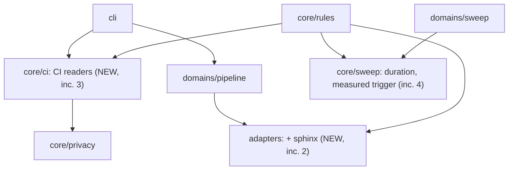

# ADR-015 — Documentation repositories get an adapter, commands derived from CI, and measured heavy suites

- **Status:** Proposed. Seven rulings were made by the user on 2026-11-05
  and are recorded below as decided. Each decision gives the design that
  carries out its ruling. Any choice beyond a ruling is marked
  *recommended*. No question is left open.
- **Date:** 2026-11-05
- **Supersedes:** nothing. Generalises ADR-010, whose sweep cadence becomes
  something a measurement can trigger as well as a declaration. Adds an
  adapter beside ADR-013's, and a shipped lane. On acceptance it amends
  `docs/architecture/manifest.md` ("Adapters", "A sweep cadence", "Full
  schema") and `docs/architecture/cli.md` (`doctor`, a `commands` command
  group). It is the gates half of IDEA_040, filed as IDEA_041. Where the records live is
  covered by [ADR-014](ADR-014-a-project-s-records-can-live-in-a-store-outside-its-repository.md).

## Context

The four repositories IDEA_040 is for are Sphinx projects, some of them using
sphinx-needs. They have no unit tests and no code to measure. Their CI already
knows how to build them. Today invariant has no adapter for them. `doctor`
fails on unset `commands.build` and `commands.test`. The `tdd` lane asks for a
red test and for coverage, and the `docs` lane runs no build at all. Some
documentation suites (a full link check above all) are slow and depend on the
network, which is the shape of problem ADR-010 solved for one consuming
project by hand.

### Rulings (user, 2026-11-05)

1. **An adapter.** Add a docs/Sphinx ecosystem adapter. Build is a strict
   `sphinx-build`. Test is a link check plus sphinx-needs validation. Coverage
   is not applicable, and the adapter says so explicitly instead of quietly
   skipping it.
2. **CI derivation.** At setup, invariant reads the repo's CI definition
   (GitHub Actions, GitLab CI, Jenkinsfile and so on) and proposes build and
   test commands. The user accepts them into config. Gates run only accepted
   commands, so a CI edit never silently changes a gate.
3. **CI update.** An update command reruns the derivation when the pipeline,
   its setup or its scripts change, and again proposes changes for the user
   to accept. The engine detects when those inputs have drifted from what was
   last derived, and says so.
4. **Heavy tests.** Record how long the full run takes. Above a configurable
   budget, the session gate runs only the tests related to the change, and
   the full suite moves to the scheduled sweep (ADR-010, generalised). The
   derivation judges how heavy the suite is and whether a full run is needed.
5. **The lane ships, and doctor follows it (the draft's Q1 and Q3, same
   day).** The `docs-project` lane ships with invariant. Doctor's command
   checks follow each project's lane, in this repository too.
6. **No separate strict build at landing in v1 (the draft's Q2, same day).**
   The `docs-project` landing does not also run `commands.build`. The test's
   own strict reading is enough.
7. **The heavy-suite defaults (the draft's Q4, same day).** The measure is
   the median of the last five full runs, and the return margin is 80% of the
   budget. Both are settings.

### What was run to write this

Labels as in ADR-014: **run** on 2026-11-05 in throwaway repositories,
**read** at a3171c7, **reasoned** otherwise.

- `sphinx-build -q -W -b dummy` (Sphinx through `uvx`) was used as
  `commands.test` under the `generic` adapter. A reference to a missing
  document failed the run (exit 1), and the fix passed it. `test.all_pass`
  then reported "suite is green and the pass is trustworthy". The run record
  read "? test(s) executed, failure count unknown, counts scraped from
  console output", because `generic` parses nothing.
- In `tdd`, an `.rst`-only change got "no coverage was recorded" from
  `coverage.meets_floor`. That is a warning under `standard` and a block under
  `strict`. `pipeline coverage` refused, with no command configured.
- A project-local lane through `methodology.extra_machines` with
  `test.all_pass` and `privacy.clean` at landing worked from start to
  `committed`.
- `doctor` fails on unset `commands.build` in this repository too, and no
  gate or domain runs `commands.build` (read).
- Run records carry `command`, `phase`, `scope`, `selectors`, the counts and
  the hazards. They carry no duration (read, `domains/pipeline`).
- sphinx-needs, link checking against a real network, and every CI reader
  are **not** run. Their parts below are reasoned.

## Decisions

### D1 — The `sphinx` adapter

`adapters/sphinx.py`, registered as `sphinx` (also selected by `docs`):

- **Detection.** A `conf.py` at the root or under `docs/`, `doc/` or
  `source/`. Its directory is the source directory. A second `conf.py`
  makes detection ask instead of guess.
- **Default commands** (ruling 1). `{srcdir}` and `{outdir}` are `vars`
  that `init` fills in. `{outdir}` is under the state root, so a build never
  writes into the tree:
  - `build`: `sphinx-build -E -W --keep-going -n -b html {srcdir} {outdir}/html`.
    `-E` re-reads every source, because an incremental build that skips
    unchanged files validates nothing it skipped. `-n` is nitpicky. `-W` turns
    warnings into failures.
  - `test`: `sphinx-build -E -W --keep-going -n -b linkcheck {srcdir} {outdir}/linkcheck`,
    then, when `sphinx_needs` is in the configured extensions,
    `sphinx-build -E -W --keep-going -n -b needs {srcdir} {outdir}/needs`.
    Both steps carry the build's `-n` (*recommended*), because the test is
    the only strict reading the landing runs (ruling 6), so it must refuse
    every reference warning the build would. The
    second step fails on sphinx-needs' own warnings: `needs_warnings`
    filters, constraint failures, and unknown or duplicate ids (reasoned).
    The two steps are joined with `&&`, so the shell's status is the first
    failure.
  - `test_one`: the same, with the changed source files appended, so Sphinx
    writes and checks only those documents (reasoned; D4 depends on it).
- **Reading a run.** `parse_test_output` counts each `WARNING:` and `ERROR:`
  line, and each linkcheck `broken` line, as a failure. It names the document
  and line, so the record is not "? test(s) executed" (run, under `generic`).
- **Coverage is explicitly not applicable** (ruling 1). The adapter declares
  `coverage_applicable = False` with a reason. For a touched file the
  adapter claims (a source document, `conf.py` and anything under the source
  directory), `coverage.meets_floor` answers *N/A: the sphinx adapter
  declares coverage not applicable, because a documentation build executes no
  measurable lines*. It names the files. That is a stated skip, never a
  silent one, and the files still count as touched for every other gate. In a
  repository that also declares `python`, the python files are held to the
  floor as before (ADR-013 stacking). `doctor` shows a row, `coverage: not
  applicable (sphinx)`, instead of a missing command.
- **Hazards**, the part that earns an adapter (manifest.md, "Adapters"):
  - A build without `-W` passes on warnings. It can overstate.
  - An incremental build without `-E` skips files. It can overstate.
  - `linkcheck_ignore`, `linkcheck_anchors = False` and `nitpick_ignore` in
    `conf.py` narrow what passes. These are noted with each pattern count.
    They can overstate, and they are annotated, not blocked, because they are
    the project's stated choice.
  - A network failure in linkcheck reads as broken links. It can only
    understate, so it is annotated, and a failed link is retried once before
    it counts (reasoned).
- **Selectors.** `owns_selector` claims a path under the source directory.
  `test_scope_of` reports "full" when no filenames follow the command.

*Recommended:* no separate `sphinx_needs` adapter. sphinx-needs is a Sphinx
extension, and the adapter reads the configured extensions to pick its steps.

### D2 — A `docs-project` lane, and doctor asks the lane what it needs

A documentation repository has no test that could fail first, so the `tdd`
lane's red phase cannot be met. The `docs` lane lands with no build at all.
Ruled (5): ship `methodology.pipeline: docs-project` with invariant:

- `drafting`, role design. The read-first gate and the design-agent gate are
  injected as for any lane.
- `reviewing`, role review.
- `committed`, role landing, with `test.all_pass` and `privacy.clean`.
  `docs.updated` and the agent gates are injected there as usual. The landing
  does not run `commands.build` in v1 (ruling 6).

The lane was run as a project-local `extra_machines` file. Shipping it keeps
four repositories from carrying four drifting copies. A project that wants a
different lane still declares its own through `extra_machines`, as today.

**Doctor** (ruling 5). The command rows become "required by this project's
lane and adapters", for every project, this repository included. The lanes
are the ones the project's sessions can run: its `methodology.pipeline` and
every lane a session may select, shipped or declared in `extra_machines`
(*recommended*: a command one selectable lane needs is required, so no lane
can be started without what its gates run). `commands.test` is required when
such a lane carries a `test.*` gate. `commands.coverage` is required when one
carries `coverage.meets_floor` and some declared adapter has coverage that
applies. `commands.build` is reported when set and required by nothing,
because no gate runs it (read). That turns this repository's own `doctor`
FAIL on `commands.build` into a pass. Each row names the lane and gate that
require it, so a FAIL says which gate would have nothing to run.

**No strict build at landing** (ruling 6). Linkcheck and the needs builder
both read every source with `-E -W -n`, so a warning that breaks the strict
build already fails the test (reasoned). What the test does not reach is
output-specific: an HTML theme or template error, which only an HTML build
raises. That is the accepted cost of v1. A project that wants it gated runs
the build in its own lane through `extra_machines`.

**`docs.updated` in a Sphinx repository.** Prose (`.md`, `.rst`, `.txt`) is
held out, as now (run: an `.rst` change passed). `conf.py`, YAML, templates and
`_static` count as structure (run: a `conf.py` change blocked). The project
can declare otherwise in `methodology.gates.non_source`, which is its own
assertion. The adapter does not declare it for them.

### D3 — Commands are derived from CI as a proposal, accepted into config, and pinned

**Readers** (`core/ci`, pure: no subprocess, no network, nothing executed).
Each reader returns candidate steps with a source location (`file:line`) and a
confidence level:

| Source | Read | Confidence |
|---|---|---|
| GitHub Actions, `.github/workflows/*.yml` | `jobs.*.steps[].run`, `working-directory`, `env` names. A `uses:` step is listed as an action, never translated by guess | high |
| GitLab CI, `.gitlab-ci.yml` | `script`, `before_script`, `extends`, local `include` | high |
| Read the Docs, `.readthedocs.yaml` | `sphinx.configuration`, `sphinx.fail_on_warning` (becomes `-W`), `python.install` | high |
| Azure Pipelines, CircleCI, Bitbucket | their `script` and `run` steps | medium |
| `Jenkinsfile` | `sh '…'` and `sh """…"""` literals only. Groovy is never evaluated | low |
| Referenced scripts | `make <target>` to the Makefile recipe, `tox -e`, `nox -s`, a `./scripts/*.sh` path | follows the caller |

**Proposals.** The steps are classified as setup, build, test, lint or
deploy, using the adapter's knowledge (`sphinx-build -b linkcheck` is a test,
`-b html` is a build). A deploy step (pages publishing, package upload,
`rsync`, cloud copies) is never proposed. A step that references a secret or
a CI-only variable is shown with the reference left as a placeholder, and it
cannot be accepted until the operator replaces it. Setup steps are shown as a
note on how to make the commands runnable locally. They are never run. Every
proposal goes through the privacy scanner before it is shown.

**Acceptance** (ruling 2). `invariant commands derive` prints the proposals
next to the current `commands.*`. `invariant commands derive --accept build,test`
(or interactive confirmation) writes the chosen values at the project's
config level, which is the store level for a store project (ADR-014 D3), and
pins what they came from:

```yaml
commands:
  build: sphinx-build -E -W --keep-going -n -b html docs _build/html
  test: ...
  derived:
    build: {from: ".readthedocs.yaml:9", accepted: 2026-11-05}
    test:  {from: ".github/workflows/docs.yml:31", accepted: 2026-11-05}
    inputs:                     # every file the derivation read, and its hash
      .github/workflows/docs.yml: 3f9a…
      .readthedocs.yaml: 81c0…
      Makefile: 0d2e…
```

**Gates run only `commands.*`.** Nothing reads a CI file at gate time, so
editing a workflow never changes what a gate runs (ruling 2). `config show`
labels an accepted value `derived:<file:line>` beside its level. A value
edited by hand afterwards reads `repo` or `store` again, and its `derived`
entry is dropped.

### D4 — Drift is detected and named; the update is another proposal

- **`commands.derivation_current`**, a new rule, warns in every profile, and
  its level can be changed. It hashes every recorded input at the repo leg's
  tree, and finds any CI file that has appeared since the last derivation. It
  reports each changed, added or removed input. It runs in `doctor`, at
  session start (in the context) and at landing. When the session's own
  change edits an input, the verdict says so: *this change edits
  `.github/workflows/docs.yml`, an input of the accepted test command; run
  `invariant commands derive --update`*.
- **`invariant commands derive --update`** (ruling 3) re-reads, shows the
  difference between the new proposals and the accepted commands, and accepts
  only what the operator names. On acceptance the hashes are refreshed. If the
  operator declines, the drift stays reported, so a declined update is never
  mistaken for a current one.
- **The inputs** are the CI files, the scripts they reference, and the
  dependency files they install from (`requirements*.txt`, `pyproject.toml`,
  `.readthedocs.yaml`). Hashes and relative paths carry nothing private, which
  is ADR-010 D9's standard for committed records.

### D5 — The full run is measured, and a budget moves it to the sweep

Ruling 4, as a generalisation of ADR-010:

- **Measure.** Every full run, whether `pipeline test` with no selector or
  `sweep run`, records `duration_seconds` on its run record. The sweep's
  committed record carries it too, so every clone shares the figure. The
  measure is the median of the last `measure_runs` full runs per ecosystem
  and command key, five by default (ruling 7). One slow run does not flip the
  policy. Until that many runs exist, the median of those recorded is used,
  and the verdict says how many it rests on (*recommended*).
- **Budget.**

  ```yaml
  methodology:
    gates:
      schedule:
        trigger: declared        # declared (ADR-010, today) | measured
        full_run_budget_seconds: null
        measure_runs: 5          # ruled default (7): median of the last five
        return_margin: 0.8       # ruled default (7): back to per-change below 80%
        cadence_days: 7          # required with either trigger
        gates: [test.all_pass]
  ```

  `trigger: declared` is the default, so a project that sets nothing keeps
  today's behaviour. With `trigger: measured`, the named gates are scheduled
  exactly as ADR-010 has it while the measured median exceeds the budget.
  They return to per-change once it falls below `return_margin` times the
  budget, 80% by default (ruling 7). The margin stops the policy flapping. `doctor` and every scheduled verdict name
  the median, the budget and which side of it the project is on.
- **Related tests, chosen by the adapter.** The per-change run must cover the
  tests related to the change, not just any subset. That is the difference
  from ADR-010, which left the choice to the agent. Adapters gain
  `related_selectors(changed) -> list | None`. A scheduled `test.all_pass`
  fails when the recorded scoped run does not include every related selector,
  and names what is missing. `None` means the adapter cannot tell, so the
  change owes a full run. It never guesses smaller.
  - `sphinx`: the changed documents, plus the documents that reference them
    (read from the build environment's cross-reference index, reasoned).
  - `python`: the changed test files, plus the tests that import a changed
    module, using ADR-012's Python import references (reasoned).
  - other adapters: `None` until they implement it.
- **Global inputs always owe a full run.** Adapters gain `global_inputs()`:
  for `sphinx` that is `conf.py`, `_templates`, `_static`, extensions and the
  dependency files. Their globs join `held_paths` automatically and are named
  as adapter-held in the verdict. Changing the build's configuration is
  exactly when scoped evidence cannot be trusted.
- **The derivation judges weight** (ruling 4). `commands derive` notes
  static signs of a heavy suite: a link check (network), a build matrix, CI
  `timeout-minutes`, and jobs on a schedule. With `--measure` it runs the
  proposed test command once, after the operator accepts it, and records the
  duration. Then it proposes a budget and a trigger, or says a per-change
  full run is affordable. Like every derivation output, it is a proposal.

## Increments

These follow ADR-014's increment 2, because the first real repository needs
both halves.

| Increment | Lands | Proven by |
|---|---|---|
| 1 | Accepted with ADR-014. | Docs only. |
| 2 | D1 and D2: the `sphinx` adapter, its hazards and N/A coverage, the shipped `docs-project` lane, doctor rows per lane for every project. | One of the four repositories: a broken reference fails the test, a fix passes, `coverage.meets_floor` says N/A naming the adapter, and the landing runs green with no build step. This repository's `doctor` passing its command rows with `commands.build` unset, each row naming the lane and gate that require it. |
| 3 | D3 and D4: `core/ci` readers, `commands derive`, acceptance and the pin, `commands.derivation_current`, `--update`. | Derivation from each of the four repositories' real CI, accepted. A workflow edit reported as drift and not run by any gate until accepted. |
| 4 | D5: duration on run records and sweeps, the measured trigger with `measure_runs` and `return_margin`, `related_selectors`, `global_inputs`, `--measure`. | A suite above budget: a scoped change gated on its related documents, a `conf.py` change owing a full run, and the sweep taking the rest. A median falling between 80% and 100% of the budget keeping the schedule, and one below 80% returning to per-change. Both defaults changed in config and honoured. |



## Alternatives rejected

| Alternative | Why not |
|---|---|
| Run the CI file itself at gate time | A CI edit would silently change a gate (ruling 2), and CI steps assume CI's environment and secrets. |
| Evaluate Groovy or follow `uses:` actions | It means executing or guessing foreign code. Listed for the operator instead. |
| Skip coverage silently for docs | Ruled out (1). |
| Keep `generic` with manifest commands | It works (run), but it reads no counts, warns of no hazards, and cannot pick related tests. |
| A pure duration threshold with no margin | It flaps around the budget. |
| Leave the `docs-project` lane project-local | Ruled out (5): four repositories would carry four drifting copies. |
| Run the strict build at the docs landing in v1 | Ruled out (6): the test's strict reading is enough. |
| Doctor's fixed command rows, whatever the lane | Ruled out (5): it fails a project on a command no gate of its lanes runs. |
| Let the agent pick the scoped selectors, as in ADR-010 | Ruling 4 asks for the related tests. The adapter can name them, and a gate can check them. |

## Consequences

- A Sphinx repository can run invariant's full lane with no test or coverage
  tooling of its own, and every gate it skips says why.
- Commands stop being something an operator has to know. They are proposed
  from the CI the repository already trusts, and pinned, so they cannot drift
  silently.
- ADR-010's cadence becomes available to a project that never configured it,
  but only once a measurement shows the suite is heavy, and every verdict
  says which side of the budget the project is on.

## Open questions

None. The draft's four questions were ruled on 2026-11-05 (rulings 5 to 7),
and no ruling raised a new one.
