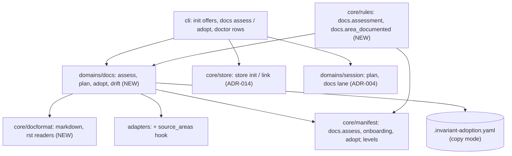

# ADR-016 — The architecture docs are assessed, and init offers to reuse, relocate or write them

- **Status:** Accepted (2026-11-07). Eleven rulings were made by the user on 2026-11-06 and
  2026-11-07 (IDEA_043, "Design rulings") and are recorded below as decided.
  Each decision gives the design that carries out its ruling. Any choice
  beyond a ruling is marked *recommended*. No question is open.
- **Date:** 2026-11-07
- **Supersedes:** nothing. Amends `docs/architecture/cli.md`
  (`init`, `doctor`, a new `docs` command group),
  `docs/architecture/manifest.md` ("Full schema", "Records and their
  locations", "Resolution order") and `docs/architecture/state_model.md`
  (the docs gates, a new rule). Builds on
  [ADR-014](ADR-014-a-project-s-records-can-live-in-a-store-outside-its-repository.md)
  (`records.docs`, the three config levels of D3, the docs lock of D5) and
  [ADR-015](ADR-015-docs-repositories-get-an-adapter-and-commands-derived-from-ci.md)
  (the `sphinx` adapter of D1).

## Context

`init` writes a starter `overview.md` only where `paths.docs` is absent. An
existing directory, even one holding unrelated content, is left alone and
nothing is said (cli.md, `init`). Nothing tells an adopter whether the docs
there are enough for `docs.read_architecture` and the design agents. Nothing
offers another location, a store, existing documentation to adopt, or to
write what is missing. IDEA_043 records the report and the interview.

Scope is invariant's architecture docs, the ones `paths.docs` names. A
project's own documentation is in scope only when the user points invariant
at it to adopt (D7).

### Rulings (user, 2026-11-06 and 2026-11-07)

From the interview of 2026-11-06:

- A. Only invariant's architecture docs at `paths.docs` are assessed.
- B. The assessment is deterministic: no model judgement, the same verdict
  on every run over the same tree.
- C. It runs at `init`, as a `doctor` row and as its own command.
- D. Offers are made, never forced. `init` never moves or writes docs on its
  own.
- E. An existing `paths.docs` gets a reuse-or-relocate offer, including an
  ADR-014 store.
- F. Existing documentation can be adopted in place or by copy, chosen by
  configuration.
- G. Docs that are created go wherever `paths.docs` / `records.docs`
  resolves. No separate setting.
- H. A non-interactive `init` (`--dry-run`, `--json`, no terminal) does
  exactly what it does today and reports the assessment. Every offer is
  skipped.

Design rulings of 2026-11-07:

1. **Incremental path.** A session touching a source area with no
   architecture doc owes that area's doc through a new rule. It warns under
   `standard`; config or the `strict` profile can raise it to block. A
   session is never unmergeable by default.
2. **Comprehensive, deterministically.** Three checks: required sections,
   every source area named, links resolve. Each check, the section list and
   how areas are derived (the adapter's source roots, globs, or a declared
   list) are settings. The defaults are the starter `overview.md`'s shape.
3. **Copy drift.** At copy time the original's hashes are recorded. `doctor`
   and `docs assess` report originals changed since then, naming the files.
   No re-sync unless the user re-runs the adoption.
4. **All at once.** `init` records a deliverable plan with one line per
   undocumented area. Each area is written and reviewed through the `docs`
   lane, so the cost stays visible and the work is resumable.
5. **Formats.** Section and link reading go through a per-format reader:
   markdown now, rST (Sphinx) alongside ADR-015's `sphinx` adapter. Any other
   format is refused for in-place mode with a reason; copy mode still works.
6. **Config levels.** Every new key resolves at the user, store and repo
   levels, with provenance (ADR-014 D3).
7. **Increments.** (1) assessment, `docs assess`, doctor row, read-only;
   (2) `init`'s reuse-or-relocate and onboarding offers, repo and store
   locations; (3) the incremental rule; (4) in-place and copy adoption, with
   drift reporting.
8. **Next step.** Draft this record.
9. **When the all-at-once plan starts (Q1, 2026-11-07).** When the base
   already carries the manifest (a store project, or a re-run), init starts a
   parked `docs`-lane session and records the plan. Otherwise it records
   nothing and prints "commit init's files, then run `invariant docs assess
   --plan`". In the in-repo case this defers ruling 4's plan until init's
   files are committed. init still never commits.
10. **A copy in a format with no reader (Q2, 2026-11-07).** It is allowed.
    Its `sections` and `links` checks report "not assessable", and `docs
    adopt` says so at copy time.
11. **Levels against ADR-014 D3 (Q3, 2026-11-07).** Every new key is accepted
    wherever D3 accepts a key: user `defaults:`, the store, and an in-repo
    project's manifest. The pointer keeps refusing them, and
    `docs.adopt.source` is refused at the user level.

## Decisions

### D1 — One assessment, three configurable checks, gaps by kind

A new `domains/docs` (*recommended* home) owns `assess(manifest) ->
Assessment`. It reads the resolved docs location (`paths.docs`, joined onto
the store root when `records.docs: store`) and returns gaps, never a single
pass or fail (ruling A, B, 2):

| Check | Gap it reports | Default |
|---|---|---|
| `sections` | each required heading found in no doc | `Layers`, `Component responsibilities`, `Compliance checklist` (the starter's three) |
| `areas` | each source area no doc names | areas from the adapter (D2) |
| `links` | each relative link in a doc whose target file does not exist, by file and line | on |

- **Deterministic by construction.** Files are read in sorted order, headings
  are compared after whitespace normalisation and case folding
  (*recommended*), and the result carries a digest of the inputs, so two runs
  over an unchanged tree print byte-identical output.
- **A section counts once across the docs** (*recommended*), not per file: the
  starter puts all three in one `overview.md`, a larger set splits them.
- **An area is named** when its name (default: the last segment of its path)
  appears as a whole word in any doc's text (*recommended*). A declared area
  may give its own name.
- **Links check file targets only** (*recommended*). Anchor slugs differ
  between renderers, so checking them would make the verdict depend on which
  renderer the reader has in mind. External URLs are never fetched.
- **Per-format reader** (ruling 5). `core/docformat` (*recommended* home)
  exposes `headings(text)` and `links(text)` per format. `markdown` (ATX and
  setext headings, inline and reference links) lands in increment 1. `rst`
  (underlined titles; `:doc:`, `include` and `toctree` targets) lands with
  ADR-015's increment 2 and is selected by `docs.format: sphinx`. A format
  with no reader makes the `sections` and `links` checks report "not
  assessable: no reader for <format>" as a gap, never a pass.
- **A check set to off** is absent from the result and says so on one line.

### D2 — How source areas are derived

`docs.assess.areas.from` chooses one of three sources (ruling 2):

- `adapter` (default): a new adapter hook, `source_areas(root) -> list[Path]
  | None`. *Recommended* base behaviour: the directories one level below each
  `measured_scope` root; where that answers `None`, the top-level directories
  holding a tracked file `source_files` accepts. An ecosystem may override it
  (Python: the subpackages of each top package; Swift: the package targets).
  `None` is a gap ("areas cannot be derived; set globs or a declared list"),
  not an empty pass.
- `globs`: each directory a glob matches is an area.
- `declared`: an explicit list of `{name, path}`.

`docs.assess.areas.exclude` holds globs out of every source. These are
**source areas**, not ADR-014 D5's lock areas, which are patterns over the
docs. The two words stay distinct in the docs.

### D3 — `invariant docs assess` and the doctor row

```
invariant docs assess [--json]
    Print the assessment: every gap by check, then a one-line summary and the
    input digest. Read-only. Exit 0 whatever the gaps; 2 on a configuration
    it cannot load. Copy-mode drift (D8) is printed under its own heading.
```

`doctor` gains a `docs assessment` row that asks the new rule
`docs.assessment` directly, as the guidelines rows do. Its level is set like
any rule under `enforcement.rules` (ruling C). *Recommended:* `warn` in every
profile, so gaps print `warn` and never make `doctor` exit 1; `block` makes
the row fail; `off` removes it. The rule is never injected into a pipeline.
The existing architecture-docs row is unchanged.

### D4 — `init` offers: reuse or relocate, then onboarding

Interactive `init` only (ruling D, H). In order:

1. **When `paths.docs` exists** (empty included), init lists what is there
   and offers: **reuse** it as invariant's docs (today's result, nothing
   written); **another repo path** (writes `paths.docs`); or **a store**
   (runs ADR-014's `store init` or `store link`, then writes `records.docs:
   store` and a store-relative `paths.docs`). The existing directory is never
   touched. Where it is absent, the starter is written as today.
2. **The assessment runs** on the chosen location and prints its gaps.
3. **When there are gaps**, init offers **all at once** (D5), **incremental**
   (writes `docs.onboarding: incremental`, D6) or **not now** (writes
   nothing; the gaps stay visible in `doctor` and `docs assess`).

Non-interactive `init` writes the same files as today and prompts for
nothing. It prints the assessment as text, and under `--json` carries it as
a `docs_assessment` field (*recommended*: text inside JSON output would break
it).

### D5 — All at once is a deliverable plan in the `docs` lane

Choosing all at once records a session plan (ADR-004) with **one deliverable
per undocumented area**, titled `Document <area>` (ruling 4), plus, first, one
`Write the missing sections: <list>` line when the `sections` check has gaps
(*recommended*). Each deliverable is written and reviewed through the `docs`
lane (drafting → reviewing → committed), so a session can stop and resume
anywhere and the remaining cost is the open lines. `docs.onboarding:
all_at_once` is written for provenance; it arms no rule. The plan is built
by `invariant docs assess --plan` (*recommended*), which init calls, so the
same plan can be made later from `doctor`'s gaps. See ruling 9.

### D6 — The incremental rule

New rule `docs.area_documented`, armed only when `docs.onboarding:
incremental` (otherwise N/A, saying so). An **entry gate on the landing
state**, beside `docs.updated` (*recommended*). It reads the session's changed
set (`core/rules._changed_set`), maps each changed source file to its source
area (D2), and asks the assessment on the session's tree whether each such
area is named. An unnamed, touched area is owed; the verdict names it and the
doc to write. An area already named is never asked again, and there is no
recorded gap list to go stale: the live, deterministic assessment is the
record (*recommended*).

Levels (ruling 1): `loose` warn (*recommended*), `standard` warn, `strict`
block, raised per project in `enforcement.rules`. A docs-lane session changes
no source and is N/A. With `records.docs: store`, the rule reads the store's
docs; its per-leg reading follows ADR-014 D9 (increment 4 there).

### D7 — Adoption: in place or by copy

```
invariant docs adopt <source> --mode in_place|copy [--dry-run]
```

The command writes the configuration (ruling F); the mode is a key, not a
flag of each run (*recommended* command name and shape).

- **In place.** `paths.docs` (and `records.docs`) are pointed at `<source>`;
  the gate reads, and agents update, the original. `<source>` must lie under
  the repo root or the project's store root, because a path key cannot be
  absolute (ADR-014 D1). `docs.format` is set from the source's detected
  format; one without a reader (D1) is refused, naming the format and
  offering copy mode (ruling 5). A store source is covered by the D5 docs
  lock like any store docs.
- **Copy.** The files under `<source>` are copied into the resolved docs
  location (repo or store, ruling G), and the copy is invariant's from then
  on. The original is never written. Any format copies (ruling 5); see ruling 10 for
  what the assessment says of an unreadable copy.

### D8 — Copy drift: hashes at copy time, reported, never re-synced

Copy writes a receipt, `<docs location>/.invariant-adoption.yaml`
(*recommended* name; held out of the assessment): the source path, the time,
and a SHA-256 per copied file, of the original and of the copy. `doctor` (a
`docs adoption` row, warn) and `docs assess` name every original file changed,
added or removed since (ruling 3). Nothing re-syncs. Re-running `docs adopt
--mode copy` re-copies; it refuses when the copy itself has been edited since
the receipt, naming the files, unless `--force` (*recommended*). A source
outside both roots is recorded as given and reported "original not reachable"
on a machine where it is absent (*recommended*).

### D9 — Keys, defaults and levels

Every default is today's behaviour: no onboarding, no adoption, and a doctor
row that never fails.

```yaml
docs:
  format: markdown               # unchanged; selects the reader (D1)
  assess:
    checks: [sections, areas, links]   # any subset; [] turns the assessment off
    sections:                    # required headings, found in any doc
      - Layers
      - Component responsibilities
      - Compliance checklist
    areas:
      from: adapter              # adapter | globs | declared (D2)
      globs: []                  # from: globs
      declared: []               # from: declared; [{name, path}]
      exclude: []                # globs held out of every source
  onboarding: off                # off | incremental | all_at_once (D5, D6)
  adopt:
    mode: null                   # null | in_place | copy (D7)
    source: null                 # repo- or store-relative; required with a mode

enforcement:
  rules:
    docs.assessment: warn        # the doctor row (D3)
    docs.area_documented: warn   # the incremental rule (D6); strict: block
```

Each key resolves through ADR-014 D3's levels, user defaults (5a), store
(5b) and repo (5c), with its provenance label in `config show` (ruling 6).
An unknown key, check, `from` or mode is refused at load, naming it. Where
D3 already restricts a level, see ruling 11.

## Increments

Each increment leaves a project that sets none of these keys exactly as
today, apart from the new informational doctor row, and proves it with the
existing suite.

| Increment | Lands | Proven by |
|---|---|---|
| Record | This ADR, accepted. Increments 1 to 4 are ruling 7's. | Docs only. |
| 1 | D1 to D3, D9's `assess` keys: `domains/docs`, the markdown reader, `source_areas`, `docs assess`, the `docs.assessment` rule and doctor row. Read-only. | On this repository and on a toy tree documenting half its areas: `docs assess` and the doctor row giving the same gap list on two runs over an unchanged tree, and the list losing an area when its doc is added. Each check turned off, and each area source, honoured. `doctor`'s exit status unchanged by gaps at `warn`. |
| 2 | D4, D5: init's reuse-or-relocate and onboarding offers, repo and store locations (ADR-014 `store init` / `link`), `docs assess --plan`, `docs.onboarding`. | `init` over an existing, unrelated `paths.docs`: choosing a store leaves `records.docs: store` and the directory byte for byte unchanged. Over no docs and over half-covered docs: the gaps by area, the three offers, and nothing written on not-now. All at once: a plan with one line per area, each landed through the `docs` lane, resumed after a stop. The same trees under `--dry-run`, `--json` and no terminal: today's files, no prompt. |
| 3 | D6: `docs.area_documented`, its profile levels. | With incremental chosen, a session touching an unnamed area warned at the landing under `standard` and blocked under `strict`; a second session on the now-named area not asked. A docs-lane session N/A. |
| 4 | D7, D8, D9's `adopt` keys: `docs adopt`, the receipt, the drift row; the rST reader where ADR-015 increment 2 has landed. | Copy mode: the original untouched, and the gate reading the copy; editing the original named by `doctor` and `docs assess`, the copy unchanged. In place: the gate reading and an agent updating the original. A Sphinx tree adopted in place and assessed through the rST reader; an unreadable format refused in place and accepted by copy. |



## Alternatives rejected

| Alternative | Why not |
|---|---|
| A model judging whether the docs are comprehensive | Ruled out (B, 2): the verdict must be the same on every run and for every model. |
| One pass/fail verdict | Ruling A: a list of gaps is what tells an adopter what to write. |
| Init writing missing docs, or moving the existing directory | Ruling D: offers only. |
| A recorded gap list for the incremental path | It goes stale the moment a doc is written outside a session; the live assessment answers the same question deterministically (D6). |
| Blocking the incremental rule by default | Ruling 1: no session unmergeable by default. |
| Re-syncing a copy from its original | Ruling 3: drift is reported, the user re-runs adoption. |
| Checking link anchors | Renderer-dependent slugs would make the verdict depend on the renderer (D1). |

## Consequences

- A fresh adopter sees, at `init` and in `doctor`, what the docs-first gate
  will want, by area, and chooses whether and when to pay for it.
- A project that sets nothing gains one warn-level doctor row and nothing
  else.
- Incremental onboarding adds one landing obligation per touched,
  undocumented area, at warn unless the project or `strict` raises it.
- Copy mode forks documentation knowingly: drift is named, never merged.
- Every adapter gains a `source_areas` hook, with a base default.

## Open questions

None. Q1 to Q3 of the draft were ruled on 2026-11-07 (rulings 9 to 11).
