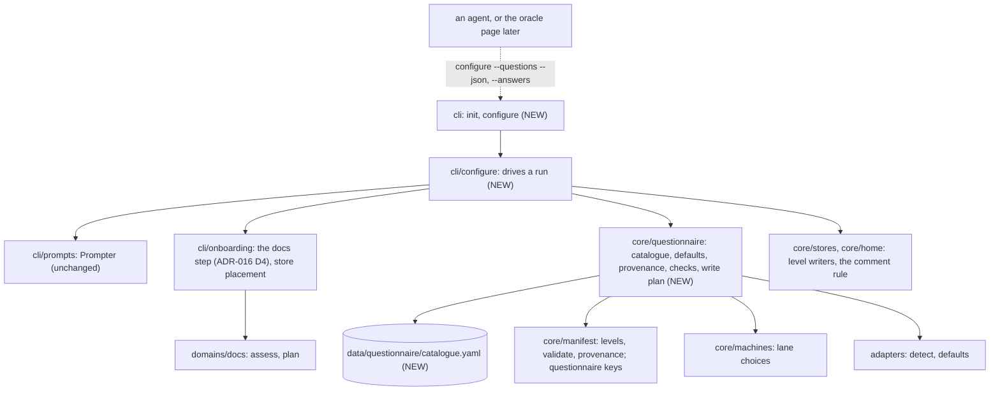

# ADR-017 — init asks the configuration as a questionnaire, and `invariant configure` asks it again

- **Status:** Accepted (2026-11-08). Thirteen rulings were made by the user
  on 2026-11-08 (IDEA_044, the design interview, then Q1 to Q5 of the draft
  at acceptance) and are recorded below as decided. Each decision gives the
  design that carries out its ruling. Any choice beyond a ruling is marked
  *recommended*. No question is open.
- **Date:** 2026-11-08
- **Supersedes:** nothing. Amends `docs/architecture/cli.md`
  (`init`, a new `configure` command), `docs/architecture/manifest.md`
  ("Full schema", "Validation", "Resolution order") and
  `docs/architecture/overview.md` (two new components). Re-houses
  [ADR-016](ADR-016-the-architecture-docs-are-assessed-and-init-offers-to-reuse-relocate-or-write-them.md)
  D4's docs offers as one step of the questionnaire, with their order and
  meaning unchanged. Builds on
  [ADR-014](ADR-014-a-project-s-records-can-live-in-a-store-outside-its-repository.md)
  (the config levels of D3, `store init` and `store link` of D2) and, once it
  lands, on
  [ADR-015](ADR-015-docs-repositories-get-an-adapter-and-commands-derived-from-ci.md)
  D3 (commands derived from CI).

## Context

`init` writes a manifest of nine lines: the project's name, its detected
ecosystems and an enforcement profile, then a comment saying that everything
else has a default and that `config show --provenance` prints it (cli.md,
`init`; `cli/main._init_body`). The only questions it asks are ADR-016 D4's
docs offers, through the `Prompter` seam in `cli/prompts`, and only on a
terminal. Every other setting is found by reading manifest.md and editing
YAML by hand. An adopter does not see the coverage floor, the lane or the
profile they are about to be held to until a gate holds them to it, and has
no way to set a value at the user or store level (ADR-014 D3) except by
knowing the file and the key.

IDEA_044 asks for `init` to walk the configuration as a questionnaire that
shows each resolved default with its provenance and lets the user accept it or
enter a value, written at the level the user picks.

### Rulings (user, 2026-11-08)

1. **Question set: core plus advanced.** The core questions are always
   asked: ecosystems and commands, enforcement profile, lane
   (`methodology.pipeline`), coverage floor, and docs location and
   onboarding (ADR-016 D4's offers become this step, in their existing order
   and with their existing meaning). Then one question, "configure advanced
   settings?", default no, opens agents, guidelines, records and store,
   privacy scope, and session settings. The catalogue of questions and its
   core/advanced split are data, and the levels can change them.
2. **Re-run.** A new command, `invariant configure [section...]`, runs the
   same questionnaire on an initialised project, whole or by section, with
   the current resolved values as defaults. `init --force` keeps its
   meaning, and `init` never rewrites an existing manifest for this.
3. **Level.** The target level (ADR-014 D3: user defaults, store, repo) is
   asked once at the start, default repo (the store for a store project).
   Each answer can override it in the advanced step. An answer a level may
   not hold (`project` and `records` at the user level; most keys at the
   pointer) goes to the nearest level that may hold it, and the
   questionnaire says so.
4. **Accepted defaults write nothing.** Only answers that differ from the
   resolved default are written, so defaults keep flowing from the library,
   the adapter, the user level or the store.
5. **Scripted input.** `--set key=value` (repeatable) and `--answers
   <file.yaml>`, each validated exactly as a typed answer and refused with
   the reason; `--yes` accepts every shown default without asking. With none
   of them, a non-interactive `init` writes exactly what it writes today
   (ADR-016 ruling H holds for files).
6. **Non-interactive output.** After today's report, a short list of each
   core question's resolved value and provenance, then "run invariant
   configure to change them"; under `--json` the same as a `configuration`
   field. Files unchanged.
7. **Host-neutral.** The catalogue is data. The terminal renders it now.
   `invariant configure --questions --json` prints the questions with their
   defaults and provenance, so an agent or the oracle page can ask them its
   own way and return the answers through `--answers`. No oracle UI is in
   scope.
8. **Validation.** Every answer goes through the manifest's own load
   validation, is refused at entry with its reason, and is asked again.
   Commands are checked for shape only (one line, non-empty, the required
   placeholders such as `{selector}`) and never run; `doctor` reports
   failing commands as it does today.

Rulings at acceptance (user, 2026-11-08), Q1 to Q5 of the draft, each as
the draft recommended:

9. **init's own comment (Q1).** A manifest whose only comment is exactly the
   comment `init` writes is treated as comment-free: it is rewritten merged,
   and init's comment is put back. An operator's own comment still stops the
   rewrite.
10. **Two store targets (Q2).** Both are offered: `store`, the store's own
    level, shared by every repository it serves, and `store-repo`, this
    repository's block. The default is `store-repo`.
11. **What a level may change in the catalogue (Q3).** Reorder sections,
    move them between core and advanced, and drop them; replace a question's
    prompt and choices; add plain questions over any manifest key. A step
    may be moved, never defined.
12. **The inherited value at a level that sets the key (Q4).** The key is
    removed from that level, and the questionnaire says so.
13. **Command shape at load (Q5).** No load refusal. A warn-level `doctor`
    row names each malformed command.

Inferred by the parent session from the code and the standing preferences,
and recorded here as *recommended*: commands are pre-filled from the
adapter's detection now, and from CI-derived commands once ADR-015 D3 lands,
with no dependency on it (D10). A write at a level reuses the comment rule
of ADR-016 increment 2: a file holding a comment is not rewritten, and the
YAML to add by hand is printed (D5). The questionnaire never commits.

## Decisions

### D1 — The catalogue is data: sections of questions, each over one key

The shipped catalogue is a YAML file in the package,
`data/questionnaire/catalogue.yaml` (*recommended* path, beside
`data/profiles` and `data/machines`). It holds **sections**, and each section
holds **questions** (ruling 1, 7):

| Field | Meaning |
|---|---|
| `id` | The question's id. For a plain question it is the dotted manifest key it writes (`methodology.gates.coverage_min`). A step's own questions are `<section>:<name>` (`docs:location`), so they can never be mistaken for a key. |
| `key` | The manifest key written; absent for a step question. |
| `kind` | `choice`, `text`, `path`, `count`, `percent`, `bool`, `list`, `command`, or `step`. |
| `prompt` | The question as shown. |
| `choices` / `choices_from` | A fixed list, or a named source the engine fills: `profiles`, `pipeline_machines`, `ecosystems`, `library_agents`, `privacy_patterns`, `record_locations`. |
| `placeholders` | For `command`: the placeholders it must carry (`test_one` and `coverage_one`: `{selector}`). |

A `step` names a handler the engine ships (`docs`, `store`, `commands`) and
is asked by code, because its questions depend on each other's answers and
on the tree (the docs offers ask about the directory they find). A step is
data in where and when it is asked, and code in what it asks.

The shipped sections, in order:

| Tier | Section | Questions |
|---|---|---|
| core | `ecosystems` | `project.ecosystems` (default: the adapters' detection, D10), then the `commands` step: every command of every declared ecosystem in one table with its default and provenance, and "change any?", default no; yes walks them one by one (*recommended*, so the core stays short) |
| core | `profile` | `enforcement.profile`, choices from the shipped profiles |
| core | `lane` | `methodology.pipeline`, choices from the pipeline machines, shipped and `extra_machines` |
| core | `coverage` | `methodology.gates.coverage_min`, a percent |
| core | `docs` | the `docs` step: ADR-016 D4.1 to D4.3, unchanged |
| advanced | `agents` | `agents.library` (choices: the shipped agents), `agents.tiers` |
| advanced | `guidelines` | `guidelines.ruleset` (a path, or none), `guidelines.checklist` |
| advanced | `records` | `records.<type>` for each record type, choices from that record's locations (ADR-014 D1), then the `store` step when any answer is `store` |
| advanced | `privacy` | `privacy.scope`, `privacy.patterns` |
| advanced | `session` | `session.push`, `session.worktree_dir`, `session.worktree_prefix`, `session.plan_stale_days` |

Not in the shipped catalogue, and why (*recommended*): `project.name` (it is
`--name`, as today); `paths.state` (machine-local, and BUG_116's subject);
`enforcement.rules` per rule (`rules list` and the manifest are where a rule
is tuned); and every relaxation (`session.exempt_paths`,
`coverage_exclude`, `non_source`, `coverage_advisory_paths`), which manifest.md
holds should arrive as a diff someone reviews for what it relaxes. A level
can add any of them as a question (D11, ruling 11).

### D2 — One engine, any renderer

A new `core/questionnaire` (*recommended* home) owns the catalogue and
everything about it that is not asking:

- `catalogue(manifest) -> Catalogue`: the shipped file with the levels'
  `questionnaire` settings applied (D11).
- `resolve(catalogue, levels, target) -> list[Question]`: each question with
  its **default** (the value the configuration resolves to now), that
  value's **provenance** label (as `config show` prints it), its **current**
  value at the target level if that level sets one, the **levels allowed**
  to hold its key, and its choices filled in.
- `check(answer, question, candidate) -> Refusal | None`: D6.
- `plan(answers) -> WritePlan`: D4 and D5, the writes by level, pure.

It reads `core/manifest`, `core/machines` (lane choices), `core/home` (the
user level) and the adapters (detection, defaults). It prompts for nothing
and writes nothing. It imports nothing above `core`, so the oracle
boundary rules (`layers.only-the-cli-imports-the-oracle`) hold by
construction.

A new `cli/configure` (*recommended*) drives a run: it asks each question
through the existing `Prompter` (`say`, `choose`, `ask`; no new method:
a `list` is asked as comma-separated text, a `bool` as a two-option choice),
calls the steps (the `docs` step is `cli/onboarding`'s existing offers), and
applies the write plan through the level writers. `init` and `configure`
both call it. The terminal is one renderer; `--questions --json` (D8) is the
other, and the suite keeps replacing `_init_prompter` with a scripted
prompter, as it does today.

### D3 — The order of a run

1. **The level** (D4), once.
2. **The core sections**, in catalogue order. Each question shows its
   default and provenance, `[standard] (profile default)`; Enter accepts it.
3. **"Configure advanced settings?"**, default no (ruling 1). Yes asks the
   advanced sections in order, then a **review of where each answer goes**:
   every answer that will be written, with its level, and the option to move
   any one of them, core answers included (ruling 3, *recommended* reading
   of "each answer can override it in the advanced step").
4. **The writes** (D5), all of them after the last answer.
5. **After the writes**, what ADR-016 D4 does after its offers today: the
   all-at-once plan where the base carries the manifest (ruling 9 there),
   and init's report.

The `docs` step keeps ADR-016 D4's order (location, assessment, onboarding),
its defaults (`reuse`, `not_now`), its store refusals and its meaning. The
one change is when the files land: today the onboarding offer runs after
init has written the manifest. In the questionnaire the assessment reads the
candidate configuration, as `init --dry-run` already does
(`_init_assessment` with `written=False`), and the key it chooses is written
with the rest.

A store is created or linked first among the writes (*recommended*), as
today: it is the write most likely to be refused, and nothing else is
written when it is. The `docs` step's store choice and the `records`
section's store answers share one placement: one store per project.

### D4 — The target level, and the nearest level that may hold an answer

The level question offers the levels this project has, as `config show`
names them (ruling 3):

| Target | File | Offered |
|---|---|---|
| `user` | `defaults:` in `~/.invariant/config.yaml` | always |
| `store` | the store's `invariant.yaml`, its own level | in a store project |
| `store-repo` | that file's `store.repos.<identity>` block | in a store project |
| `repo` | `.claude/invariant.yaml`, or the pointer `.invariant.yaml` | always |

Default: `repo` in an in-repo or a fresh project; in a store project,
`store-repo` (ruling 10), so the default changes only this repository, as
ADR-016 D4 does for a linked store, and a policy shared by every repository
the store serves stays one deliberate choice away. Scripted, the level is
`--level <target>`.

**The nearest level that may hold it.** Each key's allowed levels come from
the rules the manifest already enforces at load: the user level refuses
`project` and `records` (manifest.md, "The user level") and
`docs.adopt.source` (ADR-016 ruling 11); the pointer holds only `version`,
`store` and `records`; an in-repo manifest refuses a `store` record. An
answer whose target may not hold it goes to the next level in the order
`user`, `store`, `store-repo`, `repo` that may, searching towards the
project's own level first and then away from it (*recommended*, so a
project-specific answer from the user level lands with the project and a
policy answer from the pointer lands in the store's block for this
repository). The questionnaire says so beside the answer, `project.ecosystems
goes to repo: the user level may not hold project`, and the review step
(D3.3) lists it.

**A run that changes the project's shape.** When the `docs` step or the
`records` section makes a fresh project a store project, the `repo` level
becomes the pointer, which init does not write, and the answers aimed at it
go to `store-repo` by the same rule, said the same way.

### D5 — Writes: changed answers only, one write phase, the comment rule

**Changed only** (ruling 4). An answer is written at its level when it
differs from what the levels **below** that level resolve. Accepting a
default writes nothing, so a value keeps flowing from the library, the
adapter, the user level or the store. An answer equal to the inherited value
at a level that sets the key now removes the key from that level, and the
questionnaire says so beside the answer and in the review (ruling 12): the
value flows from below again. The removal is a write like any other and
meets the same comment rule.

**One write phase** (*recommended*). Answers are collected, each validated at
entry (D6), then the whole candidate is validated once more and written,
level by level. A refusal at that point writes nothing.

**Per level** (*recommended*):

- `repo`, in-repo, at `init`: the answers are folded into the body init
  renders (`_init_body`). The file is new, so no comment is at stake.
- `repo`, in-repo, at `configure`: `core/stores.write_repo_settings`, the
  writer `docs adopt` uses: a file without a comment is rewritten merged, a
  file holding one gets a block appended when it sets none of the block's
  top-level keys and reads back as the merge, and otherwise nothing is
  written and the YAML to add by hand is printed. The comment `init`
  itself writes does not count (ruling 9): a file whose only comment lines
  are exactly the lines `init` wrote (`INIT_COMMENT`, one constant shared
  by `_init_body` and the writer, *recommended*) is rewritten merged, and
  init's comment is written back at its end. Any other comment line, or
  init's lines edited, holds the file as before.
- `store` and `store-repo`: `core/stores.write_store_settings`, with
  ADR-016 increment 2's comment rule unchanged.
- `user`: a new `core/home.write_user_defaults` with the same comment rule.
  Today `stores._write_user` rewrites `~/.invariant/config.yaml` whole, which
  is right for the `repos:` entries `store link` owns and would drop an
  operator's comments if reused for `defaults:`.

Every file held by the comment rule collects into one "add by hand"
section, path and reason per file, carried under `--json` as
`settings_by_hand`: a list of `{"path", "reason", "yaml"}`. `init`'s existing
`store_settings_by_hand` keeps its name and shape.

**Never commits.** Every file written is left for review: the repository's
files through the session or the commit the operator makes, the store's in
the store, as ADR-016 D4 already says for the store. The user level is
machine-local and is not committed anywhere.

**`init`'s base.** The questionnaire leaves `project.name` and
`project.ecosystems` in the body init writes, since a project names itself.
Under ruling 4, an interactive or scripted `init` writes
`enforcement.profile` only when the answer differs from what the levels
below resolve, so a profile set at the user level or in the store keeps
applying. `--profile` therefore loses its parser default of `standard`:
given, it is an answer; absent, a non-interactive `init` writes `profile:
standard` as today (ruling 5).

### D6 — Validation at entry

Every answer is checked as the configuration it would produce (ruling 8): the
levels with every answer so far placed at its level, resolved through
`Manifest.from_raw` and its `validate`, the same code a hand-written value
meets at load. A refusal prints the manifest's own message and asks the
question again. A scripted answer that is refused exits 2 naming the
question, the value and the reason, before anything is written.

A `choice` is also checked against its choices and a `path` against the
rules a path key already has (no `..`, not absolute, ADR-014 D1), so the
refusal can name the options. Where a question's shape check has no
counterpart at load (a coverage floor outside 0 to 100, today accepted at
load), the check is added to `Manifest.validate` in the same increment
(*recommended*), so a typed value and a hand-written one are judged by one
rule. Command shape is the exception ruling 8 names, and it does not move
to load (ruling 13): a hand-written command of the wrong shape still loads,
and `doctor` gains a `command shape` row that warns, never fails, and names
each malformed command with its key and what is wrong. The questionnaire's
check and the row read one function in `core/questionnaire`
(*recommended*), so the two cannot disagree.

**Commands** are checked for shape only (ruling 8): one line, not empty, every
placeholder the catalogue requires for that command present, and no
placeholder the engine does not substitute for it. Nothing is run. Clearing
a command back to its default is an empty answer.

### D7 — `invariant configure [section...]`

```
invariant configure [section...] [--level user|store|store-repo|repo]
                    [--set <id>=<value>]... [--answers <file.yaml>] [--yes]
                    [--questions] [--dry-run] [--json]
    Ask the questionnaire on an initialised project (ADR-017): the level,
    then the named sections, or with none every core section and the
    advanced question. Each default is the value the project resolves to now,
    with its provenance. Writes only changed answers, at their levels, and
    never commits. Refused, exit 2, outside a project, naming `invariant
    init`, and for a section the catalogue does not hold, naming the ones it
    does.
```

Ruling 2: the same engine and catalogue as `init`. Naming an advanced
section asks it without the advanced question. The `docs` section offers
ADR-016 D4 on an initialised project, with its existing store refusal for an
in-repo project (`store migrate`, ADR-014 increment 7). A `configure` run
that changes `agents.library` or `guidelines.*` installs and renders
nothing; it names the command that does (`invariant agents install`,
`invariant guidelines render`) (*recommended*: `configure` writes
configuration only, as `docs adopt` does). `init --force` still rewrites the
manifest from scratch, now with the questionnaire on a terminal; `init`
without it still refuses an existing manifest, naming `configure` as well
as `--force`.

`configure` writes the manifest of the tree it stands in, as `docs adopt`
does: inside a session worktree, the worktree's copy, which lands through
the session.

### D8 — Scripted input and the questions as data

On both `init` and `configure` (ruling 5, 7):

- `--set <id>=<value>`, repeatable. `<id>` is a question id: a manifest key,
  or a step question such as `docs:location`. The value is read as a YAML
  scalar or flow sequence, so `coverage_min=85` is a number and
  `privacy.scope=[docs, memory]` a list (*recommended*).
- `--answers <file.yaml>`, the same as a file:

  ```yaml
  level: repo                       # optional, as --level
  answers:
    methodology.gates.coverage_min: 85
    enforcement.profile: {value: strict, level: user}   # per-answer level
    docs:location: reuse
  ```

  `--set` wins over the file for the same id (*recommended*). An id the
  catalogue does not hold is refused, naming the nearest.
- `--yes`: every question without a scripted answer takes its default, and
  nothing is asked.
- Without `--yes`, on a terminal, the questions without a scripted answer
  are still asked; with no terminal they take their defaults (*recommended*).
- `--questions` prints the questions instead of asking them: per section
  and question, the id, key, kind, prompt, choices, default, provenance,
  current value, the levels allowed and the placeholders required, plus the
  level question with its default. `--json` gives that as a document an
  agent or the oracle page can render and answer through `--answers`. It
  writes nothing.

Every scripted answer goes through D6 and is refused the same way, and
under `--dry-run` the run prints the write plan by level and writes nothing.
A non-interactive `init` given none of `--set`, `--answers` and `--yes`
takes the today path of ruling 5: today's files, byte for byte.

### D9 — What a non-interactive `init` reports

After today's report (ruling 6):

```
configuration (core questions):
  project.ecosystems            [python]   detected
  commands.test                 pytest -q  adapter:python
  enforcement.profile           standard   repo:.claude/invariant.yaml
  methodology.pipeline          tdd        default
  methodology.gates.coverage_min  85       user:~/.invariant/config.yaml
  paths.docs                    docs/architecture  default
  docs.onboarding               off        default
run 'invariant configure' to change them
```

The commands are listed for the primary ecosystem's `test` and `test_one`
and each further ecosystem's (*recommended*; the rest are in `configure
--questions`). Under `--json` the same is a `configuration` field: a list of
`{"id", "key", "value", "provenance"}`. Under `--dry-run` it is what the
manifest init would write resolves to. Nothing about files changes.

### D10 — Pre-fills

A pre-fill is a default the configuration does not resolve by itself
(*recommended*):

- `project.ecosystems`: the adapters' detection (`adapters.detect`, as
  today), provenance `detected`. Because the levels below resolve `generic`,
  a detected ecosystem differs from the inherited value and is written, as
  today.
- Commands: the adapter's defaults are resolution layer 2, so accepting
  them writes nothing. Once ADR-015 D3 lands, a CI-derived proposal is shown
  as the default where the adapter has none or the proposal is high
  confidence, with provenance `derived:<file:line>`, and accepting it writes
  the command and its `commands.derived` pin exactly as `commands derive
  --accept` does: one owner for that acceptance. Until then nothing in this
  record depends on ADR-015.

### D11 — Keys, defaults and levels

Every default is today's catalogue, unchanged by any level. What a level
may change is ruling 11's list: reorder sections, move them between core and
advanced, drop them (leave them out of both lists), replace a shipped
question's prompt and choices, and add plain questions over any manifest key.

```yaml
questionnaire:
  core: [ecosystems, profile, lane, coverage, docs]          # section ids, in order
  advanced: [agents, guidelines, records, privacy, session]  # behind the one question
  sections: {}     # id -> {title, questions: [question ids]}: a new section,
                   # or a shipped one's question list replaced whole
  questions: {}    # id -> {key, kind, prompt, choices}: a new plain question
                   # (its id is its key), or a shipped one's prompt and choices
```

Each key resolves through ADR-014 D3's levels, user `defaults:` (5a), the
store (5b) and an in-repo manifest (5c), with its provenance label in
`config show`; a list is replaced whole by the level above, as for
`docs.assess`. The pointer refuses them. Refused at load, naming it: a
section id in neither the catalogue nor `sections`; one listed in both
`core` and `advanced`; a question over a key the manifest does not have; a
kind outside the list of D1; a `step` defined or redefined at a level (a
level may move a step, never write one); and `choices` on a kind that takes
none. A section in neither list is not asked and still answers to
`configure <section>`.

The key is `questionnaire`, not under `docs.onboarding` or an `onboarding`
block (*recommended*): `docs.onboarding` already means how the docs gaps are
closed (ADR-016 D5, D6).

## Increments

Each increment leaves a project that runs `init` without a terminal and
without the new flags exactly as today, files byte for byte, and proves it
with the existing suite. The smallest provable slice comes first, and it is
read-only, as ADR-016's first increment was.

| Increment | Lands | Proven by |
|---|---|---|
| Record | This ADR, accepted with Q1 to Q5 ruled (rulings 9 to 13); the architecture docs note its unbuilt decisions. | Docs only. |
| 1 | D1, D2's `catalogue` and `resolve`, D9: the shipped catalogue, `core/questionnaire`, the non-interactive report and the `configuration` field. Writes no file. | On a toy python repository: non-interactive `init`, `--json` and `--dry-run` writing today's files byte for byte, with the core list after the report. A coverage floor set in `~/.invariant/config.yaml` (a scratch `INVARIANT_HOME`) shown with its `user:` label, a store project's value with `store:`. The `configuration` field matching `config show --provenance` for every listed key. |
| 2 | D3 to D6 in interactive `init`: the level question, the core sections, the `docs` step re-housed, validation at entry, nearest-level routing, changed-only writes in one phase, `write_user_defaults`, `--profile` without a parser default, the shared command-shape check and its `doctor` row (ruling 13). | Through a scripted prompter: accepting everything writes a manifest with the project block and no `enforcement` block. Profile `strict` at `user` lands in `defaults:` only and `config show` labels it `user:`; a commented user file is not rewritten and the block is printed. `project.ecosystems` aimed at `user` lands in `repo`, saying so. A floor of 101 refused with the manifest's reason and asked again. A `test_one` without `{selector}` refused at entry, and the same written by hand loading and named by a `doctor` row that warns. ADR-016 increment 2's docs-offer tests passing unchanged. |
| 3 | D7, D8: `invariant configure`, `--questions`, `--answers`, `--set`, `--yes`, `--level`, on `configure` and `init`. | `configure lane` on an initialised project showing the current lane with its provenance and writing only a changed one, into a manifest holding only init's comment (rewritten, the comment put back) and refused, printed by hand, when the operator added one. The inherited value answered at a level that sets it removing the key and saying so. `--questions --json` answered back through `--answers` writing what the same answers typed write. A refused `--set` exiting 2 with nothing written. `init --yes` writing no `enforcement` block; `init` with no flag and no terminal unchanged. |
| 4 | D3.3, D11: the advanced step, the review of where each answer goes, the `store` step shared with `docs`, `questionnaire` overrides at the levels; D10's CI pre-fill where ADR-015 increment 3 has landed. | A store chosen under `records` and under `docs` making one store. A user-level `questionnaire.core` without `coverage` dropping that question, and a store-level question added over `session.push` asked and validated. A step redefined at a level refused at load. `--level store` and `store-repo` writing the store's own level and this repository's block respectively. |



## Alternatives rejected

| Alternative | Why not |
|---|---|
| The questions hard-coded in `init` | Ruling 1, 7: the catalogue is data, changeable at the levels and renderable by any host. |
| Writing every answer, defaults included | Ruling 4: a written default pins the value and stops a user or store default from reaching the project. |
| Re-running the questionnaire through `init` on an existing manifest | Ruling 2: `init --force` keeps its meaning; `configure` is the re-run. |
| Asking the level for every answer | Ruling 3: once, with per-answer overrides in the advanced step. |
| Refusing an answer its level may not hold | Ruling 3: it goes to the nearest level that may, and says so. |
| Running a command to check it | Ruling 8: shape only; `doctor` reports a failing command. |
| Refusing a misshapen command at load | Ruling 13: it could stop an existing project's manifest loading; a warn-level `doctor` row names it instead. |
| A step defined at a level | Ruling 11: a step runs code, and a level is data. |
| A comment-preserving YAML library for the writes | It adds a dependency to a core that is PyYAML only (pyproject), for one writer; the comment rule already exists and is proven. Ruling 9 covers the narrow case of init's own comment. |
| An oracle or web rendering now | Ruling 7: the JSON form is the seam, and no UI is in scope. |

## Consequences

- A new adopter sees the floor, lane, profile and docs settings they will be
  held to, with where each comes from, before the first gate holds them.
- An interactive or scripted `init` that accepts everything writes a smaller
  manifest than a non-interactive one: no `enforcement` block, where today's
  path writes `profile: standard`. Both resolve the same unless a user or
  store default sets a profile, which is the point of ruling 4. The
  non-interactive path still masks such a default, as it does today.
- `configure` makes the user level and the store writable without knowing
  their files, so `doctor`'s `user defaults` row matters more: it is where a
  user-level answer shows up.
- `init` gains flags and `configure` is new, so the CLI parser test that
  walks every command and the agent-body parser test cover them.
- The catalogue is one more file to keep in step with the manifest: a
  question over a key the manifest drops fails at load (D11), and the suite
  checks the shipped catalogue the same way.

## Open questions

None. Q1 to Q5 were ruled on 2026-11-08 (rulings 9 to 13).
