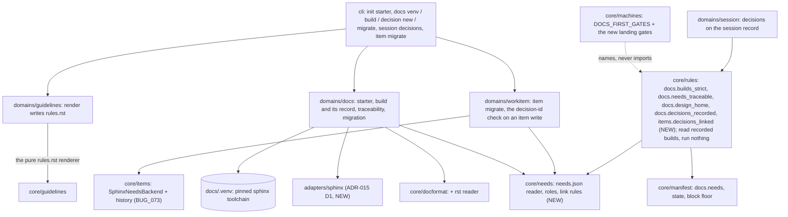

# ADR-018 — Architecture and design live only in a strict-building sphinx-needs project, in every managed project

- **Status:** Accepted (2026-11-09). Nineteen rulings were made by the user
  on 2026-11-08 (IDEA_045, rulings 1 to 10) and 2026-11-09 (rulings 11 to
  18, the answers to IDEA_045's open questions; ruling 19, the one question
  the design check raised) and are recorded below as decided. Each
  decision gives the design that carries out its ruling. Any choice beyond
  a ruling is marked *recommended*. No question is open.
- **Date:** 2026-11-09
- **Supersedes:** nothing. Amends
  [ADR-016](ADR-016-the-architecture-docs-are-assessed-and-init-offers-to-reuse-relocate-or-write-them.md)
  (the Markdown starter is retired, and the docs **format** is no longer an
  offer: ruling 1; the location, onboarding and adoption offers stand),
  [ADR-017](ADR-017-init-asks-the-configuration-as-a-questionnaire-and-configure-asks-it-again.md)
  (D11: a level may not add a question over `docs.format`; the `docs` step
  has never asked one),
  [ADR-012](ADR-012-the-guidelines-domain-and-the-model-agnostic-contract.md)
  (D3's render gains a third output, the rules as needs), and, through
  D1's level floor (ruling 19),
  [ADR-001](ADR-001-scripted-state-over-prose-rules.md) D25 (its permanent
  route, `enforcement.rules`, no longer lowers the rules this record adds in
  an enforced project; the temporary routes and `uninstall` stand). Pulls
  [ADR-015](ADR-015-docs-repositories-get-an-adapter-and-commands-derived-from-ci.md)
  D1 (the `sphinx` adapter) forward as a dependency. Uses
  [ADR-014](ADR-014-a-project-s-records-can-live-in-a-store-outside-its-repository.md)
  D1 (`records.docs: store`) and D5 (the docs lock) unchanged. Amends
  `docs/architecture/manifest.md` ("Full schema", "Backends for
  work items"), `cli.md` (`init`, `doctor`, the `docs` group),
  `state_model.md` (the docs gates) and `overview.md`.
- **This record's own format.** It is written as Markdown under `docs/adr`
  because invariant has no sphinx-needs project yet, and nothing refuses that
  home until increment 5 builds the check. It is the last record written
  this way. Increment 7 converts it with ADR-001 to ADR-017.

## Context

The docs-first rule today says that architecture docs exist and are kept up
to date. It does not say where design lives or in what shape. invariant's
own decisions are spread over seventeen Markdown ADRs, backlog item bodies,
plans and agent reports. No decision has a stable id, nothing links a
decision to the element it shapes, and nothing checks that the docs build.
Heap keeps its architecture as sphinx-needs (rST, typed element needs,
typed links, items as needs), and the user reports that it "worked really
well". dang, a newer project, has decision, requirement, rule and screen
needs and documents a strict build command.

IDEA_045 holds the user's words. The user wants this to be the rule for
every managed project, and froze all other invariant work until it is
implemented.

### Rulings (user, 2026-11-08: IDEA_045's interview)

1. **Scope.** Every invariant-managed project, invariant included. It is a
   must, not a configurable option.
2. **Format.** reStructuredText.
3. **Buildable is a gate.** A strict sphinx-build (`-W`, plus sphinx-needs'
   warnings) runs on every change that touches the docs.
4. **Existing projects** without sphinx-needs docs (invariant, dang, Heap's
   gaps) are owed a migration session. Until it lands, design content
   written elsewhere warns. After it lands, it blocks.
5. **Need types in v1:** decisions (each ADR and each of its D-decisions),
   architecture elements, requirements, bugs, ideas, guideline rules.
6. **"Design"** means architectural and software design, plus UI decisions
   (screens, flows, design-system choices), all as needs. Visuals and
   mockups may live in design tools, linked from a need, never as the
   record.
7. **Refused homes:** standalone ADR files outside the Sphinx project;
   plans and agent reports (drafts are allowed, but the session cannot merge
   until its decisions are needs); design text in backlog items (items keep
   problem and status, and rulings move to decision needs linked by id).
   Memory and external docs are **not** refused homes.
8. **Schema:** an engine baseline with fixed prefixes the gates rely on,
   plus per-project extension types in configuration. (Ruling 11 replaces
   the fixed prefixes with roles.)
9. **Traceability gate:** the strict build plus configured required-link
   rules (for example decision → element, bug → element).
10. **Diagrams:** PlantUML and Mermaid both allowed, chosen case by case.

### Rulings (user, 2026-11-09: IDEA_045's open questions)

11. **The baseline is roles.** The roles are requirement, decision, element,
    ui, rule, idea and bug, each with a default prefix. A project maps any
    number of its own types to a role. Heap is the proven reference: its
    element types (COMP_, SVC_, VIEW_, MOD_, …) map to `element` and keep
    their ids, and so do IDEA_ and BUG_. The roles Heap lacks take dang's
    prefixes: DEC_, REQ_, RULE_, UI_. (The user delegated this choice to
    Claude, and it is recorded as ruled.)
12. **Design text in backlog items:** a judgement guideline, plus a
    mechanical link check (an item that names a decision must link an
    existing DEC_ need).
13. **Migration converts everything:** all ADRs (each D-decision its own
    DEC_ need), the architecture docs to rST element needs, and every item,
    closed ones included, into the `sphinx_needs` backend. BUG_073 is fixed
    first.
14. **Toolchain:** a per-project pinned virtual environment
    (`docs/requirements.txt`, `docs/.venv` via uv). init and the migration
    create it; doctor checks it.
15. **The freeze ends** when the engine enforces the rule **and** invariant
    itself is migrated and builds strictly. Heap's gaps and the other
    projects then migrate alongside normal work.
16. **Enforcement at write and at merge.** A pre-tool-use hook refuses
    refused homes and names the fix. At merge, the decisions in plans and
    reports must exist as DEC_ needs.
17. **Location:** the docs project is in the repository by default.
    `records.docs` may point it at an ADR-014 store.
18. **Documentation repositories** (such as the user's four Sphinx
    repositories) are kept fully separate. invariant's sphinx-needs project
    has its own `conf.py`, build and id space, and is never in the
    repository's toctree or build. It lives in a store by default;
    configuration may instead name a separate in-repo folder that the
    repository's build excludes. The repository's content counts as source
    code. invariant may link to its needs only read-only, through
    `needs_external_needs`, and never writes into it. Docs-first guards
    both the repository's tooling and its content structure (toctree
    layout, its need-type schema), as elements and decisions in invariant's
    project.

### Ruling (user, 2026-11-09: raised by the design check)

19. **A floor at block.** Ruling 1 also removes ADR-001 D25's permanent
    route for the rules this record adds. In an enforced project they
    cannot be set below `block`, and a manifest that tries is refused at
    load. The temporary routes that record a reason (`invariant override`,
    `--force --reason`, `standdown`) and `uninstall` stay. ADR-018 amends
    ADR-001 D25 for these rules only. (Chosen over no floor with a failing
    `doctor` row, and over a floor lowerable with a reason in the
    manifest.)

### What was run to write this

Labels as in ADR-014. **Run** means run on 2026-11-09 in throwaway virtual
environments under a scratch directory, built from each project's own
`docs/requirements.txt`, with output written outside both trees. **Read**
means read in the code at 0cf3e28. **Reasoned** means neither.

- **Heap, strict.** With `sphinx-build -q -E -W --keep-going -n -b html`
  (Sphinx 9.1.0, sphinx-needs 8.1.1, as pinned), the build exits 1 with 153
  warnings: 50 docutils, 55 `needs.directive` (the backlog's `:residue:`
  option is not registered in `conf.py`, which BUG_073's residue notes), 10
  `toc.not_included`, 9 `ref.ref`, 7 `needs.link_ref` and 6
  `needs.link_outgoing` (links to needs that do not exist), and 16 of five
  other kinds. The same build without `-W` exits 0, and Heap's Makefile
  passes no `-W`, so none of this has ever failed a build there. The full
  build takes minutes. Heap holds 1,291 needs: 452 bug, 267 service, 238
  idea, 159 view, 89 model, 51 dataflow, 20 util, 10 component and 5 iface.
  It has no decision, requirement, rule or ui need.
- **dang, strict.** Its documented command (`-E -W --keep-going -n -b
  html`, sphinx-needs 9.2.0) exits 0 with no warning. Under the `dummy`
  builder the same tree exits 1 with five `needs.needflow` warnings
  ("NeedflowGraphiz is only supported for HTML output"). A needflow
  directive therefore fails any strict non-HTML build, which is why D5
  builds HTML and does not use ADR-015 D1's `linkcheck` and `needs` builders
  for this gate. dang holds 236 needs across ten types, including dec 42,
  req 21, rule 15 and screen 18.
- **needs.json.** The `needs` builder writes `needs.json` for both projects
  with the same top-level shape per version: `needs`, `needs_amount` and
  `needs_schema`. Each need carries `id`, `type`, `docname`, `lineno`, its
  link options and their `_back` counterparts, across both sphinx-needs
  majors. Heap sets `needs_build_json = True`, so its HTML build writes the
  file as well.
- **The two majors configure differently.** Heap (8.1) uses `needs_types`,
  `needs_extra_options` and `needs_extra_links`. dang (9.2) uses
  `needs_types`, `needs_fields` and `needs_links`. Whatever invariant
  checks must be read from the built output, not from `conf.py`.
- **The engine today** (read). `core/items.SphinxNeedsBackend` patches one
  `.rst` file and does not persist history (BUG_073; its user-approved fix
  of 2026-10-21 is option B, an `.. invariant-history::` comment block
  inside the directive body). No `sphinx` adapter exists, and
  `core/docformat` has a Markdown reader only. `domains/docs` holds ADR-016
  increments 1 to 4. The pre-tool-use rules are declared with
  `@rule(..., events=("pre-tool-use",))` and run from
  `hosts/claude_code._pre_tool_use`. The docs-first gates are injected by
  `core/machines.DOCS_FIRST_GATES` on every pipeline machine, and
  `core/machines` names rule ids without importing `core/rules`. Gates
  answer from recorded evidence, and the oracle's gate cache evaluates them
  over an inert store, so no gate runs a command. `docs.read_architecture`
  counts any read under `paths.docs`, and `docs.updated` any change there.
  The items backend reads only `.. idea::` and `.. bug::` directives, and
  mints `<items.id_prefix><TYPE>_<n>`. `docs.format` has no load-time enum.
  `guidelines render` already writes an rST checklist under
  `docs.format: sphinx`. invariant's own `docs/conf.py` is a MyST Sphinx
  site over the Markdown sources, without sphinx-needs.
- **Not run:** `needs_external_needs` against a real documentation
  repository, PlantUML rendering under `-W`, and every new command below.
  Those parts are reasoned.

## Decisions

### D1 — One docs project per managed project, and it is not optional

Every managed project has exactly one **docs project**: a Sphinx project
with sphinx-needs, written in rST, holding the project's architecture and
design (rulings 1, 2, 6). invariant writes design content nowhere else and
lets no agent write it anywhere else (rulings 7, 16).

- `docs.format: sphinx` is the only value a project in the **enforced**
  state accepts (D10). `markdown` still loads while a project is
  **migrating**, and only then, so that invariant, dang and the four
  Markdown-docs projects keep working until their migration lands
  (ruling 4).
- **No key turns the mandate off** (ruling 1). In the enforced state, the
  rules this record adds (D5, D6, D8, D9) cannot be set below `block` by a
  profile or by `enforcement.rules`. A manifest that tries is refused at
  load, naming ruling 1 (ruling 19). This removes ADR-001 D25's
  permanent route for these rules and keeps its temporary ones, each
  recorded: `invariant override` passes one call at a hook (D8),
  `pipeline advance --force --reason` passes one transition past a landing
  gate (D5, D6, D9), and `invariant standdown` holds every gate for an
  interval. `invariant uninstall` stays the route out entirely.
- **What counts as design** (ruling 6): every decision, requirement,
  architecture element, screen, flow and design-system choice. A mockup,
  screenshot or design-tool canvas is not a record. A `ui` need links to it
  through a field (`design_link`, *recommended*, dang's name), and the need
  is the record.
- **Memory and external docs** (ruling 7) are outside the mandate. Nothing
  refuses them.
- **Diagrams** (ruling 10). `docs.diagrams` becomes a list, and a single
  name still loads as a list of one, so no manifest changes. Both `mermaid`
  and `plantuml` are allowed, the starter enables `mermaid` (it needs no
  local tool), and `docs.diagrams_current` accepts either marker in rST
  (`.. mermaid::`, `.. uml::`) as well as the Markdown fences it reads today.

### D2 — The schema: seven roles, each with types and a default prefix

The gates key on **roles**, never on prefixes (ruling 11). A role is a
fixed engine concept. A type is the project's own sphinx-needs directive,
mapped to one role or to none.

| Role | Default type (directive, prefix) | Required by |
|---|---|---|
| `requirement` | `req`, `REQ_` | the traceability rules (D6) |
| `decision` | `dec`, `DEC_` | D6, D7, D9 |
| `element` | `comp`, `COMP_` | D6, the docs assessment (D11) |
| `ui` | `ui`, `UI_` | D1 (ruling 6) |
| `rule` | `rule`, `RULE_` | D12 |
| `idea` | `idea`, `IDEA_` | the items backend (D11) |
| `bug` | `bug`, `BUG_` | the items backend, D6 |

```yaml
docs:
  needs:
    types:                      # replaces the defaults whole when set
      - {directive: component, prefix: COMP_, role: element}
      - {directive: service,   prefix: SVC_,  role: element}
      - {directive: view,      prefix: VIEW_, role: element}
      - {directive: dec,       prefix: DEC_,  role: decision}
      - {directive: instr,     prefix: INSTR_}          # no role: an extension type
      ...
```

- **Any number of types per role** (ruling 11). Heap maps its seven element
  types to `element` and keeps every id. dang maps `comp` and `port` to
  `element` and `screen` to `ui`. The two item roles are the exception:
  `idea` and `bug` each take exactly one type, whose directive is the item
  type itself (`idea`, `bug`), because those are the only directives the
  items backend reads and mints (read) (*recommended*).
- **A type with no role is an extension type** (ruling 8). The gates accept
  its needs and hold them to the strict build and the id rules. No role
  rule applies to them.
- **Refused at load, naming it:** a role with no type; an unknown role; a
  directive or prefix used twice; a prefix that does not match
  `^[A-Z][A-Z0-9_]*_$`; and an `idea` or `bug` type whose prefix differs
  from what the items backend mints, `items.id_prefix` followed by the item
  type's stem (`BUG_`, or `HEAP_BUG_` with an `id_prefix` of `HEAP_`), so
  that the items `invariant item` mints are always needs of the right role
  (*recommended*).
- **Links are named per project.** The traceability rules (D6) name link
  options. The starter declares dang's set (`satisfies`, `implements`,
  `uses`, `decided_by`, `affects`, `part_of`, plus `amends` and
  `supersedes` for D7), and a project
  may declare its own.
- **conf.py stays the project's file.** It declares the directives for its
  sphinx-needs version: 8.x and 9.x take different keys (run).
  `docs.needs.types` is the engine's map from those directives to roles,
  and the build output is where the two are checked against each other
  (D6). Generating conf.py from the manifest was rejected (see
  "Alternatives rejected").

### D3 — Where the docs project lives

- **Default: in the repository** (ruling 17), at `docs/`: `conf.py`,
  `index.rst`, `requirements.txt`. That directory is the docs project's
  **source directory**, `docs.needs.srcdir`, which defaults to the nearest
  directory at or above `paths.docs` that holds a `conf.py`
  (*recommended*).
- **`paths.docs` keeps its meaning** (*recommended*): the architecture
  pages, which `docs.read_architecture` counts as read, `docs.updated`
  counts as updated and ADR-016 assesses. For the starter that is
  `docs/architecture`, inside the source directory. The items store, the
  decision pages, the generated rules page, the reports and any user guide
  also live in the source directory but not under `paths.docs`. If
  `paths.docs` named the whole source directory, reading the backlog would
  satisfy the read gate and every `invariant item transition` would satisfy
  `docs.updated` (read: both count any path under `paths.docs`).
- **The items store is in the build.** Items are needs that decisions and
  bugs link to, so in an enforced project `items.path` and
  `items.closed_path` lie under the source directory and `records.backlog`
  equals `records.docs`, refused at load otherwise (*recommended*).
- **In a store** when `records.docs: store` (ruling 17). The same layout is
  read against the store root (ADR-014 D1). The project is a policy record,
  so ADR-014 D5's lock covers it once that increment is built.
- **The docs project is not an ecosystem.** ADR-015 D1's `sphinx` adapter
  detects a `conf.py` under `docs/`, which every managed project now has.
  Its detection skips the docs project's source directory, so a project
  gains the `sphinx` ecosystem only when its own content is Sphinx
  (ruling 18, D13), and the docs project is built by D5 from its own
  environment, never through `commands.*` (*recommended*).
- **Build output and the virtual environment are never tracked.** The build
  writes under the state root (`{state}/docs/build`), as ADR-015 D1 does,
  and `docs/.venv` is listed in the starter's `.gitignore` and in
  `exclude_patterns`.
- **A documentation repository** (ruling 18) is a project whose own content
  is Sphinx. D13 covers it.

### D4 — The toolchain: one pinned virtual environment per project

Ruling 14.

- **`<docs project>/requirements.txt`** pins every package with `==`
  (*recommended*: Heap's file is fully pinned and dang's uses `>=`; a range
  lets a new sphinx-needs warning fail a build that changed nothing). The
  starter pins the versions the engine's suite is proven against, and a
  project may change them.
- **`<docs project>/.venv`**, created by `uv venv` and filled by `uv pip
  sync requirements.txt`. The engine runs `<.venv>/bin/sphinx-build`, never
  one found on `PATH`, which is the trap manifest.md's "Adapters" records
  for unpinned linters.
- **`invariant docs venv [--check]`** (new) creates or re-syncs the
  environment, or with `--check` reports whether it matches
  `requirements.txt` (a hash of the file recorded in `.venv`).
  Interactive `init` and the migration call it. A non-interactive `init`
  does not, because it may need the network (ADR-016 ruling H), and its
  report names the command.
- **`doctor`** gains rows: the `docs venv` row (present, in sync with
  `requirements.txt`, `sphinx-build` runs). When `plantuml` is in
  `docs.diagrams`, a `plantuml` row checks the command `conf.py` uses,
  because PlantUML needs Java and lies outside the environment
  (*recommended*).
- **A non-Python project** (dang is Flutter) needs only uv on the machine.
  The environment is the docs project's own, and the project's ecosystem
  adapters never see it (*recommended*).

### D5 — The strict build is a gate on every change that touches the docs

Ruling 3. A new rule, **`docs.builds_strict`**, is injected at the
landing-state **entry** of every lane, beside `docs.updated`
(`core/machines.DOCS_FIRST_GATES`):

- **When it applies:** the session's changed set (`core/rules._changed_set`,
  per leg as ADR-014 D9 has it) touches a file under the docs project's
  source directory (its `conf.py` and `requirements.txt` included), or
  `docs.needs` in the manifest. Otherwise it is N/A, and says so. A docs
  project in a store is seen only through ADR-014 D9's store leg. Until
  that increment is built, the rule answers such a project "changed set not
  established", a failure and never N/A (*recommended*, as `docs.updated`
  answers today).
- **The build:** `<.venv>/bin/sphinx-build -E -W --keep-going -n -b html
  <srcdir> <state>/docs/build/html`, with `needs_build_json = True` forced
  through `-D`. The HTML builder is chosen because a needflow directive
  warns under every other builder (run, dang), and one HTML build also
  writes the `needs.json` that D6 reads. `-E` re-reads every source, because
  an incremental build validates nothing it skips (ADR-015 D1's hazard).
- **Who runs it.** A gate never runs a command: it is evaluated by
  `pipeline gates` and by the oracle's gate cache over an inert store
  (read). So the build is run and recorded by a new command, **`invariant
  docs build`** (*recommended*), as `pipeline test` records the suite for
  `test.all_pass`. The record holds the exit status, the parsed warnings,
  the `needs.json` path and the digest of the source directory's tree. The
  gate reads the record for the current digest. With none, or one for an
  older digest, it fails, naming `invariant docs build`. A landing whose
  digest matches a recorded green build never builds again, so `pipeline
  gates` and the merge do not pay twice.
- **Reading a run** follows ADR-015 D1: every `WARNING:` and `ERROR:` line
  is a failure, named by document and line, with its warning type
  (`[needs.link_ref]`). A missing virtual environment fails `docs build`,
  naming `invariant docs venv`, so the gate has no green record. It is
  never a skip.
- **Heavy builds.** A full strict build of a large docs project takes
  minutes. Ruling 3 says every change, so this gate is never moved to a
  sweep. ADR-015 D5's budget does not apply to it.

ADR-015 ruling 6 (no strict build at a documentation repository's landing)
is unchanged. It governs that repository's own content, which ruling 18
makes source code. This gate is on invariant's docs project.

### D6 — Traceability: the build output, read against the roles and the link rules

Ruling 9. A second landing-entry rule, **`docs.needs_traceable`**, reads
the `needs.json` of the green build D5 recorded. It never parses rST:

1. **Every need's type is declared** in `docs.needs.types`, and its id
   starts with that type's prefix. A need whose directive the manifest does
   not map is named, so `conf.py` and the manifest cannot drift apart
   silently.
2. **A role with no needs yet is not a failure** (*recommended*). A library
   with no screens has no `ui` need, and a new project no bug, and a
   placeholder written to satisfy the rule would be invented content (a
   placeholder bug would sit in the items store as an open item). The other
   direction is already covered: a declared type whose directive `conf.py`
   does not register fails the strict build (an unknown directive is an
   error) the first time a need of it is written.
3. **The required-link rules hold:**

   ```yaml
   docs:
     needs:
       require_links:            # each: every need of role `from` links to at
         - {from: decision, to: element}       # least one need of role `to`
         - {from: bug, to: element}            # through any link option,
         - {from: rule, to: decision, via: [decided_by]}   # or only via those
   ```

   The defaults are the two ruling 9 names. A violation names the need, the
   rule and the file and line. A link to a need that does not exist is
   already a strict-build failure (D5).
4. **Status values** of decision needs come from one list,
   `docs.needs.decision_statuses`, default `[proposed, accepted, superseded,
   rejected]`, checked here from `needs.json`. The starter's `conf.py` does
   not set `needs_statuses`, because that list applies to every need type,
   and items carry their own lifecycle (`filed`, `reproduced`, `fixed`, …)
   (*recommended*).

### D7 — A decision record is a page of decision needs

Rulings 5 and 13. An ADR is one rST page under `<srcdir>/decisions/`, and
on it:

- **The record** is a `decision` need, id `DEC_ADR_<nnn>`, holding the
  title, status, date, and links `amends`/`supersedes` to the records it
  changes. The rulings stay on the page as the user's words. Rulings are
  not needs (ruling 5 does not list them), so each is a paragraph under its
  own rST label (`.. _adr-018-ruling-3:`), which a decision cites with
  `:ref:`.
- **Each D-decision** is its own `decision` need, `DEC_ADR_<nnn>_D<k>`,
  `part_of` the record, linked to the elements it shapes (D6's default
  rule), and citing the rulings it carries out by reference.
- **A new record** is minted by `invariant docs decision new "<title>"`
  (*recommended*), which takes the next number from the record pages under
  `<srcdir>/decisions/`, read by the rST reader, so a record written since
  the last build is counted, as `invariant item` mints from its store
  files. Ids are never reused, as with items.
- **Run, read, reasoned labels and alternatives** stay prose on the page.

The design agents (`feature-architect`, the bugfix design step) write
decisions here, and nowhere else.

### D8 — Refused homes are refused at write

Ruling 16. A new pre-tool-use rule, **`docs.design_home`**, on the edit
tools (`EDIT_TOOLS`):

- **Paths that are never a home for design:** `docs.needs.refused_paths`,
  globs. The default is `docs/adr/**`, `**/ADR-*.md`, `**/adr-*.md`, and
  any Markdown file under `paths.docs` or `<srcdir>/decisions/`, except
  the generated files invariant itself declares (*recommended*). Markdown
  elsewhere in the source directory is not refused: a user guide is not
  design (ruling 6), and the reports under `paths.reports` are drafts
  (ruling 7, below). A write to a refused path is refused, and the
  refusal names what to do: `invariant docs decision new`, or the page the
  content belongs on.
- **Backlog items** (ruling 12). An edit to an item, by a tool or through
  `invariant item`, that names the id of a need of the decision,
  requirement, ui or rule role (by the roles' declared prefixes, `DEC_`,
  `REQ_`, `UI_` and `RULE_` by default) which the last recorded build does
  not hold is refused, naming the id.
  That is **`items.decisions_linked`**, a mechanical rule that also runs at
  the landing over every item the session changed. Design prose in an item,
  with no id, is a matter of judgement, so a judgement rule carries it:
  `docs.items-carry-no-design` ("an item holds the problem, the evidence and
  the status; a ruling or design in it is a decision need linked by id").
  init and the migration write it into the project's ruleset, creating one
  at ADR-012 D3's default path when the project has none (*recommended*),
  and its verdicts are checked by ADR-012 D5's machinery.
- **Plans and agent reports** are drafts at write time (ruling 7). Nothing
  refuses them here; D9 holds them at merge.
- **Before migration** (D10) the rule warns through the hook's context
  instead of refusing (ruling 4).

### D9 — At merge, every decision a session made exists as a need

Rulings 7 and 16. A decision written in prose (an agent report, a
deliverable line) cannot be checked mechanically, so a session **declares**
its decisions:

- **`invariant session decisions add <DEC_id>`**, or **`add --draft
  "<one line>"`**, records a decision on the session record. The design
  agents' instructions end their design phase with it. Their report
  formats gain a `DECISIONS:` block listing exactly what was recorded, so
  the parent can see it.
- **`docs.decisions_recorded`**, an entry gate on the landing state, blocks
  while any entry is still a draft, or names an id the session's green
  build (D5) does not hold. The verdict names each entry and the command to
  turn a draft into a need.
- **A plan deliverable** may cite decision ids. Ids in the plan, the
  session's commit messages and the items it changed are held to the same
  check (*recommended*).
- **Prose that slipped through,** a decision in a report never declared, is
  the subject of a judgement rule, `docs.decisions-are-declared`, beside
  the one in D8. It is answered by the review agent's cited verdict.

### D10 — Two states per project: migrating, then enforced

Ruling 4.

```yaml
docs:
  needs:
    state: migrating            # migrating | enforced
```

- **New projects are enforced from the start.** `init` writes the starter
  (D11) and `state: enforced`.
- **An existing project without the key reads as `migrating`**
  (*recommended*), so that upgrading invariant never blocks a project that
  has not migrated. `doctor` fails a migrating project's `docs mandate` row,
  naming the migration (D14), so the debt is never silent.
- **While migrating:** D5 and D6 run when `docs.format` is `sphinx`, and
  are N/A, saying so, otherwise (*recommended*). "A `conf.py` exists" is
  not the test: invariant's own `docs/conf.py` is a MyST site with no
  sphinx-needs (read), and would fail a gate it has no environment for.
  Where they run, they warn, as D8 and D9 do (ruling 4), so Heap
  (`docs.format: sphinx`, 153 strict warnings, run) sees its debt named on
  every docs change and is not stopped before its migration.
- **Enforced:** every rule here blocks, and the levels cannot lower them
  (D1). `docs.format: markdown`, any `items.backend` other than
  `sphinx_needs`, and an items store outside the source directory (D3) are
  refused at load. Only the migration's last step writes `enforced` (D14).
  A change that moves the key back from `enforced` is refused at its
  landing and passes only with `pipeline advance --force --reason`, the
  recorded route ADR-001 D25 keeps (*recommended*).

### D11 — The starter, init, the questionnaire and the assessment

- **The starter** (ADR-016's Markdown `overview.md` is retired):
  `conf.py` (sphinx-needs and sphinxcontrib-mermaid; the seven baseline
  types; dang's link set; `needs_id_required`, `needs_id_regex`,
  `needs_build_json`; item fields declared from the backlog file, dang's
  `_backlog_fields`, so a field `invariant item` writes can never break the
  build, which is Heap's 55 `residue` warnings), `index.rst`,
  `requirements.txt`, `.gitignore`, `architecture/overview.rst` (one
  `element` need per detected source area, plus the three sections ADR-016's
  assessment requires), `requirements.rst`, `decisions/index.rst`, `ui.rst`,
  `rules.rst` (generated, D12) and `backlog.rst` (the items store, with
  `items.backend: sphinx_needs`). The starter builds strictly on its own;
  the suite proves it.
- **init**, interactive or not, writes the starter wherever `paths.docs` /
  `records.docs` resolves, which ADR-016 ruling G already says. Creating the
  environment is interactive only (D4).
- **ADR-017's `docs` step** keeps its location and onboarding questions and
  still asks no format (it never has, read). ADR-017 D11 lets a level add a
  plain question over any manifest key; one over `docs.format` is refused
  at load. That refusal is built with ADR-017 D11's level settings
  (ADR-017 increment 3), which wait for the freeze to lift, so it is not
  in this record's increments.
- **ADR-016's assessment** reads rST through the reader ADR-016 D1
  deferred to ADR-015 increment 2, which is built in increment 2 here. With
  sphinx-needs present, `areas` is answered by element needs: an area is
  named when an `element` need's title or content names it (*recommended*,
  the same whole-word rule).
- **Adoption** (ADR-016 D7) of Markdown docs is copy mode into a migrating
  project only, and the migration converts them.

### D12 — Guideline rules are rendered as rule needs

Rulings 5 and 11, within ADR-012 D3. The ruleset stays the one
machine-readable source, because the evaluators, the baseline and the
verdicts read it, and ADR-012 D3 makes everything a human reads generated
from it.

- **`invariant guidelines render`** writes a third generated file,
  `<docs>/rules.rst`: one `rule` need per rule, with id
  `RULE_<RULE_ID_UPPERCASED>`, where every non-alphanumeric character
  becomes `_` (so `layers.only-the-cli-imports-the-oracle` becomes
  `RULE_LAYERS_ONLY_THE_CLI_IMPORTS_THE_ORACLE`). Two rule ids that would
  collide are refused at ruleset load. The file carries the managed digest
  marker, and `guidelines.generated_current` checks it like the checklist.
- **The ruleset's `links` and `amended[].adr`** accept need ids, and render
  them as `decided_by`, so a configured `rule → decision` link rule (D6's
  example; it is not a default) can be met. A path link still renders as
  text.
- **Under the mandate** the Markdown checklist is no longer written; the
  checklist is rendered in rST. The pure renderer is `core/guidelines`'
  (beside `render_checklist`), and `domains/guidelines` writes the file,
  as for the checklist today. Both rendered rST files are in the starter's
  index toctree, so neither raises `toc.not_included` under `-W`.

### D13 — Documentation repositories

Ruling 18, for a project whose own content is a Sphinx project.

- **Separate project, store by default.** invariant's docs project for it
  lives in the project's store (`records.docs: store`). `docs.needs.home:
  in_repo` with a `docs.needs.srcdir` names an in-repo folder instead. That folder
  must be outside the repository's own Sphinx source directory or listed in
  its `exclude_patterns`, and `doctor` and load check both.
- **Read-only links into the content.** `docs.needs.external`, a list of
  `{url_prefix, json}`, configures `needs_external_needs` in the starter's
  `conf.py`. `json` is the repository's own `needs.json` as its build
  writes it under the state root, so invariant's needs can link to the
  content's needs, and a broken link fails D5. invariant never writes into
  the content tree: `docs.design_home` refuses a design need written there
  (*recommended*).
- **The content's structure is designed.** The repository's tooling
  (`conf.py`, extensions, CI) and its content structure (toctree layout,
  its need-type schema) are `element` needs in invariant's project, and
  changing them owes a decision. `docs.updated` already counts `conf.py`
  and templates as structure in such a repository (ADR-015 D2).
  Prose-only content changes need nothing, as ADR-015 D2 says.
- **This depends on ADR-014's store increments and ADR-015's lane,** so it
  is built after the freeze lifts (increment 8).

### D14 — Migration: generic commands, then one session per project

Ruling 13. The mechanical parts are engine commands that work on any
project. The judgement parts are a session's deliverables.

- **`invariant item migrate --to sphinx_needs`** (generic, any backend to
  any backend): every item, open and closed, keeps its id, fields, body
  and history (after BUG_073). Closed items go to `items.closed_path`. It
  refuses if a read-back differs, and writes nothing then.
- **`invariant docs migrate adr <files>`**: each Markdown ADR becomes a
  record page (D7). The record and each `### D<k>` heading become decision
  needs, and the prose is converted with pandoc, pinned in the docs
  environment (`pypandoc_binary`, *recommended*), so the engine gains no
  dependency. Links to other ADRs become need references. The converter
  leaves an `.. invariant-unconverted::` directive wherever it cannot
  convert. No extension registers it, so it is an unknown-directive error
  and the strict build fails on it, so nothing half-converted can land (a
  `.. todo::` would pass wherever `sphinx.ext.todo` is enabled).
- **`invariant docs migrate prose <files>`**: Markdown architecture docs to
  rST pages, by the same converter. Element needs are **not** invented by
  the converter. They are a deliverable per page, written by the design
  agent, because what is an element is a design judgement.
- **The migration session** records its plan with `docs assess --plan`'s
  machinery: the environment and starter, one deliverable per ADR batch and
  per architecture page, the items, the ruleset render, every link into a
  converted Markdown file rewritten (the ruleset's `links` and
  `amended[].adr`, the agent sources, any user guide), the required-link
  rules met, and last, the switch: `docs.format: sphinx`,
  `items.backend: sphinx_needs`, `docs.needs.state: enforced`. The source
  Markdown files are deleted by the same session, and their history stays
  in git.

## Increments

Each increment leaves every project that has not migrated exactly as today,
apart from the new `doctor` rows and, for a project already on
`docs.format: sphinx`, D5's and D6's warnings (D10), and proves that with
the existing suite. Nothing blocks a migrating project.
BUG_073 comes first (ruling 13). invariant's own migration comes last, and
the freeze lifts when it lands (ruling 15).

| Increment | Lands | Proven by |
|---|---|---|
| Record | This ADR, accepted. IDEA_045 links it. | Docs only. |
| 1 | BUG_073 in the bugfix lane: history persisted as the approved `.. invariant-history::` block, excluded from the body, byte-stable. | The red test first (`bug-reproducer`). On `sphinx_needs`, a filed bug moved to `reproduced` and `fixed` reads back with both history rows, ruling and evidence included. `item.history_matches_status` is quiet. The round-trip diff is the status line plus the history block. The block passes a strict build without any change to `conf.py` (run on a copy of Heap's backlog). |
| 2 | ADR-015 D1, pulled forward: the `sphinx` adapter (detection, skipping a declared docs project's source directory (D3), default commands, run parsing, hazards, coverage N/A), and `core/docformat`'s rST reader (ADR-016 D1, deferred). Not ADR-015's lane or CI derivation. | ADR-015 increment 2's adapter proofs on a toy Sphinx tree. A toy Python project with a starter-shaped `docs/conf.py` not detected as `sphinx`. `docs assess` over an rST tree giving the same gaps twice. |
| 3 | D1's `docs.diagrams` list (and `docs.diagrams_current` reading the rST markers), D2, D3's `docs.needs.srcdir` and items placement, D4, D5, D6: `docs.needs` keys and their load refusals, `docs venv` and its doctor rows, D10's `docs mandate` row, `docs build` and its record, `docs.builds_strict` and `docs.needs_traceable`, injected at landing, and a `core/needs` reader of `needs.json`. D10's state key, read as `migrating` where absent, with D5 and D6 warning while migrating and blocking when enforced. | On a toy docs project, enforced, in the pinned environment: a dangling link, an unregistered option and a docutils error each block the landing, named by file and line; the fix passes; a landing with no docs change is N/A. A decision with no element link blocked by name; an unmapped directive named. A landing with no `docs build` record for its digest blocked, naming the command; a tree digest already green not built again. A role with no needs passing. The same toy project migrating: each of these warns. Heap's needs.json (run) classified with its seven element types mapped. This repository, migrating on `docs.format: markdown`, unchanged and N/A. |
| 4 | D11: the Sphinx starter in `init`, interactive and not; the `docs` step without a format; the assessment's element-need areas; Markdown adoption limited to copy mode into a migrating project. D12: `rules.rst` rendered, and need ids in `links` and `amended`. | `init` on a toy Python project and a toy Flutter tree: the starter builds strictly in the created environment; `--dry-run` and no terminal write the same files and create no environment, naming `docs venv`. `guidelines render` writing `rules.rst` and `generated_current` catching a hand edit. A collision of two rule ids refused. |
| 5 | D7's `docs decision new` (D8's refusals and D9's drafts name it), D8, D9, D10's switch: `docs.design_home`, `items.decisions_linked`, `session decisions`, `docs.decisions_recorded`, the two judgement rules in the starter ruleset, the block floor of an enforced project, and the refusal of a change moving `enforced` back. The agents' report formats and instructions name `session decisions`. | Enforced toy project: `docs decision new` minting the next record page and building strictly; a write to `docs/adr/ADR-002.md` refused, naming `docs decision new`; a Markdown user guide page and a report under `paths.reports` written freely; an item edit naming an unknown `DEC_` refused; a session with a draft decision blocked at the landing until it becomes a need; `enforcement.rules: {docs.builds_strict: warn}` refused at load naming ruling 1; an override with a reason passing one change. The same toy project migrating: every one of these warns. |
| 6 | D14's commands: `item migrate`, `docs migrate adr`, `docs migrate prose`. | A copy of this repository's backlog (161 items) migrated and read back field for field and history row for row; a copy of ADR-016 converted and building strictly, with D1 to D9 as needs; an unconvertible construct left as an `invariant-unconverted` directive that fails the build. |
| 7 | invariant's own migration, as a session with a plan (D14): the docs project at `docs/` (its MyST `conf.py` gains sphinx-needs, and `paths.docs` stays `docs/architecture`, D3), ADR-001 to ADR-018 as decision pages, the six architecture docs as rST with element needs, every item as a need, `rules.rst`, the link rules met, and `docs.needs.state: enforced`. | invariant's strict build green in its pinned environment; its config reading `docs.format: sphinx` and `items.backend: sphinx_needs`; `doctor`'s `docs mandate` row passing. **The freeze lifts here (ruling 15).** |
| 8 | After the freeze, alongside normal work: D13 (documentation repositories) and any docs project in a store (D3, D5's store leg), once ADR-014's store increments and ADR-015's lane have landed; the refusal of a `docs.format` question at a level, with ADR-017 increment 3 (D11); then Heap's gaps (the 153 strict warnings, the decision, requirement, rule and ui roles, its ADR pages as decision needs) and dang's migration, each as its own session in its own project. | Each project's own strict build and its switch to enforced. One of the four documentation repositories with its docs project in a store, linking read-only to the content's needs. |



### As built: increment 1 (2026-11-09)

The decision text above is left as accepted. Increment 1 built the history
block with the marker spelled `.. invariant-history:`, with **one** colon,
where this record and BUG_073 write `.. invariant-history::`. In
reStructuredText `name::` is directive syntax, and an unknown directive is
an error, so the strict build fails with `Unknown directive type`. The
one-colon form is a comment: it renders nothing, passes the strict build and
needs no `conf.py` change, which are exactly option B's requirements. This
was checked on Heap's pinned environment (Sphinx 9.1.0, docutils 0.22.4,
sphinx-needs 8.1.1). The architecture docs use the built spelling
(manifest.md, "The `sphinx_needs` round trip").

## Alternatives rejected

| Alternative | Why not |
|---|---|
| Fixed prefixes for every baseline type | Ruled out (11): Heap's 1,291 needs keep their ids under roles. |
| Generate `conf.py` from the manifest | The two sphinx-needs majors take different keys (run), and `conf.py` holds a project's theme, extensions and its own fields. The engine checks the build output instead (D6). |
| Parse rST for the gates | `needs.json` is what sphinx-needs itself resolved, so the gate cannot disagree with the build. |
| ADR-015 D1's `linkcheck` and `needs` builders as this gate | A needflow directive warns under every non-HTML builder (run, dang). The network check of linkcheck also does not belong in a per-change design gate. |
| Rules authored as needs, with the ruleset generated from them | ADR-012 D3 makes the YAML the one source that the evaluators, the baseline and the verdicts read. Rendering keeps one owner. |
| A mechanical check for design prose in items or reports | Prose cannot be classified deterministically. Ruling 12 asks for a judgement rule plus the link check. |
| Moving the strict build to a sweep above a budget | Ruling 3: every change that touches the docs. |
| A converter that invents element needs | What is an element is a design judgement, so the converter leaves it to a deliverable (D14). |
| `sphinx-build` from `PATH` | An unpinned tool moves the warning baseline without a change in the docs, and an absent one reads as a pass (manifest.md, "Adapters"). |

## Consequences

- Every decision in every managed project gets a stable id, links to what
  it shapes, and a build that refuses a dangling reference.
- Every managed project needs uv and a docs environment, and every change
  that touches the docs pays one full strict HTML build (once per tree
  digest). For a docs project of Heap's size that is minutes.
  Items are needs in the docs project, so an `invariant item` status change
  is a docs change and owes that build too.
- Design work gains one step: decisions are needs before the session
  merges, and the design agents declare them.
- `docs/adr/*.md` stops being writable in an enforced project. invariant
  becomes enforced at increment 7, and this record is converted then.
- Heap goes from a build that has never failed to one that fails on 153
  warnings it already has. Its migration starts from that list.
- Until increment 7, invariant's own work is frozen (ruling 15). Increments
  1 to 7 are the only work that may start.

## Open questions

None. Every input was ruled (rulings 1 to 19). The one question the design
surfaced, the level floor, was ruled as ruling 19. Every other default is
marked *recommended*.
