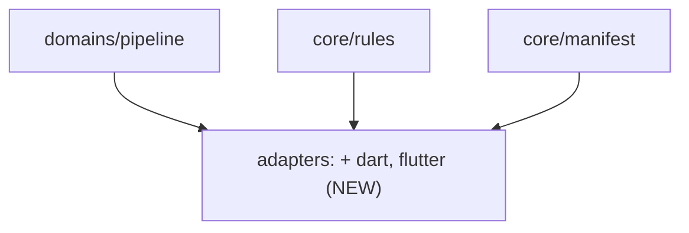

# ADR-019 — Dart and Flutter get an adapter

- **Status:** Accepted (2026-11-09). The owner asked for the adapter and set
  its three deliverables. The decisions below were made in the session that
  built it, and each says why. None needed the owner's ruling.
- **Date:** 2026-11-09
- **Supersedes:** nothing. Adds two adapters beside ADR-013's. Amends
  `docs/architecture/overview.md` (the adapters layer and its table) and
  `docs/architecture/manifest.md` ("Adapters").

## Context

A Flutter project adopting invariant had no adapter to declare, so it ran
under `generic`. `generic` parses no coverage (`Adapter.parse_coverage`
returns `{}`), so `invariant pipeline coverage` refused every run as having
"produced no per-file measurements", and `coverage.meets_floor` could never
pass. Its test counts were also unread ("? test(s) executed"), so a run that
executed nothing could not be told from one that passed.

The project measures coverage with a script that runs each package's tests
with coverage, reads each package's `lcov.info`, and prints one row per file:
`<path>  <lines hit> <lines found>  <percent>%`. Dart's own report is lcov.

### What was run to write this

Labels as in ADR-014: **run** on 2026-11-09 with Dart SDK 3.13 on a throwaway
package, **reasoned** otherwise.

- `dart test` closes each run with one line, an elapsed time and then
  `+P ~S -F: <verdict>`, for example `+2 ~1 -1: Some tests failed.`,
  `+1: All tests passed!` or `+0 ~1: All tests skipped.` (run).
- A name filter matching nothing prints `No tests ran.` and exits 79 (run).
- `dart test --coverage-path=<dir>/lcov.info` creates the directory and
  writes `SF:` with an absolute path. `flutter test --coverage` writes `SF:`
  relative to the package (read from the project's own report).
- No lcov record is written for a file marked `// coverage:ignore-file`, for
  an export-only barrel, for an abstract interface of signatures, for a plain
  enum, for a typedef, or for an empty class. An abstract class with a
  `const` constructor does get a record (run).
- The parser reads the project's real report and its script's rows to the
  same figures (run).

## Decisions

### D1 — One ecosystem, two ids: `dart` and `flutter`

`adapters/dart.py` holds `DartAdapter` (`dart`) and its subclass
`FlutterAdapter` (`flutter`). They differ only in their default commands and
in detection. Both runners print the `package:test` reporter and write lcov,
so everything else is shared.

- **Detection.** A `pubspec.yaml` at the root. It is `flutter` when an
  indented `sdk: flutter` line names a Flutter SDK dependency (under
  `dependencies` or `dev_dependencies`), else `dart`. The two never both
  match, so `detect` names one.
- **Default commands.**

  | key | `dart` | `flutter` |
  |---|---|---|
  | `test` | `dart test` | `flutter test` |
  | `test_one` | `dart test {selector}` | `flutter test {selector}` |
  | `lint` | `dart analyze` | `flutter analyze` |
  | `coverage` | `dart test --coverage-path={result_bundle}/lcov.info` | `flutter test --coverage --coverage-path={result_bundle}/lcov.info` |
  | `coverage_one` | the same, then `{selector}` | the same, then `{selector}` |
  | `coverage_report` | `cat {result_bundle}/lcov.info` | `cat {result_bundle}/lcov.info` |

Rejected: one `dart` id whose defaults pick a runner by reading the project.
Defaults are a class attribute that `defaults_for` reads with no project in
hand, and the manifest is where a project's runner is declared.

### D2 — The coverage report lives in the per-run bundle

The run writes `lcov.info` inside `{result_bundle}`, the directory the
pipeline clears before every run (`fresh_bundle`), and the report leg reads
it from there. A fixed `coverage/lcov.info` outlives a run that failed before
writing it, and the report leg would then publish the previous run's numbers
as this run's. With the bundle, such a run leaves nothing to read and is
refused as having measured nothing (tested).

The bundle holds no test counts, so the adapter's `read_run` reads only the
console. The base reader would otherwise note "a result bundle was written
but could not be read" on every coverage run, which is false.

### D3 — Coverage is read from lcov records and from summary rows

`parse_coverage` reads both, because both are real:

- **lcov** is the toolchain's own output, so a project needs no script of
  its own to be measured. A record counts only when it is complete
  (`end_of_record`), names a `.dart` file, has whole-number `LF` and `LH`,
  finds at least one line, and hits no more lines than it found. A record
  with `LF:0` is the reporter saying there was nothing to measure. That is
  not a percentage, so it gives no row, and `carries_executable_code` answers
  for the file (D6).
- **A summary row** is read the way the python adapter reads coverage.py's
  table (BUG_011): anchored on the `.dart` name at the start of a line, then
  any number of integer cells, then the first percentage. The cells must be
  on the same line, which is stricter than the python pattern. A progress
  line or a stack frame naming a `.dart` file beside a percentage does not
  start a line with the name followed only by numbers, so it is never read as
  a measurement. A row above 100% is refused.
- **A file read twice keeps its lower figure.** Merging reports is the
  reporter's job, and the higher figure is the one that can pass code nobody
  measured (`Hazard.can_overstate`).

Rejected: keying on one script's exact columns. The layout belongs to
whoever prints it. Also rejected: lcov only. A workspace's per-package
reports carry package-relative paths, and a script that rewrites them to
project paths is the better source for such a project (see Consequences).

### D4 — Test counts come from each run's closing line, summed

`+` is passed, `~` skipped and `-` failed. One closing line ends each run, so
output from several runs (a workspace script testing each package) is summed
over those lines. Progress lines carry running counts and are not read.
Executed is passed plus failed, because a skipped test ran nothing, so an
all-skipped run counts zero executed. With no closing line the count is
unknown (`None`) and the note says so. `No tests ran.` is a hazard,
`dart_test.no_tests_ran`, which makes the run untrustworthy even when other
packages in the same output passed.

### D5 — Classification follows the toolchain's own layout

- `source_files` keeps every `.dart` file, generated ones included. A
  generator that marks its output `// coverage:ignore-file` (freezed does) is
  explained by D6. Any other generated file is the project's to exempt, with
  `methodology.gates.coverage_exclude`, where the exemption is named.
- `is_test_file` answers for `.dart` only. Along the path, the first of `lib`
  or a test directory (`test`, `integration_test`, `test_driver`) decides:
  `lib/` is the library whatever a file is called, a test directory is tests
  and their support code. Otherwise `*_test.dart` is a test. `lib/src/latest.dart`
  and `lib/src/test/fixtures.dart` are production.
- `owns_selector` is the base answer over that convention, and
  `join_selectors` is positional, because `dart test` and `flutter test` take
  several paths as arguments.

### D6 — An absent row is explained only for shapes that compile to nothing

`carries_executable_code` answers `False` for a `.dart` file marked
`// coverage:ignore-file` (a real line comment, not text in a string), and
for a file whose every top-level declaration is a directive (`library`,
`import`, `export`, `part`), a typedef, a plain enum, or a class or mixin of
abstract member signatures. Those are the shapes observed to get no record.
Anything else is `None`. So is any file the reader cannot finish: an unclosed
comment or string, an interpolation `${`, an annotation taking arguments, a
brace it cannot pair, a member it does not recognise, a constructor, a
field, a default value. A barrel file or a port interface would otherwise be
held to a floor no test can meet. A file with code that no test loaded still
has no row and is still held, which is what the floor is for.

### D7 — What is not built, and is filed

`failing_test_ids`, a `test_scope_of` beyond the base answer, and
`expected_failures_are_strict` keep the base answers ("cannot tell"). The
reporter's "Failing tests:" list names a file and a test name, and turning
that into a selector `test_one` takes back is a design of its own. A lexical
mask, import references and `executable_text` for Dart, and pub-workspace
`source_areas`, are not built either. Both groups are filed as ideas.

## Consequences

- A Flutter or Dart project declares `project.ecosystems: [flutter]` or
  `[dart]`, and `pipeline coverage` reads its lcov with no configuration
  beyond that.
- A project whose own script prints summary rows sets `commands.coverage` to
  the script and `commands.coverage_report: null`, because the script prints
  the measurement itself. Without the `null`, the default report leg reads a
  bundle the script never wrote to, and the run is refused.
- **Limit.** `_same_file` matches a measured path to a touched one by suffix.
  A package-relative `SF:lib/main.dart` therefore also matches a touched
  `packages/other/lib/main.dart`. In a workspace, read coverage through
  something that prints project paths (the summarising script does), or run
  one package per scoped run.
- **Limit.** A summary row's percentage is read as printed, rounded as the
  script rounds it, as coverage.py's is. lcov is read exactly.

