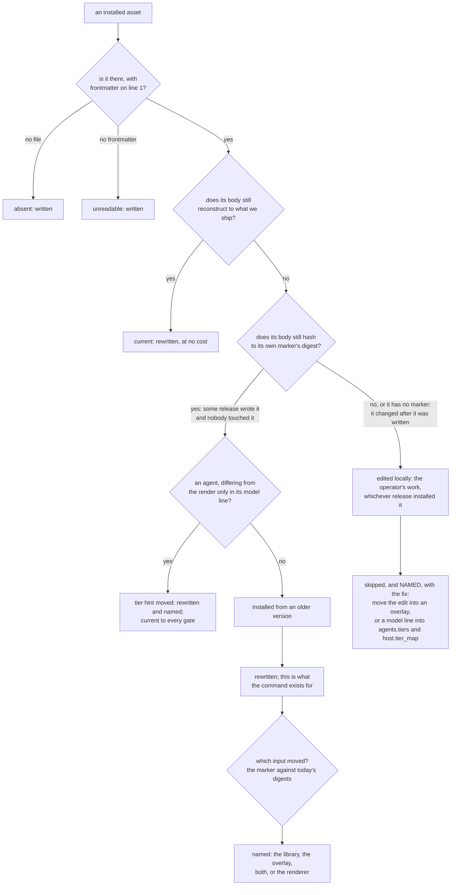

# CLI surface

The CLI is the whole API. Hooks are shims that call it, agents are instructed
to call it, and a human debugging a wedged state calls the same commands.
Nothing reaches the engine another way.

## Conventions

- Every command accepts `--json` and prints a machine-readable result.
- **Every command that resolves a session takes it as `--id <id>`** (IDEA_042).
  One flag, inherited from one shared parent parser, so the synopses below
  leave it out. "Resolves a session" is decided by the code path, not the
  name: the `session` and `pipeline` subcommands that act on one session,
  `check`, `context`, `doctor`, `override`, `standdown`, and every
  `guidelines` subcommand, since each reads the session's worktree as the
  tree in hand. `session start --id` (the id a new session registers under)
  and `session resume --id` (the session to pick up) are their own flags; the
  `hook` command takes none, because a hook is identified by its payload.
  `--id` outranks `INVARIANT_SESSION_ID`, which stays a silent working
  fallback for scripts that export it, and the variable outranks the host
  binding and the working directory as before (state_model.md,
  "Attribution"). Both given and naming different sessions is REFUSED with
  exit 2, naming both, before anything is read or recorded. No message,
  oracle step or shipped agent text offers the variable as a command line to
  copy: a Claude Code permission rule matches a command by its prefix, and
  `Bash(invariant:*)` covers `invariant <command> --id <id>` where a line
  starting with an assignment raises a prompt on every call. A test walks the
  parser and fails when a command whose code path resolves a session lacks
  the shared flag.
- Exit codes: `0` clean, `1` a gate failed or a transition is illegal, `2`
  usage error, `3` state store problem. A gate failure and a crash are never
  the same code, because a shim must be able to tell them apart.
- Every command that mutates state is idempotent where that is meaningful, and
  says so in `--help` where it is not.
- **A blocking gate that did not apply is reported; a gate that passed is
  not.** Without `--verbose` the verdict stream carries failures and
  `block`-level skips, and drops plain passes and advisory skips. A skip and a
  pass are different facts — a pass has vouched for something and a skip has
  not — and collapsing them is how a blocking gate going inert stayed
  invisible (BUG_020). A `block`-level skip renders as `[skip:BLOCK]` and is
  counted separately in the transition summary, because a rule the project
  chose to enforce going inapplicable is news about that project's own
  enforcement. Advisory skips stay behind `--verbose`, where there is nothing
  to act on.

  **A skip states the limit that applies to the call it is answering about.**
  Rendering it separately is only half the job: a skip carrying a reason that
  is untrue of this call, or no reason at all, reads as a pass to the one
  reader who could act on it. `privacy.clean` returned one sentence — "nothing
  in privacy scope was written here" — on every route including the
  shell-mediated write it was false about, and the three rules keyed on the
  same "is this an edit tool" predicate returned a bare N/A whose default text
  is "not applicable here" (BUG_027). Both are now route-specific.
- No command ever writes to the repository outside the state root, **the
  stores the manifest declares** (`items.path`, `paths.memory`,
  `paths.reports`, `paths.sweeps`), the generated files the manifest declares
  and the host assets the host adapter installs (both classes below). One
  command commits what it wrote: `sweep run`, its own record and the items it
  filed, and nothing else.

  This was once a flat list of three exceptions. ADR-002 D4 generalised it
  rather than adding a fourth, and the reason is worth stating: an enumeration
  grows on every feature, and the second exception is always easier to justify
  than the first. Expressed this way, a feature that needs a writable location
  adds a manifest key — which is visible in `config show`, reviewable in the
  manifest diff, and exempt from session isolation by the same mechanism that
  already exempts the backlog — instead of quietly widening a guarantee.

  **A third class: generated files the manifest declares** (ADR-012 ruling
  13). The guidelines domain renders files from the project's ruleset, and
  those files are neither state nor a store: `guidelines.checklist`, the
  managed blocks in `guidelines.instruction_files`, and the ratchet baseline
  `guidelines.baseline`. Only the commands that generate them write them:
  `guidelines render` the first two, and `guidelines baseline --record` and
  `--prune` the baseline. The engine never writes one at the landing; the
  gates only read them. In an instruction file the class is only the text
  between a block's markers; every other line is the project's, and render
  never rewrites it.
  Unlike a declared store, a generated file is **never exempt from session
  isolation**. A render goes through the session's branch and its review
  like any edit, and `guidelines render` and `guidelines baseline` refuse a
  target that `session.exempt_paths` or a declared store would exempt. A store is exempt
  because it holds data every session touches. A generated file is a
  projection of policy, and an unreviewed write to it is a policy change
  nobody reviewed. The two other ways to do this were rejected (ADR-012,
  Alternatives). Printing the text for an agent to write would make fixing
  drift a model's act. Declaring the files as stores would land them
  unreviewed.

  **A fourth class: host assets.** The host adapter installs files where
  its host reads them: for Claude Code, the hook shims under
  `.claude/hooks/`, this library's entries in `.claude/settings.json`, and
  the managed agents, commands and skills under `.claude/`. Only `init`,
  `hooks install`, `agents install` and `assets install` write them, and
  `uninstall` removes them. In the settings file the class is only the
  entries the library wired; every other key is the project's. A managed
  asset an operator has edited is the operator's and is never rewritten
  unasked ("A managed file the operator has edited", below). Unlike a
  generated file, a host asset is a host's own wiring rather than a
  projection of the project's policy, so it stays exempt from session
  isolation under the default `session.exempt_paths` (`.claude/*`), as
  ADR-012's A6 ruling 3 keeps it.
  Which host, and so which locations, is the manifest's `host.kind`.

  One store sits outside every repository and so outside this rule: the
  oracle's user-level directory (`$INVARIANT_HOME`, else `~/.invariant`;
  ADR-007). It holds which projects exist, plus the watcher's derived
  snapshot, alert ledger and log, and nothing of any project's. Only `init`,
  the SessionStart hook and the `oracle` commands write it. Two files lie
  outside both: `oracle install` writes, and `oracle uninstall` removes, the
  LaunchAgent plists under `~/Library/LaunchAgents`, the watcher's and,
  with `--web`, the web page's (ADR-007 D17, ADR-008 D15).

## Setup

```
invariant init [--ecosystem <id>] [--host claude_code] [--profile <name>]
    Write a manifest, install shims, wire host settings, create the state root,
    and add the state root to .gitignore. Refuses to clobber an existing
    manifest without --force; prints a diff of what it would change with
    --dry-run.

    Where the docs directory (`paths.docs`, `docs/architecture` by default)
    does not exist it also writes the docs starter (ADR-018 D11, below). A
    fresh project otherwise began by failing its own docs-first gate with
    nothing to read: `doctor` reported the directory missing and the first
    `pipeline advance` blocked on `docs.read_architecture` — "read the
    relevant doc under docs/architecture" — against a path with nothing in
    it. A directory that EXISTS — even empty — is the project's and is left
    alone, `--force` included: that flag rewrites the manifest, not the docs.
    `--dry-run` lists the writes when they would happen. Written once; no
    command rewrites it afterwards.

    Each declared ecosystem's adapter may add settings its static defaults
    cannot know (`Adapter.init_settings`), written beneath any answer the
    questionnaire gave, and a further ecosystem's commands under its own
    `commands.<ecosystem>` key. Only `sphinx` adds any (ADR-015 D1, built in
    ADR-018 increment 2): `vars.srcdir`, the source directory it detected,
    and, when that `conf.py` lists `sphinx_needs`, a `commands.test` and
    `commands.test_one` that run the needs builder after linkcheck. Two
    candidate trees, none, or extensions it cannot read are each a note in
    the report (`notes` under `--dry-run --json`) naming what to set. A store
    project gets them in its block of the store.

    Built (ADR-016 D4, D5, increment 2): the docs offers. Interactive
    init, and only interactive init, asks; `cli/onboarding` holds the
    offers and `cli/prompts` asks them. Interactive means no `--dry-run`, no
    `--json`, and a terminal on both standard input and output
    (`prompts.interactive`); the seam `_init_prompter` answers a
    `TerminalPrompter`, or `None` for a run that may not ask, and the suite
    replaces it with a scripted prompter rather than faking a terminal.
    End of input answers each question's default.

      1. Where `paths.docs` exists (empty included), init names what is
         there and offers `reuse` (the default: today's result, nothing
         written), `path` (another repo-relative directory, written as
         `paths.docs` in `.claude/invariant.yaml`) or `store`. The store
         choice runs ADR-014's `store init` (no path, or a path holding no
         store) or `store link` (a path holding one), then writes
         `records.docs: store` and a store-relative `paths.docs` into the
         store's `store.repos.<identity>` block. An in-repo manifest
         cannot carry a `store` record (manifest.md, "Records and their
         locations"), so this choice writes NO `.claude/invariant.yaml`:
         the project becomes a store project. A store it created gets
         init's `project` and `enforcement.profile` at its own level; a
         store it linked keeps its own policy, and only this repository's
         block changes. The store file is rewritten whole and left
         uncommitted for review in the store, unless it holds a comment
         (a `#` opening a line or after whitespace): a rewrite would drop
         it, so init writes nothing to that file, prints the exact YAML
         block to add by hand (the keys under `store.repos.<identity>`,
         and any top-level ones), says why, and carries on; `--json`
         carries the same as `store_settings_by_hand` (`{"path",
         "reason", "yaml"}`, null when everything was written). A store
         init itself created holds no comment, so it is always written.
         Until the block is added, the project resolves as the store's
         file says, so the assessment reads the docs that file names. The store
         is not offered, and the offer says why, outside a git repository,
         below its top level, or in an in-repo project (`store migrate`,
         ADR-014 increment 7). A path that climbs out with `..` or is
         absolute is asked again. The existing directory is never written;
         the starter goes to the chosen location when it is absent.
      2. The assessment (`invariant docs assess`) runs on the chosen
         location and prints its gaps.
      3. Where there are gaps, init offers `not_now` (the default: writes
         nothing), `incremental` (writes `docs.onboarding: incremental`, with
         the rest of init's writes since ADR-017 increment 2,
         which injects `docs.area_documented` at every landing)
         or `all_at_once` (writes `docs.onboarding: all_at_once`, then the
         plan of ruling 9). When the base already carries the manifest, a
         store project or a re-run whose `.claude/invariant.yaml` is
         committed at HEAD, init records the plan as `docs assess --plan`
         does; otherwise it records nothing and says to commit its files,
         then run `invariant docs assess --plan`. init still never commits.

    Non-interactive init (ruling H) writes exactly the files it always did
    and asks nothing. It prints the assessment after its report, and under
    `--json` carries it as `docs_assessment`, the `docs assess --json`
    document (`{"error"}` when it could not run: reported, never a failed
    init). `--dry-run` assesses the manifest it would write over the tree as
    it stands.

    Built (ADR-017, increment 1): the configuration report. A
    non-interactive `init` (no prompter: `--dry-run`, `--json`, or no
    terminal) writes exactly the files it wrote before, byte for byte, and
    after everything else it reports, the assessment included, lists each
    core question's resolved value and provenance, then the line naming
    `invariant configure`:

      configuration (core questions):
        project.ecosystems              [python]           repo:.claude/invariant.yaml
        commands.test                   pytest             adapter:python
        commands.test_one               pytest {selector}  adapter:python
        enforcement.profile             standard           repo:.claude/invariant.yaml
        methodology.pipeline            tdd                default
        methodology.gates.coverage_min  85                 user:~/.invariant/config.yaml
        paths.docs                      docs/architecture  default
        docs.onboarding                 off                default
      run 'invariant configure' to change them

    The rows are the core sections of `core/questionnaire`'s catalogue
    (ADR-017 D1), the commands narrowed to `test` and `test_one`, the
    primary's and then each further ecosystem's (`commands.<eco>.test`).
    Each value and label is the one `config show --provenance` prints for
    that key, read from the same resolved manifest; that is why
    `project.ecosystems` reads `repo:` here, where an interactive run's
    pre-fill (D10, increment 2) would read `detected`. `--dry-run` lists what
    the manifest it would write resolves to. Under `--json` the same is the
    `configuration` field, a list of `{"id", "key", "value", "provenance"}`,
    the id being the question's (`docs:location` for `paths.docs`,
    `commands:test` for `commands.test`), or `{"error"}` when it could not be
    resolved: reported, never a failed init. An interactive run lists
    nothing. `invariant configure` itself is increment 3 (below).

    Built (ADR-017, increment 2): interactive `init` asks the core
    questions. The catalogue is data (`data/questionnaire/catalogue.yaml`,
    `core/questionnaire`), and `cli/configure` asks it through the same
    `Prompter`. First the target level: `user` (`defaults:` in
    `~/.invariant/config.yaml`) or `repo`, default `repo`; a fresh project has
    no store yet, so `store` and `store-repo` are not offered. Then the core
    sections in catalogue order, each question shown with its default and
    where that comes from, "(now standard, from default)": the ecosystems
    (pre-filled from the adapters' detection, "from detected"), the commands
    step (every command of every declared ecosystem in one table with its
    default and provenance, then "change any?", default no; yes walks them one
    by one, and Enter keeps a command's default), the profile, the lane
    (`methodology.pipeline`) and the coverage floor, then the docs step, which
    is ADR-016 D4's offers above in their order, with their defaults and
    meaning. A flag given is an answer, checked like a typed one and not
    asked: `--profile`, which has no parser default any more (absent, a
    non-interactive `init` writes `profile: standard` as before), and
    `--ecosystem`. A flag refused is exit 2, before anything is written.

    Every answer is checked as the configuration it produces: the config
    levels with every answer so far placed at its level, resolved through the
    manifest's own `validate`. A refusal prints the manifest's reason and the
    question is asked again (a floor of 101: "methodology.gates.coverage_min
    must be a number from 0 to 100, got 101"). A choice is checked against its
    choices and a path against the path rule first, so the refusal names the
    options, and a command against its shape only, never run: one non-empty
    line, the placeholders the engine substitutes for it present (`{selector}`
    for `test_one` and `coverage_one`), and none that nothing substitutes (the
    engine's `{result_bundle}`, `vars` or `discover`). An answer its level may
    not hold goes to the nearest level that may, saying so beside it:
    "project.ecosystems goes to repo: the user level may not hold project".

    Nothing but a chosen store is written until the last answer. Then only
    answers that differ from the default they were shown with are written, at
    their level; one equal to what the levels below its level resolve, at a
    level that sets the key, removes the key there and says so (ruling 12).
    The user level is written through `core/home.write_user_defaults`, merged,
    unless the file holds a comment: then nothing is written to it, and the
    `defaults:` block to add by hand is printed, and carried under `--json`
    in `settings_by_hand`, a list of `{"path", "reason", "yaml"}` (`[]` when
    every file was written; the store's held block is in it too, and keeps
    its own `store_settings_by_hand`). The repo level's answers are folded
    into the manifest init writes, so accepting everything writes the
    `project` block and init's comment, and no `enforcement` block: a profile
    set at the user level keeps applying. Where the docs step chose a store,
    the project's repo level is its pointer, which init does not write, and an
    answer aimed at it goes to the store's block for this repository, saying
    so. The docs step's assessment reads the candidate configuration, as
    `--dry-run` does, so an absent docs directory is assessed as absent and
    the starter is written after the offer; `docs.onboarding` is written with
    the rest, and an all-at-once plan is recorded after the writes from the
    docs as written. An interactive run lists no configuration report.

    The questionnaire's prompter comes from its own seam,
    `_questionnaire_prompter`, beside `_init_prompter`, which answers the
    docs step; both answer by `prompts.interactive`. The suite replaces each
    on its own, so a run whose questionnaire is not asked (only the docs step
    scripted) writes the body init always wrote.

    Accepted, not yet built (ADR-017, increments 3 and 4). Then one
    question, "configure advanced settings?", default no, which opens agents,
    guidelines, records and store, privacy and session, and a review where any
    answer can be moved to another level; the `store` and `store-repo` levels
    for a store project. Scripted: `--set <id>=<value>`, `--answers
    <file.yaml>`, `--yes` and `--level`, each answer validated the same way
    and refused with exit 2 before anything is written; `--questions
    [--json]` prints the questions instead of asking them. Non-interactive
    `init` without those flags writes today's files byte for byte and adds
    the report above. `init` never rewrites an existing manifest for this;
    that is `invariant configure` (below). Increment 1 of ADR-017 built the
    non-interactive report, 2 the interactive core, 3 builds the scripted
    flags, and 4 the advanced step and the catalogue at the levels.

    Built (ADR-018 D10, D11, increment 4): the docs starter. `init`,
    interactive or not, writes a sphinx-needs docs project wherever
    `paths.docs` / `records.docs` resolves (the Markdown `overview.md` is
    retired). Its source directory is the one above `paths.docs` (`docs/`
    around `docs/architecture`, D3), and it holds, from the templates under
    `data/scaffold/sphinx/`: `conf.py` (sphinx-needs and sphinxcontrib-mermaid;
    `needs_types` from the configuration's need types, the seven baseline
    ones by default; `needs_links` with dang's set plus `amends` and
    `supersedes`; `needs_fields` with `design_link` and, read from the items
    page at build time, every option an item carries; `needs_id_required`,
    `needs_id_regex`, `needs_build_json`; the keys of the pinned sphinx-needs,
    which warns on the deprecated ones), `index.rst` (a toctree of every
    page), a fully pinned `requirements.txt` (the set the suite builds the
    starter in), `.gitignore` (`.venv/`, `_build/`),
    `<paths.docs>/overview.rst` (the three sections the assessment requires
    by default, any further `docs.assess.sections` heading, and one `element`
    need per source area, its id the element prefix and the area name as a
    need id, the path where two names collide), `requirements.rst`,
    `decisions/index.rst`, `ui.rst`, the generated `rules.rst` and
    `checklist.rst` (rendered from no ruleset, with the managed marker, so
    `guidelines render` takes them over), and `backlog.rst` (the items
    store). The manifest gains `docs.format: sphinx`, `docs.needs.state:
    enforced`, `docs.needs.srcdir` and `items.backend: sphinx_needs` with
    `items.path` the backlog page (a store project: in its block, with
    `records.backlog: store`). The starter is not written, and the project
    is left migrating with a note naming why, where the source directory
    would be the root, already holds a `conf.py`, or holds a file the
    starter would write. Only an interactive `init` creates the docs
    environment (`docs venv`, which needs the network); a failure is
    reported and is never a failed `init`. Without a terminal, and under
    `--dry-run`, it writes (or lists) the same files and names `invariant
    docs venv`; `--json` carries `docs_venv`: `{"created", "srcdir",
    "command"}` and `error` when one was met, null with no starter. The
    `docs` step still asks no format. `init --force` over an enforced
    manifest keeps the keys that make it enforced.

    A successful, non-dry-run `init` also registers the project in the
    oracle's index (`via: init`; see "Oracle" below). A failure to register is
    REPORTED and never fails the command — the project is initialised by then
    — and the note names `invariant oracle projects add` as the retry. The
    JSON result carries `oracle`: `{"added", "key"}`, or `{"error"}`.

invariant uninstall [--remove-assets] [--remove-manifest] [--dry-run]
    Remove the hook shims, unwire the entries this library added to the host
    settings file, and SAY WHAT IS LEFT BEHIND.

    The inverse of `init`, and it exists for the reason `init` does not need
    one stated: adoption was one command and withdrawal was hand surgery —
    delete each shim, then hand-edit the JSON `_wire_settings` merged its
    entries into, and know which entries were the library's. Miss one and the
    shim still fires; it then finds no `invariant` on PATH and exits silently
    BY DESIGN, so the leftover is invisible until it is not. The right to stop
    using a tool is part of authority over one's own project (IDEA_004).

    Two properties matter more than the command existing:

    * **It removes only what it wrote.** `_wire_settings` recognises its own
      entries by the shim path; removal is the same test, in one function, so
      an install that recognises its entries and a removal that does not is
      impossible to write. Everything else in the settings file is left exactly
      as found, and an emptied event list is deleted rather than left as `[]`.
      Malformed JSON is REFUSED rather than overwritten — the same care
      `_wire_settings` takes, and more so: there a bad parse costs the operator
      their wiring, here it would cost them the whole file as the last thing
      the tool ever did to their project.

    * **It never deletes the operator's data.** Sessions, work items, memories,
      architecture docs and the manifest survive by default, so uninstalling is
      not a decision about the backlog. An asset the operator has EDITED
      survives even `--remove-assets`, by the same rule `assets install`
      follows. `--dry-run` enumerates before anything moves, which is not a
      nicety here: what a removal takes away cannot be got back by running it
      again.

    An agent whose render the install refuses (an overlay that does not
    apply, a shipped source that does not parse) does not refuse the
    removal (ADR-012, A6 increment 4). Its copy is judged against the
    render without the overlay, which gives the same answer, because the
    classifier reads the copy's own witness: an untouched copy is removed
    and an edited one kept. A source that does not parse leaves nothing to
    judge against, so its copy is kept and listed under `kept`. An
    agents.library name the library does not ship still refuses it.

    A COMPLETE removal stops reading as broken. `doctor`'s shim check used to
    offer `hooks install` for any absence, pushing back toward the state the
    operator was leaving; where every shim is gone it now says "not installed"
    and names `invariant init` as the way back. A HALF removal is still
    reported as broken, because it is.

invariant doctor
    Check the installation: manifest valid, shims present and executable, host
    settings wired, state root writable, adapter commands resolvable, memory
    index current. One line per check, exit 1 if any fails. A row that
    warns passes: it prints `warn` and never sets the exit code.

    `user defaults` (ADR-014 D3, ruling 19) names every value resolved
    from the user level, `~/.invariant/config.yaml`, with its key and the
    file, or says none does. It informs and never fails. A user level that
    does not load fails `manifest valid`, naming the file.

    `repo identity` (ADR-014 D4), in a store project only, names the
    identity, the store and the level that named it. It warns when the
    repository was linked by its local ID and has since gained an origin,
    offering `invariant store link --update`.

    Accepted, not yet built. ADR-014 D8 names an active
    `privacy.store.scan` exception; D11 adds rows for the user-level install
    (`permissions.additionalDirectories` and the install receipt). Increment
    3 builds the D11 rows and increment 6 the D8 row.
    ADR-015 D2 makes the command rows follow the lanes the project's sessions
    can run: a command is required when a selectable lane carries a gate that
    runs it, each row names that lane and gate, and `commands.build`, which no
    gate runs, is reported rather than required, and D5 names the measured
    median, the budget and which side of it the project is on. It also adds
    a `commands` command group (`commands derive`, with `--accept`,
    `--update` and `--measure`, D3 to D5) and the rule
    `commands.derivation_current`; this file gains their sections when they
    are built. Increment 2 of ADR-015 builds the D2 rows, increment 3
    `commands derive` and the rule, and increment 4 `--measure` and the D5
    row.

    `coverage` (ADR-015 D1, built in ADR-018 increment 2), once per declared
    ecosystem whose adapter declares coverage not applicable, reads `not
    applicable (sphinx): a documentation build executes no measurable lines`
    and passes, so an unset coverage command reads as the stated choice it
    is.

    `docs assessment` (ADR-016 D3, increment 1) asks the rule
    `docs.assessment` directly, as the guidelines rows do, and lists the
    gaps by check: required sections found in no doc, source areas no doc
    names, and relative links whose target file is missing (see `invariant
    docs assess` below). Its level is the rule's under `enforcement.rules`:
    `warn` in every profile, so gaps print `warn` and never make `doctor`
    exit 1; `block` (or `ask`) makes the row fail; `off` removes it. With
    every check off it says so and passes. The architecture-docs row above
    it is unchanged.

    `docs adoption` (ADR-016 D8, ruling 3, increment 4) is present only
    under `docs.adopt.mode: copy`. It reads the receipt the copy wrote and
    names every original file changed, added or removed since, or says the
    original is unchanged. It warns and never fails, and it also warns
    on a missing or unreadable receipt and on an original not reachable on
    this machine. Nothing re-syncs: its fix is re-running `docs adopt`
    (below). A project that adopted nothing has no such row.

    Built (ADR-017 ruling 13, increment 2). The `command shape` row warns,
    and never fails, naming each configured command of every declared
    ecosystem that is not one non-empty line, lacks a placeholder the engine
    substitutes for it (`{selector}` for `test_one` and `coverage_one`), or
    names one nothing substitutes, with its key and what is wrong. It reads
    the questionnaire's own check (`core/questionnaire.command_problems`),
    so a typed and a hand-written command are judged alike; a misshapen
    command still loads.

    Built (ADR-018 D4, D10, increment 3). The `docs mandate` row passes for
    an enforced project and fails for one still `migrating`, naming the
    migration (D14) and its last step, `docs.needs.state: enforced`, so the
    debt is never silent; increment 7 proves it passing for invariant itself.
    The `docs venv` row: the docs environment is present, matches
    `requirements.txt` (the hash recorded in it) and its `sphinx-build
    --version` runs; each failure names `invariant docs venv`. While a
    project migrates on a docs format other than `sphinx` it passes, saying
    the environment is not required until the migration. The `plantuml` row,
    present only when `docs.diagrams` lists `plantuml`, checks that the
    program of the command `conf.py` assigns to `plantuml` (read without
    running it; the extension's default `plantuml` otherwise) is found on
    `PATH`, because PlantUML needs Java outside the environment. Nothing is
    run but `sphinx-build --version`.

    A failing row names its remedy. The architecture-docs row used to say
    only "docs-first is core policy", which told a fresh adopter the rule
    they were about to be blocked by and nothing about satisfying it; it now
    says to create `overview.md` there (`init` scaffolds one when the
    directory is absent) or to set `docs.read_architecture` to `warn`.

    It also reports what was left PARKED here — sessions whose host binding is
    spent, and live sessions with an open plan — which `end_host_session` has
    promised in its docstring since it was written. Those two rows are
    INFORMATIONAL and never fail: any false row makes this command exit 1, and
    a parked session is the designed resting state of a plan that spans several
    host sessions. A `doctor` that goes permanently red on every project which
    adopts a checklist is the gate that gets ignored, and then switched off.

    The `coverage advisory paths` and `sweep cadence` rows are informational
    in the same way: the first names a configured `coverage_advisory_paths`
    as an active exception, the second the sweep cadence, its scheduled gates,
    any `held_paths` and the last sweep's age, prefixed STALE when
    `sweep.fresh` would warn (ADR-010 D6). A late sweep is that rule's
    warning, never a failed diagnosis.

    The `guidelines ruleset` row is `guidelines.ruleset_valid`'s verdict on
    the tree in hand: "no guidelines ruleset configured" passes, a ruleset
    that validates passes naming its guideline count and digest, and one that
    is configured but missing, outside the project or invalid FAILS, naming
    every problem (ADR-012 D3). It asks the rule directly, so a level or a
    stand-down holding the gate does not change what the diagnosis reports.

    The `guidelines generated` row is `guidelines.generated_current`'s
    verdict, asked the same way: "no guidelines ruleset configured" passes,
    every generated output current passes naming the count and the ruleset
    digest, and drift WARNS, naming each output (a checklist missing, stale
    or edited by hand; a block stale or edited by hand) and the command that
    fixes it. It never fails, so drift alone never makes `doctor` exit 1: the
    row warns as the gate does at the landing (ADR-012, A2 increment 5, by
    user ruling). A plan refusal warns here as well, naming the refusal and
    its fix; a ruleset that does not load is the `guidelines ruleset` row's
    failure, not this one's. A warned row prints `warn` in the status column
    and carries `"warn": true` beside `"ok": true` in `--json`; every other
    row carries `"warn": false`.

    The `guidelines always layer` row appears only when the ruleset has
    `always` rules and no instruction file carries the guidelines/index
    block (ADR-012, the A5 ruling D12, A5 increment 4). It WARNS, naming how
    many always rules there are, the instruction files it looked in and the
    fix, `invariant guidelines render --insert guidelines/index`; with no
    instruction file configured (guidelines.instruction_files null and a
    host kind with no default) the fix names that key first. It never
    fails: the turn index still lists the always rules on every turn. With
    no ruleset, no always rules, a block present in any instruction file
    (whatever its state) or a render plan that is refused, there is no row.

    The `guidelines baseline` row reads the ratchet baseline the way the
    gates do (ADR-012 D6, A3 increment 5): "no guidelines ruleset
    configured" and "no baseline configured" pass, and a baseline that reads
    in full passes naming its entries, the findings they hold, the files and
    guidelines they cover, and its path. A baseline that is missing,
    unreadable, malformed, exempt or outside the project WARNS, naming every
    problem and the fix, and never fails: the gates that read it fail at the
    landing, and a ruleset that does not load is the `guidelines ruleset`
    row's failure. A warned row carries `"warn": true` in `--json`.

    The `library agents current` row is `agents.rendered_current`'s verdict
    over the host's own install plan (ADR-012, A6 increment 4): its message,
    its detail and each fix as `try: <fix>`, so the row and the rule give
    one answer. It passes naming how many library agents are current, and
    WARNS on any agent that is absent, older or edited locally (the user's
    A6.4 ruling), naming each one as the rule does; drift alone leaves
    `doctor`'s exit code clean, and the row carries `"warn": true`. A plan
    the install refuses, an unparseable shipped agent source, a broken
    overlay or an unshipped library name among them, is a defect and FAILS
    the row naming the refusal rather than stopping the diagnosis. With an empty agents.library there is no row.
    Commands and skills keep their own currency rows, which no rule reads.

    A copy whose tier hint moved is current on that row. The `agent tier hints`
    row names it, `<name> (tier hint moved)`, with `invariant agents install`
    as the way to apply it (the A7 ruling 6). It reads no gate and no gate reads
    it. It carries `"warn": true`, never fails, and is absent while no hint has
    moved or the plan is refused.

    The `claude window environment` row is machine-wide and warns, never
    fails (IDEA_035). It lists every running `claude` from one `ps -axo
    pid=,tty=,comm=` and reads each one's OWN environment as it was started,
    with `ps -E -ww` on that pid, never `doctor`'s: Claude Code sets markers
    on its tool shells, so `doctor` run from a clean host's shell carries
    them and proves nothing. A host warns when its environment carries
    `CLAUDE_CODE_CHILD_SESSION` or `COLORTERM=truecolor` and the parent chain
    shows Terminal.app started it with no other `claude` between: a
    Terminal.app started from a Claude tool shell before BUG_068's scrub
    hands both to every window it opens, so Claude draws colour Terminal.app
    cannot show and writes no transcript and no per-process record (BUG_099).
    The row names each such host by pid and terminal and the remedy, "quit
    Terminal.app fully and relaunch it from the Dock"; with none it passes,
    saying how many windows it read, and how many could not be read. Only the
    two names are reported; no other variable and no value is shown or kept.
    iTerm and editors set `COLORTERM` themselves and are not judged, and a
    Claude started by a Claude inherits by design. The suite replaces the
    read (`_doctor_host_environments`) everywhere.

    When the oracle's LaunchAgent is installed, one more row, `oracle agent
    interpreter`, fails if the interpreter its plist names no longer exists:
    an editable install can move, and the agent would then fail at every
    login without a word. The remedy is `invariant oracle install`. The row
    reads the plist only and asks launchd nothing; with no plist there is no
    row. Beside it, while a fresh snapshot shows a watcher running, `oracle
    watcher build` fails when that watcher runs an older invariant than the
    installed one: its stamp differs, it wrote none, or it reports a skew
    itself (BUG_089). It restarts itself once it notices; `invariant oracle
    install` restarts it now.

    When the web page's LaunchAgent is installed, two more: `oracle web
    interpreter`, the same check on its plist (remedy `invariant oracle
    install --web`), and `oracle web page`, which passes while the process
    that last reported in <oracle home>/oracle/web.json is alive and no bind
    error stands. Its detail is where the page serves (or that it waits for
    Tailscale, which passes), the paired device count and the last action
    from the audit log. Both read files and ask launchd nothing (ADR-008
    D17). While that process runs, `oracle web build` fails when it runs an
    older invariant than the installed one, as the watcher's row does. When that report names a certificate, a third row, `oracle web
    certificate`, fails while the page is served over plain HTTP (its detail
    says why: HTTPS Certificates off in the Tailscale admin console, or
    Tailscale not answering) or once fewer than 14 days remain before the
    certificate expires (ADR-008 D21, D23).

    The "hook shims actually run" row executes every installed shim, so it
    proves the shim resolves the CLI, the engine imports, the rules evaluate
    and a parseable verdict comes back without the degraded marker. Running a
    hook is delivering an event, and every hook is a writer — so each probe
    payload carries `invariantProbe: true`, and `invariant hook` answers a
    probe from a state store that reads the real state and discards every
    write. The payloads used to be harmless by choice instead (no session id,
    no file path), and the hook found the caller anyway through the
    `INVARIANT_HOST_SESSION_ID` it inherits: the session-end probe ended the
    caller's real host binding, and the parked row below then reported the
    caller's own live session as parked (BUG_059). The guarantee sits at the
    store because identity has more routes than the environment — cwd and
    worktree resolve a session too — and a store that writes nothing covers
    every write path, present and future, at once. A shim that execs an OLDER
    build of the library does not know the marker and is not covered.

    A manifest that will not LOAD is one of those checks and not a reason to
    stop: this is the command someone runs because the manifest is wrong, and
    it used to resolve the manifest before it could report anything, so a
    refusal at load took out the one command that would explain it (BUG_050).

invariant assets list [--kind agent|command|skill]
    Every host asset: kind, whether the host can load it, and whether this
    library or the project owns it.

    The asset commands (assets list, assets install, agents list, agents
    show, agents install) ask the manifest's host.kind for the host adapter, since the
    files are that host's format in that host's locations. A kind with no
    adapter in this release is refused by name, exit 2, before anything is
    read or written; claude_code is the only one (ADR-012, the A6 ruling 12).

invariant assets install [--kind ...] [--overwrite-local] [--dry-run]
    Reinstall library-shipped assets and nothing else. Not a flag on `init`:
    `init --force` rewrites the manifest, so routing a repair through it would
    trade a broken asset for a discarded enforcement configuration.

    An asset you have EDITED is skipped and named, whichever release
    installed it. See "A managed file the operator has edited" below.
    --overwrite-local asks for the shipped version back; --dry-run enumerates
    every target, its divergence, and whether the run would write it.

    It reads the install plan, ClaudeCodeHost.plan_assets, which is the
    one plan: `doctor`'s currency rows, `agents install`, `init` and
    `uninstall --remove-assets` read it too, so no two of them can classify
    one target differently.

    Each rewritten stale copy says which input moved: `agent:<name> — the
    overlay changed` (or the library, both, or the renderer; see "A managed
    file the operator has edited" below), and --dry-run appends the same to
    the target's line. --json carries it as `changed`. A skipped agent adds
    the hint to move the edit into an overlay, or a model line into agents.tiers
    and host.tier_map.

invariant agents list
    Every library agent: installed or not, whether the host can load it,
    which pipeline role it answers for, and its capability tier (ADR-012 D9):
    `tier deep (source) -> <value>`, `tier light (agents.tiers), not mapped`, or
    `no tier`. --json carries them as `tier`, `tier_from` and `mapped`. The
    library is the manifest's agents.library (ADR-012, the A6 ruling 11).

invariant agents show <name> [--sections]
    One library agent as the host would install it, without the marker an
    install adds. Writes nothing. The text is the host adapter's render of
    the agent's host-neutral source (ADR-012 D8, A6 increment 2) with the
    project's overlay applied (agents.overlays, A6 increment 3): for Claude
    Code, the capabilities as a `tools:` line, the section anchors dropped,
    and a `model` line only where host.tier_map maps the agent's tier (ADR-012
    D9, A7 increment 2). Printed byte for byte, so it can be redirected and
    diffed against an installed copy. --sections lists the section anchors
    instead, in order, those an overlay inserts included: the ids an overlay
    can target. A name the library does not ship is refused naming the ones
    it does, exit 2, and the host is the manifest's host.kind, as for the
    other agent commands. An overlay that does not apply is refused as the
    install refuses it.

    A body names the invariant commands it runs as literal text, so the
    render never reads the ruleset (A6 increment 5). Every command a shipped
    body names, in a code span or on a line of its own, parses with this
    CLI's parser (tests/test_agent_bodies.py): a renamed flag or subcommand
    fails a test instead of leaving an instruction nobody can run. The
    review agent runs, in order, `guidelines show --phase review --touched`,
    `check guidelines.mechanical_clean`, `guidelines verdicts show`, and one
    `guidelines verdict` per owed rule, and pastes the standings into its
    report.

invariant agents install [--overwrite-local] [--dry-run]
    Reinstall the library agents and nothing else. Deliberately not a flag on
    `init`: `init --force` rewrites the manifest, so routing an agent repair
    through it would trade a broken agent file for a discarded enforcement
    configuration. Same edit protection as `assets install`, and it matters
    more here: this is the command `doctor` actually points people at. It is
    that command's plan and writer narrowed to agents, and its loadable row
    is `doctor`'s row, naming `agents install` as the repair; it once kept a
    classifier loop, a writer and a check of its own.

    It installs what agents.library lists, and never touches an agent in
    agents.local. Each agent is rendered with its overlay, if
    agents.overlays names one (ADR-012 D8, A6 increment 3; manifest.md,
    "Agents: the library, the project's own, and overlays"). Each rewritten
    stale copy is named with the input that moved, `updated <name> — the
    overlay changed`, and --dry-run says the same. A copy whose tier hint moved
    is rewritten too, `updated <name> — the tier hint changed`. An edited copy
    is skipped and named, with the fix to move the edit into an overlay, or a
    model line into agents.tiers and host.tier_map.

    A bad overlay is refused before anything is written, exit 1, by this
    command and by `assets install`, naming each problem with its fix: an
    unknown key or operation; an anchor the agent does not carry, with the
    nearest real one; an inserted id that is already a section; an overlay
    path outside the project, exempt from session isolation (an overlay is
    policy, ADR-012 D10) or naming no file; and a privacy finding the
    overlay brings into the merged text. So is an agents.library name the
    library does not ship. `doctor` reports the refusal on its `library
    agents current` row rather than failing to run, and so does
    `agents.rendered_current`.

    --dry-run --json carries `plan`, one entry per agent with its
    `identity`, `state`, `write` and `changed` (the input that moved), as
    `assets install --dry-run` does, beside `would_install` and
    `would_skip`. That plan is what `agents.rendered_current` reads.

invariant config show [--provenance]
    Print resolved configuration and where each value came from: a label
    per value, `default`, `adapter:<eco>`, `profile:<name>`, and the config
    levels (ADR-014 D3): `user:<file>` for the user level's defaults,
    `store:<name>` and `store:<name>#<identity>` for a store and its block
    for this repository, `repo:<file>` for the repository's own level
    (`repo:.claude/invariant.yaml`, or the pointer `repo:.invariant.yaml`),
    and `env:<variable>`.

invariant configure [section...] [--level user|store|store-repo|repo]
                    [--set <id>=<value>]... [--answers <file.yaml>] [--yes]
                    [--questions] [--dry-run] [--json]
    Accepted, not yet built (ADR-017 D7, D8, increment 3; the advanced
    sections with increment 4). Ask `init`'s questionnaire again on an
    initialised project, whole or by section, each default the value the
    project resolves to now with its provenance. Writes only changed answers,
    at their levels, through the level writers and their comment rule: a file
    holding a comment is not rewritten and the YAML to add by hand is
    printed, except that the comment `init` itself writes does not count
    (ruling 9); `--json` carries held files as `settings_by_hand`. It writes
    configuration only and never commits; a change to `agents.library` or
    `guidelines.*` names `invariant agents install` or `invariant guidelines
    render` rather than running them. It writes the manifest of the tree it
    stands in. `--questions --json` prints every question with its id, key,
    kind, choices, default, provenance, current value, allowed levels and
    required placeholders, for an agent or the oracle page to render and
    answer through `--answers`. Refused, exit 2: outside a project (naming
    `invariant init`), a section the catalogue does not hold (naming those it
    does), and any scripted answer that does not validate, with nothing
    written.

invariant store init [PATH]
    Create a store for the repository you stand in, and link it (ADR-014
    D2). PATH defaults to ~/.invariant/stores/<name>, named by the user
    level's store_naming (ruling 14): `repo`, the origin's last segment or
    the directory name; `url`, the origin with slashes as underscores. Under
    `repo`, a name another store or directory already holds falls back to
    the `url` form (the local ID, `:` as `_`, with no remote), and the output
    names both. The store is a new git repository holding invariant.yaml,
    which names the project and lists the repository under store.repos. It
    is left uncommitted, to be reviewed and committed in the store. Refused:
    outside a git repository, in an in-repo project (moving records is
    `store migrate`, increment 7), at a store already listing this
    repository (link it instead), and at a PATH that is not empty.

invariant store link [PATH] [--update]
    Link the repository to the store at PATH from the user level: the
    repos: entry in ~/.invariant/config.yaml, the repository's invariant.id
    in its local git config (written even when it has a remote, D4), and
    the linked-identity index ~/.invariant/linked-repos.txt, which a
    user-level hook shim reads (D11). Nothing is written to the repository's
    tracked files, and the other keys of the user config are kept. Refused,
    writing nothing to the user level, when the store does not list the
    repository under store.repos (the refusal names the line to add) or the
    repository is already linked to another store. Linking again is a no-op.
    --update re-keys a link made by local ID onto the origin added since,
    once the store lists the origin; `doctor`'s `repo identity` row offers it.

invariant store status [--quiet]
    Exit 0 when the repository you stand in is linked to a store, naming the
    identity and its source, the store, the level that named it and the
    records it holds; exit 1 otherwise, saying why (an in-repo project, no
    project, a refused link). --quiet prints nothing and only answers: the
    guard a user-level agent runs first (D11).

invariant docs assess [--json]
    Print the assessment of the architecture docs (ADR-016 D1 to D3,
    increment 1): every gap by check, a line `<check>: off` for each check
    `docs.assess.checks` leaves out, then a one-line summary and the input
    digest. Read-only. Exit 0 whatever the gaps; 2 on a configuration it
    cannot load. The docs are read at the resolved `paths.docs`, joined onto
    the store root under `records.docs: store`. `domains/docs` owns the
    assessment:
      sections  each heading of `docs.assess.sections` found in no doc,
                compared after whitespace normalisation and case folding,
                counted once across the docs
      areas     each source area no doc names as a whole word; the areas
                come from the adapter's `source_areas` hook, from globs or
                from a declared list (`docs.assess.areas`), less `exclude`.
                An adapter that cannot tell is a gap naming the ecosystem.
                Where the docs are a sphinx-needs project (`docs.format:
                sphinx` and the docs project's `conf.py` lists
                `sphinx_needs`), only an `element` need's title and content
                name an area (ADR-018 D11); prose elsewhere does not
      links     each relative link whose target does not exist, by file and
                line. Anchors and queries are stripped; external URLs and
                root-absolute paths are never checked
    Headings and links are read through `core/docformat`'s reader for
    `docs.format`. Markdown has one, and so has `sphinx`, which reads the
    `.rst` files (ADR-018 increment 2): section titles, and the `:doc:`,
    `toctree`, `:download:`, `include`, `image` and `figure` targets and
    hyperlink targets, a document name resolving to its `.rst` file, with
    literal blocks, code directives and comments skipped. Any other format
    makes `sections` and `links` report "not assessable: no reader for
    <format>", never a pass, and `areas` reads every file's text. Files are read in sorted order and
    the digest covers every input (the settings, each doc's bytes, the
    areas, each link target checked), so two runs over an unchanged tree
    print byte-identical output. Anything under a dot-named directory of the
    docs is held out, and so is any dot-named file, the adoption receipt
    among them. `--json` carries the same, the gaps under `checks`.
    Under `docs.adopt.mode: copy` an `adoption drift` heading follows the
    digest, naming each original file changed, added or removed since the
    copy (`domains/docs.adoption_drift`, the `doctor` row's own read), and
    `--json` adds it as `adoption`. Without that mode neither appears, so
    the output is what it was before increment 4.

invariant docs assess --plan [--json]
    Record the all-at-once plan (ADR-016 D5, ruling 9, increment 2): a
    parked `docs`-lane session, `document-architecture-<id>`, whose plan
    holds first one `Write the missing sections: <list>` line when the
    `sections` check has gaps, then one `Document <area>` line per area no
    doc names (`domains/docs.plan_deliverables`). A gap no doc can close
    (a check with no reader, areas that cannot be derived) and a broken
    link are not planned. The session binds no host and is registered as put
    down (`SessionDomain.start(parked=True)`), so `doctor`'s parked row and
    the greeting offer it and `session resume` picks it up; its `docs`
    pipeline starts in `drafting`, and each deliverable is written and
    reviewed through that lane. The output never prints `session <id> (`,
    the binding sequence, so the command that records the plan is not bound
    to it. Refused, exit 2, until the base carries the manifest: in an
    in-repo project, `.claude/invariant.yaml` committed at HEAD. A second
    run while the plan is parked is refused by `session start`'s fork
    guard, naming it. No gap a doc can close records nothing and says so.
    `--json` adds `plan`: `{"session", "id", "deliverables"}`, or null.
    `init`'s all-at-once choice runs the same code.

invariant docs adopt <source> --mode in_place|copy [--force] [--dry-run] [--json]
    Adopt existing documentation as the architecture docs (ADR-016 D7, D8,
    increment 4). The mode is configuration, not a flag of each later run:
    the command writes `docs.adopt.mode` and `docs.adopt.source`, at the
    project's own level (the in-repo manifest, or this repository's block in
    its store, as `init`'s store choice writes it). `<source>` is a
    directory, read against the working directory when relative; dot-named
    files under it are held out, and one holding no other file is refused.
    `docs.format` is set from the source's detected format
    (`core/docformat.detect_format`: the format most of its document files
    carry, `.rst` read as `sphinx`).
      in_place  `paths.docs` points at the source, and under a store
                `records.docs` names the root it lies under (`repo` or
                `store`). The source must lie under the repo root or the
                store root, below the root itself, because a path key cannot
                be absolute (ADR-014 D1); outside both it is refused,
                offering copy. A format with no reader is refused naming it
                and offering copy (ruling 5). Nothing is copied, so the
                docs-first gate reads, and agents update, the original.
                Markdown is refused in place, offering copy (ADR-018 D11):
                Markdown is adopted by copy only, into a migrating project,
                whose migration converts it.
      copy      every file is copied into the resolved docs location (repo,
                or store under `records.docs: store`), and the original is
                never written. Any format copies; one with no reader is
                said at copy time to make the `sections` and `links` checks
                report not assessable (ruling 10). The receipt
                `<docs location>/.invariant-adoption.yaml` records the
                source, the time, and per file the SHA-256 of the original
                and of the copy. The source is spelled relative to the root
                `records.docs` names when it lies under it, else as given,
                absolute. Running it again re-copies, but is refused, naming
                the files, when it would write over a copy edited since the
                receipt or over a file no earlier copy wrote, unless
                `--force`. A copy whose original is gone is kept and named.
                The source and the docs location may not lie one inside the
                other.
    Refused, exit 2, before anything is written: a mode outside the two, a
    source in any format but `sphinx` in an enforced project (ADR-018 D11),
    a receipt that cannot be read, and in a store project a key the pointer
    sets, because the pointer is read above the store's block and would
    silently win. A file holding comments a rewrite would drop is not
    rewritten: in the in-repo manifest the settings are appended as a block
    of their own when the file sets none of their top-level keys and the
    result reads back as the merge (`core/stores.write_repo_settings`);
    otherwise, there and in a store file, nothing is written to it, and the
    block to add by hand is printed and carried under `--json` as
    `settings_by_hand` (`{"path", "reason", "yaml"}`). `--dry-run` says what
    it would write and writes nothing. `--json` carries the plan: `mode`,
    `source`, `location`, `format`, `assessable`, `files`, `overwrites`,
    `kept`, `settings`, `written` and `dry_run`.

    Built (ADR-018 D4, D5, increment 3):
      docs venv [--check]    create `<srcdir>/.venv` with `uv venv` when it
                             is absent, then `uv pip sync` it to the pinned
                             `<srcdir>/requirements.txt`, and record the
                             file's SHA-256 in
                             `.venv/invariant-requirements.sha256`, written
                             only after a sync that succeeded. `--check`
                             creates nothing and exits 1 unless the
                             environment is present and its recorded hash
                             matches the file. No `uv` on `PATH`, no
                             requirements file, or a failed step is refused,
                             naming it. `--json` carries `srcdir`, `venv`,
                             `present`, `in_sync` and both hashes.
      docs build [--force]   the strict build: `<srcdir>/.venv/bin/sphinx-build
                             -E -W --keep-going -n -b html -D
                             needs_build_json=1 <srcdir>
                             <state>/docs/build/html`, under a lock on the
                             state root (a second build refuses rather than
                             share the output directory). An absent or stale
                             environment is refused naming `invariant docs
                             venv`, and records nothing. The record,
                             `<state>/docs/builds/<digest>.json`, holds the
                             exit status, every `WARNING:`/`ERROR:`/
                             `CRITICAL:`/`SEVERE:` line read by the `sphinx`
                             adapter's parser and spelled from the project
                             (file, line, `[type]`), the documents read, the
                             command, and the path of the build's
                             `needs.json`, kept beside the record as
                             `<digest>.needs.json`. The digest is of the
                             source directory's tree (core/needs,
                             `tree_digest`). A tree already recorded green is
                             not built again unless `--force`; a red one is.
                             Exit 0 when green, 1 when not. `--json` carries
                             the record and `built`.
    Built (ADR-018 D7, increment 5):
      docs decision new "<title>" [--dry-run]
                             mint the next decision record page,
                             `<srcdir>/decisions/ADR-<nnn>-<slug>.rst`: the
                             label `adr-<nnn>`, the title, and one need, the
                             record, of the `decision` role's first type
                             (`.. dec::`, id `DEC_ADR_<nnn>`) in the first
                             of `docs.needs.decision_statuses`. The number is
                             one past the highest any `.rst` there spends,
                             by file name or by a decision type's
                             `<prefix>ADR_<n>` need id, read by the rST
                             reader, so a page written since the last build
                             counts. The page is appended to the last
                             toctree of `decisions/index.rst` (one is added
                             if there is none; a `:glob:` toctree is left
                             alone). Refused, writing nothing, for a title
                             that is not one line, no docs project, or no
                             `decisions/index.rst`. The output names what the
                             record owes next: its decisions as needs linked
                             as `docs.needs.require_links` asks, `docs build`,
                             and `session decisions add`. `--json` carries
                             `id`, `number`, `status`, `path`, `index` and
                             `dry_run`.
    Built (ADR-018 D14, increment 6):
      docs migrate adr <files>... [--from <reader>] [--dry-run]
      docs migrate prose <files>... [--into <dir>] [--from <reader>] [--dry-run]
                             Markdown into the docs project through the
                             pandoc `pypandoc_binary==1.17` installs in
                             `<srcdir>/.venv` (refused, naming that line and
                             `invariant docs venv`, when the environment
                             lacks it or is out of sync). pandoc reads the
                             Markdown (`gfm` unless `--from` names another
                             reader) into its tree, `core/mdconvert`
                             rewrites it, and pandoc writes the rST. A link
                             to another record's file becomes `:need:` to its
                             record need; one to a page of the docs project
                             (in the batch, or there already) becomes
                             `:doc:`, its anchor dropped and said; an
                             external URL stays. Raw HTML, an in-page
                             anchor, and a link to anything else are not
                             converted: the smallest block holding one is
                             left as `.. invariant-unconverted:: <reason>`
                             with its Markdown inside, which nothing
                             registers, so the strict build fails on it. An
                             HTML comment becomes an rST comment; a
                             `mermaid` or `plantuml` block its directive.
                             `adr`: each file becomes
                             `<srcdir>/decisions/ADR-<nnn>-<slug>.rst`,
                             keeping its number, the record a need
                             (`DEC_ADR_<nnn>`, its status the first word of
                             `Status:`, one of
                             `docs.needs.decision_statuses`; `amends` and
                             `supersedes` read from the metadata) holding
                             the metadata list, each `D<k>` heading a need
                             `DEC_ADR_<nnn>_D<k>` `part_of` it, and each
                             ruling under a "Rulings" heading its own
                             paragraph under `adr-<nnn>-ruling-<k>`; listed
                             in `decisions/index.rst` in number order. A
                             number already spent there, or carried by two
                             files, is refused. `prose`: each file becomes
                             its `.rst` beside it, or under `--into`, inside
                             the docs project and never over a page, listed
                             in the nearest `index.rst` at or above it. A
                             page under `paths.docs` owes its element needs,
                             which the converter never writes. Every file is
                             converted before anything is written, so a
                             refusal writes nothing; the Markdown is never
                             deleted (the migration session does that).
                             The output names, per page, the needs, each
                             construct left unconverted, the notes and the
                             index; `--json` carries `pages` (`source`,
                             `path`, `needs`, `unconverted`, `notes`,
                             `index`, `element_owed`) and `dry_run`.
    Built (D11, increment 4): `docs adopt` of Markdown docs is limited to
    copy mode into a migrating project, which the migration then converts
    (`docs adopt`, above).

    A Sphinx tree adopts in place like Markdown: its `.rst` files make the
    detected format `sphinx`, which has a reader (built in ADR-018 increment
    2), so `paths.docs` points at it and the assessment reads it. With
    `records.docs: store` an adopted source is store docs like any other, so
    ADR-014 D5's docs lock covers it once that lock is built.
```

### A managed file the operator has edited

Library assets are **managed** files: each carries a marker holding the digest
of what was shipped, which is what makes divergence detectable at all. So
"managed" reasonably means the library owns the bytes — and it does not,
quite. The project already offers `agents.local` for project-owned agents, and
an operator who edits a *shipped* one is saying something, usually "your
version is nearly right".

The resolution: **the library owns the shipped copy and the operator owns the
installed one.** An install that would diverge from what is on disk is a
question rather than a write.

The marker is what separates the two divergences, and one function —
`assets.classify`, read through `classify_installed` by the install plan —
is the only place that judgement is made. The marker is its own witness: an
install writes the digest of the very text it writes, so a body that still
hashes to its own marker is exactly what some release put there, and a body
that does not was changed after. For an agent, what is shipped is the
render of its host-neutral source, so an installed copy is judged against
the render, and a copy an earlier release wrote reads as older, not edited,
when only the format moved (ADR-012, A6 increment 2).

Since A6 increment 3 the marker records three digests (ADR-012, the A6
ruling 1): `source=<d> overlay=<d|none> body=<d>`, the neutral source's,
the overlay's, and the rendered body's own. The body digest is the witness,
and the classifier reads nothing else, so a one-digest marker an earlier
release wrote, which is that witness alone, classifies the same way with no
history. The other two say which input a stale copy answers to: the library
changed, the overlay changed (added, edited or removed), both, or, where
neither moved, the renderer. A one-digest marker records no inputs, so it is
"the overlay changed" when one is configured now, and otherwise says it
cannot tell the library from the renderer.

An agent's `model` line is a rendered hint (ADR-012 D9, the A7 ruling 6), so one
more question follows the witness, for agents only. An untouched copy that
differs from the render only in that line is `tier hint moved`: an install
rewrites it and names it, `--dry-run` shows the write, and `agents.rendered_current`
and the `library agents current` row read it as current, the one place the dry
run and the rule differ. The host answers `current` on its `AgentCopy`, so no
rule ever sees the state. A model line edited by hand fails the witness first,
and reads as edited locally.



The witness question is the second rule. The first asked whether the
marker held the digest *this* release ships, and so could only see an edit
made to a copy the current release had installed. A copy an earlier release
installed, then edited, carries that release's digest, and went to "older
version", which both install commands rewrote without naming it (BUG_106).
A file with frontmatter and no marker is the project's own under a shipped
name, and is kept as well.

The edited-or-older distinction was computed all along, rendered into a **failing** `doctor`
check, and then ignored by the only command `doctor`'s output pointed at:
`install_assets` overwrote every target unconditionally, with no `--force`, no
per-asset skip, no backup, and a `--dry-run` that named nothing it would
flatten. The knowledge needed to protect the edit existed; the code that acted
on it did not (BUG_051).

Four consequences are load-bearing:

- **An agent edit belongs in an overlay.** An edited agent copy is kept, and
  the skip, the dry run and the `doctor` row each name the fix: move the
  edit into an overlay (`agents.overlays`), which every upgrade re-applies,
  then take the shipped version back with `--overwrite-local`.
- **A skip is named, never counted.** The defect was an install reporting a
  tidy total while a flattened file went unmentioned; a skip nobody can see is
  the same fault with the opposite sign.
- **The currency row says how to reverse it.** A locally edited asset is a
  standing FAILED check, and it must not read as a demand to discard the edit —
  so the row states that the edits are kept and names `--overwrite-local`.
- **A target that already matches is still rewritten.** It costs nothing, and a
  repair command reporting "installed 0" on a healthy project reads as a
  failure. The one case withheld is the one where writing destroys work.

The managed block `guidelines render` keeps in an instruction file follows the
same rule (ADR-012 D3), and asked the witness question first. Its begin
marker holds the digest of its body, so a
body that no longer matches is the operator's edit: skipped and named, and
`--overwrite-local` takes the rendered text back. The generated checklist is
the exception. The whole file is render's and the ruleset is its only source,
so its hand edits are replaced and named.

## Session

```
invariant session start <name> [--base <branch>] [--force]
    The session id is APPENDED to the task slug, so the name a human types is
    an address: `add-widget` registers as `add-widget-a3f9c1de`. Uniqueness is
    then structural rather than checked — ids are unique, therefore `slug-id`
    is — and `session resume` can take the name back.

    REFUSED when the same task slug already has a session parked here, because
    that is the fork this whole model exists to prevent: a second host session
    starting a second invariant session under one task name leaves two branches
    holding half the work each. The refusal names the parked session, prints
    its plan, and gives the command that picks it up. `--force` starts a
    genuinely separate session; it is the escape the refusal's own last line
    names, and it was passed through to the domain only when the commands
    below landed — until then that line named a flag the CLI did not have.

    --base is the branch the worktree is cut from and merged back into. It
    defaults to the branch the MAIN CHECKOUT has checked out, and the choice
    is printed on the line after the registration line, at the one moment
    somebody is looking. It used to default to a literal `master`, which
    nothing read before `isolate --execute` — so a repository whose default
    branch is `main` failed there, with git's `invalid reference: master`. A
    checkout that cannot name its branch — a detached HEAD, or no repository
    at all — is REFUSED with the flag named, never guessed at: a wrong base
    surfaces at isolate or merge time, the worst place to learn it. Line one
    of the output is unchanged; it is the host's binding contract (see
    `session resume`).
invariant session isolate            Print the worktree and branch to create,
                                     or create them with --execute.
invariant session status [--json]
invariant session transition <state> [--reason <text>] [--force]
    The generic edge-walker. The machine's entry and exit gates for the edge
    are evaluated inside the domain, so this route is exactly as gated as
    `session review` / `session merge` (AUD-05 — it used to carry no gates at
    all). --force records an override naming the gates it went past.
    `isolated -> working` normally needs no command: the first edit tool call
    completing inside the session's own worktree walks it from the
    PostToolUse hook (BUG_062). Naming it here is for a session that edits
    only through the shell, which that hook deliberately does not count.
invariant session files add <path>...    Declare this session's file set.
invariant session review              Evaluate the review gates and advance to
                                      `reviewed`. The gate list is the
                                      machine's, evaluated by the same domain
                                      code as every other transition.
invariant session merge               Validate the merge is being run from the
                                      right checkout, then perform it. The
                                      `merged` entry gates are evaluated
                                      BEFORE git runs — a refusal after the
                                      irreversible step would be a report,
                                      not a gate.
invariant session push                Publish the base branch. `pushed`'s
                                      entry gates — session.push_enabled
                                      (off by default) and the one-push
                                      barrier — are read from the machine and
                                      evaluated before the push runs.
invariant pipeline test [--phase <state>] [--selector <sel>]...
    Run the configured suite and record it as pipeline evidence. --phase
    labels the run; it defaults to the pipeline's current state, which is
    what the proof-of-red gate reads.

    --selector is REPEATABLE, and how several are spelled in one command is
    the adapter's answer: pytest takes node ids positionally, xcodebuild needs
    a repeated `-only-testing:` flag that lives in the manifest's template.
    An adapter that cannot join them makes the command REFUSE, having run and
    recorded nothing. The one behaviour that is not on offer is the one it
    used to have — accepting both flags and silently keeping the last, so the
    run reported a healthy green for a scope nobody asked for (BUG_031). A
    refusal costs one retry; a discard costs the belief that the scope was
    covered.

    In a project declaring several ecosystems the selectors also decide
    WHOSE run it is: the ecosystem whose adapter claims them supplies
    commands.<ecosystem>.test_one and reads the result, and selectors no
    adapter claims stay with the primary. Selectors spanning two ecosystems,
    or one two adapters claim, are REFUSED having run and recorded nothing,
    for the same reason as above. With no --selector the run is the primary
    ecosystem's whole suite (ADR-013; manifest.md, "Several ecosystems").

    The spawned suite does NOT inherit INVARIANT_SESSION_ID. That variable
    names the session a CALLER is recording against, and the test command is a
    child program: in the one repository whose suite exercises session
    creation, inheriting it collided every test that starts a session with the
    live one and wrote 25 false failures into durable evidence (BUG_035).
    INVARIANT_HOST_SESSION_ID and INVARIANT_HANDOFF are stripped too, for the
    same reason one variable over (BUG_058, BUG_077). One seam spawns and reads
    every recorded run, module-level in domains/pipeline so the sweep
    (ADR-010) runs the suite the same way.

    Each record says which run it was: `selectors` as given, and `scope`,
    `full` with none and `scoped` with some, and `ecosystem`, whose command
    ran and whose adapter read it.

    Under a sweep cadence that schedules test.all_pass, a run with no
    --selector is the whole suite on a change, and `sweep.no_full_run` is
    asked BEFORE anything spawns. Where it stops the work (block, or ask:
    there is nobody here to ask) the command exits 1 having run and recorded
    nothing, unless `invariant override sweep.no_full_run` was granted, which
    this command spends and records with surface `cli`. At warn it prints the
    verdict and runs. A change touching a `schedule.held_paths` glob owes the
    full run and is not asked about it (ADR-010 D5, D8).

invariant pipeline coverage [--selector <sel>]...
    Run commands.coverage, parse it with the adapter, and record per-file
    numbers as pipeline evidence. This is what coverage.meets_floor reads.

    --selector runs commands.coverage_one instead, the scoped sibling
    (ADR-010), repeatable, joined by the adapter and routed to its ecosystem
    exactly as for `pipeline test` (commands.<ecosystem>.coverage_one and
    .coverage_report for a further ecosystem, ADR-013); with no coverage_one configured or supplied by the adapter it is
    refused, having run nothing. A scoped run that executes no tests is still
    refused, but its message names the selector as the likely cause (a filter
    that matched nothing), keeps the build-or-launch alternative, and appends
    the adapter's own note; a full run keeps the build-or-launch hint alone.
    The record's `scope` says `scoped`, and the
    figures are a lower bound: under a sweep cadence they are reported, never
    held to the floor. With no --selector, under a cadence scheduling either
    gate, it is asked about first exactly as `pipeline test` is: a
    whole-scheme coverage run also runs the whole suite.

    Where an ecosystem measures and reports with separate programs, set
    commands.coverage_report too: the suite's exit status is then read from
    the first command and the numbers from the second, and neither can be
    mistaken for the other. Joining them into one command is REFUSED — a
    shell reports only the LAST command's status, so a red suite followed by
    a clean read exits 0 and a green suite followed by a failed read exits
    non-zero. Whatever the first leg needs in its environment the second
    needs too: a `VAR=value cmd` prefix applies to that one command alone.

    A changed file with no row in that evidence normally BLOCKS: an absent row
    is what "never measured" looks like. Four absences are set aside instead,
    each on positive evidence — a file git reports the change deleted, a file
    outside the directories the coverage reporter is CONFIGURED to measure,
    a file the ecosystem's adapter recognises as part of the TEST SUITE, and a
    file that adapter reports carries no executable lines. None could ever
    earn a row, so demanding one is a gate no test can clear, and a gate no
    test can clear is one people route around. Anything else, including every
    "cannot tell", keeps blocking, and every file set aside is NAMED in the
    verdict — a pass that quietly narrowed its own scope is the vacuous green
    the gate exists to prevent.

    The test-file case is a separate question from the executable-lines one and
    not a special case of it: a test file is full of executable lines, so the
    honest fact is not that it cannot be measured but that it is what does the
    measuring, and the usual coverage configuration is defined never to emit a
    row for one. A file that DOES carry a row is held to the floor like any
    other — setting aside is for an absent row, never for a low one.

    A file under methodology.gates.coverage_advisory_paths is a different
    case again: a POLICY about where the floor binds. It is named in the
    verdict with its figure, or as not measured, and never fails the gate. A
    change touching only such files needs no coverage run at all, and the
    pass says so, naming the coverage run still owed before the list is
    removed.

    Under a sweep cadence scheduling coverage.meets_floor, every touched file
    outside methodology.gates.schedule.held_paths is advisory the same way,
    through the same split, the verdict naming the cadence instead of a glob.
    A held path is held as before, and its figure must come from a run with
    no --selector (manifest.md, "A sweep cadence"). Each advisory file is
    named with the last committed sweep's figure for it and that sweep's
    commit — "last sweep 97% at <12 hex>", "not in the last sweep", or one
    sentence saying no sweep is recorded or the last measured no coverage —
    so the scoped lower bound is read beside the number the floor is held to.

invariant pipeline ack <rule> --reason "<why>"
    Record a deliberate decision to proceed against an ADVISORY gate. It then
    reports as skipped, carrying that reason, for the rest of the pipeline —
    at a transition AND at a hook. The acknowledgement used to be read only by
    `PipelineDomain.evaluate_gates`, so a warn-level rule bound to a host event
    repeated on every tool call for the life of the run with the
    acknowledgement recorded and inert (AUTH-01). Both routes now read one
    function, `core.rules.apply_acknowledgements`.

    Refused for a gate that stops work — `block` or `ask`. Satisfy those, or
    override them, and the refusal now names only the routes that can actually
    reach THIS rule: `invariant override` where it fires at a hook,
    `advance --force --reason` where it gates a state of the pipeline being
    run, both where both are true, and neither-plus-a-reason where neither is.
    It used to name `advance --force` unconditionally, which for a rule that
    fired on a tool call pointed at a command that could not help — worse than
    saying there is no override.

invariant session adopt <host-id> [--id <id>] [--force]
    Bind a host session to an invariant session. Normally automatic; needed by
    hand only to claim a session registered before the binding existed.

    What it is NOT is a rebind of a LIVE binding. That is the hand-over
    ADR-001 D19 forbids — work changing owner behind its owner's back, with
    its pipeline, its evidence and its declared file set going with it — and
    `--force` is the deliberate exception, not the ordinary route. The case
    that looks like it and is not is a binding that is SPENT: the host session
    ended, and there is nobody on the other end to take anything away from.
    That is a continuation, and it has its own command.

invariant session resume <name> [--id <id>] [--force]
    Pick up a session a previous host session put down. `<name>` is a full
    name, a bare task slug, or an id; a partial name that matches more than one
    session is refused with every candidate printed in full, because a full
    name carries its id and therefore cannot be ambiguous.

    The success line is a CONTRACT with the host adapter, which binds a host
    session by parsing `session <id> (` out of the stdout of the command that
    claimed it — a command run through a shell carries no hook payload, so this
    text is the only evidence of which session was claimed. The refusals are
    shaped so that sequence never appears in them: the same reader searches the
    whole tool response, stderr included on a host that merges the streams, so
    a refusal carrying it would bind the caller to the session it just declined
    to give them.

invariant session handoff --note "<line>" [--name <slug>] [--dry-run] [--keep-open] [--id <id>]
    Hand the work to a fresh Claude Code session, in one command. The note is
    privacy-scanned with the project's own patterns and REFUSED on a finding
    (exit 1, findings redacted); it must be one line, and may not carry the
    exemption marker. It is recorded on the session — in any state, torn down
    included, since the handoff normally runs after merge and teardown — and a
    new macOS Terminal window opens in the MAIN checkout running

        claude --name <slug> --remote-control <slug> "<note>"

    The slug is derived from the note's `next:` item, up to the first
    separator, type prefixes dropped, at most six words and 48 characters:
    `next: P1.11 BUG_SOME_ITEM_NAME critical -> bugprep` names
    `p1-11-some-item-name-critical`. `--name` overrides it. Having neither is
    a refusal: a session named after nothing is one nobody can find again.

    Every refusal comes before anything is written: a bad note, no name,
    another `host.kind`, no `claude` on PATH, or a host that is not macOS —
    that last one printing the command to run by hand. `--dry-run` prints the
    exact command, the line a real run types and the AppleScript, records,
    writes and launches nothing, and needs neither macOS nor `claude`. The note is recorded BEFORE the launch, so a
    failed launch keeps it, and the next unbound greeting shows it.

    Which session hands off: `--id` / `INVARIANT_SESSION_ID`, else a session
    the call proves, else the most recently moved one registered here. The
    output names the one it recorded on. It never prints `session <id> (`,
    the binding sequence `start` and `resume` own: a handoff claims nothing.

    The note never rides the typed line (BUG_075). Terminal TYPES the line into
    the new window's tty, which keeps at most 1024 bytes of it (`MAX_CANON`),
    so a long note was cut and nothing ran. The whole `claude` command goes
    into a launch file instead — mode 0600, in a private 0700 directory under
    the user's temporary directory, never in the project — and the line
    actually typed only runs it, carrying the claim token:

        cd <main> && exec env -u CLAUDECODE -u … INVARIANT_HANDOFF=<session-id>:<at> /bin/sh <launch file>

    The launch file removes itself and then runs `claude --name <slug>
    --remote-control <slug> "<note>"`, the note still the one positional
    argument and so the first prompt, whatever its length. A launch file left
    by a failed launch is removed; any older than an hour is swept on the next
    handoff. The JSON result carries `launch_file` and `by_hand`, the same
    command as one line with the note inline, to paste into a running shell.

    The window ends with Claude (IDEA_035). The typed line `exec`s the launch
    shell, so the tab's own shell is replaced and no prompt is left once
    Claude exits: the window closes, or shows itself finished, as the user's
    Terminal profile says. A `cd` that fails stops before the `exec`, and that
    window keeps its prompt. The launch file runs `claude` as its child, not
    by `exec`, so it can still speak afterwards: when Claude fails, a
    non-zero exit up to 128, and only at a terminal, it prints "claude exited
    with status N. Press Return to close this window." and waits, so a
    start-up error stays on screen. A status above 128 is Claude ended by a
    signal, such as the closer's SIGTERM below, and never waits. Every path
    then exits 0, which a default profile ("close if the shell exited
    cleanly") takes as a window to close. The by-hand line is never
    `exec`-ed: it is pasted into a shell somebody is still using. The
    successor watch is unchanged, because it finds `claude` by its flags and
    the launch shell's argv carries none; a Claude that fails at start is
    gone within the grace, so the launch still fails and prints the by-hand
    line, while its window shows why.

    The token names the note just recorded, so the launched host's first `session
    start` or `session resume` marks THAT note consumed and the greeting stops
    offering it (state_model.md, "A note leaves the offer three ways"). A
    `--dry-run` and the by-hand line printed on another platform carry no
    token, because nothing was recorded for one to name; the dry run says what
    a real run adds. The JSON result carries `token` (`null` on a dry run).
    `env -u` removes the launching host's markers (`HOST_MARKERS`: `CLAUDECODE`,
    the `CLAUDE_CODE_*` session variables, `COLORTERM`), so the successor
    starts as a top-level session, not as a child of this one (BUG_068). The
    list also names `CLAUDE_EFFORT` and `GIT_EDITOR`, which Claude Code sets
    for its own tool shells: the first would pin the successor's effort level,
    and `GIT_EDITOR=true` makes git skip the editor, so git falls back to the
    user's configured one instead (BUG_069). The same `env` unsets an
    inherited `INVARIANT_HANDOFF` before it sets this launch's own token, so
    a window that names no note (`oracle start-session`, the dashboard's
    terminal step) claims none (ADR-009 D16).

    A launch has succeeded only when a successor is seen alive (BUG_075): a new
    process — not one of that name already running — whose argv runs `claude`
    with `--name <slug>` and `--remote-control <slug>`, found within 15
    seconds (`SUCCESSOR_TIMEOUT_SECONDS`) and still running 3 seconds later
    (`SUCCESSOR_GRACE_SECONDS`). Without one the handoff exits 1, says no
    successor started and prints the command to run by hand, removes the
    launch file, and leaves this session running whatever `--keep-open`
    says. The note stays recorded. The JSON result carries `successor`:
    `{"pid": <pid>}`.

    Once the launch has succeeded, the old session ends itself, its window
    included (IDEA_009, BUG_100). The output is printed in full; then, 20
    seconds later (`CLOSE_DELAY_SECONDS`), the Claude Code process named by
    `CLAUDE_PID` is sent SIGTERM, and once it has exited its Terminal tab
    closes under the rules of the panel's Close (oracle.md, "Close host"):
    only on a tty, only when the parent chain, read before the signal, shows
    Terminal.app, only when nothing but the tab's shell is left
    (`TERMINAL_TAB_SCRIPT`, asked again while the tab is busy for up to 5
    seconds), and never by starting Terminal. A Claude still running 10
    seconds after the signal is not forced, and its window is left; so is a
    window in any other terminal, an editor or over Remote Control, where
    Claude still ends. The delay is the 15-second budget of the PostToolUse
    hook that records the call, plus a margin; the note itself was recorded
    before the launch. The wait runs in a detached process of its own
    (`python -m invariant.cli.host_close <pid> <delay>`, started by
    `DetachedCloser`) that exits on its own. It describes the pid with `ps`
    when it starts and again immediately before the signal, and ends only
    the same process: still `claude`, started at the same moment, on the same
    terminal, so a pid reused in the meantime is spared and nothing is
    signalled. `--keep-open` launches and leaves the session running. A `--dry-run`, any
    refusal and a failed launch never end it.

    The closer meets a window the handoff itself launched (IDEA_035): its
    tab's shell was replaced by the launch shell, so once the SIGTERM has
    ended Claude the launch file exits without waiting and the window ends
    with it. The tab script then finds no tab on the tty, or a finished one
    with nothing but a shell left, which it closes; nothing in the closer
    changes. The last line for no tab says so, "Claude ended, and no Terminal
    tab is left on <tty>: its window closed with it, or was already closed.",
    rather than that the window was left open. When `CLAUDE_PID` is unset,
    unusable, or names something other than `claude`, the handoff still
    succeeds, prints why it is leaving the session open, and signals nothing.
    The JSON result carries `close`: `scheduled`, `pid` and `delay`.

invariant session handoff --dismiss [--dry-run] [--json]
    Retire the note the unbound greeting is showing — the latest fresh,
    unconsumed one here — without acting on it, recorded as `dismissed`
    rather than `claimed`. For a handoff somebody decided not to take up, and
    the only exit short of staleness for a note launched by hand. One note
    per call, never "all of them": a dismissal must not silence a note the
    caller has not seen. Refused (exit 2) when nothing fresh is recorded here,
    and refused with --note, --name or --id, which select or describe a
    handoff this form does not make. --dry-run names the note and writes
    nothing. Prints no `session <id> (`.

invariant session plan add "<deliverable>" | done <n> | reopen <n>
                    | remove <n> | show          [--id <id>] [--json]
    The deliverable set this session owes — what makes a session outlive its
    host, and what `session.deliverables_complete` and
    `session.work_would_be_stranded` read. A number is retired when its entry
    is removed and never reissued, so `plan done 3` means the same thing after
    a `remove` as it did before one.

    `add` takes exactly ONE positional, so a lost quote is a usage error rather
    than a deliverable called "wire". Every action prints the whole plan and
    the same JSON document, because a mutation that reported only itself would
    leave the caller re-running `show` to see the numbering it just changed.

    `show --json` carries `planned` and `complete` as SEPARATE keys. `planned`
    is "a checklist exists"; `complete` is "and nothing on it is open".
    Collapsed into one flag, a session that never recorded a plan is
    indistinguishable from one that finished its plan — so a consumer
    switching mode on it either defers the merge forever on every project that
    does not keep checklists, or passes every unplanned session as finished.
    That consumer now exists: the shipped reviewing agent reads these two keys
    to decide whether a run commits and stops or commits and finishes the
    session. See state_model.md, "How a session lands".

invariant session decisions add <DEC_id> | add --draft "<one line>"
                         | resolve <n> <DEC_id> | remove <n> | show
                                                  [--id <id>] [--json]
    Built (ADR-018 D9, increment 5). The decisions this session made, on
    the session record (`decisions`: `{n, id, draft}` each), numbered as a
    plan is. `add` takes the id of a need of a decision type (its prefix,
    `DEC_` by default) or `--draft`, one of the two; `resolve` names the need
    a draft became and keeps its text; every action prints the whole list,
    and `--json` carries `decisions` and `drafts`. The design agents end
    their design phase with it and list what they recorded in their report's
    `DECISIONS:` block. The landing gate `docs.decisions_recorded` blocks
    while an entry is a draft or names an id the green `docs build` of the
    tree does not hold, and holds the decision ids the plan's deliverables
    and the session's commit messages cite to the same check
    (state_model.md).

invariant session sync [--id <id>]
    Rebase this session's branch onto its base. What
    `session.branch_is_current` names as its fix: the model has always said
    "rebase onto the local base after every commit", and until this existed,
    saying it was all anything did.

    Every refusal runs BEFORE git does, the same shape as `session merge`, and
    for the same reason: a rebase rewrites commits, so a validation after it
    would be a report. It refuses to run outside the session's own worktree —
    the mirror of `session.ff_merge_target` one command over, because `git
    rebase` acts on whatever HEAD the CALLING tree has checked out, so run from
    the main checkout it rebases the base branch onto itself and exits zero. A
    detached HEAD is refused on the same evidence.

    A conflict is reported, never resolved: the rebase is aborted, which leaves
    the commits exactly where they were, and the decision stays with the
    operator. Resolving a conflict is a judgement about two people's intent,
    and a program that guesses at one produces a merge nobody reviewed.

invariant session reap [--dry-run]
    Abandon sessions whose worktree AND branch are both gone. A missing
    worktree alone is not enough: its branch may still hold unmerged commits.

invariant session teardown [--keep-worktree] [--keep-branch] [--force]
    Remove the worktree, delete the branch, deregister.

    REFUSED when the session's host binding is still live AND this command is
    running inside the worktree it would remove. Removing an occupied worktree
    wedges its host: the host's own isolation then refuses every shell call and
    orders the caller back into the deleted path, and the repair commands sit
    behind that same refusal, so there is no in-band recovery. The refusal
    names the way out — step to the main checkout and run it from there. A
    binding spent by SessionEnd, or none at all, tears down from anywhere.
    --force is for the case where the operator knows the host has moved.

    Run it from the MAIN CHECKOUT. That is the documented route, it is what
    the refusal asks for, and git's own calls run from there too — removing
    the worktree a later git call is standing in fails after the removal has
    already happened.

    Accepted, not yet built (ADR-014 D6): in a store project the docs
    land in the store when the session releases its docs-lock units (with a
    remote and pull on, a fetch, then a same-file check that stops and shows
    a conflict rather than resolving it), always before the repo's merge. `session merge` then runs
    the gates over every leg's changed set and merges the repo leg as today.
    A repo merge that fails leaves the session half-landed, recorded, and
    `session merge` or `session resume` finishes it; there is no rollback.
    Teardown removes the repo worktree and branch as today and releases
    every unit the session still holds; there is no store worktree to
    remove. Increment 5 builds it.
invariant session list                All registered sessions on this machine,
                                      with how far each is through its plan.
                                      The fraction is what distinguishes two
                                      sessions on one task; a session with no
                                      plan reads `-` rather than `0/0`, because
                                      those are different facts. `--json` is
                                      unchanged — the record already carries
                                      the plan.
```

## Pipeline

```
invariant pipeline start [--methodology <id>] [--task <text>]
    --methodology overrides the manifest's methodology for THIS pipeline —
    a chore in a TDD project is the motivating case. The choice is recorded
    on the pipeline and every later command resolves the machine from that
    record, so neither the override nor a mid-pipeline manifest edit can
    swap a running pipeline's gate set (AUD-02/03).

    With guidelines.ruleset configured, the ruleset is pinned the same way
    (ADR-012 D3): the record's `ruleset` holds its path and digest, read
    from the tree in hand as guidelines.ruleset_valid reads it, and start
    prints "ruleset <path> pinned at <digest>". A ruleset that does not load
    does not refuse the start (ruling DN-D): the record keeps the path, a
    null digest and the reason in `error`, start names it, and the landing
    refuses it through guidelines.ruleset_valid until it loads. The
    guidelines landing gates stay on a pipeline that pinned a ruleset even
    if the manifest key is cleared later. With no ruleset configured nothing
    is pinned and `ruleset` is null.
invariant pipeline status [--json]
    The methodology, task, state and legal successors, and the pinned
    ruleset: "ruleset <path> @ <digest>", or the reason it could not be
    loaded at start. No line when nothing was pinned. --json is the record,
    `ruleset` included, and the evidence, each landing's guidelines record
    and `audit` included.

    One more line when the host recorded subagents (ADR-012 A7.3):
    "audit   <host>: <agent> tier <t>, asked <m>, observed <m> + <m>; ...",
    with "none" for a fact it does not hold. asked is the model requested at
    dispatch, or the one on the agent's installed model line. observed is what
    the run's own transcript showed. No gate reads any of it, and a pipeline
    older than the record prints no line.
invariant pipeline advance <state> [--force]
    Validates the transition against the FSM and runs the gates. --force
    records an override with a required --reason rather than bypassing
    silently; the override is visible in status and in the session record.
    An advance that succeeds into the landing state, with guidelines gates
    on the edge, appends what they decided to
    evidence["guidelines_landings"] (ADR-012 DN-7, A4 increment 6): each
    guidelines.* gate's outcome and level, its ruleset digest, the findings
    and standings, and each grant spent or held, copied from this advance's
    verdicts. A forced landing records the same, with `forced: true`; a
    refused advance records nothing. It prints nothing new.
invariant pipeline gates [--state <id>]
    List the gates for a state and their current verdicts, without advancing.
```

`pipeline gates` is deliberately separate from `advance`. Asking "what is owed
here" must not have the side effect of moving.

## Work items

```
invariant item new <type> --title <t> [--field k=v]... [--body <text>]
                   [--section "<title>" | --after <id>]
    Files the item in its machine's initial state. Every --field is honoured
    or refused, never dropped: `id=X` replaces the minted id, and is refused
    if X is malformed or already spent in any store the backend reads
    (items.closed_path included), naming the clash; `status`, `type`,
    `title`, `residue` and `history` are refused, each naming the surface
    that sets it (a status is reached with `item transition`). A pair
    without `=` and a key given twice are refused. --section files at the
    end of the named section's own content and --after directly after the
    named entry; either naming nothing is an error, never a fallback, and
    the markdown and json backends refuse both. With neither, a
    sphinx_needs entry lands after the last entry of its type (BUG_006).
    manifest.md, "What item new writes".
invariant item list [--type <t>] [--status <s>] [--open]
invariant item show <id>
invariant item transition <id> <status> [--reason <text>] [--force]
                          [--ruling "<who, date>" --evidence <commit>]
    --ruling and --evidence come as a pair; either alone is refused, naming
    the missing one, and --evidence must resolve to a commit. Every history
    row the command writes carries both. Where the machine has no direct
    edge but exactly one state lies between, that state is recorded too, on
    the ruling — how an ALREADY-FIXED bug goes filed -> reproduced -> fixed
    in one command and one write (state_model.md, "An already-fixed bug
    closes through a ruling").
invariant item residue <id> [--add <text> | --clear <text>]
invariant item migrate --to markdown|json|sphinx_needs [--path <p>]
                       [--closed-path <p>] [--dry-run]
```

**Built (ADR-018 increment 1).** On `sphinx_needs`, `transition` persists
its history rows in an `.. invariant-history:` comment block, so `show` reads
them back on that backend too (BUG_073).

**Built (ADR-018 D14, increment 6).** `item migrate` moves every item, from
the configured store and its closed store (`items.closed_path`), into the
named backend, with its id, fields, residue, body and history. `--path` is
the target store, which for `sphinx_needs` defaults to the docs project's
`backlog.rst`. With `--closed-path`, an item in a terminal state of its
machine goes there instead; a closed store no item goes to is not written.
The move is made on a staged copy of the target and read back by a fresh
backend. Every item must read back exactly (`core/items.differences`), or
nothing is written and each difference is named by item and field. Items
the target already holds are kept, and an id it holds is refused. The source
store and the manifest are left alone. The output names the switch
(`items.backend`, `items.path`, `items.closed_path`), which the migration
session makes, deleting the source in the same session. `--json` carries
`backend`, `path`, `closed_path`, `open`, `closed`, `kept`, `settings` and
`dry_run`.

**Built (ADR-018 D8, increment 5).** `item new` (its title, body and
fields), `item transition` (its reason and ruling) and `item residue --add`
are refused, writing nothing and exiting 1 with the verdict, when the text
names a decision, requirement, ui or rule need id (`DEC_`, `REQ_`, `UI_` or
`RULE_` by default) that the recorded build of the tree, or else the last
build recorded, does not hold, or when no build is recorded at all:
`items.decisions_linked`. While the project migrates the write goes through
and the verdict is printed on stderr as a warning. `item transition --force
--reason` passes it, the recorded route.

`item show` prints the history, one row per line, with its reason, `forced`,
the ruling and the evidence commit, and marks a row recorded on a ruling
rather than walked — which is what tells a ruled close apart from a
`not_reproducible` one.

## Memory

```
invariant memory check           Validate schema, links, index currency, dupes,
                                 privacy. Exit 1 on any failure.
invariant memory write <name> --type <t> --description <d> [--body-file <f>]
invariant memory index           Regenerate the index from the directory.
invariant memory dedup           Report candidate duplicate pairs.
invariant memory link-check      Report dead [[links]].
```

## Stats

What a session took and what it cost. Measurement is **scripted** — parsing
and arithmetic, no model in the loop — because a measurement that varies
between runs is not a measurement. See ADR-002.

```
invariant stats refresh [--force]
    Rebuild the raw store from the host's own transcripts. A record whose
    source watermark has not moved is left alone; --force re-parses anyway.
    The JOIN to an invariant session is re-run either way, because a session
    can be named, bound or advanced without its transcript changing.

invariant stats report [--write]
    Render the report. Without --write it goes to stdout and nothing is
    written. With it, the artifact lands in paths.reports, carrying a
    fingerprint of the store it was rendered from — which is what `stats
    check` compares against, and why stdout-only was rejected: the staleness
    contract needs an anchor.

invariant stats show <session>
    <session> is a selector, not a spelling: the host session id, the
    invariant session's id, its full name, its bare task name, or a prefix of
    the name — the same ladder `session resume` takes, because it is the same
    question asked of a record that outlives the session. A selector matching
    several records REFUSES and lists them by full name; it never takes the
    first hit, which would render one session's telemetry under another's
    name. The listing names no host session identifier, for the reason
    `check` names none.

    One session in full, including its per-state breakdown. A session with no
    breakdown says so explicitly and says WHY: recorded before per-state
    attribution existed, no pipeline state left yet, no pipeline at all, no
    invariant session joined to the record, or the reason itself never
    recorded — five facts, five sentences. Never a zero and never a blank: a
    blank invites the reader to conclude the work was free, and a cause that
    is not the real one invites them to stop asking. The unjoined case is the
    one that most tempts an over-claim: nothing in such a record can
    distinguish "ran before the instrumentation" from "ran after and was never
    joined", so it names the absent join and stops there (BUG_024). A state whose two watermarks cannot be subtracted — the counter
    changed under a rebind, the reading went backwards, or it did not move —
    renders as unattributable, with the reason, and never as a figure.

invariant stats archive <session>
    Promote a record to permanent. The raw store is a cache only while the
    host's transcripts survive; once they are pruned it is the only copy, and
    this is where the user decides what outlives the host's retention.

invariant stats check
    Staleness against the source, host sessions not yet ingested, records that
    are now the only copy and are not archived, models missing from the price
    table, and whether the rendered report matches the store. Exit 1 on any.
    Problems are named by the invariant session's name or counted, never by a
    host session identifier: this output gets pasted into commits, and the
    repair is the same single command whichever record is affected.
```

Two properties of the output are not stylistic:

- **Every currency figure is a floor**, labelled "excludes subagent spend". A
  subagent's own loop is billed and never written down, so the honest answer
  is "at least this much". The agents view reports launches, declared model
  and frequency, and no cost at all — estimating the missing share would be
  modelling stacked on modelling, producing an invented number in the same
  units as a measured one.
- **Tokens are measured, cost is modelled.** A model missing from the price
  table prices `None`, never zero, and a session containing one reports no
  total rather than a partial one. A total that silently omits a model's spend
  is worse than no total, because it looks like a total.

Deliberately absent: any gate that regenerates the report at teardown.
Teardown is the step that must never acquire new ways to refuse.

## Sweep

The whole suite on a cadence (IDEA_032, ADR-010 D4, D9). A scheduler, CI or a
person runs it; the engine judges the evidence it leaves, not what started it.

```
invariant sweep run [--dry-run]
    Refused before anything runs outside the main checkout, on a detached
    HEAD, or with a tracked change (untracked files do not count), with
    items.backend 'none', or with a coverage_baseline that cannot be read.
    One run of commands.coverage when coverage.meets_floor is scheduled,
    else commands.test, through the seam `pipeline coverage` uses: a run
    that executed nothing, or measured no rows, records and files nothing.
    Failing tests are read through the adapter's failing_test_ids. Against
    the last COMMITTED record on this branch (read from git, never the
    working tree): each new red is re-run alone through commands.test_one,
    red again files test:<id>, green alone files flaky:<id>, and more than
    20 new reds files one suite:red instead; a held file under the floor
    that was not under it last time files floor:<path>, judged by the
    floor's own non_source, coverage_exclude and baseline policy. Each is a
    bug carrying sweep_key and sweep_range (<last head>..<this head>, both
    the first 12 hex digits, as every hash the sweep writes is), and a
    key an OPEN item holds (fixed and verified count) is reported as still
    broken instead, a fixed one flagged as a regression. Recovered keys are
    reported, never closed. The first sweep on a branch is a baseline and
    files nothing. Then the record is written to paths.sweeps, scanned with
    the project's privacy patterns together with the commit message and the
    filed items, and committed with `git commit --only` over exactly those
    paths. Never pushed. No full commit hash is written anywhere, so the
    opt-in device_ids pattern passes the sweep's own output (BUG_090). A
    privacy finding or a failed commit leaves them in the working tree and
    exits 1, each finding named by its project-relative path. A lock under
    the state root refuses a
    second concurrent sweep (exit 3).

    --dry-run runs and diffs, and writes no record, files nothing and
    commits nothing; it says what it would file.

invariant sweep status [--branch <b>]
    The last sweep on the branch, its age in days, and the cadence and grace
    it is held to. With a cadence it ends with the `sweep.fresh` verdict for
    that branch, rendered as every gate renders it (`fresh` in --json), so
    `status` and the gates cannot disagree about whether the sweep is stale.

invariant sweep show [<seq> | <record file name> | <head prefix>] [--branch <b>]
    One record, the latest by default. A head is matched by prefix either
    way, at least 7 digits, so a short name finds a record written before
    BUG_090 with a full head and a full hash finds a short one. A prefix
    matching records of more than one commit is refused with their seqs; one
    commit swept twice answers its latest record.
```

Freshness (`sweep.fresh`, ADR-010 D6) is not a command of its own. It is a
rule, injected beside every gate a cadence schedules, so it is reported on
each transition and `pipeline gates` call that carries one; `invariant check`
evaluates it with every other unbound rule; and `doctor` prints a `sweep
cadence` row naming the cadence, the scheduled gates, any `held_paths` and
the last sweep's age (`core.rules.sweep_cadence_summary`), informational and
never failing. It reads committed records on the session's base branch, or on
the checked-out branch with no session, so a worktree cut before the latest
sweep still sees it. It warns on no sweep, an unreadable branch, an unreadable
date, or an age past `cadence_days + grace_days`, and the manifest refuses it
at `block` or `ask`.

## Guidelines

The project's coding guidelines live in one YAML ruleset (ADR-012 D3). Render
and baseline write the generated-file class from Conventions, and nothing
else; a verdict writes only the pipeline's evidence, under the state root;
`show` and `verdicts show` write nothing.

```
invariant guidelines render [--dry-run] [--insert <block>]... [--overwrite-local]
    Write the human checklist from the ruleset, in docs.format: markdown
    gives a .md file, sphinx a .rst file. The target is guidelines.checklist,
    or with that key null, checklist.<md|rst> beside the ruleset. The
    ruleset is read from the tree in hand (the session's worktree when there
    is one), and the checklist is written into that same tree.

    The first line is a managed marker holding the digest of everything
    after it: `<!-- invariant-managed: <digest> -->` in markdown,
    `.. invariant-managed: <digest>` in rst. That marker is how a hand edit
    is seen without rendering again.

    The rendered text is privacy-scanned BEFORE anything is written, and any
    finding refuses the whole render. The finding is named by line, pattern
    and redacted match. --dry-run renders and scans in full and reports what
    it would write, and writes nothing.

    The status names what was there: new; current (still rewritten, as
    assets install rewrites a matching file); stale (rendered from an older
    ruleset); or edited (its body no longer matches its marker). Hand edits
    are replaced and named, because the ruleset is the source: the fix for
    drift is to move the change into the ruleset, then render. The file is
    never exempt from isolation, so the replaced text is still in the
    branch's diff.

    Refused (exit 1, nothing written, each naming its fix):
      - a ruleset that does not load or validate (every problem named);
      - a guidelines.checklist that names nothing inside the project, names
        the ruleset itself, or has a suffix that disagrees with docs.format;
      - a docs.format with no checklist renderer;
      - a target that session.exempt_paths or a declared store exempts from
        isolation (ruling 13);
      - an existing file at the target with no managed marker, because
        render did not write it and the text is the project's;
      - a privacy finding in the rendered text.

    Drift is reported without rendering by `guidelines.generated_current`
    (ADR-012 D3), at the landing and as a `doctor` row. It asks the same plan
    this command writes from (`core.rules.plan_render`), so it calls an
    output current exactly when --dry-run does: a checklist that is new
    (missing), stale or edited, and a block that is stale or edited, are its
    findings, each named by file with `invariant guidelines render` as the
    fix, and `--overwrite-local` for an edited block. An absent block is not
    a finding. Anything this command refuses fails the rule as well. The
    rule warns in every profile and never renders. When the ruleset has
    `always` rules and no instruction file carries the block, its detail
    says so, with the count, the files and
    `invariant guidelines render --insert guidelines/index`, and the rule
    does not fail on that alone (A5 increment 4).

    Built (ADR-018 D12, increment 4). Where the docs are a sphinx-needs
    project in the tree (`docs.format: sphinx` and a source directory), the
    render writes a third file, `<srcdir>/rules.rst`: one need per rule of
    the `rule` role's first type (`rule`, `RULE_` by default), id the prefix
    and the rule id upper-cased with every non-alphanumeric character as `_`
    (`RULE_LAYERS_ONLY_THE_CLI_IMPORTS_THE_ORACLE`), its content the
    checklist's text of the rule, with the managed marker
    `guidelines.generated_current` checks as it checks the checklist (new,
    stale, edited, and refused where a file without the marker is there).
    Two rule ids that would collide are refused at ruleset load, naming
    both. Need ids (`NEED_ID`, the starter's `needs_id_regex`) in a rule's
    `links` and `amended[].adr` render as its `decided_by`; a path link
    stays text. Under the mandate (`docs.needs.state: enforced`, which only
    `docs.format: sphinx` loads with) the checklist is rST, and a null
    `guidelines.checklist` puts it at `<srcdir>/checklist.rst`, beside
    `rules.rst`, where the starter's toctree names both. The text output
    adds a line for `rules.rst`, and `--json` a `rules` field, `{"path",
    "status", "written"}`, null with no rules page.

    With no ruleset configured it reports "nothing to render" and exits 0
    (ADR-012 D3, "No ruleset, no change"). --json carries status, written,
    dry_run, path, the ruleset digest, and blocks: one entry per instruction
    file with its path, block, status and written.

    The same render rewrites the managed block in each instruction file:
    guidelines.instruction_files, or with that key null the host adapter's
    default (CLAUDE.md for claude_code; none for a host kind with no
    adapter), which the CLI supplies on the rule context, so the drift rule
    reads the same files. There is one block, guidelines/index (ADR-012 DN-C): a header
    naming the ruleset, then one line per rule, the `always` rules first with
    their statements, then every other rule's id and title. It is capped at
    guidelines.injection.max_lines lines, and past the cap its last line is
    "N more: `invariant guidelines show`". The block sits between two marker
    lines, and the begin marker holds the digest of the body:

      <!-- invariant:begin guidelines/index digest=<12 hex> -->
      ...
      <!-- invariant:end guidelines/index -->

    Only the text between the markers is render's. Each block's status:
      absent   no block there, and none inserted. Render never inserts one
               unasked: --insert guidelines/index appends it after the
               project's text (creating the file if it is missing), and the
               operator moves it where they want it. After that it is found
               by name wherever it sits.
      new      inserted by this render.
      current  the body matches its digest and what render produces now
               (still rewritten).
      stale    the body matches its digest but came from an older ruleset;
               rewritten.
      edited   the body no longer matches its digest: a hand edit. Skipped
               and named, unless --overwrite-local takes the rendered text
               back. The same three-way rule as an installed asset ("A
               managed file the operator has edited", above).
    A block of another name is left alone.

    Refused as well, with nothing written to any file, the checklist
    included:
      - a malformed pair (a begin with no end, an end with no begin, a nested
        or crossed pair, two blocks of one name, a line that opens like a
        marker and is not one), named by file and line;
      - an --insert naming a block render does not know;
      - an instruction file outside the project, not a .md file, exempt from
        isolation, or the same file as the ruleset or the checklist;
      - a privacy finding in a block that is about to be written, named by
        file, block and line within the block. Like the checklist's, the scan
        always runs, whatever privacy.enabled and privacy.scope say.

invariant guidelines show [--phase <role> [--files <path>...]... [--touched]]
    Print the full checklist text from the ruleset in the tree in hand, in
    markdown whatever docs.format says, without its marker line. Writes
    nothing. This is where a capped block points. A ruleset that does not
    load is refused (exit 1); with none configured it says so and exits 0.
    --json carries the ruleset digest and the text.

    --phase prints only the rules a state with that role sees (ADR-012 D7,
    A5 increment 1), selected by core.guidelines.select: design sees design
    and always rules, review sees review, landing and always rules, landing
    and abandon see none. A state carrying none of these roles (tdd's red,
    green and refactor, chore's doing) is a build state and sees what design
    sees, so --phase design is what such a state is shown. Each rule is
    printed as the checklist prints it, under one header line naming the
    ruleset, the phases and the file scope.

    --files narrows the selection to the rules these files bring into play:
    under a rule's applies_to and not set aside by a path exception. A path
    is read against the working directory; one naming nothing inside the
    project is refused (exit 1). --touched adds the declared plus changed
    files of the session resolved from the working directory (its working
    tree, its branch's commits and its declared set; a declared file not yet
    created counts). With both, the scope is the union. An empty scope is
    no file filter: every rule of the phases.

    --json carries phase, phases, the selected rule ids in declared order
    (rules), the ruleset digest, the files and the text. Refused, exit 1,
    writing nothing: an unknown phase, naming the four; --touched with no
    session; and --files or --touched without --phase.

    The shipped agents call it (ADR-012, "As built: A6 increment 5"):
    feature-architect asks --phase design --touched before it plans, and
    compliance-reviewer asks --phase review --touched first in its review.
    Both take the no-ruleset line, "no guidelines ruleset configured;
    nothing to show", as the signal to fall back to the checklist under
    paths.docs, so its wording is pinned by a test.

invariant guidelines baseline (--record [--rule <id>]... | --prune) [--dry-run]
    Write the ratchet baseline guidelines.baseline names (ADR-012 D6, A3
    increment 5), into the tree in hand. One entry per line,

      rule-id  path  fingerprint  count

    sorted by path, rule and fingerprint under one header comment, with no
    managed marker. The path is everything between the rule id and the last
    two fields, so a path with spaces still parses.

    --record scans every file the index tracks under each pattern and
    boundary rule's applies_to, with the evaluator
    guidelines.mechanical_clean uses, and records each (rule, path,
    fingerprint) it finds with how many times. A staged new file counts; an
    untracked one does not. With --rule (repeatable) it replaces only those
    rules' entries and keeps every other rule's, so the existing file must
    then read in full; an entry whose rule is gone from the ruleset, or is
    no longer pattern or boundary, is dropped and named. Without --rule the
    file is replaced whatever it held. It creates a configured file that
    does not exist yet. Admission of the entries it adds is
    guidelines.baseline_only_shrinks' question (A3 increment 6), not this
    command's.

    --prune recomputes the files the change touched and only ever shrinks.
    An entry whose file the change renamed (git's detection from the merge
    base, DN-7) moves to the new path first, merging with one already
    recorded there. Then it lowers a count to what the file still holds, and
    drops an entry whose
    count reaches zero, whose file was deleted, whose rule is gone or no
    longer pattern or boundary, or whose rule no longer applies to its file.
    It never adds an entry and never raises a count. Each lowered, dropped
    or moved entry is named with its reason.

    Refused (exit 1, nothing written, each naming its fix):
      - guidelines.baseline null (DN-1: --record refuses until it names a
        path), or a path naming nothing inside the project;
      - a target that is the ruleset, the checklist, an instruction file or
        a registry the ruleset names, or that isolation exempts (ruling 13);
      - --rule naming no guideline, or a rule that is not pattern or
        boundary (a cochange finding has no fingerprint, DN-4); --rule with
        --prune;
      - a scan with an unanswerable file: a record of part of the tree is no
        record, and a prune cannot say what such a file still holds;
      - --prune with no file, a file that does not parse, or a changed set
        that cannot be established; --prune when an entry's file is gone,
        a base is recorded, and git cannot say which files the change
        renamed; --record --rule with a file that does not parse;
      - a privacy finding in the text, scanned whatever privacy.enabled and
        privacy.scope say, as render's is.

    --dry-run plans, scans and reports, and writes nothing. With no ruleset
    configured it reports "nothing to record" (or prune) and exits 0. --json
    carries mode, status (new, current or changed), written, dry_run, path,
    the ruleset digest, entries (how many the file holds after), and
    changes: each {rule, path, fingerprint, before, after, reason,
    moved_to}, after 0 for a dropped entry, moved_to the new path for a
    moved one and null otherwise.

    The gates read the file in full or not at all: a line with fewer than
    four fields, a bad fingerprint, a count that is not a positive integer,
    a duplicate, a path outside the project, a rule the ruleset lacks, and a
    rule that is not pattern or boundary each fail guidelines.mechanical_clean
    rather than yield a smaller record.

invariant guidelines verdict <rule-id> --status pass|fail|na
    [--cite <path> <first> <last>]... [--test <selector>]...
    [--na-condition <id>] [--note "<text>"]
invariant guidelines verdicts submit <file.json>
    Answer a judgement guideline with a cited verdict (ADR-012 D5, A4
    increment 1). The first form is one verdict; the second is a JSON list
    of D5 objects, each {rule, status, citations: [{path, lines: [first,
    last]}], tests, na_condition, note}. An object may also carry ruleset
    and a citation's blob, and each must then equal what the engine
    records. The session is resolved by working directory, and both need a
    running pipeline.

    Checked by core.rules.plan_verdicts. The guidelines.verdicts_complete
    gate (A4 increment 3) reads the same facts and checks every recorded
    verdict again with the same predicates, the review role aside. A
    verdict is accepted only when every predicate holds:
      P1  the rule is a judgement guideline; the ruleset in the tree has
          the digest the pipeline pinned (no pin, or a null one, takes the
          tree's); a changed file present in the tree falls under the
          rule's applies_to outside its path exceptions (a deleted file
          does not count); the state carries the review role, and the
          rule's phases name review, landing or always.
      P2  a pass or fail rests on the evidence the rule's `evidence` names:
          citation, test, either or both. A kind it does not name is
          refused, not ignored.
      P3  each citation is spelled project-relative and names a UTF-8 text
          file the change touched, present in the tree (any touched file,
          under applies_to or not), with 1 <= first <= last <= its line
          count. For scope: diff, one cited range meets a line the change
          added (git, from the merge base to the working tree). No base,
          no merge base, or lines git cannot give: unanswerable, refused.
      P4  each test is a selector equal to an entry of `selectors` on a
          run `pipeline test` recorded in this pipeline. A full run never
          vouches for a named test. For a pass, the latest run naming it
          passed and was not read as red.
      P5  an na names one of the rule's declared conditions with
          --na-condition, and carries no citations and no tests. A claim
          is the agent's pick, recorded for audit. A mechanical condition
          is the engine's to answer: the na is accepted only when the
          engine finds it true over the change, and refused, naming the
          file and line or why it cannot answer, when it is false or
          unanswerable.
      P6  the note is at most guidelines.verdicts.note_max_chars characters
          (default 280), and the privacy scan finds nothing in it, whatever
          privacy.scope says. A note may not carry the exemption marker.

    Refused (exit 1, nothing recorded): any failed predicate, named per
    entry with its fix ("entry 2 (data.tested): P2: ..."); no session, no
    running pipeline, no ruleset configured, a ruleset that does not load;
    a file that cannot be read or is not JSON, not a list, or empty; a
    shape the schema does not have (an unknown key, a line that is not an
    integer); one rule answered twice. A bulk submission with any invalid
    entry records none of them (DN-11).

    Under --json a refusal still prints a document (A4 increment 7):
    {recorded: [], refused: [{entry, rule, predicate, problem}]}, one
    object per line of the refusal, in its order. predicate is one of
    core/verdicts.PREDICATES: P1 to P6, shape for a shape problem, pipeline
    for a refusal of the whole with nothing to check against (no session,
    no running pipeline, no ruleset, a ruleset that does not load, a
    pipeline that moved), and submission for a file that cannot be read or
    is not JSON. entry counts from 1 and is null, with rule, for a problem
    of the whole; rule is null for an entry that names none. problem is the
    line the text form prints. A host, a script or the conformance harness
    reads which predicate failed from here, never from the prose. The exit
    is still 1.

    Accepted verdicts are appended to the pipeline's evidence["verdicts"]
    (state_model.md), each with its citations' blobs (the cited file's
    digest in the tree), the pinned ruleset digest, the state and surface
    "cli", the submission's token, and no clock time. Nothing is written
    into the tree. The text's first line is "recorded N verdicts (ruleset
    <digest>, state <state>, token <hex>)". --json carries recorded (the
    records), ruleset, state and token.

    The token is 32 random hex digits, one per accepted submission, on
    every record it wrote (A4 increment 8). It is the engine's: an object
    naming token, like one naming agent, model, state or surface, is refused
    as an unknown key. Its only reader is the host. A host that can name the
    agent acting in the call (Claude Code's agent_type, on a subagent's
    own shell calls) reads the token out of this output after the command
    returns and stamps that agent on the records, once. A main-loop call
    is not stamped. The same stamp carries the model that agent's own
    transcript shows, when it can be read (A7.3), and a submission naming
    model is refused as an unknown key too. No gate reads the agent, the
    model or the token (ADR-012 DN-12); pipeline status --json prints them.

invariant guidelines verdicts show
    Show what guidelines.verdicts_complete sees over the change in hand
    (ADR-012 D5, A4 increment 4), for the session resolved by working
    directory, in any state. It writes nothing. The command and the gate
    ask one read, core.rules.read_standings, and the gate's verdict is
    core.rules.standings_verdict over that read, so the two cannot
    disagree.

    One line per judgement guideline the change owes a verdict, in ruleset
    order, led by its standing:
      current  the latest verdict still holds: "pass", or "fail at blocker"
               or "fail at warn";
      stale    the latest verdict no longer holds, naming every predicate it
               now fails and its fix. A cited file edited after the verdict
               names both blobs and asks for the rule again;
      missing  no verdict;
      engine   answered by a mechanical N/A condition the engine finds true,
               with its reason, and "the pass (or fail) recorded on it is
               set aside" when one was.
    A missing, stale or failing rule a live grant passes (A4 increment 5)
    keeps its standing and adds "passed by override, granted with
    `invariant override <rule>` (reason: ...)"; it does not block.
    Then, under "recorded on guidelines the change no longer owes:", each
    rule with a recorded verdict that is not owed now: the latest status,
    how many were recorded, and why it is not owed (core/verdicts.not_owed,
    the reading owed asks: no changed file meets its applies_to, its phases
    name neither review, landing nor always, it is not a judgement
    guideline, or it is gone from the ruleset). Then, under "grants on
    judgement guidelines that pass nothing here:", each live grant naming a
    judgement guideline that passed nothing, and why: its latest verdict
    holds, the engine answers it, or the change does not owe it a verdict.
    Last, the gate's own line, rendered as a gate prints, with its "try:"
    fixes.

    Exits 0 whenever it can show the standings, whatever the gate would
    say, as `pipeline gates` does; `invariant check
    guidelines.verdicts_complete` is the gate's own exit. With no ruleset
    configured, or no running pipeline, it says no verdict is owed and
    exits 0, where the gate is N/A. Refused (exit 1), naming the gate's
    message and its "try:" fixes: no session; a ruleset that does not
    load; a changed set that cannot be established.

    --json carries status (standings, no-ruleset or no-pipeline), ruleset
    (the digest verdicts are judged against), state, owed (each {rule,
    severity, standing, status, reason, problems: [{predicate, message,
    fix}], set_aside, blocks, warns, override, overridden}), not_owed (each
    {rule, status, recorded, reason}), unused_grants (each {rule, reason,
    why}) and gate (the verdict payload). override is the reason of the
    grant that passes the rule, or null. It never reads or shows the acting
    agent (DN-12), and it never spends a grant.
```

## Rules and gates

```
invariant check [<rule-id>...]   Evaluate rules; default is every rule bound
                                 to no particular event.
    With --json, each verdict is {rule, level, ok, skipped, message, detail,
    fixes}. A rule that computes findings adds "findings", and today that is
    guidelines.mechanical_clean alone (ADR-012 D5, A3 increments 3 and 4):

      invariant check guidelines.mechanical_clean [--json]

    evaluates the pattern, boundary and cochange guidelines over the changed
    files and names each finding by rule, path, line and, for a boundary,
    target. A cochange finding names the rule and the trigger file, and its
    note says what triggered it and what did not change with it. Under
    --json each finding is a record in D5's shape: rule, kind, severity,
    status (fail, or pass for an exception that applied), finding (new,
    unanswerable or excepted), citations [{path, lines}], fingerprint, target,
    note, fix and the ruleset digest. The fingerprint is what a reasoned
    exception names in the ruleset, and what a baseline entry records.
    With guidelines.baseline configured (A3 increment 5), a pattern or
    boundary finding the baseline records is `baselined`: status pass,
    never counted, whether or not its file is touched. For each touched
    file and rule, F findings of one fingerprint against N recorded give
    min(F, N) baselined and F - N new; N - F stale entries are named in the
    detail with `invariant guidelines baseline --prune` as the fix, and do
    not fail this rule; guidelines.baseline_only_shrinks fails them (DN-5).
    A baseline that does not read in full
    fails the rule. A cochange finding has no line and no
    fingerprint, because it describes the change and not the tree, so no
    baseline can hold it (DN-4); its fix is what the rule owes (the files to
    change, or a registry class's fix), and the verdict's fixes carry each
    blocking finding's fix. The findings are printed and kept nowhere (DN-16).
    The rule is N/A with no ruleset, and fails on a ruleset that does not load
    and on a changed set that cannot be established. There is no guidelines
    verb for this.

      invariant check guidelines.baseline_only_shrinks [--json]

    compares the baseline in the change with the base branch's committed
    copy, read at the merge base at the path the base's own manifest names
    (ADR-012 D6, A3 increment 6). Each added entry is named "added <rule>
    <path> <fingerprint> (count N)" and each raised count "raised <rule>
    <path> <fingerprint> from N to M". Growth is admitted, and named with
    its reason in the detail of a passing verdict, when the base configured
    no baseline or the entry's rule is absent from the base's ruleset or
    has a different applies_to, check or exceptions there (DN-6). An entry
    follows a rename git detects from the merge base (DN-7). Each stale
    entry of a touched file is named as mechanical_clean names it, and the
    fix is `invariant guidelines baseline --prune` (DN-5). N/A with no
    ruleset or no baseline. It fails on a ruleset or baseline that does not
    load, a changed set that cannot be established, no base recorded, a
    merge base or rename listing git cannot give, and a base copy that git
    cannot read or that does not parse.

      invariant check guidelines.verdicts_complete [--json]

    asks whether every judgement guideline the change owes a verdict has
    one that still holds (ADR-012 D5, A4 increment 3). A rule is owed when
    its phases name review, landing or always and a changed file present in
    the tree falls under it outside its path exceptions; a deleted file owes
    nothing. A mechanical N/A condition the engine finds true answers the
    rule, and the detail names it ("na, answered by the engine (no-code
    holds: ...)"); a pass or fail recorded on that rule is named as set
    aside. Otherwise the latest recorded verdict answers the rule, checked
    again by P1 to P6 without the review-role predicate. Each failing rule
    is named: "<rule>: no verdict", "<rule>: the latest verdict no longer
    holds (P3: ...)" for a cited file edited since, a ruleset not the pin,
    a test whose latest run is not green or a mechanical N/A no longer
    true, and "<rule>: fail at blocker". A fail at warn is named in the
    detail of a passing verdict. The fixes name `invariant guidelines
    verdict <rule>` per rule. N/A with no ruleset or no running pipeline;
    it fails on a ruleset that does not load and on a changed set that
    cannot be established. It warns in loose and standard and blocks in
    strict. A live grant naming a judgement guideline (`invariant override
    <guideline-id>`, A4 increment 5) passes every failure of that guideline
    in one evaluation, a warn guideline's included (DN-9): no verdict, a
    stale one, a current fail. The message counts "N passed by override",
    the detail names each with the grant's reason, and a fail at warn passed
    this way is named as deciding nothing. A grant passing nothing (a
    current pass, the engine's N/A, a rule not owed) is named as unused. A
    blocking rule's fixes name `invariant override <rule> --reason '<why>'`
    beside the verdict. Every other guideline stays in force.

      invariant check agents.rendered_current [--json]

    asks whether every library agent's installed copy is what the host
    would render now from its neutral source and overlay (ADR-012 D8, the
    A6 ruling 10, A6 increment 4). Each one that is not is named "<name>
    (<state>)": absent, edited locally, unreadable, or installed from an
    older version followed by "— <the input that moved>" (the library, the
    overlay, both, or the renderer). A copy differing only in its tier hint
    is current here (the A7 ruling 6). The fixes are `invariant agents
    install`, and, for an edited copy, moving the edit into an overlay, or a
    model line into agents.tiers and host.tier_map, then `invariant agents
    install --overwrite-local`. It reads the plan `agents
    install --dry-run` prints, through a callable the CLI puts on the rule
    context, so the two cannot disagree. A plan the install refuses (an
    overlay that does not apply, a shipped source that does not parse, an
    agents.library name the library does not ship) fails it, naming the
    refusal. N/A for a host.kind with no adapter and for an empty
    agents.library. It warns in every profile, installs nothing, and rides
    the landing entry only where host.kind has an adapter.
invariant rules list [--level]   Every rule, its bound event, resolved level.
invariant privacy scan <path>... Report personal-data matches with offsets.

invariant standdown --reason "<why>" [--until pipeline|session]
                    [--include <rule-id>]... [--id <sid>]
invariant standdown --clear [--id <sid>]
    Hold every gate for an INTERVAL, reversibly, without editing project
    policy. Every rule reports `stood down — <reason>` while it holds, which a
    `block`-level rule renders as `[skip:BLOCK]` — on the default verdict
    stream, not behind --verbose, because enforcement being held is news about
    the project's own enforcement.

    Per-call and per-interval are different wants: `override` is "let this call
    through", this is "stop asking for the next while". They share a seam and
    neither replaces the other.

    --until defaults to `pipeline`, the SHORTEST scope that is useful, and
    expiry is DERIVED rather than stored: a pipeline-scoped hold dies when that
    pipeline finishes or is replaced. A stand-down nobody remembers to lift is
    indistinguishable from having uninstalled the tool, and an expiry that
    depends on a later command running is an expiry that does not happen.

    Granted while NO pipeline is running, it WAITS for the next one and then
    rides it to its finish. "No pipeline yet" is not a scope already satisfied
    — standing down for work outside a pipeline is usually done precisely so
    that the pipeline that work leads into does not reopen the gates the hold
    was thrown for. Reading a pipeline's mere existence as the end of the hold
    ended it at `pipeline start`, before anything ran under it (BUG_052).

    `privacy.clean` is held OUT unless --include names it. It is the one gate
    whose failure cannot be undone after the fact, and this library has argued
    that case twice already — the `loose` profile keeps it blocking and so does
    the README. Going past it stays a separate sentence the operator wrote.

    It is loud. `session status` shows it, and `build_context` puts it at the
    top of every turn, because this is the one state that must not be
    discoverable only by noticing that nothing is stopping you.

invariant override <rule-id> --reason "<why>" [--calls N] [--id <sid>]
invariant override <guideline-id> --reason "<why>" [--id <sid>]
invariant override <rule-id | guideline-id> --clear [--id <sid>]
    Pass a rule that fires at a HOOK, deliberately, with the decision
    recorded. The next N evaluations of that rule at `pre-tool-use` or `stop`
    are let through; spending one appends to the session's `overrides` — the
    same list a forced transition writes to — naming the rule, the reason and
    the surface. An unspent grant shows in `session status`.

    Naming a GUIDELINE instead (ADR-012 ruling 4) passes that guideline in
    one evaluation of its family gate, reported as passed by override and
    naming the grant:
      - a pattern, boundary or cochange guideline at `blocker`: its new
        blocker findings at `guidelines.mechanical_clean`; every other
        finding of the gate stands, the guideline's unanswerable ones
        included;
      - a judgement guideline whose phases name review, landing or always,
        at either severity (A4 increment 5, DN-9): its missing, stale or
        failing verdict at `guidelines.verdicts_complete`, a fail at warn
        included; the engine's mechanical N/A still answers the rule, and a
        grant on a rule whose verdict holds passes nothing.
    The id must name such a guideline in the ruleset of the tree in hand
    (an engine guideline is refused naming its rule, a warn mechanical one
    and a design-only judgement one as never spendable), and the grant
    covers one evaluation, so `--calls` above one is refused. `pipeline
    advance` spends it, with surface `cli`, only when the advance succeeds
    while the family gate blocks or asks here and passed because of the
    grant; otherwise the command says it is held. The decision is
    core.rules.grant_outcomes, and a landing records it, spent or held. A grant that passed only a
    fail at warn decided nothing and is not spent. `pipeline gates`,
    `check`, `doctor`, `guidelines verdicts show` and the oracle never spend
    one, and the family gate names an unspent grant on every evaluation.

    A held guideline grant carries over: it stays in `pending_overrides`
    for the rest of the session, passing its guideline at every later
    evaluation, in this pipeline and the next, until an advance spends it
    or `--clear` withdraws it. Where the family gate warns, as both do in
    `loose` and `standard`, nothing ever spends it, so a judgement grant
    there holds for the whole session. It is loud throughout: `session
    status` names it and its gate, and every evaluation of the gate names
    it, used or unused.
    `guidelines.baseline_only_shrinks` is not passed by any guideline grant;
    its route is a forced advance.

    This is the appeal for the surface the operator actually meets. Everything
    the CLI evaluates already had one; the twelve rules that fire from hooks
    did not, and a blocking verdict there was final, with the only relief a
    permanent edit to project policy made mid-task to get past a single call
    (BUG_049).

    One CLI surface spends a grant too: `sweep.no_full_run`, asked by
    `pipeline test` and `pipeline coverage` before a full run on a change.
    The command is the delivery surface there, so the grant is consumed and
    recorded there, with surface `cli` (ADR-010 D5).

    A GRANT, not a flag, because there is nothing for a flag to be on: a tool
    call carries no argument the operator can add and no environment a running
    host will re-read. `--reason` is required for the same reason `--force`
    requires one — an override with no stated reason is indistinguishable from
    the gate never having run.
```

**A rule set to `ask` is not overridden by this and does not need to be.** At
`pre-tool-use` an `ask` verdict is delivered to the human as the host's `ask`
decision, which is the override, in band, with the verdict as its reason. At
every other surface there is nobody to ask, so it stops the work and the token
is what passes it. See `manifest.md` § Levels.

## State maintenance

```
invariant state show [--session <sid>]
invariant state repair [--dry-run]
    Reconcile the registry against session files and the worktrees actually on
    disk. Marks entries with no live worktree as abandoned rather than deleting
    them.
invariant state gc [--older-than <days>]
```

## Oracle

The machine-wide view of every invariant project (IDEA_012; see
[oracle.md](oracle.md) and ADR-007). These commands read and write the
user-level index, not a project's state, so none of them needs a manifest:
they run from any directory.

```
invariant oracle projects list [--json]
    Every registered project: name, root, how it arrived, and its state-root
    key. The JSON result is {"home", "projects": [{"key", "root", "name",
    "via"}]}.

invariant oracle projects add [PATH] [--json]
    Register the project governing PATH (default: here) by hand, `via:
    manual`. Idempotent: a project already registered — from any of its
    worktrees, or through another manifest in the same repository, since the
    key is the state root — is reported and left as it was. No manifest at or
    above PATH is a usage error (exit 2). JSON: {"added", "project"}.

invariant oracle projects remove KEY [--json]
    Drop one entry from the index. KEY is tried as the state-root key, then
    as a root (relative to here, or absolute), then as a project name; the
    first rung with a hit wins. A name shared by several entries is refused
    with every candidate's key, and a KEY matching nothing is refused (exit
    2) — a typo should not read as a removal. Nothing in the project is
    touched. JSON: {"removed"}.

invariant oracle projects prune [--dry-run] [--json]
    Drop every entry whose root no longer carries a manifest. --dry-run names
    them and writes nothing. JSON: {"pruned": [...], "dry_run"}.

invariant oracle list [--project NAME] [--json]
    Scan every registered project once, read-only, and print each live
    session with its hosts, each orphan host, each leaked worktree and each
    project that could not be read, with the signals each raises and the
    one next step recommended for it. --project narrows to one project,
    matched as `projects remove` matches (key, root, then name); a NAME
    matching nothing is a usage error (exit 2). The text is a status table:
    a line per project with its scan time, then a line per row flagged
    ALERT, note or ok, and a `next` line naming the recommended command and
    the directory to run it in, and under it the gates owed when they are
    known. It never runs one. The gates of each idle session with a running
    pipeline are evaluated once, read-only, in the session's worktree, and
    the wait for them is bounded by a 10-second timeout; they add detail to
    the recommendation and never raise an alert. Exit 0 whatever the rows
    say: it is a query. An oracle older than the installed invariant (a
    profile naming a rule this build lacks, or, for a long-lived process,
    the installed tree changed since it started) is one line under the
    table, "oracle OLDER than the installed invariant: <why>; not read:
    <projects>", and a project it could not read for that reason has no
    rows and no error row (BUG_089). JSON: {"home", "now", "oracle":
    {"skew": {"reasons", "started", "installed", "rules", "detail"} | null,
    "unread": [<project name>]}, "projects": [{"project", "unread",
    "scanned_at", "elapsed", "rows": [{<row>, "signals": [{"kind",
    "severity", "alert", "detail", "key", "cause"}], "recommendation":
    {"label", "argv", "cwd", "kind", "env", "detail"} | null, "gates":
    {"pipeline_state", "owed": [{"rule_id", "level", "message", "blocks",
    "to", "fix"}], "stale", "timed_out", "error"} | null, "turn_state":
    "busy" | "waiting" | "idle"}]}]}. turn_state is whether the row's current
    host is mid-turn (oracle.md, "Mid-turn").

invariant oracle watch [--once] [--interval 5] [--stuck-minutes 20] [--no-notify] [--json]
    Every --interval seconds: scan every registered project, write the
    snapshot (<oracle home>/oracle/snapshot.json — the `oracle list --json`
    document plus version, generated, watcher_pid and interval), and post one
    notification per rising edge of an alert, de-duplicated through the
    ledger (<oracle home>/oracle/alerts.json). An edge alerts once; a
    condition that clears and returns alerts again; markers never notify.
    --once runs one tick and exits, and a failure in it is this command's
    error (exit 3 for a home it cannot write). Without --once it runs until
    interrupted (exit 0), a failed tick is logged to stderr and the next one
    runs, and the text prints only ticks with news; --json prints one line
    per tick. Without --once it also restarts itself when invariant changes
    under it (BUG_089): once the installed tree has changed and held still
    for 5 s, it runs the same command again in the same process, between two
    ticks (exit 75 if that exec fails, for launchd to start it again). The
    snapshot carries "build", the stamp of the tree the watcher started from.
    --stuck-minutes is the threshold for `stuck`. --no-notify posts
    nothing: the edges it sees are recorded as owed, and a later watcher that
    notifies delivers them. Gates are evaluated as `list` evaluates them, in
    worker threads the loop never waits for; an answer that finishes between
    ticks is the next tick's. --once waits for them, up to the timeout. Both numbers must be positive (exit 2). JSON:
    {"snapshot", "ledger", "rows", "elapsed", "alerts": [{"key", "project",
    "subject", "kind", "severity", "detail", "since", "notified"}]}.

invariant oracle tui
    The live dashboard (needs the [oracle] extra: pip install
    'invariant[oracle]'; without Textual it exits 2 naming the extra). One
    table of every live session with its hosts nested under it, then orphan
    hosts, leaked worktrees and unreadable projects; columns project,
    session, stage / lane, status, signals (a high alert red, any other
    alert amber, markers dim) and the recommended next command. It reads the
    watcher's snapshot while it is fresh, and otherwise scans in-process, as
    `list` does, under a "watcher not running" banner. It refreshes on the
    snapshot's interval; r refreshes now, q quits. n opens a New session
    modal for `oracle start-session`: a picker of the registered projects
    (the highlighted row's preselected), an optional first message and an
    editable label, then the full name, the open-window and uncommitted-
    change facts and the exact command, asked again after each edit through
    the command's own prepare step. Nothing launches until Start, which
    prepares again from a fresh read and starts nothing if the name moved;
    the outcome ("started as <name>", or "did not start: <why>") is shown as
    a step's output is. Enter or a on a row opens
    a confirm modal showing the step's exact argv, cwd and added environment;
    nothing runs without y or the Run button. A run step is started as a
    subprocess with no shell and no stdin, without Claude Code's host markers
    or INVARIANT_SESSION_ID, and its output is shown; a terminal step opens a
    new Terminal window through the `session handoff` launcher; an info step
    shows its text and has no action. It never answers a prompt: a step on a
    row waiting on one is refused, and so is any argv that is not an
    invariant command. Exit 0 when quit.

invariant oracle close-host HOST_ID --pid N --start TOKEN [--tty TTY] [--json]
    End a leftover Claude window, then close its Terminal tab (IDEA_027
    increment 6, ADR-009 D15). The step the panel's "Close…" runs; the oracle
    recommends it with every fact filled in. It first checks all of them
    again: Claude Code's per-process record for N exists, names HOST_ID and
    carries TOKEN; kill 0 finds N; ps says N is claude, started at TOKEN, on
    TTY (on no terminal when --tty is omitted); and no live session in any
    registered project lists HOST_ID. Any mismatch exits 1 with "nothing was
    done: <why>", and nothing is signalled. Then one SIGTERM, and a wait of up
    to 10 s for N to exit; it never sends SIGKILL, and a Claude still running
    exits 1 with "Claude did not exit … nothing else was done". Once Claude
    has gone, and only when Terminal.app owns the window, the tab on TTY is
    closed if nothing but its login shell is left (with its window when it was
    the only tab); otherwise the window is left and the last line says why.
    No tab on TTY once Claude has gone says the window closed with it, or was
    already closed: a window invariant launched ends with its Claude
    (IDEA_035).
    The last line is always the outcome; exit 0 once Claude has ended. The
    first close from the launchd agent may raise macOS's Automation prompt for
    Terminal; refused or unanswered (30 s), it says so and how to allow it.
    JSON: {"host_id", "pid", "tty", "lines"}.

invariant oracle start-session PROJECT [--prompt TEXT] [--name LABEL] [--dry-run] [--json]
    Open a new macOS Terminal window running `claude --name <name>
    --remote-control <name> [TEXT]` in a registered project's main checkout
    (IDEA_030, ADR-009 D16). PROJECT is matched as `projects remove` matches
    (key, root, then name); one the index does not name is refused (exit 2)
    and nothing launches, and so is a registered root that lost its manifest
    or a project whose host.kind is not claude_code. The name is
    <project>-<LABEL>, slugged; LABEL defaults to the local time, MMDD-HHMM,
    and a name a live Claude window holds (its Claude Code record, or a
    --name or --remote-control on a claude in the process table) gets -2,
    -3. --prompt is the first prompt, carried as one argument in the private
    launch file the handoff writes; empty is none, and one that starts with
    '-' is refused (exit 1), because claude would read it as a flag. Before
    the launch it prints two facts, neither of which blocks it: the Claude
    windows the scan knows to be alive in the project, and the main
    checkout's uncommitted changes (git status, read without optional
    locks). Claude runs in its default permission mode: the command never
    carries --dangerously-skip-permissions or --permission-mode. No invariant
    session is created, no note is recorded, and an inherited
    INVARIANT_HANDOFF is unset in the window. The window ends when its Claude
    exits, and waits for Return first when Claude failed, as a handoff's does
    (IDEA_035). It counts once the new claude
    is seen alive; otherwise exit 1 with the line to run by hand. Off macOS,
    or without claude on PATH, exit 1. --dry-run prints the command and the
    facts and launches nothing. JSON: {"project", "name", "label", "cwd",
    "argv", "prompt", "by_hand", "facts": {"open_windows", "uncommitted",
    "dirty"}, "dry_run", "successor": {"pid"} | null}; "label" is the label
    the name was made from (the time when --name was not given). The web
    page's "New session…" sheet and the dashboard's n run this command's own
    prepare and launch steps, not a copy (oracle.md, "Start a session").

invariant oracle notify-test [--json]
    Post one notification through the seam the watcher uses, to check that
    notifications reach you. A delivery failure exits 1 with the reason.
    JSON: {"sent": true}.

invariant oracle install [--interval 5] [--dry-run] [--json]
invariant oracle install --web [--port 7341] [--dry-run] [--json]
    Install the LaunchAgent that keeps `oracle watch --interval N` running
    (macOS): write ~/Library/LaunchAgents/dev.invariant.oracle.plist, then
    `launchctl bootstrap gui/<uid> <plist>`. The plist runs this
    interpreter (absolute) with `-m invariant`, at load and kept alive, logs
    both streams to <oracle home>/oracle/watcher.log, and carries an explicit
    PATH that finds git and osascript, plus INVARIANT_HOME only if it is set.
    An agent already loaded is booted out first, and install waits for it to
    go, so a second install replaces the first cleanly. --dry-run prints the
    plist and the launchctl calls it would make, and changes nothing; it asks
    `launchctl print` whether the agent is loaded so the calls are exact. A
    non-positive --interval exits 2; a launchctl refusal exits 1 and names
    the plist. JSON: {"plist_path", "plist", "steps": [[argv]...],
    "was_loaded", "dry_run", "wrote", "removed"}.
    --web installs the web page's agent instead, and only it (ADR-008 D15):
    ~/Library/LaunchAgents/dev.invariant.oracle.web.plist, running `oracle
    web --port N --wait`, kept alive, logging to <oracle home>/oracle/web.log,
    with a PATH that also finds invariant (an action runs it), claude (a
    start from the page opens it; the folder `claude` resolves to in the
    shell that runs the install), git, osascript, tailscale and the
    interpreter's own directory. After an upgrade that adds a program to that
    list, run `install --web` again so the plist carries it. A second --web install replaces it. It
    says so when the watcher's agent is not installed. --port without --web,
    --interval with it, and a port outside 1-65535 exit 2. JSON: as above.

invariant oracle uninstall [--web] [--dry-run] [--json]
    `launchctl bootout gui/<uid>/dev.invariant.oracle` if it is loaded, then
    remove the plist; the same for dev.invariant.oracle.web, whose loop's
    report, <oracle home>/oracle/web.json, is removed too. --web removes the
    web page's agent only. Nothing installed is nothing to do (exit 0).
    --dry-run prints what it would run and changes nothing. The logs and the
    snapshot are left; they are derived and safe to delete. The paired
    devices and the audit log under web/ are records and are left too.
    JSON: as install, for the watcher, plus "web": the same for the page;
    with --web, the page's alone.

invariant oracle status [--json]
    Is the agent installed and loaded, does the interpreter its plist names
    still exist, and how old is the watcher's snapshot. The snapshot is
    STALE when it is older than three of its own intervals, or missing: no
    watcher is writing it. Then the web page's half: its agent, installed
    and loaded, its port and interpreter; where the page serves, or that it
    waits for Tailscale, and whether the process reporting it is alive; its
    certificate (the name, when it expires and in how many days, "renewing"
    inside the last 30, a failed renewal; or NONE and why, over plain
    HTTP); the paired device count; and the last action from the audit
    log. With no
    web agent and no report, one line says how to install it. Under a fresh
    snapshot, `build` says whether the watcher runs the installed invariant
    (`current (<digest>)`, or OLDER, which a snapshot with no stamp, or one
    whose document reports a skew, is too); `web build` says the same of a
    running page (BUG_089). Exit 0
    whatever it finds: it is a query. JSON:
    {"agent": {"plist_path", "installed", "loaded", "interpreter",
    "interpreter_exists", "interval", "error", "label", "port"}, "snapshot":
    {"path", "exists", "age", "interval", "stale", "watcher_pid"}, "web":
    {"agent": <as agent>, "page": {"path", "exists", "state", "pid",
    "running", "addresses", "port", "urls", "since", "error", "unreadable",
    "scheme", "certificate", "devices", "devices_error", "last_action",
    "build"}}, "build": {"installed": {"version", "digest", "files"},
    "watcher": {"older", "text"}, "web": {"older", "text"}}}; "older" is
    null when no process is behind the report. The snapshot also carries
    "build" and "skew".

invariant oracle web [--port 7341] [--allow-loopback | --wait]
    Serve the dashboard to paired devices, with the TUI's confirm-first
    actions, in the foreground until Ctrl-C (ADR-008). It listens only on
    this Mac's Tailscale addresses, found with `tailscale ip`, else on
    ifconfig's tunnel interfaces, and never on the wildcard. With no
    Tailscale address it exits 1, unless --allow-loopback, which then serves
    on loopback alone. GET / is the page; GET /api/state is {"document":
    <oracle list --json>, "view", "freshness": {"source", "age", "interval",
    "stale_after", "stale", "text", "served_at", "banner"}, "jobs"}. A
    request without a paired device's token gets only a "not paired" page
    (401), and one whose Host is not this server gets 421. The page
    refreshes itself on the snapshot's interval, backs off after a failed
    fetch, and flags its rows STALE after three intervals.
    A row whose step is run or terminal has a button. GET
    /api/confirm?row=<key> shows exactly what the TUI's confirm shows (argv,
    cwd, added environment; for a terminal the launch line and the Remote
    Control name) and a nonce: single use, 120 s, bound to this device and
    this row. POST /api/act {"row", "nonce"} (JSON or a form, at most 4096
    bytes) runs it only with a same-origin Origin header, which is required
    here: 202 with a job, polled at GET /api/job?id=<id> for its exit
    status, output and elapsed time. The server scans afresh and derives the
    step itself; nothing the client sends but the row key and the nonce is
    read. It refuses what the TUI refuses (a row waiting on a prompt, an
    argv that is not invariant, a missing cwd, an unknown kind) and a step
    that changed since the confirm (409). It runs one action at a time per
    row, four at most, and audits each in <oracle home>/web/actions.log. It
    never answers a permission prompt. Each connection reads with a 10 s
    timeout and at most 40 headers (431), and at most 32 are served at once.
    A --port outside 1-65535 exits 2; an address it cannot bind exits 1.
    macOS may ask once for Local Network permission for the Python that
    serves it.
    Over HTTPS (IDEA_026, ADR-008 D19-D24): it asks Tailscale's CLI for the
    Let's Encrypt certificate of the Mac's MagicDNS name (`status --json`,
    then `cert --cert-file - --key-file - <name>`, through stdout), keeps it
    in <oracle home>/web/tls/oracle.pem, owner-only, and serves HTTPS on the
    same port at that name: https://<host>.<tailnet>.ts.net:<port>/. Then
    only that name is a Host (others get 421 naming the https URL), the
    Origin must be https, the cookie is Secure, and a plain-HTTP request gets
    only a 307 to the https name. With no certificate to be had it serves
    plain HTTP as before and says so: "PLAIN HTTP: ..." here, and a red line
    on the page and the pairing form. --allow-loopback is always plain HTTP
    and asks Tailscale nothing.
    --wait is the mode the web agent runs (ADR-008 D16): with no Tailscale
    address it waits, looking every 10 s, instead of exiting; it binds when
    one appears, looks again every 30 s while serving, listens again when
    the addresses change and closes when they go. A failed bind is retried
    every 10 s. It never binds anything outside Tailscale's ranges, and
    --wait with --allow-loopback exits 2. Each change is one line on stdout
    and in <oracle home>/oracle/web.json, which it removes when it stops.
    Under --wait the certificate is kept by the loop: it asks Tailscale again
    once fewer than 30 days remain (hourly until a newer one comes), or
    every 10 minutes while it has none, and swaps a renewal into the running
    listener with no restart. A first certificate, a lost one or a new name
    makes it listen again, over HTTPS or plain HTTP.
    Under --wait it also restarts itself when invariant changes under it
    (BUG_089): once the installed tree has changed and held still for 5 s,
    new actions and starts are refused (409, "the oracle is restarting to
    pick up an updated invariant; nothing ran"), the running ones finish,
    and then it closes, removes its report and runs the same command again
    in the same process (exit 75 if that exec fails, for launchd to start it
    again). The report carries "build", the stamp it started from.

invariant oracle web pair [--name device] [--ttl 300] [--port PORT] [--allow-loopback] [--json]
    Issue a one-time pairing code, valid --ttl seconds, and print it with its
    link: https://<host>.<tailnet>.ts.net:<port>/pair?code=<code> when a
    valid certificate is kept (read from the file; Tailscale is not asked),
    else one per Tailscale address (http://<address>:<port>/pair?code=<code>).
    The port is --port, else the one the page reports serving on, else the
    one its agent was installed with, else 7341.
    Opening the link shows a form; its button pairs the device, which keeps
    an HttpOnly, SameSite=Strict cookie, Secure over HTTPS. Only the code's
    hash is stored.
    Without a Tailscale address it still issues the code and says so.
    JSON: {"code", "name", "expires", "links"}.

invariant oracle web devices [--json]
    The paired devices and the count of unused codes. JSON: {"devices":
    [{"id", "name", "paired"}], "pending"}.

invariant oracle web revoke ID [--json]
    Forget one device; its next request gets nothing, and the others are
    untouched. An unknown ID exits 2. JSON: {"revoked"}.
```

The other two routes into the index are automatic: `init` (above) and the
first SessionStart in a project, which `invariant hook session-start`
registers after computing its response — reading first, locking only for a
missing project, skipped for `doctor`'s probe, and swallowing any failure so
the hook's output cannot change.

`oracle list` writes nothing anywhere: not to any project's state root, and
not to the oracle home. Neither does `oracle tui` itself; what a confirmed
action changes is what that command changes. `oracle watch` writes only its two derived files and
their lock under the oracle home, never under a project's state root; both
files are safe to delete. `oracle web` writes nothing
but `web/devices.json` under the oracle home, when a device pairs, and
`web/actions.log`, one line when an action from the page starts and one when
it ends; what a confirmed action changes is what that command changes.
`pair` and `revoke` write `web/devices.json` too. Both files are created
owner-only, and so is `web/tls/oracle.pem`, the HTTPS certificate and its
key, which `oracle web` writes when Tailscale hands it one. `oracle web --wait` also writes its report, `oracle/web.json`,
derived and removed when it stops. `oracle install` and `uninstall` are the
only commands that write outside a repository and the oracle home: the two
plists under ~/Library/LaunchAgents. The signal and recommendation tables it prints from
are in [oracle.md](oracle.md).

A gate refusal from `pipeline advance`, `session transition`, `session
review` or `session merge` is also recorded for the oracle. The refused
rule ids go into the attention sidecar of the host bound to the session
(`blocked`, `surface: cli`), when it has a live one. A later success from
one of those commands clears it. The command's output and exit status are
unchanged, and a failure to record is swallowed.

## Host bridge

```
invariant hook <event>
    Read the host's payload on stdin, evaluate the rules bound to <event>, and
    write the host's expected response on stdout. Events for Claude Code:
    session-start, user-prompt-submit, pre-tool-use, post-tool-use, stop,
    session-end, notification. `hooks install` wires all seven.

    The governing manifest is resolved from CLAUDE_PROJECT_DIR when the host
    supplies it, falling back to the working directory. The host guarantees
    that variable to its hooks; the process cwd it does not, and resolving
    from cwd alone meant a hook firing anywhere else found no manifest and
    silently disabled every gate (AUD-04). When no manifest is found at all
    the response still exits zero and never denies — a missing manifest must
    not wedge the host — but it carries the degraded marker
    (`invariantDegraded`) and says enforcement is off, instead of an empty
    verdict that read as a pass.

    That manifest is the HOST's project. A tool call (pre-tool-use or
    post-tool-use) can still be handled in another one: the one its path
    names, when that path lies in a live session worktree of another
    invariant project (ADR-011). The path is the call's `file_path`, or the
    paths its brief names when it has none. The project is the nearest
    manifest above the path, and it is foreign when its state root differs.
    The call is re-rooted only when every live-worktree match lands on one
    session. It is then evaluated and recorded there, standing in that
    session's worktree, with no host identifier, so no binding is ever
    learned across roots. A call that reaches into another project and cannot
    be placed is recorded nowhere, the host's project included. A dispatch,
    or a read that would have been docs evidence there, says so as
    PostToolUse additionalContext. The hook still exits zero and never
    denies on that account. The attention sidecar and the SessionStart
    registration stay with the host's project.

    With guidelines.ruleset configured, post-tool-use on an edit tool, once
    the edit has landed, carries the guidelines edit layer (ADR-012 D7,
    A3 increment 8 and A5 increment 3) as additionalContext, never as a
    permission decision: the edited file's new pattern and boundary findings
    with the baseline applied, then the statements of the judgement rules
    the current state's phases select for that file (off with
    guidelines.injection.on_edit false). One cap,
    guidelines.injection.max_lines, covers both, and its last line names
    `invariant check guidelines.mechanical_clean`,
    `invariant guidelines show --phase <role> --files <path>`, or both. An
    edit outside the session's tree, or one no rule covers, is silent.
    user-prompt-submit and session-start carry the turn layer, the lines
    `invariant context` prints (below). The third layer, the
    guidelines/index block, is `guidelines render`'s; when always rules
    exist and no instruction file carries it, `doctor` warns.

    A payload carrying `invariantProbe: true` is `doctor`'s liveness probe,
    never something a host sends. It is evaluated in full — same rules, same
    response — against a state store that discards every write, so a probe
    binds, records, spends and ends nothing. Only the literal `true` counts.
    It registers nothing in the oracle's index either.

    `session-start` additionally registers the project in the oracle's index
    the first time a host starts there (`via: session-start`). It never
    changes the response: a known project costs one read, and a failure is
    swallowed.

    Every event except session-start also updates the host's attention
    sidecar, <state root>/attention/<host-id>.json (see oracle.md for the
    per-event table). `notification` exists for that alone: its response is
    always empty, and it marks the host as waiting on a permission prompt,
    a question, or idle. A handler that raises records `degraded` there.
    These writes happen after the response is computed, except that a stop
    records `turn: ended` before its closeout runs, so a closeout the host
    cancels at the hook timeout still ends the turn (BUG_095). They never
    change the response, a failure is swallowed, and the probe writes none.

invariant context
    Print the state projection a host would inject: current state, legal
    transitions, pending gates, outstanding residue. Useful standalone for
    debugging what an agent is actually being told.

    With guidelines.ruleset configured and a session bound, the last lines
    are the guidelines turn index (ADR-012 D7, A5 increment 2), the same
    lines UserPromptSubmit and the SessionStart greeting carry. A header
    names the phases the pipeline's state sees, the ruleset and its digest,
    how many rules are listed out of how many, and the file scope: the
    session's declared plus changed files, or no file filter, saying so when
    the changed files could not be established. Then one line per rule, id
    and title: the always rules first, whatever the phase and the files, then
    the state's own rules over the scope. Capped at
    guidelines.injection.max_lines, the last line counting what was left out
    and naming the command that prints it,
    `invariant guidelines show --phase <role> --touched` (with no pipeline,
    `invariant guidelines show`). No pipeline lists the always rules alone;
    a landing or abandon state lists nothing; nothing selected is silent. A
    ruleset that does not load is one line naming
    `invariant check guidelines.ruleset_valid`, a tree ruleset whose digest
    is not the pipeline's pin adds one line saying a verdict is refused until
    they agree, and a failure inside the projection is one line. No
    statement and no verdict standing is carried.

    With no session bound it prints nothing — unless a fresh, unconsumed
    handoff is recorded here, in which case it prints that note, who left it
    and `invariant session handoff --dismiss`, as the SessionStart greeting
    does. That is the backstop for a handed-off session whose prompt argument
    was lost. A note a session has claimed, or somebody dismissed, is not
    shown; an older open one is, if there is one.
```

`invariant context` existing as a plain command is the point of the design.
What the model gets injected is not a static rulebook someone hopes is being
followed — it is this command's output, reproducible on demand, derived from
the recorded state.
