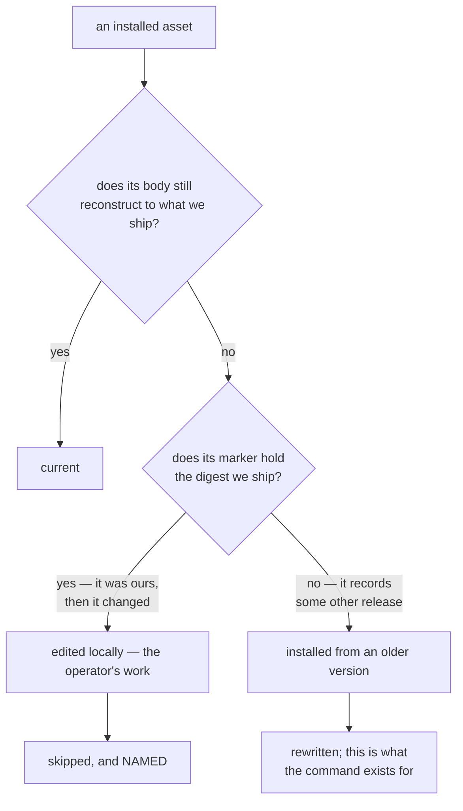

# CLI surface

The CLI is the whole API. Hooks are shims that call it, agents are instructed
to call it, and a human debugging a wedged state calls the same commands.
Nothing reaches the engine another way.

## Conventions

- Every command accepts `--json` and prints a machine-readable result.
- Exit codes: `0` clean, `1` a gate failed or a transition is illegal, `2`
  usage error, `3` state store problem. A gate failure and a crash are never
  the same code, because a shim must be able to tell them apart.
- Every command that mutates state is idempotent where that is meaningful, and
  says so in `--help` where it is not.
- **A blocking gate that did not apply is reported; a gate that passed is
  not.** Without `--verbose` the verdict stream carries failures and
  `block`-level skips, and drops plain passes and advisory skips. A skip and a
  pass are different facts — a pass has vouched for something and a skip has
  not — and collapsing them is how a blocking gate going inert stayed
  invisible (BUG_020). A `block`-level skip renders as `[skip:BLOCK]` and is
  counted separately in the transition summary, because a rule the project
  chose to enforce going inapplicable is news about that project's own
  enforcement. Advisory skips stay behind `--verbose`, where there is nothing
  to act on.

  **A skip states the limit that applies to the call it is answering about.**
  Rendering it separately is only half the job: a skip carrying a reason that
  is untrue of this call, or no reason at all, reads as a pass to the one
  reader who could act on it. `privacy.clean` returned one sentence — "nothing
  in privacy scope was written here" — on every route including the
  shell-mediated write it was false about, and the three rules keyed on the
  same "is this an edit tool" predicate returned a bare N/A whose default text
  is "not applicable here" (BUG_027). Both are now route-specific.
- No command ever writes to the repository outside the state root and **the
  stores the manifest declares** (`items.path`, `paths.memory`,
  `paths.reports`).

  This was once a flat list of three exceptions. ADR-002 D4 generalised it
  rather than adding a fourth, and the reason is worth stating: an enumeration
  grows on every feature, and the second exception is always easier to justify
  than the first. Expressed this way, a feature that needs a writable location
  adds a manifest key — which is visible in `config show`, reviewable in the
  manifest diff, and exempt from session isolation by the same mechanism that
  already exempts the backlog — instead of quietly widening a guarantee.

## Setup

```
invariant init [--ecosystem <id>] [--host claude_code] [--profile standard]
    Write a manifest, install shims, wire host settings, create the state root,
    and add the state root to .gitignore. Refuses to clobber an existing
    manifest without --force; prints a diff of what it would change with
    --dry-run.

invariant uninstall [--remove-assets] [--remove-manifest] [--dry-run]
    Remove the hook shims, unwire the entries this library added to the host
    settings file, and SAY WHAT IS LEFT BEHIND.

    The inverse of `init`, and it exists for the reason `init` does not need
    one stated: adoption was one command and withdrawal was hand surgery —
    delete each shim, then hand-edit the JSON `_wire_settings` merged its
    entries into, and know which entries were the library's. Miss one and the
    shim still fires; it then finds no `invariant` on PATH and exits silently
    BY DESIGN, so the leftover is invisible until it is not. The right to stop
    using a tool is part of authority over one's own project (IDEA_004).

    Two properties matter more than the command existing:

    * **It removes only what it wrote.** `_wire_settings` recognises its own
      entries by the shim path; removal is the same test, in one function, so
      an install that recognises its entries and a removal that does not is
      impossible to write. Everything else in the settings file is left exactly
      as found, and an emptied event list is deleted rather than left as `[]`.
      Malformed JSON is REFUSED rather than overwritten — the same care
      `_wire_settings` takes, and more so: there a bad parse costs the operator
      their wiring, here it would cost them the whole file as the last thing
      the tool ever did to their project.

    * **It never deletes the operator's data.** Sessions, work items, memories,
      architecture docs and the manifest survive by default, so uninstalling is
      not a decision about the backlog. An asset the operator has EDITED
      survives even `--remove-assets`, by the same rule `assets install`
      follows. `--dry-run` enumerates before anything moves, which is not a
      nicety here: what a removal takes away cannot be got back by running it
      again.

    A COMPLETE removal stops reading as broken. `doctor`'s shim check used to
    offer `hooks install` for any absence, pushing back toward the state the
    operator was leaving; where every shim is gone it now says "not installed"
    and names `invariant init` as the way back. A HALF removal is still
    reported as broken, because it is.

invariant doctor
    Check the installation: manifest valid, shims present and executable, host
    settings wired, state root writable, adapter commands resolvable, memory
    index current. One line per check, exit 1 if any fails.

    It also reports what was left PARKED here — sessions whose host binding is
    spent, and live sessions with an open plan — which `end_host_session` has
    promised in its docstring since it was written. Those two rows are
    INFORMATIONAL and never fail: any false row makes this command exit 1, and
    a parked session is the designed resting state of a plan that spans several
    host sessions. A `doctor` that goes permanently red on every project which
    adopts a checklist is the gate that gets ignored, and then switched off.

    A manifest that will not LOAD is one of those checks and not a reason to
    stop: this is the command someone runs because the manifest is wrong, and
    it used to resolve the manifest before it could report anything, so a
    refusal at load took out the one command that would explain it (BUG_050).

invariant assets list [--kind agent|command|skill]
    Every host asset: kind, whether the host can load it, and whether this
    library or the project owns it.

invariant assets install [--kind ...] [--overwrite-local] [--dry-run]
    Reinstall library-shipped assets and nothing else. Not a flag on `init`:
    `init --force` rewrites the manifest, so routing a repair through it would
    trade a broken asset for a discarded enforcement configuration.

    An asset you have EDITED is skipped and named. See "A managed file the
    operator has edited" below. --overwrite-local asks for the shipped version
    back; --dry-run enumerates every target, its divergence, and whether the
    run would write it.

invariant agents list
    Every library agent: installed or not, whether the host can load it, and
    which pipeline role it answers for.

invariant agents install [--overwrite-local] [--dry-run]
    Reinstall the library agents and nothing else. Deliberately not a flag on
    `init`: `init --force` rewrites the manifest, so routing an agent repair
    through it would trade a broken agent file for a discarded enforcement
    configuration. Same edit protection as `assets install`, and it matters
    more here: this is the command `doctor` actually points people at.

invariant config show [--provenance]
    Print resolved configuration and where each value came from.
```

### A managed file the operator has edited

Library assets are **managed** files: each carries a marker holding the digest
of what was shipped, which is what makes divergence detectable at all. So
"managed" reasonably means the library owns the bytes — and it does not,
quite. The project already offers `agents.local` for project-owned agents, and
an operator who edits a *shipped* one is saying something, usually "your
version is nearly right".

The resolution: **the library owns the shipped copy and the operator owns the
installed one.** An install that would diverge from what is on disk is a
question rather than a write.

The marker is what separates the two divergences, and one function —
`classify_installed` — is the only place that judgement is made:



That distinction was computed all along, rendered into a **failing** `doctor`
check, and then ignored by the only command `doctor`'s output pointed at:
`install_assets` overwrote every target unconditionally, with no `--force`, no
per-asset skip, no backup, and a `--dry-run` that named nothing it would
flatten. The knowledge needed to protect the edit existed; the code that acted
on it did not (BUG_051).

Three consequences are load-bearing:

- **A skip is named, never counted.** The defect was an install reporting a
  tidy total while a flattened file went unmentioned; a skip nobody can see is
  the same fault with the opposite sign.
- **The currency row says how to reverse it.** A locally edited asset is a
  standing FAILED check, and it must not read as a demand to discard the edit —
  so the row states that the edits are kept and names `--overwrite-local`.
- **A target that already matches is still rewritten.** It costs nothing, and a
  repair command reporting "installed 0" on a healthy project reads as a
  failure. The one case withheld is the one where writing destroys work.

## Session

```
invariant session start <name> [--base <branch>] [--force]
    The session id is APPENDED to the task slug, so the name a human types is
    an address: `add-widget` registers as `add-widget-a3f9c1de`. Uniqueness is
    then structural rather than checked — ids are unique, therefore `slug-id`
    is — and `session resume` can take the name back.

    REFUSED when the same task slug already has a session parked here, because
    that is the fork this whole model exists to prevent: a second host session
    starting a second invariant session under one task name leaves two branches
    holding half the work each. The refusal names the parked session, prints
    its plan, and gives the command that picks it up. `--force` starts a
    genuinely separate session; it is the escape the refusal's own last line
    names, and it was passed through to the domain only when the commands
    below landed — until then that line named a flag the CLI did not have.
invariant session isolate            Print the worktree and branch to create,
                                     or create them with --execute.
invariant session status [--json]
invariant session transition <state> [--reason <text>] [--force]
    The generic edge-walker. The machine's entry and exit gates for the edge
    are evaluated inside the domain, so this route is exactly as gated as
    `session review` / `session merge` (AUD-05 — it used to carry no gates at
    all). --force records an override naming the gates it went past.
invariant session files add <path>...    Declare this session's file set.
invariant session review              Evaluate the review gates and advance to
                                      `reviewed`. The gate list is the
                                      machine's, evaluated by the same domain
                                      code as every other transition.
invariant session merge               Validate the merge is being run from the
                                      right checkout, then perform it. The
                                      `merged` entry gates are evaluated
                                      BEFORE git runs — a refusal after the
                                      irreversible step would be a report,
                                      not a gate.
invariant session push                Publish the base branch. `pushed`'s
                                      entry gates — session.push_enabled
                                      (off by default) and the one-push
                                      barrier — are read from the machine and
                                      evaluated before the push runs.
invariant pipeline test [--phase <state>] [--selector <sel>]...
    Run the configured suite and record it as pipeline evidence. --phase
    labels the run; it defaults to the pipeline's current state, which is
    what the proof-of-red gate reads.

    --selector is REPEATABLE, and how several are spelled in one command is
    the adapter's answer: pytest takes node ids positionally, xcodebuild needs
    a repeated `-only-testing:` flag that lives in the manifest's template.
    An adapter that cannot join them makes the command REFUSE, having run and
    recorded nothing. The one behaviour that is not on offer is the one it
    used to have — accepting both flags and silently keeping the last, so the
    run reported a healthy green for a scope nobody asked for (BUG_031). A
    refusal costs one retry; a discard costs the belief that the scope was
    covered.

    The spawned suite does NOT inherit INVARIANT_SESSION_ID. That variable
    names the session a CALLER is recording against, and the test command is a
    child program: in the one repository whose suite exercises session
    creation, inheriting it collided every test that starts a session with the
    live one and wrote 25 false failures into durable evidence (BUG_035).

invariant pipeline coverage
    Run commands.coverage, parse it with the adapter, and record per-file
    numbers as pipeline evidence. This is what coverage.meets_floor reads.

    Where an ecosystem measures and reports with separate programs, set
    commands.coverage_report too: the suite's exit status is then read from
    the first command and the numbers from the second, and neither can be
    mistaken for the other. Joining them into one command is REFUSED — a
    shell reports only the LAST command's status, so a red suite followed by
    a clean read exits 0 and a green suite followed by a failed read exits
    non-zero. Whatever the first leg needs in its environment the second
    needs too: a `VAR=value cmd` prefix applies to that one command alone.

    A changed file with no row in that evidence normally BLOCKS: an absent row
    is what "never measured" looks like. Four absences are set aside instead,
    each on positive evidence — a file git reports the change deleted, a file
    outside the directories the coverage reporter is CONFIGURED to measure,
    a file the ecosystem's adapter recognises as part of the TEST SUITE, and a
    file that adapter reports carries no executable lines. None could ever
    earn a row, so demanding one is a gate no test can clear, and a gate no
    test can clear is one people route around. Anything else, including every
    "cannot tell", keeps blocking, and every file set aside is NAMED in the
    verdict — a pass that quietly narrowed its own scope is the vacuous green
    the gate exists to prevent.

    The test-file case is a separate question from the executable-lines one and
    not a special case of it: a test file is full of executable lines, so the
    honest fact is not that it cannot be measured but that it is what does the
    measuring, and the usual coverage configuration is defined never to emit a
    row for one. A file that DOES carry a row is held to the floor like any
    other — setting aside is for an absent row, never for a low one.

invariant pipeline ack <rule> --reason "<why>"
    Record a deliberate decision to proceed against an ADVISORY gate. It then
    reports as skipped, carrying that reason, for the rest of the pipeline —
    at a transition AND at a hook. The acknowledgement used to be read only by
    `PipelineDomain.evaluate_gates`, so a warn-level rule bound to a host event
    repeated on every tool call for the life of the run with the
    acknowledgement recorded and inert (AUTH-01). Both routes now read one
    function, `core.rules.apply_acknowledgements`.

    Refused for a gate that stops work — `block` or `ask`. Satisfy those, or
    override them, and the refusal now names only the routes that can actually
    reach THIS rule: `invariant override` where it fires at a hook,
    `advance --force --reason` where it gates a state of the pipeline being
    run, both where both are true, and neither-plus-a-reason where neither is.
    It used to name `advance --force` unconditionally, which for a rule that
    fired on a tool call pointed at a command that could not help — worse than
    saying there is no override.

invariant session adopt <host-id> [--id <id>] [--force]
    Bind a host session to an invariant session. Normally automatic; needed by
    hand only to claim a session registered before the binding existed.

    What it is NOT is a rebind of a LIVE binding. That is the hand-over
    ADR-001 D19 forbids — work changing owner behind its owner's back, with
    its pipeline, its evidence and its declared file set going with it — and
    `--force` is the deliberate exception, not the ordinary route. The case
    that looks like it and is not is a binding that is SPENT: the host session
    ended, and there is nobody on the other end to take anything away from.
    That is a continuation, and it has its own command.

invariant session resume <name> [--id <id>] [--force]
    Pick up a session a previous host session put down. `<name>` is a full
    name, a bare task slug, or an id; a partial name that matches more than one
    session is refused with every candidate printed in full, because a full
    name carries its id and therefore cannot be ambiguous.

    The success line is a CONTRACT with the host adapter, which binds a host
    session by parsing `session <id> (` out of the stdout of the command that
    claimed it — a command run through a shell carries no hook payload, so this
    text is the only evidence of which session was claimed. The refusals are
    shaped so that sequence never appears in them: the same reader searches the
    whole tool response, stderr included on a host that merges the streams, so
    a refusal carrying it would bind the caller to the session it just declined
    to give them.

invariant session plan add "<deliverable>" | done <n> | reopen <n>
                    | remove <n> | show          [--id <id>] [--json]
    The deliverable set this session owes — what makes a session outlive its
    host, and what `session.deliverables_complete` and
    `session.work_would_be_stranded` read. A number is retired when its entry
    is removed and never reissued, so `plan done 3` means the same thing after
    a `remove` as it did before one.

    `add` takes exactly ONE positional, so a lost quote is a usage error rather
    than a deliverable called "wire". Every action prints the whole plan and
    the same JSON document, because a mutation that reported only itself would
    leave the caller re-running `show` to see the numbering it just changed.

    `show --json` carries `planned` and `complete` as SEPARATE keys. `planned`
    is "a checklist exists"; `complete` is "and nothing on it is open".
    Collapsed into one flag, a session that never recorded a plan is
    indistinguishable from one that finished its plan — so a consumer
    switching mode on it either defers the merge forever on every project that
    does not keep checklists, or passes every unplanned session as finished.

invariant session sync [--id <id>]
    Rebase this session's branch onto its base. What
    `session.branch_is_current` names as its fix: the model has always said
    "rebase onto the local base after every commit", and until this existed,
    saying it was all anything did.

    Every refusal runs BEFORE git does, the same shape as `session merge`, and
    for the same reason: a rebase rewrites commits, so a validation after it
    would be a report. It refuses to run outside the session's own worktree —
    the mirror of `session.ff_merge_target` one command over, because `git
    rebase` acts on whatever HEAD the CALLING tree has checked out, so run from
    the main checkout it rebases the base branch onto itself and exits zero. A
    detached HEAD is refused on the same evidence.

    A conflict is reported, never resolved: the rebase is aborted, which leaves
    the commits exactly where they were, and the decision stays with the
    operator. Resolving a conflict is a judgement about two people's intent,
    and a program that guesses at one produces a merge nobody reviewed.

invariant session reap [--dry-run]
    Abandon sessions whose worktree AND branch are both gone. A missing
    worktree alone is not enough: its branch may still hold unmerged commits.

invariant session teardown [--keep-worktree] [--keep-branch] [--force]
    Remove the worktree, delete the branch, deregister.

    REFUSED when the session's host binding is still live AND this command is
    running inside the worktree it would remove. Removing an occupied worktree
    wedges its host: the host's own isolation then refuses every shell call and
    orders the caller back into the deleted path, and the repair commands sit
    behind that same refusal, so there is no in-band recovery. The refusal
    names the way out — step to the main checkout and run it from there. A
    binding spent by SessionEnd, or none at all, tears down from anywhere.
    --force is for the case where the operator knows the host has moved.

    Run it from the MAIN CHECKOUT. That is the documented route, it is what
    the refusal asks for, and git's own calls run from there too — removing
    the worktree a later git call is standing in fails after the removal has
    already happened.
invariant session list                All registered sessions on this machine,
                                      with how far each is through its plan.
                                      The fraction is what distinguishes two
                                      sessions on one task; a session with no
                                      plan reads `-` rather than `0/0`, because
                                      those are different facts. `--json` is
                                      unchanged — the record already carries
                                      the plan.
```

## Pipeline

```
invariant pipeline start [--methodology <id>] [--task <text>]
    --methodology overrides the manifest's methodology for THIS pipeline —
    a chore in a TDD project is the motivating case. The choice is recorded
    on the pipeline and every later command resolves the machine from that
    record, so neither the override nor a mid-pipeline manifest edit can
    swap a running pipeline's gate set (AUD-02/03).
invariant pipeline status [--json]
invariant pipeline advance <state> [--force]
    Validates the transition against the FSM and runs the gates. --force
    records an override with a required --reason rather than bypassing
    silently; the override is visible in status and in the session record.
invariant pipeline gates [--state <id>]
    List the gates for a state and their current verdicts, without advancing.
```

`pipeline gates` is deliberately separate from `advance`. Asking "what is owed
here" must not have the side effect of moving.

## Work items

```
invariant item new <type> [--title <t>] [--field k=v]...
invariant item list [--type <t>] [--status <s>] [--open]
invariant item show <id>
invariant item transition <id> <status> [--residue <text>]
invariant item residue <id> [--add <text> | --clear <text>]
```

## Memory

```
invariant memory check           Validate schema, links, index currency, dupes,
                                 privacy. Exit 1 on any failure.
invariant memory write <name> --type <t> --description <d> [--body-file <f>]
invariant memory index           Regenerate the index from the directory.
invariant memory dedup           Report candidate duplicate pairs.
invariant memory link-check      Report dead [[links]].
```

## Stats

What a session took and what it cost. Measurement is **scripted** — parsing
and arithmetic, no model in the loop — because a measurement that varies
between runs is not a measurement. See ADR-002.

```
invariant stats refresh [--force]
    Rebuild the raw store from the host's own transcripts. A record whose
    source watermark has not moved is left alone; --force re-parses anyway.
    The JOIN to an invariant session is re-run either way, because a session
    can be named, bound or advanced without its transcript changing.

invariant stats report [--write]
    Render the report. Without --write it goes to stdout and nothing is
    written. With it, the artifact lands in paths.reports, carrying a
    fingerprint of the store it was rendered from — which is what `stats
    check` compares against, and why stdout-only was rejected: the staleness
    contract needs an anchor.

invariant stats show <session>
    One session in full, including its per-state breakdown. A session with no
    breakdown says so explicitly and says WHY: recorded before per-state
    attribution existed, no pipeline state left yet, no pipeline at all, no
    invariant session joined to the record, or the reason itself never
    recorded — five facts, five sentences. Never a zero and never a blank: a
    blank invites the reader to conclude the work was free, and a cause that
    is not the real one invites them to stop asking. The unjoined case is the
    one that most tempts an over-claim: nothing in such a record can
    distinguish "ran before the instrumentation" from "ran after and was never
    joined", so it names the absent join and stops there (BUG_024). A state whose two watermarks cannot be subtracted — the counter
    changed under a rebind, the reading went backwards, or it did not move —
    renders as unattributable, with the reason, and never as a figure.

invariant stats archive <session>
    Promote a record to permanent. The raw store is a cache only while the
    host's transcripts survive; once they are pruned it is the only copy, and
    this is where the user decides what outlives the host's retention.

invariant stats check
    Staleness against the source, host sessions not yet ingested, records that
    are now the only copy and are not archived, models missing from the price
    table, and whether the rendered report matches the store. Exit 1 on any.
    Problems are named by the invariant session's name or counted, never by a
    host session identifier: this output gets pasted into commits, and the
    repair is the same single command whichever record is affected.
```

Two properties of the output are not stylistic:

- **Every currency figure is a floor**, labelled "excludes subagent spend". A
  subagent's own loop is billed and never written down, so the honest answer
  is "at least this much". The agents view reports launches, declared model
  and frequency, and no cost at all — estimating the missing share would be
  modelling stacked on modelling, producing an invented number in the same
  units as a measured one.
- **Tokens are measured, cost is modelled.** A model missing from the price
  table prices `None`, never zero, and a session containing one reports no
  total rather than a partial one. A total that silently omits a model's spend
  is worse than no total, because it looks like a total.

Deliberately absent: any gate that regenerates the report at teardown.
Teardown is the step that must never acquire new ways to refuse.

## Rules and gates

```
invariant check [<rule-id>...]   Evaluate rules; default is every rule bound
                                 to no particular event.
invariant rules list [--level]   Every rule, its bound event, resolved level.
invariant privacy scan <path>... Report personal-data matches with offsets.

invariant standdown --reason "<why>" [--until pipeline|session]
                    [--include <rule-id>]... [--id <sid>]
invariant standdown --clear [--id <sid>]
    Hold every gate for an INTERVAL, reversibly, without editing project
    policy. Every rule reports `stood down — <reason>` while it holds, which a
    `block`-level rule renders as `[skip:BLOCK]` — on the default verdict
    stream, not behind --verbose, because enforcement being held is news about
    the project's own enforcement.

    Per-call and per-interval are different wants: `override` is "let this call
    through", this is "stop asking for the next while". They share a seam and
    neither replaces the other.

    --until defaults to `pipeline`, the SHORTEST scope that is useful, and
    expiry is DERIVED rather than stored: a pipeline-scoped hold dies when that
    pipeline finishes or is replaced. A stand-down nobody remembers to lift is
    indistinguishable from having uninstalled the tool, and an expiry that
    depends on a later command running is an expiry that does not happen.

    Granted while NO pipeline is running, it WAITS for the next one and then
    rides it to its finish. "No pipeline yet" is not a scope already satisfied
    — standing down for work outside a pipeline is usually done precisely so
    that the pipeline that work leads into does not reopen the gates the hold
    was thrown for. Reading a pipeline's mere existence as the end of the hold
    ended it at `pipeline start`, before anything ran under it (BUG_052).

    `privacy.clean` is held OUT unless --include names it. It is the one gate
    whose failure cannot be undone after the fact, and this library has argued
    that case twice already — the `loose` profile keeps it blocking and so does
    the README. Going past it stays a separate sentence the operator wrote.

    It is loud. `session status` shows it, and `build_context` puts it at the
    top of every turn, because this is the one state that must not be
    discoverable only by noticing that nothing is stopping you.

invariant override <rule-id> --reason "<why>" [--calls N] [--id <sid>]
invariant override <rule-id> --clear [--id <sid>]
    Pass a rule that fires at a HOOK, deliberately, with the decision
    recorded. The next N evaluations of that rule at `pre-tool-use` or `stop`
    are let through; spending one appends to the session's `overrides` — the
    same list a forced transition writes to — naming the rule, the reason and
    the surface. An unspent grant shows in `session status`.

    This is the appeal for the surface the operator actually meets. Everything
    the CLI evaluates already had one; the twelve rules that fire from hooks
    did not, and a blocking verdict there was final, with the only relief a
    permanent edit to project policy made mid-task to get past a single call
    (BUG_049).

    A GRANT, not a flag, because there is nothing for a flag to be on: a tool
    call carries no argument the operator can add and no environment a running
    host will re-read. `--reason` is required for the same reason `--force`
    requires one — an override with no stated reason is indistinguishable from
    the gate never having run.
```

**A rule set to `ask` is not overridden by this and does not need to be.** At
`pre-tool-use` an `ask` verdict is delivered to the human as the host's `ask`
decision, which is the override, in band, with the verdict as its reason. At
every other surface there is nobody to ask, so it stops the work and the token
is what passes it. See `manifest.md` § Levels.

## State maintenance

```
invariant state show [--session <sid>]
invariant state repair [--dry-run]
    Reconcile the registry against session files and the worktrees actually on
    disk. Marks entries with no live worktree as abandoned rather than deleting
    them.
invariant state gc [--older-than <days>]
```

## Host bridge

```
invariant hook <event>
    Read the host's payload on stdin, evaluate the rules bound to <event>, and
    write the host's expected response on stdout. Events for Claude Code:
    session-start, user-prompt-submit, pre-tool-use, post-tool-use, stop,
    session-end.

    The governing manifest is resolved from CLAUDE_PROJECT_DIR when the host
    supplies it, falling back to the working directory. The host guarantees
    that variable to its hooks; the process cwd it does not, and resolving
    from cwd alone meant a hook firing anywhere else found no manifest and
    silently disabled every gate (AUD-04). When no manifest is found at all
    the response still exits zero and never denies — a missing manifest must
    not wedge the host — but it carries the degraded marker
    (`invariantDegraded`) and says enforcement is off, instead of an empty
    verdict that read as a pass.

invariant context
    Print the state projection a host would inject: current state, legal
    transitions, pending gates, outstanding residue. Useful standalone for
    debugging what an agent is actually being told.
```

`invariant context` existing as a plain command is the point of the design.
What the model gets injected is not a static rulebook someone hopes is being
followed — it is this command's output, reproducible on demand, derived from
the recorded state.
