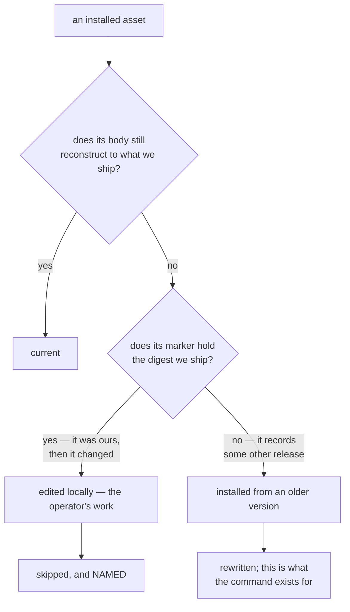

# CLI surface

The CLI is the whole API. Hooks are shims that call it, agents are instructed
to call it, and a human debugging a wedged state calls the same commands.
Nothing reaches the engine another way.

## Conventions

- Every command accepts `--json` and prints a machine-readable result.
- Exit codes: `0` clean, `1` a gate failed or a transition is illegal, `2`
  usage error, `3` state store problem. A gate failure and a crash are never
  the same code, because a shim must be able to tell them apart.
- Every command that mutates state is idempotent where that is meaningful, and
  says so in `--help` where it is not.
- **A blocking gate that did not apply is reported; a gate that passed is
  not.** Without `--verbose` the verdict stream carries failures and
  `block`-level skips, and drops plain passes and advisory skips. A skip and a
  pass are different facts — a pass has vouched for something and a skip has
  not — and collapsing them is how a blocking gate going inert stayed
  invisible (BUG_020). A `block`-level skip renders as `[skip:BLOCK]` and is
  counted separately in the transition summary, because a rule the project
  chose to enforce going inapplicable is news about that project's own
  enforcement. Advisory skips stay behind `--verbose`, where there is nothing
  to act on.

  **A skip states the limit that applies to the call it is answering about.**
  Rendering it separately is only half the job: a skip carrying a reason that
  is untrue of this call, or no reason at all, reads as a pass to the one
  reader who could act on it. `privacy.clean` returned one sentence — "nothing
  in privacy scope was written here" — on every route including the
  shell-mediated write it was false about, and the three rules keyed on the
  same "is this an edit tool" predicate returned a bare N/A whose default text
  is "not applicable here" (BUG_027). Both are now route-specific.
- No command ever writes to the repository outside the state root and **the
  stores the manifest declares** (`items.path`, `paths.memory`,
  `paths.reports`, `paths.sweeps`). One command commits what it wrote there:
  `sweep run`, its own record and the items it filed, and nothing else.

  This was once a flat list of three exceptions. ADR-002 D4 generalised it
  rather than adding a fourth, and the reason is worth stating: an enumeration
  grows on every feature, and the second exception is always easier to justify
  than the first. Expressed this way, a feature that needs a writable location
  adds a manifest key — which is visible in `config show`, reviewable in the
  manifest diff, and exempt from session isolation by the same mechanism that
  already exempts the backlog — instead of quietly widening a guarantee.

  One store sits outside every repository and so outside this rule: the
  oracle's user-level directory (`$INVARIANT_HOME`, else `~/.invariant`;
  ADR-007). It holds which projects exist, plus the watcher's derived
  snapshot, alert ledger and log, and nothing of any project's. Only `init`,
  the SessionStart hook and the `oracle` commands write it. Two files lie
  outside both: `oracle install` writes, and `oracle uninstall` removes, the
  LaunchAgent plists under `~/Library/LaunchAgents`, the watcher's and,
  with `--web`, the web page's (ADR-007 D17, ADR-008 D15).

## Setup

```
invariant init [--ecosystem <id>] [--host claude_code] [--profile standard]
    Write a manifest, install shims, wire host settings, create the state root,
    and add the state root to .gitignore. Refuses to clobber an existing
    manifest without --force; prints a diff of what it would change with
    --dry-run.

    Where the docs directory (`paths.docs`, `docs/architecture` by default)
    does not exist it also writes a starter `overview.md` there. A fresh
    project otherwise began by failing its own docs-first gate with nothing
    to read: `doctor` reported the directory missing and the first `pipeline
    advance` blocked on `docs.read_architecture` — "read the relevant doc
    under docs/architecture" — against a path with nothing in it. The starter
    is generic, with the project name substituted: what the file is for, a
    Layers diagram to replace, a responsibilities table, and a compliance
    checklist the reviewing agents read as canonical. A directory that EXISTS
    — even empty — is the project's and is left alone, `--force` included:
    that flag rewrites the manifest, not the docs. `--dry-run` lists the write
    when it would happen. Written once; no command rewrites it afterwards.

    A successful, non-dry-run `init` also registers the project in the
    oracle's index (`via: init`; see "Oracle" below). A failure to register is
    REPORTED and never fails the command — the project is initialised by then
    — and the note names `invariant oracle projects add` as the retry. The
    JSON result carries `oracle`: `{"added", "key"}`, or `{"error"}`.

invariant uninstall [--remove-assets] [--remove-manifest] [--dry-run]
    Remove the hook shims, unwire the entries this library added to the host
    settings file, and SAY WHAT IS LEFT BEHIND.

    The inverse of `init`, and it exists for the reason `init` does not need
    one stated: adoption was one command and withdrawal was hand surgery —
    delete each shim, then hand-edit the JSON `_wire_settings` merged its
    entries into, and know which entries were the library's. Miss one and the
    shim still fires; it then finds no `invariant` on PATH and exits silently
    BY DESIGN, so the leftover is invisible until it is not. The right to stop
    using a tool is part of authority over one's own project (IDEA_004).

    Two properties matter more than the command existing:

    * **It removes only what it wrote.** `_wire_settings` recognises its own
      entries by the shim path; removal is the same test, in one function, so
      an install that recognises its entries and a removal that does not is
      impossible to write. Everything else in the settings file is left exactly
      as found, and an emptied event list is deleted rather than left as `[]`.
      Malformed JSON is REFUSED rather than overwritten — the same care
      `_wire_settings` takes, and more so: there a bad parse costs the operator
      their wiring, here it would cost them the whole file as the last thing
      the tool ever did to their project.

    * **It never deletes the operator's data.** Sessions, work items, memories,
      architecture docs and the manifest survive by default, so uninstalling is
      not a decision about the backlog. An asset the operator has EDITED
      survives even `--remove-assets`, by the same rule `assets install`
      follows. `--dry-run` enumerates before anything moves, which is not a
      nicety here: what a removal takes away cannot be got back by running it
      again.

    A COMPLETE removal stops reading as broken. `doctor`'s shim check used to
    offer `hooks install` for any absence, pushing back toward the state the
    operator was leaving; where every shim is gone it now says "not installed"
    and names `invariant init` as the way back. A HALF removal is still
    reported as broken, because it is.

invariant doctor
    Check the installation: manifest valid, shims present and executable, host
    settings wired, state root writable, adapter commands resolvable, memory
    index current. One line per check, exit 1 if any fails.

    A failing row names its remedy. The architecture-docs row used to say
    only "docs-first is core policy", which told a fresh adopter the rule
    they were about to be blocked by and nothing about satisfying it; it now
    says to create `overview.md` there (`init` scaffolds one when the
    directory is absent) or to set `docs.read_architecture` to `warn`.

    It also reports what was left PARKED here — sessions whose host binding is
    spent, and live sessions with an open plan — which `end_host_session` has
    promised in its docstring since it was written. Those two rows are
    INFORMATIONAL and never fail: any false row makes this command exit 1, and
    a parked session is the designed resting state of a plan that spans several
    host sessions. A `doctor` that goes permanently red on every project which
    adopts a checklist is the gate that gets ignored, and then switched off.

    The `coverage advisory paths` and `sweep cadence` rows are informational
    in the same way: the first names a configured `coverage_advisory_paths`
    as an active exception, the second the sweep cadence, its scheduled gates,
    any `held_paths` and the last sweep's age, prefixed STALE when
    `sweep.fresh` would warn (ADR-010 D6). A late sweep is that rule's
    warning, never a failed diagnosis.

    When the oracle's LaunchAgent is installed, one more row, `oracle agent
    interpreter`, fails if the interpreter its plist names no longer exists:
    an editable install can move, and the agent would then fail at every
    login without a word. The remedy is `invariant oracle install`. The row
    reads the plist only and asks launchd nothing; with no plist there is no
    row. Beside it, while a fresh snapshot shows a watcher running, `oracle
    watcher build` fails when that watcher runs an older invariant than the
    installed one: its stamp differs, it wrote none, or it reports a skew
    itself (BUG_089). It restarts itself once it notices; `invariant oracle
    install` restarts it now.

    When the web page's LaunchAgent is installed, two more: `oracle web
    interpreter`, the same check on its plist (remedy `invariant oracle
    install --web`), and `oracle web page`, which passes while the process
    that last reported in <oracle home>/oracle/web.json is alive and no bind
    error stands. Its detail is where the page serves (or that it waits for
    Tailscale, which passes), the paired device count and the last action
    from the audit log. Both read files and ask launchd nothing (ADR-008
    D17). While that process runs, `oracle web build` fails when it runs an
    older invariant than the installed one, as the watcher's row does. When that report names a certificate, a third row, `oracle web
    certificate`, fails while the page is served over plain HTTP (its detail
    says why: HTTPS Certificates off in the Tailscale admin console, or
    Tailscale not answering) or once fewer than 14 days remain before the
    certificate expires (ADR-008 D21, D23).

    The "hook shims actually run" row executes every installed shim, so it
    proves the shim resolves the CLI, the engine imports, the rules evaluate
    and a parseable verdict comes back without the degraded marker. Running a
    hook is delivering an event, and every hook is a writer — so each probe
    payload carries `invariantProbe: true`, and `invariant hook` answers a
    probe from a state store that reads the real state and discards every
    write. The payloads used to be harmless by choice instead (no session id,
    no file path), and the hook found the caller anyway through the
    `INVARIANT_HOST_SESSION_ID` it inherits: the session-end probe ended the
    caller's real host binding, and the parked row below then reported the
    caller's own live session as parked (BUG_059). The guarantee sits at the
    store because identity has more routes than the environment — cwd and
    worktree resolve a session too — and a store that writes nothing covers
    every write path, present and future, at once. A shim that execs an OLDER
    build of the library does not know the marker and is not covered.

    A manifest that will not LOAD is one of those checks and not a reason to
    stop: this is the command someone runs because the manifest is wrong, and
    it used to resolve the manifest before it could report anything, so a
    refusal at load took out the one command that would explain it (BUG_050).

invariant assets list [--kind agent|command|skill]
    Every host asset: kind, whether the host can load it, and whether this
    library or the project owns it.

invariant assets install [--kind ...] [--overwrite-local] [--dry-run]
    Reinstall library-shipped assets and nothing else. Not a flag on `init`:
    `init --force` rewrites the manifest, so routing a repair through it would
    trade a broken asset for a discarded enforcement configuration.

    An asset you have EDITED is skipped and named. See "A managed file the
    operator has edited" below. --overwrite-local asks for the shipped version
    back; --dry-run enumerates every target, its divergence, and whether the
    run would write it.

invariant agents list
    Every library agent: installed or not, whether the host can load it, and
    which pipeline role it answers for.

invariant agents install [--overwrite-local] [--dry-run]
    Reinstall the library agents and nothing else. Deliberately not a flag on
    `init`: `init --force` rewrites the manifest, so routing an agent repair
    through it would trade a broken agent file for a discarded enforcement
    configuration. Same edit protection as `assets install`, and it matters
    more here: this is the command `doctor` actually points people at.

invariant config show [--provenance]
    Print resolved configuration and where each value came from.
```

### A managed file the operator has edited

Library assets are **managed** files: each carries a marker holding the digest
of what was shipped, which is what makes divergence detectable at all. So
"managed" reasonably means the library owns the bytes — and it does not,
quite. The project already offers `agents.local` for project-owned agents, and
an operator who edits a *shipped* one is saying something, usually "your
version is nearly right".

The resolution: **the library owns the shipped copy and the operator owns the
installed one.** An install that would diverge from what is on disk is a
question rather than a write.

The marker is what separates the two divergences, and one function —
`classify_installed` — is the only place that judgement is made:



That distinction was computed all along, rendered into a **failing** `doctor`
check, and then ignored by the only command `doctor`'s output pointed at:
`install_assets` overwrote every target unconditionally, with no `--force`, no
per-asset skip, no backup, and a `--dry-run` that named nothing it would
flatten. The knowledge needed to protect the edit existed; the code that acted
on it did not (BUG_051).

Three consequences are load-bearing:

- **A skip is named, never counted.** The defect was an install reporting a
  tidy total while a flattened file went unmentioned; a skip nobody can see is
  the same fault with the opposite sign.
- **The currency row says how to reverse it.** A locally edited asset is a
  standing FAILED check, and it must not read as a demand to discard the edit —
  so the row states that the edits are kept and names `--overwrite-local`.
- **A target that already matches is still rewritten.** It costs nothing, and a
  repair command reporting "installed 0" on a healthy project reads as a
  failure. The one case withheld is the one where writing destroys work.

## Session

```
invariant session start <name> [--base <branch>] [--force]
    The session id is APPENDED to the task slug, so the name a human types is
    an address: `add-widget` registers as `add-widget-a3f9c1de`. Uniqueness is
    then structural rather than checked — ids are unique, therefore `slug-id`
    is — and `session resume` can take the name back.

    REFUSED when the same task slug already has a session parked here, because
    that is the fork this whole model exists to prevent: a second host session
    starting a second invariant session under one task name leaves two branches
    holding half the work each. The refusal names the parked session, prints
    its plan, and gives the command that picks it up. `--force` starts a
    genuinely separate session; it is the escape the refusal's own last line
    names, and it was passed through to the domain only when the commands
    below landed — until then that line named a flag the CLI did not have.

    --base is the branch the worktree is cut from and merged back into. It
    defaults to the branch the MAIN CHECKOUT has checked out, and the choice
    is printed on the line after the registration line, at the one moment
    somebody is looking. It used to default to a literal `master`, which
    nothing read before `isolate --execute` — so a repository whose default
    branch is `main` failed there, with git's `invalid reference: master`. A
    checkout that cannot name its branch — a detached HEAD, or no repository
    at all — is REFUSED with the flag named, never guessed at: a wrong base
    surfaces at isolate or merge time, the worst place to learn it. Line one
    of the output is unchanged; it is the host's binding contract (see
    `session resume`).
invariant session isolate            Print the worktree and branch to create,
                                     or create them with --execute.
invariant session status [--json]
invariant session transition <state> [--reason <text>] [--force]
    The generic edge-walker. The machine's entry and exit gates for the edge
    are evaluated inside the domain, so this route is exactly as gated as
    `session review` / `session merge` (AUD-05 — it used to carry no gates at
    all). --force records an override naming the gates it went past.
    `isolated -> working` normally needs no command: the first edit tool call
    completing inside the session's own worktree walks it from the
    PostToolUse hook (BUG_062). Naming it here is for a session that edits
    only through the shell, which that hook deliberately does not count.
invariant session files add <path>...    Declare this session's file set.
invariant session review              Evaluate the review gates and advance to
                                      `reviewed`. The gate list is the
                                      machine's, evaluated by the same domain
                                      code as every other transition.
invariant session merge               Validate the merge is being run from the
                                      right checkout, then perform it. The
                                      `merged` entry gates are evaluated
                                      BEFORE git runs — a refusal after the
                                      irreversible step would be a report,
                                      not a gate.
invariant session push                Publish the base branch. `pushed`'s
                                      entry gates — session.push_enabled
                                      (off by default) and the one-push
                                      barrier — are read from the machine and
                                      evaluated before the push runs.
invariant pipeline test [--phase <state>] [--selector <sel>]...
    Run the configured suite and record it as pipeline evidence. --phase
    labels the run; it defaults to the pipeline's current state, which is
    what the proof-of-red gate reads.

    --selector is REPEATABLE, and how several are spelled in one command is
    the adapter's answer: pytest takes node ids positionally, xcodebuild needs
    a repeated `-only-testing:` flag that lives in the manifest's template.
    An adapter that cannot join them makes the command REFUSE, having run and
    recorded nothing. The one behaviour that is not on offer is the one it
    used to have — accepting both flags and silently keeping the last, so the
    run reported a healthy green for a scope nobody asked for (BUG_031). A
    refusal costs one retry; a discard costs the belief that the scope was
    covered.

    The spawned suite does NOT inherit INVARIANT_SESSION_ID. That variable
    names the session a CALLER is recording against, and the test command is a
    child program: in the one repository whose suite exercises session
    creation, inheriting it collided every test that starts a session with the
    live one and wrote 25 false failures into durable evidence (BUG_035).
    INVARIANT_HOST_SESSION_ID and INVARIANT_HANDOFF are stripped too, for the
    same reason one variable over (BUG_058, BUG_077). One seam spawns and reads
    every recorded run, module-level in domains/pipeline so the sweep
    (ADR-010) runs the suite the same way.

    Each record says which run it was: `selectors` as given, and `scope`,
    `full` with none and `scoped` with some.

    Under a sweep cadence that schedules test.all_pass, a run with no
    --selector is the whole suite on a change, and `sweep.no_full_run` is
    asked BEFORE anything spawns. Where it stops the work (block, or ask:
    there is nobody here to ask) the command exits 1 having run and recorded
    nothing, unless `invariant override sweep.no_full_run` was granted, which
    this command spends and records with surface `cli`. At warn it prints the
    verdict and runs. A change touching a `schedule.held_paths` glob owes the
    full run and is not asked about it (ADR-010 D5, D8).

invariant pipeline coverage [--selector <sel>]...
    Run commands.coverage, parse it with the adapter, and record per-file
    numbers as pipeline evidence. This is what coverage.meets_floor reads.

    --selector runs commands.coverage_one instead, the scoped sibling
    (ADR-010), repeatable and joined by the adapter exactly as for `pipeline
    test`; with no coverage_one configured or supplied by the adapter it is
    refused, having run nothing. A scoped run that executes no tests is still
    refused, but its message names the selector as the likely cause (a filter
    that matched nothing), keeps the build-or-launch alternative, and appends
    the adapter's own note; a full run keeps the build-or-launch hint alone.
    The record's `scope` says `scoped`, and the
    figures are a lower bound: under a sweep cadence they are reported, never
    held to the floor. With no --selector, under a cadence scheduling either
    gate, it is asked about first exactly as `pipeline test` is: a
    whole-scheme coverage run also runs the whole suite.

    Where an ecosystem measures and reports with separate programs, set
    commands.coverage_report too: the suite's exit status is then read from
    the first command and the numbers from the second, and neither can be
    mistaken for the other. Joining them into one command is REFUSED — a
    shell reports only the LAST command's status, so a red suite followed by
    a clean read exits 0 and a green suite followed by a failed read exits
    non-zero. Whatever the first leg needs in its environment the second
    needs too: a `VAR=value cmd` prefix applies to that one command alone.

    A changed file with no row in that evidence normally BLOCKS: an absent row
    is what "never measured" looks like. Four absences are set aside instead,
    each on positive evidence — a file git reports the change deleted, a file
    outside the directories the coverage reporter is CONFIGURED to measure,
    a file the ecosystem's adapter recognises as part of the TEST SUITE, and a
    file that adapter reports carries no executable lines. None could ever
    earn a row, so demanding one is a gate no test can clear, and a gate no
    test can clear is one people route around. Anything else, including every
    "cannot tell", keeps blocking, and every file set aside is NAMED in the
    verdict — a pass that quietly narrowed its own scope is the vacuous green
    the gate exists to prevent.

    The test-file case is a separate question from the executable-lines one and
    not a special case of it: a test file is full of executable lines, so the
    honest fact is not that it cannot be measured but that it is what does the
    measuring, and the usual coverage configuration is defined never to emit a
    row for one. A file that DOES carry a row is held to the floor like any
    other — setting aside is for an absent row, never for a low one.

    A file under methodology.gates.coverage_advisory_paths is a different
    case again: a POLICY about where the floor binds. It is named in the
    verdict with its figure, or as not measured, and never fails the gate. A
    change touching only such files needs no coverage run at all, and the
    pass says so, naming the coverage run still owed before the list is
    removed.

    Under a sweep cadence scheduling coverage.meets_floor, every touched file
    outside methodology.gates.schedule.held_paths is advisory the same way,
    through the same split, the verdict naming the cadence instead of a glob.
    A held path is held as before, and its figure must come from a run with
    no --selector (manifest.md, "A sweep cadence"). Each advisory file is
    named with the last committed sweep's figure for it and that sweep's
    commit — "last sweep 97% at <12 hex>", "not in the last sweep", or one
    sentence saying no sweep is recorded or the last measured no coverage —
    so the scoped lower bound is read beside the number the floor is held to.

invariant pipeline ack <rule> --reason "<why>"
    Record a deliberate decision to proceed against an ADVISORY gate. It then
    reports as skipped, carrying that reason, for the rest of the pipeline —
    at a transition AND at a hook. The acknowledgement used to be read only by
    `PipelineDomain.evaluate_gates`, so a warn-level rule bound to a host event
    repeated on every tool call for the life of the run with the
    acknowledgement recorded and inert (AUTH-01). Both routes now read one
    function, `core.rules.apply_acknowledgements`.

    Refused for a gate that stops work — `block` or `ask`. Satisfy those, or
    override them, and the refusal now names only the routes that can actually
    reach THIS rule: `invariant override` where it fires at a hook,
    `advance --force --reason` where it gates a state of the pipeline being
    run, both where both are true, and neither-plus-a-reason where neither is.
    It used to name `advance --force` unconditionally, which for a rule that
    fired on a tool call pointed at a command that could not help — worse than
    saying there is no override.

invariant session adopt <host-id> [--id <id>] [--force]
    Bind a host session to an invariant session. Normally automatic; needed by
    hand only to claim a session registered before the binding existed.

    What it is NOT is a rebind of a LIVE binding. That is the hand-over
    ADR-001 D19 forbids — work changing owner behind its owner's back, with
    its pipeline, its evidence and its declared file set going with it — and
    `--force` is the deliberate exception, not the ordinary route. The case
    that looks like it and is not is a binding that is SPENT: the host session
    ended, and there is nobody on the other end to take anything away from.
    That is a continuation, and it has its own command.

invariant session resume <name> [--id <id>] [--force]
    Pick up a session a previous host session put down. `<name>` is a full
    name, a bare task slug, or an id; a partial name that matches more than one
    session is refused with every candidate printed in full, because a full
    name carries its id and therefore cannot be ambiguous.

    The success line is a CONTRACT with the host adapter, which binds a host
    session by parsing `session <id> (` out of the stdout of the command that
    claimed it — a command run through a shell carries no hook payload, so this
    text is the only evidence of which session was claimed. The refusals are
    shaped so that sequence never appears in them: the same reader searches the
    whole tool response, stderr included on a host that merges the streams, so
    a refusal carrying it would bind the caller to the session it just declined
    to give them.

invariant session handoff --note "<line>" [--name <slug>] [--dry-run] [--keep-open] [--id <id>]
    Hand the work to a fresh Claude Code session, in one command. The note is
    privacy-scanned with the project's own patterns and REFUSED on a finding
    (exit 1, findings redacted); it must be one line, and may not carry the
    exemption marker. It is recorded on the session — in any state, torn down
    included, since the handoff normally runs after merge and teardown — and a
    new macOS Terminal window opens in the MAIN checkout running

        claude --name <slug> --remote-control <slug> "<note>"

    The slug is derived from the note's `next:` item, up to the first
    separator, type prefixes dropped, at most six words and 48 characters:
    `next: P1.11 BUG_SOME_ITEM_NAME critical -> bugprep` names
    `p1-11-some-item-name-critical`. `--name` overrides it. Having neither is
    a refusal: a session named after nothing is one nobody can find again.

    Every refusal comes before anything is written: a bad note, no name,
    another `host.kind`, no `claude` on PATH, or a host that is not macOS —
    that last one printing the command to run by hand. `--dry-run` prints the
    exact command, the line a real run types and the AppleScript, records,
    writes and launches nothing, and needs neither macOS nor `claude`. The note is recorded BEFORE the launch, so a
    failed launch keeps it, and the next unbound greeting shows it.

    Which session hands off: `--id` / `INVARIANT_SESSION_ID`, else a session
    the call proves, else the most recently moved one registered here. The
    output names the one it recorded on. It never prints `session <id> (`,
    the binding sequence `start` and `resume` own: a handoff claims nothing.

    The note never rides the typed line (BUG_075). Terminal TYPES the line into
    the new window's tty, which keeps at most 1024 bytes of it (`MAX_CANON`),
    so a long note was cut and nothing ran. The whole `claude` command goes
    into a launch file instead — mode 0600, in a private 0700 directory under
    the user's temporary directory, never in the project — and the line
    actually typed only runs it, carrying the claim token:

        cd <main> && env -u CLAUDECODE -u … INVARIANT_HANDOFF=<session-id>:<at> /bin/sh <launch file>

    The launch file removes itself and then `exec`s `claude --name <slug>
    --remote-control <slug> "<note>"`, the note still the one positional
    argument and so the first prompt, whatever its length. A launch file left
    by a failed launch is removed; any older than an hour is swept on the next
    handoff. The JSON result carries `launch_file` and `by_hand`, the same
    command as one line with the note inline, to paste into a running shell.

    The token names the note just recorded, so the launched host's first `session
    start` or `session resume` marks THAT note consumed and the greeting stops
    offering it (state_model.md, "A note leaves the offer three ways"). A
    `--dry-run` and the by-hand line printed on another platform carry no
    token, because nothing was recorded for one to name; the dry run says what
    a real run adds. The JSON result carries `token` (`null` on a dry run).
    `env -u` removes the launching host's markers (`HOST_MARKERS`: `CLAUDECODE`,
    the `CLAUDE_CODE_*` session variables, `COLORTERM`), so the successor
    starts as a top-level session, not as a child of this one (BUG_068). The
    list also names `CLAUDE_EFFORT` and `GIT_EDITOR`, which Claude Code sets
    for its own tool shells: the first would pin the successor's effort level,
    and `GIT_EDITOR=true` makes git skip the editor, so git falls back to the
    user's configured one instead (BUG_069). The same `env` unsets an
    inherited `INVARIANT_HANDOFF` before it sets this launch's own token, so
    a window that names no note (`oracle start-session`, the dashboard's
    terminal step) claims none (ADR-009 D16).

    A launch has succeeded only when a successor is seen alive (BUG_075): a new
    process — not one of that name already running — whose argv runs `claude`
    with `--name <slug>` and `--remote-control <slug>`, found within 15
    seconds (`SUCCESSOR_TIMEOUT_SECONDS`) and still running 3 seconds later
    (`SUCCESSOR_GRACE_SECONDS`). Without one the handoff exits 1, says no
    successor started and prints the command to run by hand, removes the
    launch file, and leaves this session running whatever `--keep-open`
    says. The note stays recorded. The JSON result carries `successor`:
    `{"pid": <pid>}`.

    Once the launch has succeeded, the old session ends itself (IDEA_009).
    The output is printed in full; then, 20 seconds later
    (`CLOSE_DELAY_SECONDS`), the Claude Code process named by `CLAUDE_PID` is
    sent SIGTERM and exits, and its terminal window stays at a shell prompt.
    The delay is the 15-second budget of the PostToolUse hook that records the
    call, plus a margin; the note itself was recorded before the launch. The
    wait is a detached `sleep 20; <check>; kill -TERM <pid>` that exits on its
    own, and the check — `ps -p <pid> -o comm=` names `claude` — runs
    immediately before the signal, so a pid reused in the meantime is spared.
    `--keep-open` launches and leaves the session running. A `--dry-run`, any
    refusal and a failed launch never end it. When `CLAUDE_PID` is unset,
    unusable, or names something other than `claude`, the handoff still
    succeeds, prints why it is leaving the session open, and signals nothing.
    The JSON result carries `close`: `scheduled`, `pid` and `delay`.

invariant session handoff --dismiss [--dry-run] [--json]
    Retire the note the unbound greeting is showing — the latest fresh,
    unconsumed one here — without acting on it, recorded as `dismissed`
    rather than `claimed`. For a handoff somebody decided not to take up, and
    the only exit short of staleness for a note launched by hand. One note
    per call, never "all of them": a dismissal must not silence a note the
    caller has not seen. Refused (exit 2) when nothing fresh is recorded here,
    and refused with --note, --name or --id, which select or describe a
    handoff this form does not make. --dry-run names the note and writes
    nothing. Prints no `session <id> (`.

invariant session plan add "<deliverable>" | done <n> | reopen <n>
                    | remove <n> | show          [--id <id>] [--json]
    The deliverable set this session owes — what makes a session outlive its
    host, and what `session.deliverables_complete` and
    `session.work_would_be_stranded` read. A number is retired when its entry
    is removed and never reissued, so `plan done 3` means the same thing after
    a `remove` as it did before one.

    `add` takes exactly ONE positional, so a lost quote is a usage error rather
    than a deliverable called "wire". Every action prints the whole plan and
    the same JSON document, because a mutation that reported only itself would
    leave the caller re-running `show` to see the numbering it just changed.

    `show --json` carries `planned` and `complete` as SEPARATE keys. `planned`
    is "a checklist exists"; `complete` is "and nothing on it is open".
    Collapsed into one flag, a session that never recorded a plan is
    indistinguishable from one that finished its plan — so a consumer
    switching mode on it either defers the merge forever on every project that
    does not keep checklists, or passes every unplanned session as finished.
    That consumer now exists: the shipped reviewing agent reads these two keys
    to decide whether a run commits and stops or commits and finishes the
    session. See state_model.md, "How a session lands".

invariant session sync [--id <id>]
    Rebase this session's branch onto its base. What
    `session.branch_is_current` names as its fix: the model has always said
    "rebase onto the local base after every commit", and until this existed,
    saying it was all anything did.

    Every refusal runs BEFORE git does, the same shape as `session merge`, and
    for the same reason: a rebase rewrites commits, so a validation after it
    would be a report. It refuses to run outside the session's own worktree —
    the mirror of `session.ff_merge_target` one command over, because `git
    rebase` acts on whatever HEAD the CALLING tree has checked out, so run from
    the main checkout it rebases the base branch onto itself and exits zero. A
    detached HEAD is refused on the same evidence.

    A conflict is reported, never resolved: the rebase is aborted, which leaves
    the commits exactly where they were, and the decision stays with the
    operator. Resolving a conflict is a judgement about two people's intent,
    and a program that guesses at one produces a merge nobody reviewed.

invariant session reap [--dry-run]
    Abandon sessions whose worktree AND branch are both gone. A missing
    worktree alone is not enough: its branch may still hold unmerged commits.

invariant session teardown [--keep-worktree] [--keep-branch] [--force]
    Remove the worktree, delete the branch, deregister.

    REFUSED when the session's host binding is still live AND this command is
    running inside the worktree it would remove. Removing an occupied worktree
    wedges its host: the host's own isolation then refuses every shell call and
    orders the caller back into the deleted path, and the repair commands sit
    behind that same refusal, so there is no in-band recovery. The refusal
    names the way out — step to the main checkout and run it from there. A
    binding spent by SessionEnd, or none at all, tears down from anywhere.
    --force is for the case where the operator knows the host has moved.

    Run it from the MAIN CHECKOUT. That is the documented route, it is what
    the refusal asks for, and git's own calls run from there too — removing
    the worktree a later git call is standing in fails after the removal has
    already happened.
invariant session list                All registered sessions on this machine,
                                      with how far each is through its plan.
                                      The fraction is what distinguishes two
                                      sessions on one task; a session with no
                                      plan reads `-` rather than `0/0`, because
                                      those are different facts. `--json` is
                                      unchanged — the record already carries
                                      the plan.
```

## Pipeline

```
invariant pipeline start [--methodology <id>] [--task <text>]
    --methodology overrides the manifest's methodology for THIS pipeline —
    a chore in a TDD project is the motivating case. The choice is recorded
    on the pipeline and every later command resolves the machine from that
    record, so neither the override nor a mid-pipeline manifest edit can
    swap a running pipeline's gate set (AUD-02/03).
invariant pipeline status [--json]
invariant pipeline advance <state> [--force]
    Validates the transition against the FSM and runs the gates. --force
    records an override with a required --reason rather than bypassing
    silently; the override is visible in status and in the session record.
invariant pipeline gates [--state <id>]
    List the gates for a state and their current verdicts, without advancing.
```

`pipeline gates` is deliberately separate from `advance`. Asking "what is owed
here" must not have the side effect of moving.

## Work items

```
invariant item new <type> --title <t> [--field k=v]... [--body <text>]
                   [--section "<title>" | --after <id>]
    Files the item in its machine's initial state. Every --field is honoured
    or refused, never dropped: `id=X` replaces the minted id, and is refused
    if X is malformed or already spent in any store the backend reads
    (items.closed_path included), naming the clash; `status`, `type`,
    `title`, `residue` and `history` are refused, each naming the surface
    that sets it (a status is reached with `item transition`). A pair
    without `=` and a key given twice are refused. --section files at the
    end of the named section's own content and --after directly after the
    named entry; either naming nothing is an error, never a fallback, and
    the markdown and json backends refuse both. With neither, a
    sphinx_needs entry lands after the last entry of its type (BUG_006).
    manifest.md, "What item new writes".
invariant item list [--type <t>] [--status <s>] [--open]
invariant item show <id>
invariant item transition <id> <status> [--reason <text>] [--force]
                          [--ruling "<who, date>" --evidence <commit>]
    --ruling and --evidence come as a pair; either alone is refused, naming
    the missing one, and --evidence must resolve to a commit. Every history
    row the command writes carries both. Where the machine has no direct
    edge but exactly one state lies between, that state is recorded too, on
    the ruling — how an ALREADY-FIXED bug goes filed -> reproduced -> fixed
    in one command and one write (state_model.md, "An already-fixed bug
    closes through a ruling").
invariant item residue <id> [--add <text> | --clear <text>]
```

`item show` prints the history, one row per line, with its reason, `forced`,
the ruling and the evidence commit, and marks a row recorded on a ruling
rather than walked — which is what tells a ruled close apart from a
`not_reproducible` one.

## Memory

```
invariant memory check           Validate schema, links, index currency, dupes,
                                 privacy. Exit 1 on any failure.
invariant memory write <name> --type <t> --description <d> [--body-file <f>]
invariant memory index           Regenerate the index from the directory.
invariant memory dedup           Report candidate duplicate pairs.
invariant memory link-check      Report dead [[links]].
```

## Stats

What a session took and what it cost. Measurement is **scripted** — parsing
and arithmetic, no model in the loop — because a measurement that varies
between runs is not a measurement. See ADR-002.

```
invariant stats refresh [--force]
    Rebuild the raw store from the host's own transcripts. A record whose
    source watermark has not moved is left alone; --force re-parses anyway.
    The JOIN to an invariant session is re-run either way, because a session
    can be named, bound or advanced without its transcript changing.

invariant stats report [--write]
    Render the report. Without --write it goes to stdout and nothing is
    written. With it, the artifact lands in paths.reports, carrying a
    fingerprint of the store it was rendered from — which is what `stats
    check` compares against, and why stdout-only was rejected: the staleness
    contract needs an anchor.

invariant stats show <session>
    <session> is a selector, not a spelling: the host session id, the
    invariant session's id, its full name, its bare task name, or a prefix of
    the name — the same ladder `session resume` takes, because it is the same
    question asked of a record that outlives the session. A selector matching
    several records REFUSES and lists them by full name; it never takes the
    first hit, which would render one session's telemetry under another's
    name. The listing names no host session identifier, for the reason
    `check` names none.

    One session in full, including its per-state breakdown. A session with no
    breakdown says so explicitly and says WHY: recorded before per-state
    attribution existed, no pipeline state left yet, no pipeline at all, no
    invariant session joined to the record, or the reason itself never
    recorded — five facts, five sentences. Never a zero and never a blank: a
    blank invites the reader to conclude the work was free, and a cause that
    is not the real one invites them to stop asking. The unjoined case is the
    one that most tempts an over-claim: nothing in such a record can
    distinguish "ran before the instrumentation" from "ran after and was never
    joined", so it names the absent join and stops there (BUG_024). A state whose two watermarks cannot be subtracted — the counter
    changed under a rebind, the reading went backwards, or it did not move —
    renders as unattributable, with the reason, and never as a figure.

invariant stats archive <session>
    Promote a record to permanent. The raw store is a cache only while the
    host's transcripts survive; once they are pruned it is the only copy, and
    this is where the user decides what outlives the host's retention.

invariant stats check
    Staleness against the source, host sessions not yet ingested, records that
    are now the only copy and are not archived, models missing from the price
    table, and whether the rendered report matches the store. Exit 1 on any.
    Problems are named by the invariant session's name or counted, never by a
    host session identifier: this output gets pasted into commits, and the
    repair is the same single command whichever record is affected.
```

Two properties of the output are not stylistic:

- **Every currency figure is a floor**, labelled "excludes subagent spend". A
  subagent's own loop is billed and never written down, so the honest answer
  is "at least this much". The agents view reports launches, declared model
  and frequency, and no cost at all — estimating the missing share would be
  modelling stacked on modelling, producing an invented number in the same
  units as a measured one.
- **Tokens are measured, cost is modelled.** A model missing from the price
  table prices `None`, never zero, and a session containing one reports no
  total rather than a partial one. A total that silently omits a model's spend
  is worse than no total, because it looks like a total.

Deliberately absent: any gate that regenerates the report at teardown.
Teardown is the step that must never acquire new ways to refuse.

## Sweep

The whole suite on a cadence (IDEA_032, ADR-010 D4, D9). A scheduler, CI or a
person runs it; the engine judges the evidence it leaves, not what started it.

```
invariant sweep run [--dry-run]
    Refused before anything runs outside the main checkout, on a detached
    HEAD, or with a tracked change (untracked files do not count), with
    items.backend 'none', or with a coverage_baseline that cannot be read.
    One run of commands.coverage when coverage.meets_floor is scheduled,
    else commands.test, through the seam `pipeline coverage` uses: a run
    that executed nothing, or measured no rows, records and files nothing.
    Failing tests are read through the adapter's failing_test_ids. Against
    the last COMMITTED record on this branch (read from git, never the
    working tree): each new red is re-run alone through commands.test_one,
    red again files test:<id>, green alone files flaky:<id>, and more than
    20 new reds files one suite:red instead; a held file under the floor
    that was not under it last time files floor:<path>, judged by the
    floor's own non_source, coverage_exclude and baseline policy. Each is a
    bug carrying sweep_key and sweep_range (<last head>..<this head>, both
    the first 12 hex digits, as every hash the sweep writes is), and a
    key an OPEN item holds (fixed and verified count) is reported as still
    broken instead, a fixed one flagged as a regression. Recovered keys are
    reported, never closed. The first sweep on a branch is a baseline and
    files nothing. Then the record is written to paths.sweeps, scanned with
    the project's privacy patterns together with the commit message and the
    filed items, and committed with `git commit --only` over exactly those
    paths. Never pushed. No full commit hash is written anywhere, so the
    opt-in device_ids pattern passes the sweep's own output (BUG_090). A
    privacy finding or a failed commit leaves them in the working tree and
    exits 1, each finding named by its project-relative path. A lock under
    the state root refuses a
    second concurrent sweep (exit 3).

    --dry-run runs and diffs, and writes no record, files nothing and
    commits nothing; it says what it would file.

invariant sweep status [--branch <b>]
    The last sweep on the branch, its age in days, and the cadence and grace
    it is held to. With a cadence it ends with the `sweep.fresh` verdict for
    that branch, rendered as every gate renders it (`fresh` in --json), so
    `status` and the gates cannot disagree about whether the sweep is stale.

invariant sweep show [<seq> | <record file name> | <head prefix>] [--branch <b>]
    One record, the latest by default. A head is matched by prefix either
    way, at least 7 digits, so a short name finds a record written before
    BUG_090 with a full head and a full hash finds a short one. A prefix
    matching records of more than one commit is refused with their seqs; one
    commit swept twice answers its latest record.
```

Freshness (`sweep.fresh`, ADR-010 D6) is not a command of its own. It is a
rule, injected beside every gate a cadence schedules, so it is reported on
each transition and `pipeline gates` call that carries one; `invariant check`
evaluates it with every other unbound rule; and `doctor` prints a `sweep
cadence` row naming the cadence, the scheduled gates, any `held_paths` and
the last sweep's age (`core.rules.sweep_cadence_summary`), informational and
never failing. It reads committed records on the session's base branch, or on
the checked-out branch with no session, so a worktree cut before the latest
sweep still sees it. It warns on no sweep, an unreadable branch, an unreadable
date, or an age past `cadence_days + grace_days`, and the manifest refuses it
at `block` or `ask`.

## Rules and gates

```
invariant check [<rule-id>...]   Evaluate rules; default is every rule bound
                                 to no particular event.
invariant rules list [--level]   Every rule, its bound event, resolved level.
invariant privacy scan <path>... Report personal-data matches with offsets.

invariant standdown --reason "<why>" [--until pipeline|session]
                    [--include <rule-id>]... [--id <sid>]
invariant standdown --clear [--id <sid>]
    Hold every gate for an INTERVAL, reversibly, without editing project
    policy. Every rule reports `stood down — <reason>` while it holds, which a
    `block`-level rule renders as `[skip:BLOCK]` — on the default verdict
    stream, not behind --verbose, because enforcement being held is news about
    the project's own enforcement.

    Per-call and per-interval are different wants: `override` is "let this call
    through", this is "stop asking for the next while". They share a seam and
    neither replaces the other.

    --until defaults to `pipeline`, the SHORTEST scope that is useful, and
    expiry is DERIVED rather than stored: a pipeline-scoped hold dies when that
    pipeline finishes or is replaced. A stand-down nobody remembers to lift is
    indistinguishable from having uninstalled the tool, and an expiry that
    depends on a later command running is an expiry that does not happen.

    Granted while NO pipeline is running, it WAITS for the next one and then
    rides it to its finish. "No pipeline yet" is not a scope already satisfied
    — standing down for work outside a pipeline is usually done precisely so
    that the pipeline that work leads into does not reopen the gates the hold
    was thrown for. Reading a pipeline's mere existence as the end of the hold
    ended it at `pipeline start`, before anything ran under it (BUG_052).

    `privacy.clean` is held OUT unless --include names it. It is the one gate
    whose failure cannot be undone after the fact, and this library has argued
    that case twice already — the `loose` profile keeps it blocking and so does
    the README. Going past it stays a separate sentence the operator wrote.

    It is loud. `session status` shows it, and `build_context` puts it at the
    top of every turn, because this is the one state that must not be
    discoverable only by noticing that nothing is stopping you.

invariant override <rule-id> --reason "<why>" [--calls N] [--id <sid>]
invariant override <rule-id> --clear [--id <sid>]
    Pass a rule that fires at a HOOK, deliberately, with the decision
    recorded. The next N evaluations of that rule at `pre-tool-use` or `stop`
    are let through; spending one appends to the session's `overrides` — the
    same list a forced transition writes to — naming the rule, the reason and
    the surface. An unspent grant shows in `session status`.

    This is the appeal for the surface the operator actually meets. Everything
    the CLI evaluates already had one; the twelve rules that fire from hooks
    did not, and a blocking verdict there was final, with the only relief a
    permanent edit to project policy made mid-task to get past a single call
    (BUG_049).

    One CLI surface spends a grant too: `sweep.no_full_run`, asked by
    `pipeline test` and `pipeline coverage` before a full run on a change.
    The command is the delivery surface there, so the grant is consumed and
    recorded there, with surface `cli` (ADR-010 D5).

    A GRANT, not a flag, because there is nothing for a flag to be on: a tool
    call carries no argument the operator can add and no environment a running
    host will re-read. `--reason` is required for the same reason `--force`
    requires one — an override with no stated reason is indistinguishable from
    the gate never having run.
```

**A rule set to `ask` is not overridden by this and does not need to be.** At
`pre-tool-use` an `ask` verdict is delivered to the human as the host's `ask`
decision, which is the override, in band, with the verdict as its reason. At
every other surface there is nobody to ask, so it stops the work and the token
is what passes it. See `manifest.md` § Levels.

## State maintenance

```
invariant state show [--session <sid>]
invariant state repair [--dry-run]
    Reconcile the registry against session files and the worktrees actually on
    disk. Marks entries with no live worktree as abandoned rather than deleting
    them.
invariant state gc [--older-than <days>]
```

## Oracle

The machine-wide view of every invariant project (IDEA_012; see
[oracle.md](oracle.md) and ADR-007). These commands read and write the
user-level index, not a project's state, so none of them needs a manifest:
they run from any directory.

```
invariant oracle projects list [--json]
    Every registered project: name, root, how it arrived, and its state-root
    key. The JSON result is {"home", "projects": [{"key", "root", "name",
    "via"}]}.

invariant oracle projects add [PATH] [--json]
    Register the project governing PATH (default: here) by hand, `via:
    manual`. Idempotent: a project already registered — from any of its
    worktrees, or through another manifest in the same repository, since the
    key is the state root — is reported and left as it was. No manifest at or
    above PATH is a usage error (exit 2). JSON: {"added", "project"}.

invariant oracle projects remove KEY [--json]
    Drop one entry from the index. KEY is tried as the state-root key, then
    as a root (relative to here, or absolute), then as a project name; the
    first rung with a hit wins. A name shared by several entries is refused
    with every candidate's key, and a KEY matching nothing is refused (exit
    2) — a typo should not read as a removal. Nothing in the project is
    touched. JSON: {"removed"}.

invariant oracle projects prune [--dry-run] [--json]
    Drop every entry whose root no longer carries a manifest. --dry-run names
    them and writes nothing. JSON: {"pruned": [...], "dry_run"}.

invariant oracle list [--project NAME] [--json]
    Scan every registered project once, read-only, and print each live
    session with its hosts, each orphan host, each leaked worktree and each
    project that could not be read, with the signals each raises and the
    one next step recommended for it. --project narrows to one project,
    matched as `projects remove` matches (key, root, then name); a NAME
    matching nothing is a usage error (exit 2). The text is a status table:
    a line per project with its scan time, then a line per row flagged
    ALERT, note or ok, and a `next` line naming the recommended command and
    the directory to run it in, and under it the gates owed when they are
    known. It never runs one. The gates of each idle session with a running
    pipeline are evaluated once, read-only, in the session's worktree, and
    the wait for them is bounded by a 10-second timeout; they add detail to
    the recommendation and never raise an alert. Exit 0 whatever the rows
    say: it is a query. An oracle older than the installed invariant (a
    profile naming a rule this build lacks, or, for a long-lived process,
    the installed tree changed since it started) is one line under the
    table, "oracle OLDER than the installed invariant: <why>; not read:
    <projects>", and a project it could not read for that reason has no
    rows and no error row (BUG_089). JSON: {"home", "now", "oracle":
    {"skew": {"reasons", "started", "installed", "rules", "detail"} | null,
    "unread": [<project name>]}, "projects": [{"project", "unread",
    "scanned_at", "elapsed", "rows": [{<row>, "signals": [{"kind",
    "severity", "alert", "detail", "key", "cause"}], "recommendation":
    {"label", "argv", "cwd", "kind", "env", "detail"} | null, "gates":
    {"pipeline_state", "owed": [{"rule_id", "level", "message", "blocks",
    "to", "fix"}], "stale", "timed_out", "error"} | null, "turn_state":
    "busy" | "waiting" | "idle"}]}]}. turn_state is whether the row's current
    host is mid-turn (oracle.md, "Mid-turn").

invariant oracle watch [--once] [--interval 5] [--stuck-minutes 20] [--no-notify] [--json]
    Every --interval seconds: scan every registered project, write the
    snapshot (<oracle home>/oracle/snapshot.json — the `oracle list --json`
    document plus version, generated, watcher_pid and interval), and post one
    notification per rising edge of an alert, de-duplicated through the
    ledger (<oracle home>/oracle/alerts.json). An edge alerts once; a
    condition that clears and returns alerts again; markers never notify.
    --once runs one tick and exits, and a failure in it is this command's
    error (exit 3 for a home it cannot write). Without --once it runs until
    interrupted (exit 0), a failed tick is logged to stderr and the next one
    runs, and the text prints only ticks with news; --json prints one line
    per tick. Without --once it also restarts itself when invariant changes
    under it (BUG_089): once the installed tree has changed and held still
    for 5 s, it runs the same command again in the same process, between two
    ticks (exit 75 if that exec fails, for launchd to start it again). The
    snapshot carries "build", the stamp of the tree the watcher started from.
    --stuck-minutes is the threshold for `stuck`. --no-notify posts
    nothing: the edges it sees are recorded as owed, and a later watcher that
    notifies delivers them. Gates are evaluated as `list` evaluates them, in
    worker threads the loop never waits for; an answer that finishes between
    ticks is the next tick's. --once waits for them, up to the timeout. Both numbers must be positive (exit 2). JSON:
    {"snapshot", "ledger", "rows", "elapsed", "alerts": [{"key", "project",
    "subject", "kind", "severity", "detail", "since", "notified"}]}.

invariant oracle tui
    The live dashboard (needs the [oracle] extra: pip install
    'invariant[oracle]'; without Textual it exits 2 naming the extra). One
    table of every live session with its hosts nested under it, then orphan
    hosts, leaked worktrees and unreadable projects; columns project,
    session, stage / lane, status, signals (a high alert red, any other
    alert amber, markers dim) and the recommended next command. It reads the
    watcher's snapshot while it is fresh, and otherwise scans in-process, as
    `list` does, under a "watcher not running" banner. It refreshes on the
    snapshot's interval; r refreshes now, q quits. n opens a New session
    modal for `oracle start-session`: a picker of the registered projects
    (the highlighted row's preselected), an optional first message and an
    editable label, then the full name, the open-window and uncommitted-
    change facts and the exact command, asked again after each edit through
    the command's own prepare step. Nothing launches until Start, which
    prepares again from a fresh read and starts nothing if the name moved;
    the outcome ("started as <name>", or "did not start: <why>") is shown as
    a step's output is. Enter or a on a row opens
    a confirm modal showing the step's exact argv, cwd and added environment;
    nothing runs without y or the Run button. A run step is started as a
    subprocess with no shell and no stdin, without Claude Code's host markers
    or INVARIANT_SESSION_ID, and its output is shown; a terminal step opens a
    new Terminal window through the `session handoff` launcher; an info step
    shows its text and has no action. It never answers a prompt: a step on a
    row waiting on one is refused, and so is any argv that is not an
    invariant command. Exit 0 when quit.

invariant oracle close-host HOST_ID --pid N --start TOKEN [--tty TTY] [--json]
    End a leftover Claude window, then close its Terminal tab (IDEA_027
    increment 6, ADR-009 D15). The step the panel's "Close…" runs; the oracle
    recommends it with every fact filled in. It first checks all of them
    again: Claude Code's per-process record for N exists, names HOST_ID and
    carries TOKEN; kill 0 finds N; ps says N is claude, started at TOKEN, on
    TTY (on no terminal when --tty is omitted); and no live session in any
    registered project lists HOST_ID. Any mismatch exits 1 with "nothing was
    done: <why>", and nothing is signalled. Then one SIGTERM, and a wait of up
    to 10 s for N to exit; it never sends SIGKILL, and a Claude still running
    exits 1 with "Claude did not exit … nothing else was done". Once Claude
    has gone, and only when Terminal.app owns the window, the tab on TTY is
    closed if nothing but its login shell is left (with its window when it was
    the only tab); otherwise the window is left and the last line says why.
    The last line is always the outcome; exit 0 once Claude has ended. The
    first close from the launchd agent may raise macOS's Automation prompt for
    Terminal; refused or unanswered (30 s), it says so and how to allow it.
    JSON: {"host_id", "pid", "tty", "lines"}.

invariant oracle start-session PROJECT [--prompt TEXT] [--name LABEL] [--dry-run] [--json]
    Open a new macOS Terminal window running `claude --name <name>
    --remote-control <name> [TEXT]` in a registered project's main checkout
    (IDEA_030, ADR-009 D16). PROJECT is matched as `projects remove` matches
    (key, root, then name); one the index does not name is refused (exit 2)
    and nothing launches, and so is a registered root that lost its manifest
    or a project whose host.kind is not claude_code. The name is
    <project>-<LABEL>, slugged; LABEL defaults to the local time, MMDD-HHMM,
    and a name a live Claude window holds (its Claude Code record, or a
    --name or --remote-control on a claude in the process table) gets -2,
    -3. --prompt is the first prompt, carried as one argument in the private
    launch file the handoff writes; empty is none, and one that starts with
    '-' is refused (exit 1), because claude would read it as a flag. Before
    the launch it prints two facts, neither of which blocks it: the Claude
    windows the scan knows to be alive in the project, and the main
    checkout's uncommitted changes (git status, read without optional
    locks). Claude runs in its default permission mode: the command never
    carries --dangerously-skip-permissions or --permission-mode. No invariant
    session is created, no note is recorded, and an inherited
    INVARIANT_HANDOFF is unset in the window. It counts once the new claude
    is seen alive; otherwise exit 1 with the line to run by hand. Off macOS,
    or without claude on PATH, exit 1. --dry-run prints the command and the
    facts and launches nothing. JSON: {"project", "name", "label", "cwd",
    "argv", "prompt", "by_hand", "facts": {"open_windows", "uncommitted",
    "dirty"}, "dry_run", "successor": {"pid"} | null}; "label" is the label
    the name was made from (the time when --name was not given). The web
    page's "New session…" sheet and the dashboard's n run this command's own
    prepare and launch steps, not a copy (oracle.md, "Start a session").

invariant oracle notify-test [--json]
    Post one notification through the seam the watcher uses, to check that
    notifications reach you. A delivery failure exits 1 with the reason.
    JSON: {"sent": true}.

invariant oracle install [--interval 5] [--dry-run] [--json]
invariant oracle install --web [--port 7341] [--dry-run] [--json]
    Install the LaunchAgent that keeps `oracle watch --interval N` running
    (macOS): write ~/Library/LaunchAgents/dev.invariant.oracle.plist, then
    `launchctl bootstrap gui/<uid> <plist>`. The plist runs this
    interpreter (absolute) with `-m invariant`, at load and kept alive, logs
    both streams to <oracle home>/oracle/watcher.log, and carries an explicit
    PATH that finds git and osascript, plus INVARIANT_HOME only if it is set.
    An agent already loaded is booted out first, and install waits for it to
    go, so a second install replaces the first cleanly. --dry-run prints the
    plist and the launchctl calls it would make, and changes nothing; it asks
    `launchctl print` whether the agent is loaded so the calls are exact. A
    non-positive --interval exits 2; a launchctl refusal exits 1 and names
    the plist. JSON: {"plist_path", "plist", "steps": [[argv]...],
    "was_loaded", "dry_run", "wrote", "removed"}.
    --web installs the web page's agent instead, and only it (ADR-008 D15):
    ~/Library/LaunchAgents/dev.invariant.oracle.web.plist, running `oracle
    web --port N --wait`, kept alive, logging to <oracle home>/oracle/web.log,
    with a PATH that also finds invariant (an action runs it), claude (a
    start from the page opens it; the folder `claude` resolves to in the
    shell that runs the install), git, osascript, tailscale and the
    interpreter's own directory. After an upgrade that adds a program to that
    list, run `install --web` again so the plist carries it. A second --web install replaces it. It
    says so when the watcher's agent is not installed. --port without --web,
    --interval with it, and a port outside 1-65535 exit 2. JSON: as above.

invariant oracle uninstall [--web] [--dry-run] [--json]
    `launchctl bootout gui/<uid>/dev.invariant.oracle` if it is loaded, then
    remove the plist; the same for dev.invariant.oracle.web, whose loop's
    report, <oracle home>/oracle/web.json, is removed too. --web removes the
    web page's agent only. Nothing installed is nothing to do (exit 0).
    --dry-run prints what it would run and changes nothing. The logs and the
    snapshot are left; they are derived and safe to delete. The paired
    devices and the audit log under web/ are records and are left too.
    JSON: as install, for the watcher, plus "web": the same for the page;
    with --web, the page's alone.

invariant oracle status [--json]
    Is the agent installed and loaded, does the interpreter its plist names
    still exist, and how old is the watcher's snapshot. The snapshot is
    STALE when it is older than three of its own intervals, or missing: no
    watcher is writing it. Then the web page's half: its agent, installed
    and loaded, its port and interpreter; where the page serves, or that it
    waits for Tailscale, and whether the process reporting it is alive; its
    certificate (the name, when it expires and in how many days, "renewing"
    inside the last 30, a failed renewal; or NONE and why, over plain
    HTTP); the paired device count; and the last action from the audit
    log. With no
    web agent and no report, one line says how to install it. Under a fresh
    snapshot, `build` says whether the watcher runs the installed invariant
    (`current (<digest>)`, or OLDER, which a snapshot with no stamp, or one
    whose document reports a skew, is too); `web build` says the same of a
    running page (BUG_089). Exit 0
    whatever it finds: it is a query. JSON:
    {"agent": {"plist_path", "installed", "loaded", "interpreter",
    "interpreter_exists", "interval", "error", "label", "port"}, "snapshot":
    {"path", "exists", "age", "interval", "stale", "watcher_pid"}, "web":
    {"agent": <as agent>, "page": {"path", "exists", "state", "pid",
    "running", "addresses", "port", "urls", "since", "error", "unreadable",
    "scheme", "certificate", "devices", "devices_error", "last_action",
    "build"}}, "build": {"installed": {"version", "digest", "files"},
    "watcher": {"older", "text"}, "web": {"older", "text"}}}; "older" is
    null when no process is behind the report. The snapshot also carries
    "build" and "skew".

invariant oracle web [--port 7341] [--allow-loopback | --wait]
    Serve the dashboard to paired devices, with the TUI's confirm-first
    actions, in the foreground until Ctrl-C (ADR-008). It listens only on
    this Mac's Tailscale addresses, found with `tailscale ip`, else on
    ifconfig's tunnel interfaces, and never on the wildcard. With no
    Tailscale address it exits 1, unless --allow-loopback, which then serves
    on loopback alone. GET / is the page; GET /api/state is {"document":
    <oracle list --json>, "view", "freshness": {"source", "age", "interval",
    "stale_after", "stale", "text", "served_at", "banner"}, "jobs"}. A
    request without a paired device's token gets only a "not paired" page
    (401), and one whose Host is not this server gets 421. The page
    refreshes itself on the snapshot's interval, backs off after a failed
    fetch, and flags its rows STALE after three intervals.
    A row whose step is run or terminal has a button. GET
    /api/confirm?row=<key> shows exactly what the TUI's confirm shows (argv,
    cwd, added environment; for a terminal the launch line and the Remote
    Control name) and a nonce: single use, 120 s, bound to this device and
    this row. POST /api/act {"row", "nonce"} (JSON or a form, at most 4096
    bytes) runs it only with a same-origin Origin header, which is required
    here: 202 with a job, polled at GET /api/job?id=<id> for its exit
    status, output and elapsed time. The server scans afresh and derives the
    step itself; nothing the client sends but the row key and the nonce is
    read. It refuses what the TUI refuses (a row waiting on a prompt, an
    argv that is not invariant, a missing cwd, an unknown kind) and a step
    that changed since the confirm (409). It runs one action at a time per
    row, four at most, and audits each in <oracle home>/web/actions.log. It
    never answers a permission prompt. Each connection reads with a 10 s
    timeout and at most 40 headers (431), and at most 32 are served at once.
    A --port outside 1-65535 exits 2; an address it cannot bind exits 1.
    macOS may ask once for Local Network permission for the Python that
    serves it.
    Over HTTPS (IDEA_026, ADR-008 D19-D24): it asks Tailscale's CLI for the
    Let's Encrypt certificate of the Mac's MagicDNS name (`status --json`,
    then `cert --cert-file - --key-file - <name>`, through stdout), keeps it
    in <oracle home>/web/tls/oracle.pem, owner-only, and serves HTTPS on the
    same port at that name: https://<host>.<tailnet>.ts.net:<port>/. Then
    only that name is a Host (others get 421 naming the https URL), the
    Origin must be https, the cookie is Secure, and a plain-HTTP request gets
    only a 307 to the https name. With no certificate to be had it serves
    plain HTTP as before and says so: "PLAIN HTTP: ..." here, and a red line
    on the page and the pairing form. --allow-loopback is always plain HTTP
    and asks Tailscale nothing.
    --wait is the mode the web agent runs (ADR-008 D16): with no Tailscale
    address it waits, looking every 10 s, instead of exiting; it binds when
    one appears, looks again every 30 s while serving, listens again when
    the addresses change and closes when they go. A failed bind is retried
    every 10 s. It never binds anything outside Tailscale's ranges, and
    --wait with --allow-loopback exits 2. Each change is one line on stdout
    and in <oracle home>/oracle/web.json, which it removes when it stops.
    Under --wait the certificate is kept by the loop: it asks Tailscale again
    once fewer than 30 days remain (hourly until a newer one comes), or
    every 10 minutes while it has none, and swaps a renewal into the running
    listener with no restart. A first certificate, a lost one or a new name
    makes it listen again, over HTTPS or plain HTTP.
    Under --wait it also restarts itself when invariant changes under it
    (BUG_089): once the installed tree has changed and held still for 5 s,
    new actions and starts are refused (409, "the oracle is restarting to
    pick up an updated invariant; nothing ran"), the running ones finish,
    and then it closes, removes its report and runs the same command again
    in the same process (exit 75 if that exec fails, for launchd to start it
    again). The report carries "build", the stamp it started from.

invariant oracle web pair [--name device] [--ttl 300] [--port PORT] [--allow-loopback] [--json]
    Issue a one-time pairing code, valid --ttl seconds, and print it with its
    link: https://<host>.<tailnet>.ts.net:<port>/pair?code=<code> when a
    valid certificate is kept (read from the file; Tailscale is not asked),
    else one per Tailscale address (http://<address>:<port>/pair?code=<code>).
    The port is --port, else the one the page reports serving on, else the
    one its agent was installed with, else 7341.
    Opening the link shows a form; its button pairs the device, which keeps
    an HttpOnly, SameSite=Strict cookie, Secure over HTTPS. Only the code's
    hash is stored.
    Without a Tailscale address it still issues the code and says so.
    JSON: {"code", "name", "expires", "links"}.

invariant oracle web devices [--json]
    The paired devices and the count of unused codes. JSON: {"devices":
    [{"id", "name", "paired"}], "pending"}.

invariant oracle web revoke ID [--json]
    Forget one device; its next request gets nothing, and the others are
    untouched. An unknown ID exits 2. JSON: {"revoked"}.
```

The other two routes into the index are automatic: `init` (above) and the
first SessionStart in a project, which `invariant hook session-start`
registers after computing its response — reading first, locking only for a
missing project, skipped for `doctor`'s probe, and swallowing any failure so
the hook's output cannot change.

`oracle list` writes nothing anywhere: not to any project's state root, and
not to the oracle home. Neither does `oracle tui` itself; what a confirmed
action changes is what that command changes. `oracle watch` writes only its two derived files and
their lock under the oracle home, never under a project's state root; both
files are safe to delete. `oracle web` writes nothing
but `web/devices.json` under the oracle home, when a device pairs, and
`web/actions.log`, one line when an action from the page starts and one when
it ends; what a confirmed action changes is what that command changes.
`pair` and `revoke` write `web/devices.json` too. Both files are created
owner-only, and so is `web/tls/oracle.pem`, the HTTPS certificate and its
key, which `oracle web` writes when Tailscale hands it one. `oracle web --wait` also writes its report, `oracle/web.json`,
derived and removed when it stops. `oracle install` and `uninstall` are the
only commands that write outside a repository and the oracle home: the two
plists under ~/Library/LaunchAgents. The signal and recommendation tables it prints from
are in [oracle.md](oracle.md).

A gate refusal from `pipeline advance`, `session transition`, `session
review` or `session merge` is also recorded for the oracle. The refused
rule ids go into the attention sidecar of the host bound to the session
(`blocked`, `surface: cli`), when it has a live one. A later success from
one of those commands clears it. The command's output and exit status are
unchanged, and a failure to record is swallowed.

## Host bridge

```
invariant hook <event>
    Read the host's payload on stdin, evaluate the rules bound to <event>, and
    write the host's expected response on stdout. Events for Claude Code:
    session-start, user-prompt-submit, pre-tool-use, post-tool-use, stop,
    session-end, notification. `hooks install` wires all seven.

    The governing manifest is resolved from CLAUDE_PROJECT_DIR when the host
    supplies it, falling back to the working directory. The host guarantees
    that variable to its hooks; the process cwd it does not, and resolving
    from cwd alone meant a hook firing anywhere else found no manifest and
    silently disabled every gate (AUD-04). When no manifest is found at all
    the response still exits zero and never denies — a missing manifest must
    not wedge the host — but it carries the degraded marker
    (`invariantDegraded`) and says enforcement is off, instead of an empty
    verdict that read as a pass.

    That manifest is the HOST's project. A tool call (pre-tool-use or
    post-tool-use) can still be handled in another one: the one its path
    names, when that path lies in a live session worktree of another
    invariant project (ADR-011). The path is the call's `file_path`, or the
    paths its brief names when it has none. The project is the nearest
    manifest above the path, and it is foreign when its state root differs.
    The call is re-rooted only when every live-worktree match lands on one
    session. It is then evaluated and recorded there, standing in that
    session's worktree, with no host identifier, so no binding is ever
    learned across roots. A call that reaches into another project and cannot
    be placed is recorded nowhere, the host's project included. A dispatch,
    or a read that would have been docs evidence there, says so as
    PostToolUse additionalContext. The hook still exits zero and never
    denies on that account. The attention sidecar and the SessionStart
    registration stay with the host's project.

    A payload carrying `invariantProbe: true` is `doctor`'s liveness probe,
    never something a host sends. It is evaluated in full — same rules, same
    response — against a state store that discards every write, so a probe
    binds, records, spends and ends nothing. Only the literal `true` counts.
    It registers nothing in the oracle's index either.

    `session-start` additionally registers the project in the oracle's index
    the first time a host starts there (`via: session-start`). It never
    changes the response: a known project costs one read, and a failure is
    swallowed.

    Every event except session-start also updates the host's attention
    sidecar, <state root>/attention/<host-id>.json (see oracle.md for the
    per-event table). `notification` exists for that alone: its response is
    always empty, and it marks the host as waiting on a permission prompt,
    a question, or idle. A handler that raises records `degraded` there.
    These writes happen after the response is computed. They never change
    it, a failure is swallowed, and the probe writes none.

invariant context
    Print the state projection a host would inject: current state, legal
    transitions, pending gates, outstanding residue. Useful standalone for
    debugging what an agent is actually being told.

    With no session bound it prints nothing — unless a fresh, unconsumed
    handoff is recorded here, in which case it prints that note, who left it
    and `invariant session handoff --dismiss`, as the SessionStart greeting
    does. That is the backstop for a handed-off session whose prompt argument
    was lost. A note a session has claimed, or somebody dismissed, is not
    shown; an older open one is, if there is one.
```

`invariant context` existing as a plain command is the point of the design.
What the model gets injected is not a static rulebook someone hopes is being
followed — it is this command's output, reproducible on demand, derived from
the recorded state.
