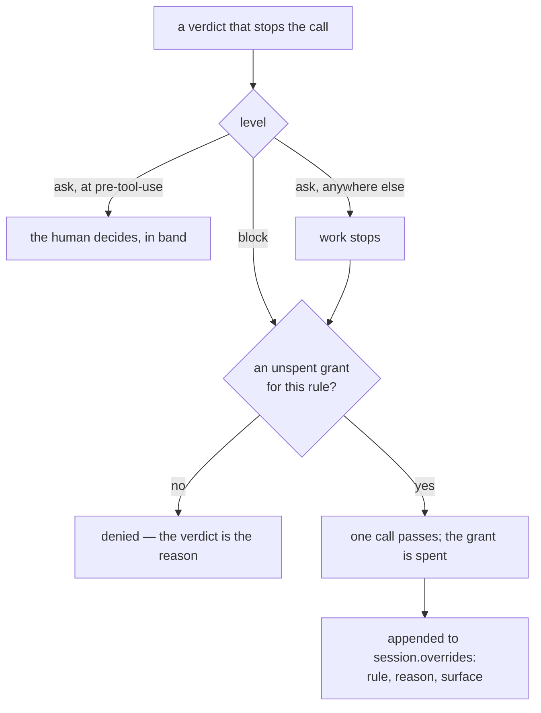
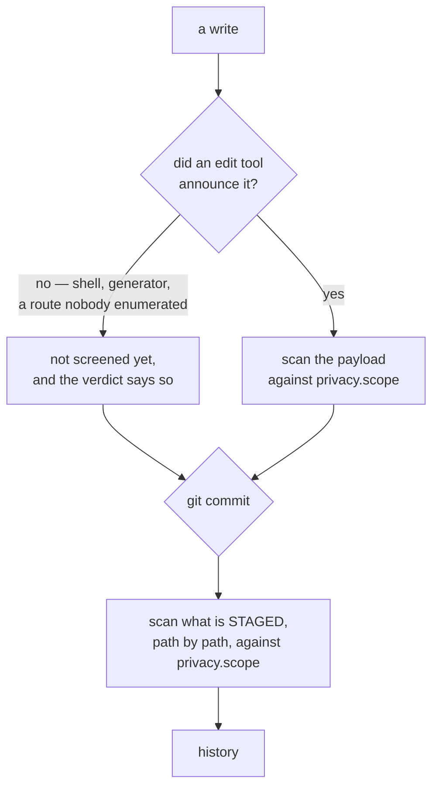
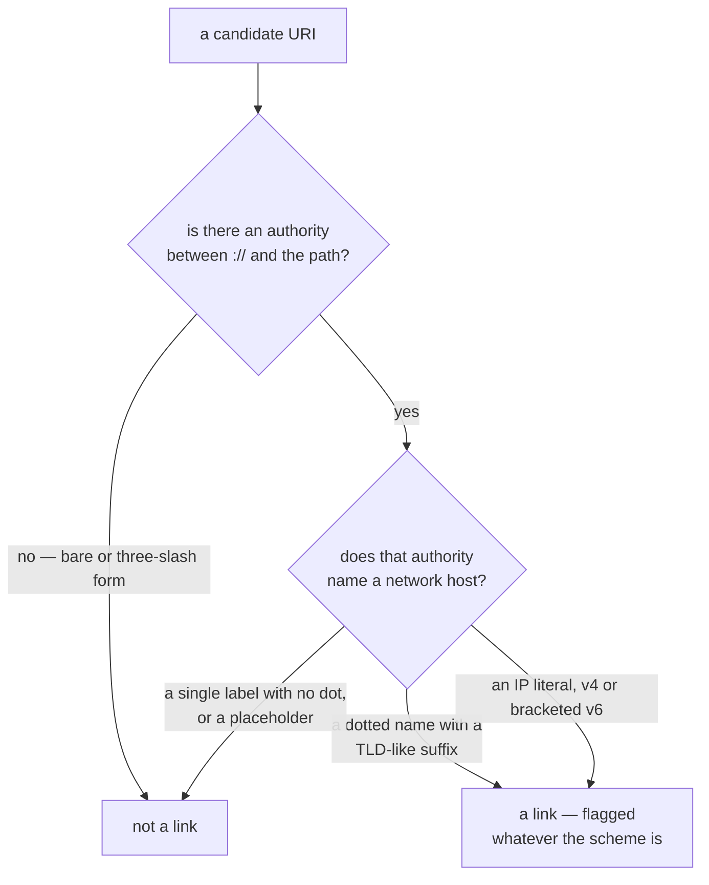
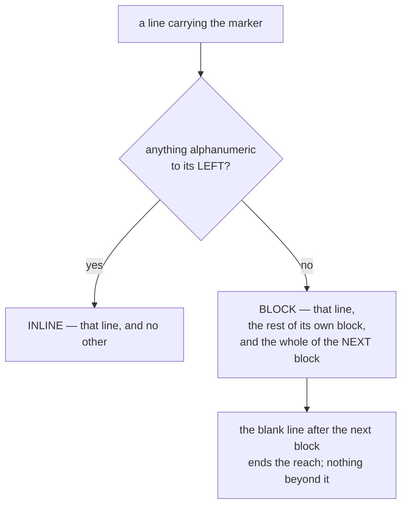

# The manifest

`.claude/invariant.yaml` is the only project-aware artifact. Everything the
library does that depends on *this* project is resolved from here or from an
adapter named here. If something about a project cannot be expressed in the
manifest, that is a gap in the library, not a reason to edit installed files.

## Full schema

```yaml
version: 1

project:
  name: example
  ecosystems: [swift]          # selects adapters; first is primary

paths:
  root: .                      # repo root, relative to the manifest's parent's parent
  state: .claude/invariant/state
  docs: docs/architecture      # the docs-first gate reads these
  memory: .claude/memory
  memory_index: MEMORY.md
  reports: docs/reports        # where `stats report --write` puts its artifact

commands:                      # adapters supply defaults; these override
  build: null
  test: null
  test_one: null               # {selector} is substituted
  lint: null
  coverage: null                 # runs the suite; {result_bundle} substituted
  coverage_report: null          # optional: reads the measurement, separately
                                 # — a shell reports only the LAST command's
                                 # status, so the two must not be one command

docs:
  format: markdown             # markdown | sphinx
  diagrams: mermaid            # mermaid | plantuml | none
  index: docs/index.md
  require_diagram_update: true

methodology:
  pipeline: tdd                # id of a shipped or project-local FSM file
  extra_machines: []           # project-local FSM yaml paths
  gates:
    coverage_min: 90
    coverage_scope: touched    # touched | affected | all
    coverage_exclude: []       # globs held out of the FLOOR, not the measurement:
                               # the row is still required and the number still
                               # reported, and the verdict names every path it set
                               # aside. Empty by default — excluding anything from
                               # a floor is a policy decision, and it belongs in a
                               # diff someone can review.
    coverage_baseline: null    # path to a recorded per-file shortfall the floor is
                               # RATCHETED against. One entry per line,
                               # `<repo-relative-path> <pct>`, `#` comments and
                               # blank lines ignored. Below the floor and at or
                               # above its entry does not block; below its entry is
                               # a regression and does; no entry fails exactly as
                               # before. A line that will not parse, an entry
                               # recorded twice, and a file this key names but no
                               # root holds are all ERRORS — a record read in part
                               # drops entries in both directions invisibly. Null
                               # by default.

enforcement:
  profile: standard            # strict | standard | loose
  rules:                       # per-rule overrides on top of the profile
    session.own_file_set_only: block
    memory.index_current: warn
    privacy.clean: ask         # block | ask | warn | off — see "Levels" below

session:
  exempt_paths: [".claude/*", ".claude/**", "MEMORY.md"]
  worktree_prefix: null        # null derives it from the project directory name
  worktree_dir: null           # null puts worktrees beside the repository;
                               # a relative value resolves against the repo root,
                               # so worktrees may live INSIDE it
  push: false                  # is publishing to a remote a session step at all

items:
  backend: markdown            # markdown | sphinx_needs | json | none
  path: docs/backlog.md
  id_prefix: ""                # an ADDITIONAL prefix; the type supplies its own
  id_strategy: numeric         # numeric -> BUG_001 | slug -> BUG_DRAIN_STALLS
  exempt: true                 # work items are data; exempt from isolation

memory:
  managed: true
  index_generated: true

privacy:
  enabled: true
  # The default set is DEFAULT_PATTERNS in core/privacy — the ONE authoritative
  # list, shared with a bare PrivacyScanner() so the two construction paths
  # cannot disagree (AUD-15). `device_ids` is implemented but opt-in: its hex
  # shapes collide with git commit hashes, which documents cite routinely.
  patterns: [home_paths, emails, ip_addresses, tokens, clock_times, links]
  extra: []                    # project-specific regexes
  allow: []                    # literal strings exempted
  # Keywords resolve through paths.*; any other entry is a project-relative
  # path prefix. See "Privacy scope" below.
  scope: [docs, memory, reports, commit_messages]

agents:
  library: [feature-architect, compliance-reviewer, backlog-curator, bug-reproducer]
  local: []                    # project-owned agents the library leaves alone
  roles:                       # which agent answers for which pipeline role
    design: [feature-architect]
    review: [compliance-reviewer]

host:
  kind: claude_code
```

### Levels, and where each one can be delivered

A level is **how a verdict is delivered, not a property of the rule's logic**.
That is what makes D10 and D11 compose: a project retunes policy without
touching code.

| Level | At `pre-tool-use` | At `stop`, at a transition, in `invariant check` |
|---|---|---|
| `block` | the call is denied | work stops |
| `ask` | the call goes to the **human**, with the verdict as its reason | work stops |
| `warn` | the verdict is injected as context; the call proceeds | reported; nothing stops |
| `off` | the rule does not run | the rule does not run |

`ask` is the newest and the one with a seam worth stating. The agent host's
permission contract has always carried an *ask* decision alongside allow and
deny — it routes the call to the operator with the reason attached — and this
library only ever emitted `deny`, so a rule the project wanted to be *asked*
about had two settings, "stop the work" and "say nothing" (AUTH-01).

Its second row is the important one. **An `ask` delivered where there is
nobody to ask stops the work.** The `stop` hook's output is a decision the host
acts on, not a question it can put to anyone; a transition gate is evaluated by
a CLI command that may be running unattended. Passing there would mean a level
whose enforcement silently depended on which surface happened to evaluate it,
and this library's standing asymmetry decides that case: a spurious block is
visible and self-correcting, a silent pass is neither. What reaches those
surfaces instead is the override token below.

### The override token, and why it is a grant rather than a flag

Every gate the CLI evaluates can be passed deliberately — `session transition
--force --reason`, `pipeline advance --force --reason`, `item transition
--force --reason` — and each appends an override to the record. For a long time
the gates that actually stop an agent could not be: seven rules fire at
`pre-tool-use` and five at `stop`, and a blocking verdict there was final. No
flag, no marker, no prompt, no recorded exception. The only relief was editing
committed project policy, mid-task, to get past a single call (BUG_049).

```
invariant override <rule.id> --reason '<why>' [--calls N]
invariant override <rule.id> --clear
```

It is a **grant written down before the call**, and it has to be, because a
tool call is not a command the operator types: it carries no argument they can
add, and no environment a running host will re-read — a hook subprocess
inherits the environment the host was launched with, which is why
`INVARIANT_DISABLE` cannot reach one mid-session.



Four properties are deliberate:

- **Spending it is recorded**, in the same `overrides` list a forced transition
  writes to, naming the rule, the reason and the surface. An override that
  leaves no trace is indistinguishable from the gate never having run.
- **It is spent only where the verdict actually stops something.** A token
  burnt by a rule that was passing anyway would be gone at the moment the
  operator needed it.
- **It is consumed at the delivery surface, never inside `core/rules`.** A rule
  is a question about the world, and asking it must not change the world.
- **An unspent grant is loud** — `session status` prints it above the fold,
  because a held override is enforcement the operator turned off and may well
  have forgotten.

`ask` and the token are not alternatives. `ask` puts the human in the loop at
`pre-tool-use` and reaches nothing else; the token reaches `stop` too and
leaves a record, which a host-side approval does not — a human approval arrives
back through the host and is not observable to this library at all.

### Declared stores are writable stores

`items.path`, `paths.memory` and `paths.reports` are not merely locations —
declaring one is what makes the CLI's write-scope invariant cover it, and what
exempts it from session isolation. `cli.md` states the invariant as "the state
root and the stores the manifest declares" (ADR-002 D4) rather than as a list,
so a feature that needs somewhere to write adds a key here instead of adding
an exception there.

The consequence to be aware of: `paths.reports` defaults to `docs/reports`, so
a project that already keeps hand-written prose at that path would find it
exempt from isolation. Point the key somewhere else if so — the exemption
follows the declaration, which is the whole point.

### Privacy scope

`privacy.scope` is a list of two kinds of entry:

- **Keywords**, which resolve through `paths.*` so the scope follows the
  declaration: `docs` → `paths.docs`; `memory` → `paths.memory` **and**
  `paths.memory_index` (the generated index is a concentrate of exactly the
  text the memory scope protects, and was the unscanned second copy —
  AUD-15); `reports` → `paths.reports` (the one rendering of the raw stats
  store that leaves the machine); `commit_messages`, which scans `git commit`
  messages in every spelling git accepts — `-m`, `--message[=]`, combined
  clusters like `-am`, and `-F <file>` by reading the file. A message the
  gate is configured to scan and cannot read (`-F` on an absent file, `-F -`
  from stdin) FAILS rather than passing unread, in the same do-not-relax
  convention as the git helpers (AUD-09); `all`, which scans everything.
- **Literal project-relative path prefixes** — any entry that is not a
  keyword. This is how a project widens scope beyond what `paths.*` names:
  a repository whose `paths.docs` is `docs/architecture` can declare `docs/`
  so its audits and ADRs — committed prose where a leak is just as permanent —
  are scanned too (AUD-15). This library's own manifest does exactly that.

The gate reads every payload shape the edit tools produce: `content`
(Write), `new_string` (Edit), `edits[].new_string` (MultiEdit) and
`new_source` (NotebookEdit). The last two were unscanned while the isolation
rules fired on all four tools, so the same data that blocked a `Write` passed
through a `MultiEdit` untouched (AUD-06).

### Where the gate screens, and why it is not only the edit tools

Reading edit payloads can only ever cover writes that arrive as an edit
payload. A write made through the shell does not: a `cat` heredoc, a `sed -i`,
a `cp`, or a generator that emits a document all carry their content in a
`Bash` command, land in the same file, and used to reach history with the gate
reporting *"nothing in privacy scope was written here"* — a sentence that is
affirmatively false on that route, and indistinguishable from a pass. In one
consuming project whose harness edits Bash-first, that was **every** edit of a
long session (BUG_027).

So the gate screens at a second point, where every route converges:



The commit is the boundary that makes the answer route-independent: nothing in
a staged blob records which tool produced it, so nothing in the gate has to
enumerate them. Five properties of that scan are deliberate:

- **The whole staged blob, not the diff's added lines.** An exemption marker
  reaches a *block* (BUG_045), so a marker on an unchanged line above an added
  one is invisible to a scan of the addition alone — and the gate would block
  on a finding the project had already exempted, at a spot the author cannot
  see in the diff.
- **`privacy.scope` decides which staged paths are read**, by the same
  project-relative prefix rules as an edit's target. A commit typed in a
  subdirectory names the same blobs, because staged paths are spelled against
  the repository toplevel.
- **A staged set or a staged blob that cannot be read FAILS**, in the same
  do-not-relax convention as `-F` on an unreadable message (AUD-09). This is
  the one gate whose subject cannot be recovered after the fact.
- **A deleted path is not an unreadable one.** Deletions are excluded from the
  list before any blob is read, so removing a document is not a fail-closed.
- **Bytes that do not decode carry nothing that can leak in text form** — the
  same answer `PrivacyScanner.scan_file` and `invariant privacy scan` already
  give a binary file. A commit containing a diagram is not a gate no change
  can clear.

The skip sentences were rewritten in the same change, because the false one is
what let the gap survive a long session unnoticed. Each route now states the
limit that actually applies to it: an edit outside scope still says nothing in
scope was written; a commit says no staged path is inside scope; a shell call
that is not a commit says it is not read as it runs and that what it writes is
screened when it is committed. A skip and a pass are different facts, and a
skip that misstates its own reason is the harder of the two to notice
(BUG_020).

**Deliberately unchanged:** `session.isolated_before_edit`,
`session.no_edit_in_main_checkout` and `pipeline.started_before_edit` share the
same "is this an edit tool" predicate and are therefore blind to the same
route. They now *say* so instead of returning a reason-less N/A, but their
enforcement is untouched: teaching them to refuse shell commands is a
behaviour change that could wedge a live session, and it is its own scoped
decision rather than a rider on this one.

### What `links` flags

Of the default patterns, `links` is the one whose concept is easiest to state
too broadly, so it is stated here: **a link is a URI whose authority names a
network host.** The authority is the axis, not the scheme.



An authority names a network host when it is a dotted name ending in a
TLD-like suffix, or an IP literal — v4, or v6 in brackets. Optional userinfo
before it and a port after it change nothing. That is a finding whatever
scheme carries it, which is the half worth keeping: a private scheme aimed at
a real host leaks exactly as much as a web address does, and narrowing the
pattern to an allowlist of the web's own schemes would have stopped catching
it.

An authority names no network host when it is **absent** — the bare `file://`
form, or the three-slash local-file form — or when it is a single label with
no dot: `applephotos://asset/<lid>`, `scan://<uuid>/document`,
`encrypted-media://local/...`. These are documented identifier *formats*
written with placeholders. They address nothing reachable and can leak
nothing, and every one of them used to be a finding, because the pattern
matched anything before a `://`. On two architecture documents of one
consuming project that came to 26 findings, 20 of them false — which is the
shape the module's own rule warns about: a noisy privacy gate is one that gets
disabled wholesale rather than tuned (BUG_044).

Two consequences of the test being structural, both deliberate:

- A **single-label host** — a loopback name, or a container-network service
  name — is not a finding, with or without a port. Those name the reader's own
  machine or its private network and identify nobody. The rest of that class is
  the accepted residue: a bare intranet hostname parses the same way, and a
  machine name can carry its owner's. It is accepted rather than unnoticed —
  a personal machine reaches a document far more often through its home path,
  which `home_paths` still catches.
- A **reverse-DNS identifier** in the authority position *is* a finding.
  Nothing in the text distinguishes it from a hostname, and where the two are
  indistinguishable this pattern errs noisy rather than silent.

The schemeless `www.` form and the scp-style `user@host:path` a git remote is
written in are separate arms and are unaffected by any of the above.

### The exemption marker, and how far it reaches

Every gate needs an escape hatch for the case it gets wrong, and this one is a
string written into the text being scanned: `invariant: allow-privacy`. The
spelling lives in exactly one place — `EXEMPTION_MARKER` in `core/privacy` —
read both by the scanner and by the rule that prints the advice, so the two
cannot come to disagree about it.

**The rule, in one sentence:** a marker exempts its own line; and when nothing
but comment punctuation precedes it on that line, it also exempts the rest of
the block it opens and the whole of the next block, where a block is a run of
consecutive non-blank lines.



The inline half is the older of the two and is unchanged. It is the right form
in source code, where every language has an inline comment, and it is what the
`allow` list is not: `privacy.allow` exempts a literal string everywhere it
appears, and a marker exempts a *place*.

The block half exists because the inline form is unwritable in the markup this
gate mostly scans. `privacy.scope` defaults to documents, memories and reports
— all prose — and **reStructuredText and Markdown have no inline comment**: a
comment there owns its line. So the only way to exempt a finding in prose was
to append the marker to the prose itself, where it renders into the published
output. One consuming project shipped six of those, visible in its built HTML
as parentheticals, before this was fixed (BUG_045).

**A block and not a line**, because in RST the marker cannot be put next to
what it covers. A comment inserted mid-paragraph *splits the paragraph*; a
comment inserted between list items *ends the list* and starts a second one.
Both change the rendered output, which is the thing the marker exists to leave
alone — so the comment can only go before the whole block, and in practice the
finding is mid-block every time. A one-line reach would exempt nothing that
needs exempting.

**Two blocks and not the rest of the file, or of the section**, because the
reach is the whole risk. A marker is a place a real leak can be parked, so its
cover has to be something a reviewer reading the diff can see the end of. Its
own block is included so that a comment wrapped over two lines covers what
follows it rather than only itself, and the reach runs FORWARD only — a line
above the marker in the same block is still scanned. Blank lines between the
marker and the block it covers are skipped, because RST needs one to close the
comment; what follows them is still exactly one block.

A file can be exempted only by marking every block in it, which is a diff full
of markers rather than a single line nobody notices. That is the intended
trade: the escape hatch is cheap to use honestly and conspicuous to abuse.

Two things the engine deliberately does not know. It does not parse markup, so
whether the marker's line is *really* a comment is the author's problem — a
bullet beginning with the marker is block-scoped and also renders. And a
comment is still source text: Sphinx keeps the marker out of every rendered
page, but a published `_sources` mirror or a machine-readable export of the
directive bodies carries the source verbatim, as it does for the inline form.

### Where worktrees live

`session.worktree_dir` exists for hosts that trust one location and confirm
every other. Claude Code, for one, asks before relocating its permission root
into a worktree outside `.claude/worktrees/`, and that confirmation is
deliberately not suppressible by any permission rule — so a project whose
worktrees sit beside the repository is asked once per session, forever. Pointing
this at the trusted directory ends that, and the trust is decided by path: a
worktree created there by plain `git worktree add` is entered without a prompt.

Placing worktrees inside the repository has one consequence worth stating,
because it fails silently rather than loudly. Exempt patterns are matched with
`fnmatch`, whose `*` spans path separators, so `.claude/*` matches
`.claude/worktrees/wt-1/src/app.py` — every source file in a worktree placed
there. The isolation rule consults the exemption first and skips on a match, so
the result would not be an error but an absence of enforcement. The library
therefore resolves a path inside a linked worktree against **that worktree
alone**, which is the more accurate reading anyway: a file's project-relative
identity is where it sits in its own checkout, not where its checkout sits. A
directory prefix cannot exempt what is underneath it.

The directory should also be ignored by git, or the main checkout is dirtied by
every live session. Claude Code writes `.claude/worktrees/` into
`.git/info/exclude`, which is local to one clone — a project that wants this to
hold on every machine commits the entry to `.gitignore` instead.

Every key has a default. A minimal usable manifest is three lines:

```yaml
version: 1
project: { name: example, ecosystems: [python] }
```

## Validation

`Manifest.validate()` runs on every load and refuses, with a named reason: an
unsupported `version`, an unparseable enforcement level (`block`, `ask`, `warn`
or `off`), an `enforcement.rules` KEY naming no registered rule, a non-list
`privacy.scope`, an unknown `items.backend`, and — because several gates used
to skip, silently and non-blocking, exactly when this was mistyped (AUD-08) —
a `methodology.pipeline` that names no shipped or `extra_machines` machine.
Existence is checked at load; whether the file parses as a machine of the
right *kind* is still the loader's question, and a machine that exists but
cannot load as a pipeline now **fails** the gates that need it
(`pipeline.complete`, `session.work_would_be_stranded`) rather than being
stepped past.

### An override either takes effect or says it did not

The rule ids in `enforcement.rules` are checked against the registry, and a key
naming nothing is a **refusal at load** carrying the nearest real id.

Only the *value* used to be parsed. `rule_level()` answers `warn` for any id it
does not hold, so `privacy_clean: off` written beside a real `privacy.clean`
loaded without error, left the real rule at `block`, and showed a provenance
entry for the typo that read as though the override had taken. `doctor` was
green; `rules list` shows only real rules, so the discarded key appeared
nowhere (BUG_050).

This is the library's own central claim pointed at its own configuration.
*"Non-compliance is silent"* is the failure it exists to remove, and a
discarded override is that failure aimed at the operator instead of at the
agent — in the one place it costs most, because an override is the single
control this library hands back. The instinct was already written down twice:
`core.rules.evaluate` fails loudly on a gate naming a rule that does not exist,
*"A gate naming a rule that does not exist would otherwise pass silently
forever"*, and AUD-08 added exactly this check for a mistyped methodology.

Three properties of the check are deliberate:

- **Refused at load, not warned.** A manifest is read on every command, so a
  warning here is printed hundreds of times and read none of them.
- **`INVARIANT_DISABLE` warns instead, and proceeds.** It is an escape hatch
  reached in a hurry by someone already blocked; refusing to load the whole
  manifest because one token was mistyped would wedge exactly that caller. The
  unknown token is dropped, named on stderr with the nearest real id, and the
  rest of the list applies.
- **`doctor` survives it.** `doctor` is the command someone runs *because* the
  manifest is wrong, and it resolved the manifest before it could report
  anything — so a refusal at load took out the one command that would explain
  it. An unloadable manifest is now a failed `manifest valid` row carrying the
  reason.

One consequence worth naming: editing `methodology.pipeline` mid-pipeline does
**not** retune the pipeline already running. The methodology is recorded on
the pipeline at `start` and the machine is resolved from that record ever
after, so the manifest edit takes effect from the next `pipeline start`
(AUD-02/AUD-03).

## Resolution order

For any value, later wins:

1. Library defaults
2. Primary adapter defaults (from `project.ecosystems[0]`)
3. Additional adapters, in listed order
4. Enforcement profile (for rule levels only)
5. Explicit manifest values
6. Environment overrides (`INVARIANT_*`), for one-off escapes

Layers 5 and 6 are where the operator exercises authority, and they are held to
a different standard than the rest because of it: a rule id either resolves or
is refused by name. See "An override either takes effect or says it did not"
above.

`invariant config show` prints the fully resolved configuration with the
provenance of each value, because "why is this rule blocking me" must be
answerable without reading the library's source.

## Adapters

An adapter is a Python class exposing ecosystem knowledge:

```python
class Adapter:
    id: str
    def detect(self, root: Path) -> bool: ...
    def default_commands(self) -> dict[str, str | None]: ...
    def parse_test_output(self, stdout: str, stderr: str, code: int) -> TestResult: ...
    def parse_coverage(self, raw: str) -> dict[str, float]: ...
    def source_files(self, changed: list[Path]) -> list[Path]: ...
    def carries_executable_code(self, path: Path) -> bool | None: ...
    def hazards(self) -> list[Hazard]: ...
```

`hazards()` is the interesting one. It returns known ecosystem traps that the
engine surfaces as context or as pre-flight checks — cases where a command's
exit code does not mean what it appears to mean. The `swift_xcode` adapter
ships with several: an exit status that indicates whole test suites were
silently dropped rather than run, a destination argument whose name-based form
resolves to a device that may not exist, and a debug device build whose main
binary carries no symbols so that symbol lookups return empty for every query.

A hazard is not a rule. Rules gate transitions; hazards annotate results so
that a green is not mistaken for proof. `parse_test_output` returning
`passed=True` alongside a hazard flag is how the library says "this looks
green, and here is the specific reason that might be a lie."

`default_commands` has a quieter failure, and it is the one that costs most
because nothing reports it. A default names a tool; it does not guarantee the
tool is installed. The Python adapter defaults `lint` to a bare `ruff check .`,
which needs `ruff` on PATH — where it is absent the command does not fail the
check, it fails to *spawn*, and "the linter could not run" is indistinguishable
in a report from "the linter found nothing". Five consecutive sessions in this
repository recorded lint as NOT RUN and moved on before one of them tried an
invocation that resolved. The node adapter's `npm run lint` has the same shape:
it assumes a script the project may never have defined.

The rule is the one `parse_coverage` states from the other direction — a
reading that can come back clean for the wrong reason is the one to refuse. A
project overrides the default with an invocation that resolves through a
declared, locked dependency rather than through whatever happens to be on PATH;
pinning is part of the fix, because an unpinned linter moves the finding
baseline without a change to a line of source. An unrunnable gate is worse than
an absent one: an absent gate is visibly absent, while an unrunnable one reads
as a pass.

`parse_coverage` has a trap of its own, and it is the quiet kind. A reporter's
table layout belongs to the reporter, so a parser keyed to that layout breaks
whenever the layout legitimately varies — and it breaks by returning `{}`,
which is indistinguishable from "nobody has measured yet". The Python adapter
required exactly two numeric columns, which is coverage.py's non-branch table;
every project setting `branch = true` got four, matched nothing, and could
never satisfy a coverage floor at all (BUG_011). The rule is therefore to
anchor on what the adapter does own — the source extension — and to read a
table ROW rather than a column count: the name, then whatever numeric cells
this version emits, then the first percentage. Not "anything up to the first
percentage", which reads `pytest -v`'s per-test progress line as a
measurement; per `Hazard.can_overstate`, a reading that can come back HIGH is
the one a parser must refuse.

`carries_executable_code` is the other three-valued answer, and it is asked
only to explain a coverage row that is **absent**. Reporters emit nothing for
a file with no executable lines — a bare protocol, an enum of cases, a
typealias — and that silence is indistinguishable from a file the run never
measured. `True` and `False` are claims; `None` means "cannot tell", and a
caller deciding whether to *relax* must treat it as "do not relax", exactly as
with `git.branch_files`. The generic adapter knows no language, so it always
answers `None`. The two wrong answers are not symmetrical and an
implementation must prefer the first: calling an inert file live costs a
spurious block, which is visible and sends someone to look; calling a live
file inert passes unmeasured code silently.

## Backends for work items

The item model is fixed; storage is pluggable, so a project keeps whatever
format it already uses.

| Backend | Stores as | Notes |
|---|---|---|
| `markdown` | One file per item, frontmatter fields | Default; git-native, no tooling |
| `sphinx_needs` | Directives in a reStructuredText file | For projects already rendering a needs graph |
| `json` | One JSON document | For machine consumption |
| `none` | Nothing | Work-item domain disabled |

A backend implements read, write, list, and transition-persist. The lifecycle
FSM and the id scheme live above it in `domains/workitem`, so switching
backends does not change item semantics.
