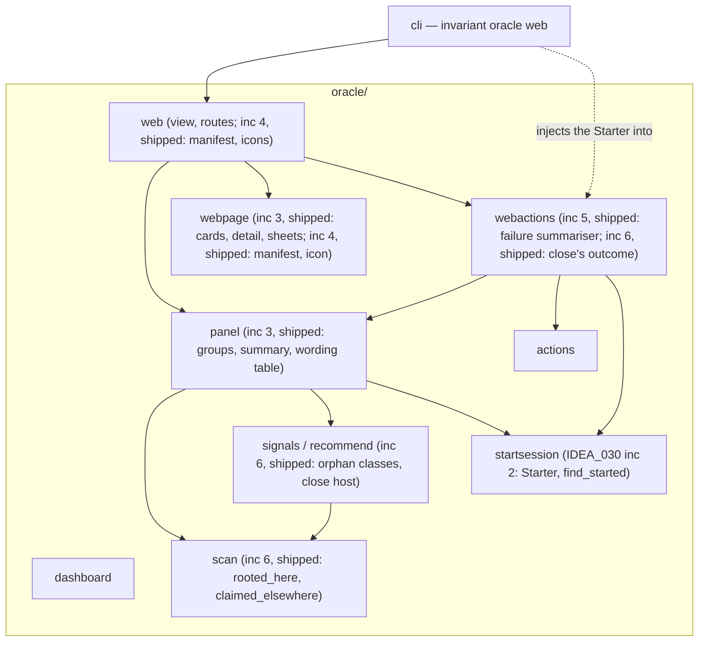
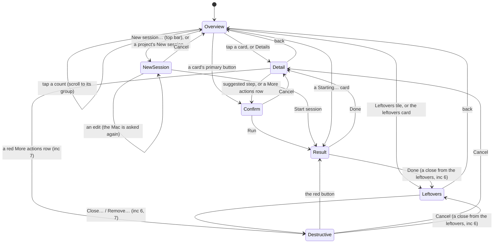

# The oracle's mobile control panel

The design of record for the oracle web page as a mobile control panel
(IDEA_027). The decisions behind it are ADR-009's. The page it replaces, and
the server, transport and pairing it keeps, are in [oracle.md](oracle.md),
"Shipped: the web page". The person-facing setup is the guide's
[The oracle on your phone](../guide/oracle-web.md).

**Status: increments 3 to 6 shipped.** The user approved the mockup on
2026-10-23. Increments 3 to 7 build it ("Increment plan" below). Increment
3, the plain-language panel, increment 4, the home-screen app, increment 5,
failure reasons, and increment 6, orphan classes and close host, are what
the page serves now; "As built in increment 3" to "As built in increment 6"
below record where they fill in what this page left open. Increment 7 is not
built. IDEA_030's increment 2 added the "New session" sheet and the
"Starting…" card ("7 · New session" and "As built in IDEA_030 increment 2"
below; ADR-009 D16).

**Visual reference.** The approved mockup is a private claude.ai artifact of
six 390-pixel-wide phone screens. The scratch files it was drawn from did not
outlive the session that made them. This page copies every value the build
needs, so it is the record: where it and the artifact disagree, this page
wins.

<!-- invariant: allow-privacy -->
Mockup: <https://claude.ai/artifact/M8PBU7JKuUxbYmV6MLViKK> (screens 1 to 6:
overview, session detail, confirm, destructive confirm, failed result,
leftovers).

## Where it sits

The panel changes three modules and adds one. The wording table, the
grouping and the summary counts are pure functions of the `assess` document,
so they get a module of their own, `oracle/panel`, which `web.view` calls.
It imports nothing that runs anything: no `actions`, no `webactions`, no
`hosts/`. The page renders what the view returns and holds no vocabulary
(ADR-009 D2, D3).

`webactions → panel` is for the confirm's and the result's words: the
confirm sheet's title, sentence and button come from the same table as the
card's button, and the result's "Why" is worded by `panel.why_words` from
what `webactions.evidence` read in the output. The new arrows are `web → panel`, `panel → scan` (for
`row_key` and the row kinds), `panel → signals` (the signal kinds and
`recommend`'s step kinds) and `webactions → panel`. IDEA_030 adds
`webactions → startsession` (the `Starter` the CLI injects, and
`find_started`) and `panel → startsession` (`find_started` and the `start`
kind), both pure. As built, the panel
needs nothing from `dashboard`, so the `panel → dashboard` arrow this page
first drew is not there, and `web` no longer reads `scan` or `signals`
itself: the two arrows `web → scan` and `web → signals` went with the old
per-project view.

## Screens

The detail and leftovers screens are views inside the one page, not new
routes: they are drawn from the state document the page already polls, so
they refresh with it. Back returns to the scroll position the person left.
The confirm, destructive confirm and result are bottom sheets over the
screen they were opened from.

### 1 · Overview

Top to bottom, with 20 px between blocks and a 16 px side margin:

1. **Header.** "Sessions" as the title, and under it the freshness line: a
   7 px green dot and "Live · updated N s ago". When stale it reads "Stale ·
   updated N s ago" in red, with a red dot. On the right, a round 44 px
   Refresh button that reads at once.
2. **Summary strip.** Four equal tiles in one row: Need you (amber), Problems
   (red), Working (blue), Leftovers (grey). Each tile is a count over a
   label. The first three are anchor links to their group, the last opens
   the Leftovers screen. A count of 0 still shows, so the strip never moves.
3. **Groups**, in order: Needs you, Problems, Working, Idle. Each has an
   uppercase heading in its accent colour. A group with no rows is not
   drawn. Idle has no tile and uses the compact card.
4. **Leftovers card**, last: "N leftovers to tidy", a one-line breakdown
   ("8 Claude windows with no session, 2 left-over folders") and a chevron.
   Not drawn when there are none.

A plain-HTTP warning, the watcher banner and a read error keep their place
under the header (oracle.md, "What the page shows").

**Full card** (Needs you, Problems). From top to bottom:

- a meta row: the project name, uppercase, on the left, and the age of the
  condition ("4 min") on the right;
- the session's title: its name without the trailing id, else its task;
- one or more state chips (wording table, "States");
- an optional note line (secondary text), such as "Its Claude window closed.
  Fixing a bug." or the permission note;
- a button row: the primary button (blue, flexible width) and Details
  (92 px, secondary). A row with nothing to run shows only Details, full
  width. A row waiting on a prompt shows no buttons, and the whole card
  opens the detail view (ADR-009 D8).

**Compact card** (Working, Idle). A single tappable row: the project
(uppercase), the title, and a line "<phase> · active N min ago", with a
chevron. It opens the detail view.

### 2 · Session detail

1. A back link, "‹ Sessions", 44 px tall.
2. The kicker "<project> · <lane>" (uppercase), the title (28 px), and the
   state chips with ages ("Paused 3 h").
3. **What is going on**: a card with one to three plain sentences composed
   from the wording table. Example: "The last test run had 52 failures. The
   Claude window working on it closed 3 hours ago, so nothing is happening
   until you resume it."
4. **Suggested next step**: the step's name ("Re-run the tests"), one
   sentence on what it does and does not touch, then the 48 px primary
   button and a 48 px square Copy button.
5. **More actions**: a grouped list of 56 px rows, each a title and a
   one-line consequence, with a chevron. "Resume in a new Claude window"
   (Opens Terminal on your Mac) from increment 3. From increment 7, the red
   rows: "Abandon session" (Keeps its folder and branch) and "Remove its
   folder and branch" (Deletes unmerged work). A row is shown only when its
   action is allowed on this row now.
6. **Recent**: dated events of this session, newest first, as "<event>" and
   a local time on the right. Only events with a recorded time (ADR-009 D4).
7. **Technical details**, closed by default. Session id, state and lane
   ("Session 4b7b00c1 · state isolated · lane bugfix:fixing"), the worktree
   path in a horizontal scroller, and the host id with its pid or "process
   id not recorded". This is the only place engine names appear.

### 3 · Confirm (a safe step)

A bottom sheet with a 24 px top radius, over the dimmed screen (28 %
opacity of the content behind):

1. A grabber, 36 by 5 px.
2. The title, a question ("Re-run the tests?"), 22 px bold, and one
   sentence: "Runs Heap's test suite in this session's folder and records
   the result. Nothing is changed or deleted."
3. **Command** block: an uppercase "Command" label with a Copy button on
   the right, the command in 15 px monospace (horizontal scroller), and the
   place in plain words: "In Heap › session folder 4b7b00c1".
4. A closed toggle, "Exact folder and environment": the exact `cwd` (in a
   scroller), each added variable as `NAME=value`, and "Runs as you on the
   Mac, without the marks of any Claude window."
5. The Run button (primary, 52 px, named for the deed: "Run tests") over
   Cancel (secondary, 52 px). Cancel holds focus when the sheet opens.
6. "This confirm expires in M:SS", counting down from the nonce's 120 s.
   At zero, Run is disabled and the line becomes "This confirm expired.
   Look again".

A terminal step adds "Opens Terminal on your Mac" to its sentence and
shows the launch line inside the toggle.

### 4 · Confirm (a destructive step)

As screen 3, except:

1. The sentence ends with the cost: "Ends this session and deletes its work
   that was never merged. This cannot be undone."
2. **This deletes**: a red-ground panel listing each thing that goes, one
   line each, counted from a fresh read: "The session folder
   Heap-wt-4b7b00c1", "The branch session/4b7b00c1, with 3 commits not on
   main", "2 changed files that were never committed".
3. **Checked just now**: "No Claude window is using this session" and
   "Checked again the moment you press Remove".
4. The exact command behind a closed "Exact command" toggle.
5. Cancel first, then the red button named for the deed ("Remove folder and
   branch").
6. The expiry line, as screen 3.

### 5 · Result (failed)

1. A 40 px round red mark with a cross, the headline ("The tests did not
   start", 20 px bold), and under it "<step> · stopped after N s".
2. **Why**: one sentence (ADR-009 D9).
3. **Show full output**, closed: the output's tail in 12 px monospace,
   `white-space: pre`, at most 160 px tall, scrolling inside.
4. Done (secondary, 52 px), which returns to the detail view.

A successful result uses the same sheet with a green tick, "Done in N s" and
the same output toggle. A terminal step's result says "Opened in a new
window" or why it was not seen alive.

### 6 · Leftovers

1. Back link, title "Leftovers", and "Things that outlived their session.
   None of them needs you; tidy them when you like."
2. **Claude windows with no session**, with its count: 64 px rows of
   "<project> · idle 2 days" over "Still open on the Mac · window 27885f4e",
   each with a "Close…" pill (increment 6). The first three show, then
   "Show N more".
3. **Left-over folders**, with its count: "<project> · session 0c269de4"
   over "Abandoned · 1 commit not on main", with "Remove…": red-tinted when
   it holds unmerged work, grey when it holds none (increment 7).
4. A note card: "Close and Remove always ask first, show what goes, and
   check again that nothing is using it the moment you confirm."

As built in increment 6, a Claude window's row carries its pill when its
step is one the panel runs: "Close…" for a host every close guard lets go,
"Attach…" for an unmanaged one that is the only live window the one
session here without a window could take. A row with nothing to run has no
pill, and the folders have none until increment 7.

### 7 · New session (IDEA_030)

A bottom sheet, built like screen 3, opened by "New session…" in the
overview's top bar (left of Refresh; 44 px tall, radius 22, `surface-button`,
15 px semibold; hidden on the detail and leftovers screens and on a page that
cannot act) or by a project's "New session…" pill in the **Projects**
section, the overview's last block: one 64 px list row per registered project,
its name over "N live sessions", and the pill. The pill opens the sheet with
that project chosen; the top bar's chooses the first.

1. Grabber, the title "Start a new session?", and the sentence "A new
   Terminal window on the Mac runs Claude with Remote Control in <project>'s
   main folder."
2. **Project**: a picker of the registered projects, the snapshot's list.
3. **Name**: the label, a text field holding the time label ("1026-0049")
   until edited, and under it the full name in 13 px monospace, "Remote
   Control name: invariant-1026-0049".
4. **First message (optional)**: a three-line text area, and the note
   "Claude starts with this message. Leave it empty to start without one."
5. **Checked just now**: an inset block, "N Claude windows already open here"
   (or "No Claude window is open here") and "Main folder has uncommitted
   changes (N files)" (or "has no uncommitted changes", or "Could not tell
   …"). Neither blocks.
6. A refusal, when the Mac refuses what the fields say: one red line, "Not
   run: <reason>". The fields keep what was typed.
7. A closed toggle, "Exact command and folder": the Command block (the
   `claude` line with the first message quoted, Copy, "In <project> › main
   checkout") and the folder.
8. "Start session" (primary, 52 px) over Cancel, which holds focus, and the
   expiry line.

Fields are 16 px (so iOS does not zoom), at least 44 px tall and the sheet's
full width. Each edit disables "Start session" and asks the Mac again 400 ms
after the typing stops; the answer refills the name, the facts and the
command in place and re-arms the button with a new nonce. What is posted is
always what the sheet shows.

**The Starting… card.** After "Start session", the result sheet shows the
start like any action ("Running…", then "Opened in a new window" and "Pick
it up from Remote Control on your phone as <name>."). On the overview the
start is a compact card at the top of **Working**: the project, the name, and
"Starting…". Tapping it opens the start's result. Once a scan sees a live
Claude window launched by that name, the card is gone and the window's own
row is drawn there instead, titled by the name; its detail says "Claude is
running in a new window on the Mac. Pick it up from Remote Control on your
phone as <name>." A window not seen a minute after the start, or a launch
that failed, turns the card into a failure: a red "Did not start" chip and
the reason, and tapping it opens the failed result (screen 5) with that
reason under "Why".

## Components

| Component | Size and shape | Used on |
|---|---|---|
| Freshness line | 13 px, 7 px dot (6 px gap) | 1 |
| Icon button | 44 × 44, radius 22, `surface-button` | 1 (refresh) |
| Summary tile | grid of 4, gap 8; padding 10 × 8, radius 14, min height 44; count 24/28 bold, label 12 semibold | 1 |
| Group heading | 13 px semibold, uppercase, tracking 0.6 px, accent colour | 1, 2, 6 |
| Card | `surface-card`, radius 18, padding 14 × 16, inner gap 8 | 1, 2 |
| Quiet card | `surface-quiet`, 1 px `border`, radius 18 | 1, 2, 6 |
| State chip | 13 px semibold, padding 4 × 10, radius 10, tinted ground and accent text | 1, 2 |
| Primary button | `accent-primary`, white text, radius 12, height 44 (card), 48 (detail); 52 and radius 14 in a sheet; 16/17 px semibold | 1, 2, 3 |
| Secondary button | `surface-button` (card) or `surface-pill` (sheet), same sizes | all |
| Destructive button | `accent-destructive`, white text, 52 px, radius 14 | 4 |
| Pill button | visible 36 px tall, padding 0 × 14, radius 10, 15 px semibold; hit area padded to 44 (ADR-009 D12) | 6 |
| List row | min height 56 (actions) or 64 (leftovers), padding 0 or 10 × 16, 1 px `border` between rows | 2, 6 |
| Disclosure | `
`, summary min height 44 to 52, 14 to 15 px semibold `text-tertiary` | 2, 3, 4, 5 |
| Bottom sheet | `surface-sheet`, top radius 24, padding 10 × 16 × 34 plus the bottom safe area, gap 16; grabber 36 × 5, radius 3, `grabber` | 3, 4, 5 |
| Inset block | `surface-inset` (or `tint-problem` for "This deletes"), radius 14, padding 12 × 14 | 3, 4, 5 |
| Monospace value | `ui-monospace, Menlo, monospace`, 13 to 15 px, single-line scroller or separator wrap (ADR-009 D12) | 2, 3, 4, 5 |
| Back link | 44 px tall, 17 px, `link`, chevron 20 px | 2, 6 |

Icons are inline SVG, 18 to 20 px, stroke 2 (2.2 for the back chevron, 2.4
for the result's cross), round caps and joins: refresh, chevron right,
chevron left, chevron down, copy, cross, tick.

## Tokens

The values are the mockup's, exactly. The page declares them once, as CSS
custom properties.

### Colour

| Token | Value | Use |
|---|---|---|
| `bg` | `#0B0C0E` | page ground |
| `bg-under-sheet` | `#050506` | ground behind an open sheet |
| `surface-card` | `#16181B` | cards, list groups |
| `surface-quiet` | `#121417` | the leftovers card, Technical details, the note card |
| `surface-sheet` | `#17191C` | bottom sheets |
| `surface-inset` | `#0F1113` | command block, Why, full output, Checked just now |
| `surface-button` | `#1F2226` | icon button, Details, Copy (detail) |
| `surface-pill` | `#23262A` | Cancel, Done, Copy (sheet), grey pills, Paused chip ground |
| `tile-idle` | `#1A1C1F` | Leftovers tile ground |
| `border` | `#24272B` | row separators, quiet-card border |
| `grabber` | `#3A3E44` | sheet grabber |
| `text` | `#F2F3F5` | primary text |
| `text-secondary` | `#A4AAB0` | meta, notes, labels |
| `text-tertiary` | `#C4C9CE` | sheet sentences, grey chip text, disclosure summaries |
| `chevron` | `#8A9097` | list chevrons |
| `link` | `#8FC1FF` | back link, Show N more (hover/pressed `#B9D8FF`) |
| `live` | `#4ADE80` | the freshness dot when fresh |
| `accent-needs` | `#FFC266` on `tile-needs` `#2B2114`, chip `#3A2A12` | Need you |
| `accent-problem` | `#FF8F85` on `tile-problem` `#2A1716`, chip `#3A1A18` | Problems, destructive text, This deletes ground |
| `accent-working` | `#8FC1FF` on `tile-working` `#14202D`, chip `#142436` | Working |
| `accent-idle` | `#C4C9CE` on `tile-idle` `#1A1C1F`, chip `#23262A` | Idle, Leftovers |
| `accent-primary` | `#2563EB` | primary buttons |
| `accent-destructive` | `#B91C1C` | the destructive button |

The stale freshness line and its dot use `accent-problem`. The success tick
uses `live` on a `#13261A` ground; the mockup draws no success sheet, so
this one pairing is derived.

### Type

System fonts only: `-apple-system, system-ui, "Segoe UI", sans-serif`;
monospace `ui-monospace, Menlo, monospace`.

| Role | Size / line height | Weight | Notes |
|---|---|---|---|
| Overview title | 32 / 38 | 700 | tracking −0.4 px |
| Detail and leftovers title | 28 / 34 | 700 | tracking −0.3 px |
| Sheet title | 22 / 28 | 700 | |
| Result headline | 20 / 26 | 700 | |
| Tile count | 24 / 28 | 700 | |
| Card title, step name | 17 / 22 | 600 | |
| Back link, sheet buttons | 17 | 400 / 600 | |
| List row title, card buttons | 16 | 400 / 600 | |
| Body sentence | 15 / 22 | 400 | |
| Note, secondary line | 14 / 20 | 400 | |
| Chip, freshness, meta value | 13 | 600 / 400 | |
| Labels (uppercase) | 12 to 13 | 600 | tracking 0.4 to 0.6 px |
| Full output | 12 / 18 | 400 | monospace |

### Space, radius, size

- Side margin 16. Gaps: 20 between overview blocks, 18 on detail and
  leftovers, 16 inside a sheet, 10 between cards of a group, 8 inside a
  card.
- Radii: 28 phone frame (mockup only), 24 sheet top, 18 card, 14 tile,
  inset block and sheet button, 12 card button, 10 chip and pill, 8 the
  small Copy.
- Safe areas: the page pads by `env(safe-area-inset-*)` (top 58 and bottom
  34 in the mockup's 390 × 844 frame, which are the inset plus the margin).
  A sheet adds the bottom inset to its own 34 px.
- Minimum hit area 44 × 44 for every control (ADR-009 D12).

## Wording

One table in `oracle/panel`, and the only place these strings are spelled
(ADR-009 D3). Buttons are sentence case. A button that opens a confirm ends
with "…". A button that acts is named for the deed.

### Groups and tiles

| Group | Heading | Tile label | Who is in it |
|---|---|---|---|
| needs | Needs you | Need you | `waiting` (permission, question, input); `finished` (reviewed, ready) |
| problems | Problems | Problems | `error` (tests, degraded, scan); `gate_blocked`; `stuck`; `host_gone`; `stranded` |
| working | Working | Working | the row's `turn_state` is `busy` (the current host is mid-turn and working, `signals.turn_state`, BUG_087), nothing above |
| idle | Idle | (no tile) | every other live session: `your_turn`, `parked`, `teardown_pending`, no signal |
| leftovers | Leftovers | Leftovers | `orphan_host` and `leaked_worktree` rows with no alert |

### States (chips and sentences)

| Fact | Chip | Tone | Sentence for "What is going on" |
|---|---|---|---|
| `waiting`, permission | Waiting for your permission | needs | Claude asked for permission N min ago. Answer it in Claude on your Mac or phone. This panel never answers prompts. |
| `waiting`, question | Waiting for your answer | needs | Claude asked you a question N min ago. Answer it in Claude. |
| `waiting`, input (only Claude Code's own status says it waits, BUG_087) | Waiting for you | needs | Claude is waiting for you in its window. Answer it in Claude on your Mac or phone. This panel never answers prompts. |
| `finished`, reviewed | Finished, ready to merge | needs | The review checks passed. It can be merged. |
| `finished`, ready | Finished, ready for review | needs | Its plan is complete and its lane has landed. It is ready for the review checks. |
| `error`, tests | N tests failing (else Tests failing) | problem | The last test run had N failures. |
| `gate_blocked` | Blocked by a check | problem | A check refused the last step: <rule, in plain words where the table knows it>. |
| `stuck` | No progress for N min | problem | Claude has been working for N min with no sign of progress. |
| `error`, degraded | A hook failed | problem | One of invariant's hooks failed in this session. |
| `error`, scan | Cannot read this project | problem | invariant cannot read this project's settings. |
| `host_gone` | Paused | idle | Its Claude window closed without saying so, N ago, so nothing is happening until you resume it. |
| `stranded` | Its folder is gone | problem | The session's folder no longer exists. |
| `turn_state` `busy` | Claude is working | working | Claude is working on it; active N min ago. |
| `your_turn` | Waiting for your next message | idle | Claude finished its turn and is waiting for you. |
| `parked` | Paused | idle | No Claude window is working on it. Resume it to go on. |
| `teardown_pending` | Merged, ready to clean up | idle | It is merged. Its folder and branch can be removed. |
| unknown | (none) | — | (none) |

### Lanes and phases

| Methodology | Lane | Phases |
|---|---|---|
| `tdd` | feature | designing: Designing; red: Writing tests; green: Making tests pass; refactor: Tidying up; reviewing: In review |
| `bugfix` | bug fix | triaging: Looking at the bug; reproducing: Reproducing the bug; reproduced: Bug reproduced; not_reproducible: Could not reproduce; fixing: Fixing a bug; verifying: Checking the fix |
| `chore` | chore | doing: Working; reviewing: In review |
| `spec-first` | feature | designing: Designing; specified: Spec written; implementing: Building; reviewing: In review |
| `docs` | docs | drafting: Writing docs; reviewing: In review |
| `none` | (none) | working: Working |
| any other | (none) | (none) |

A terminal or abandoned phase is never shown on a live card. A machine a
project defines itself gets no phrase, unless its state name is one of
these (ADR-009 D3).

### Steps

| Recommended command | Card button | Confirm title | Confirm sentence | Run button |
|---|---|---|---|---|
| `pipeline test` | Re-run tests… | Re-run the tests? | Runs <project>'s test suite in this session's folder and records the result. Nothing is changed or deleted. | Run tests |
| `pipeline gates` | Show blockers… | Show what is blocking it? | Lists the checks this session still owes and what clears each. Nothing is changed. | Show blockers |
| `context --id` | Show its instructions… | Show what the session is being told? | Prints the session's current instructions. Nothing is changed. | Show |
| `session review --id` | Review… | Run the review checks? | Runs the review checks and marks the session reviewed if they pass. Nothing is merged. | Run review |
| `session merge --id` | Merge… | Merge this session? | Merges the session's branch from the main checkout. Its folder and branch stay until clean-up. | Merge |
| `session teardown --id` | Clean up… | Remove the folder and branch? | Removes the merged session's folder and branch. (Destructive sheet: lists the folder and the branch.) | Remove folder and branch |
| `session reap --dry-run` | Check clean-up… | See what clean-up would abandon? | Lists the sessions whose folder and branch are both gone. Nothing is changed. | Show |
| `session resume --id` (terminal) | Resume… | Resume in a new Claude window? | Opens Terminal on your Mac and starts Claude in this session's folder. You can pick it up from Remote Control on your phone. | Open window |
| `session resume --id --force` (terminal) | Resume… | Take over in a new Claude window? | Its last Claude window closed without saying so. Opens Terminal on your Mac and starts Claude there to take over. | Open window |
| `session adopt <host> --id` | Attach… | Attach this window to its session? | Binds the open Claude window to the one session here that has none. | Attach |
| `oracle close-host <host> --pid --start [--tty]` | Close… | Close this Claude window? | Ends Claude in this window, then closes the Terminal tab. You can reopen the conversation later with claude --resume. (Destructive sheet: "This ends" lists the window and its process.) | Close window |
| `doctor` | Check setup… | Run invariant's setup check? | Checks this project's hooks and settings. Nothing is changed. | Run check |
| a start (`oracle start-session`, IDEA_030) | New session… | Start a new session? | A new Terminal window on the Mac runs Claude with Remote Control in <project>'s main folder. | Start session |
| `info` step, or waiting | (no button) | — | — | — |

Increment 6 added close host. Increment 7 adds rows here for kill a leaked
process, abandon a session, remove an orphaned worktree, and nudge or
re-dispatch a stuck agent, each with its "This deletes" lines.

### Fixed strings

| Where | Text |
|---|---|
| Overview title | Sessions |
| Freshness, fresh / stale | Live · updated N s ago / Stale · updated N s ago |
| Leftovers card | N leftovers to tidy; "N Claude windows with no session, N left-over folders" |
| Waiting note | Answer it in Claude on your Mac or phone. This panel never answers prompts. |
| Detail sections | What is going on · Suggested next step · More actions · Recent · Technical details |
| Confirm | Command · Copy · Exact folder and environment · Runs as you on the Mac, without the marks of any Claude window. · Cancel · This confirm expires in M:SS · This confirm expired. Look again |
| Destructive confirm | This deletes · Checked just now · No Claude window is using this session · Checked again the moment you press <deed> · Exact command · This cannot be undone. |
| Close host confirm (inc 6) | This ends · Claude in <project> · window <first 8> · Process <pid> · idle <age> · Checked just now · No invariant session is using this Claude window · Checked again the moment you press Close window |
| Result | Why · What happened · Show full output · Done · stopped after N s · Done in N s |
| Failure fallback | Failed, exit N. <last meaningful line> |
| Leftovers | Things that outlived their session. None of them needs you; tidy them when you like. · Claude windows with no session · Left-over folders · Show N more · Close… · Remove… |
| Leftover classes (inc 6) | leftover host: Still open on the Mac · unmanaged: Open, never had a session · recently active (leftover or unmanaged): Active, no session · gone: Already closed · record only · unknown: Process id not recorded (no pid), Still open on the Mac (alive, no activity known) · process ids disagree: Its process ids disagree |
| New session (IDEA_030) | New session… · Projects · Project · Name · Remote Control name: <name> · First message (optional) · Claude starts with this message. Leave it empty to start without one. · Exact command and folder · Start session · N Claude windows already open here / 1 Claude window already open here / No Claude window is open here · Main folder has uncommitted changes (N files) / (1 file) / Main folder has no uncommitted changes / Could not tell whether the main folder has uncommitted changes · No live session / 1 live session / N live sessions |
| Starting card (IDEA_030) | Starting… · Did not start · The window did not appear on the Mac within a minute; check the Mac (a trust prompt or a login may be waiting). · Claude is running in a new window on the Mac. Pick it up from Remote Control on your phone as <name>. |
| Back | Sessions |
| Technical details | Session <id> · state <state> · lane <methodology>:<phase>; Host <id> · process id <pid> / process id not recorded / process ids disagree: <source> <pid> (<alive, gone or unknown>), … |

### Times

Ages are relative and short: "now" under a minute, "N min" under an hour,
"N h" under two days, then "N days". "Active N min ago" on a compact card.
"Recent" shows the local clock time for today, and the date otherwise. An
age is shown only when the fact has a recorded time (BUG_078 makes the last
activity true).

## Behaviour rules

- **Order.** Groups as above. Within a group: severity (high, medium, low,
  info), then the oldest condition first. Ties keep the document's order.
- **No mid-word breaks.** `overflow-wrap: normal; word-break: normal`
  everywhere. Paths and commands are single-line scrollers, or carry a
  `<wbr>` after `/`, `-`, `_` and `.` where they wrap (ADR-009 D12).
- **The first view fits.** At 390 px wide, the strip and the Needs you cards
  need no horizontal scrolling.
- **Refresh.** Unchanged (ADR-008 D6, D18): the timer at the snapshot's
  interval, the backoff, the freshness line and the stale flag. An open
  sheet, an open disclosure and the scroll position survive a refresh.
- **Copy.** `navigator.clipboard.writeText` over HTTPS. Over plain HTTP the
  button selects the command's text instead (ADR-009 D5).
- **Expiry.** The sheet counts down from the confirm's `expires_in`.
- **Waiting rows** never get a primary button (ADR-009 D8).
- **Safe areas** on every screen and sheet (ADR-009 D10).

## Where the build departs from the mockup

The mockup's content is illustrative. The build follows this page where they
differ:

| Mockup | Build | Why |
|---|---|---|
| "Close…" and "Remove…" pills 36 px, sheet Copy 32 px | visible size kept, hit area 44 px | ADR-009 D12 |
| Result "Why": "Heap could not choose a simulator: 4 are running…" | a cause only when invariant wrote it, else "Failed, exit N" and the last meaningful line | The mockup's sentence names a cause the output does not state (ADR-009 D9) |
| Destructive command `invariant session teardown --id … --force` | no `--force`; run from the main checkout | `--force` overrides a refusal the oracle must keep (ADR-009 D7) |
| "Abandon session" | a pinned `invariant session transition abandoned`, or a new subcommand, decided in increment 7 | `session transition` takes no `--id` |
| A "Forget" button on a gone host | no button; gone rows age out after 24 h | IDEA_025 puts any action on a gone row out of scope. Forgetting a record is an open question |
| No Idle group drawn | an Idle group after Working, compact cards, no tile | The user's order is needs you, problems, working, idle |
| No success sheet drawn | the result sheet with a tick | Derived from screen 5 |

## As built in increment 3

Where the build had to decide something this page left open. Each is in
`oracle/panel`'s table, the only place the strings are spelled.

| Question | As built |
|---|---|
| The title of a row that is not a session (an alerting orphan host, an unreadable record) | "A Claude window with no session", "A record invariant cannot read"; a session with neither a name nor a task is "Unnamed session". The name drops its trailing id, and dashes become spaces |
| "Paused" for a window that closed without saying so | "Its Claude window closed without saying so, so nothing is happening until you resume it." The "N ago" form waits for a true time: the only one today is the attention record's modification time, which BUG_078 shows is not one |
| A sentence whose time or count is unknown | Its short form: "Claude asked for permission.", "The last test run failed.", "A check refused the last step." (the rules it knows are named, in plain words, from a short table of the common gates; an unknown rule is never named) |
| "Its Claude window closed" on a card | the note for a `parked` or `host_gone` row, followed by the phase ("Its Claude window closed. Fixing a bug.") |
| A compact card with no phase or no activity | "Active N min ago" alone, "Active now" under a minute, or nothing |
| Leftover rows before increment 6 | A Claude window: "<project> · idle N" over "Still open on the Mac", "Already closed · record only" or "Process id not recorded", then "· window <first 8 of its id>". A folder: "<project> · <folder name>" over "On branch <branch>" or "Not on a branch". The card's breakdown is singular for one ("1 Claude window with no session") |
| The never-read freshness line | "Stale · not updated yet" |
| A failed refresh | a red line under the header, "Refresh failed N times in a row (<reason>). Retrying." |
| The result before increment 5 | "Running…", "Done in N s", "Failed, exit N" (or "Failed" for a window that did not open), "Opened in a new window", the deed and "stopped after N s" under it, the output behind "Show full output". No "Why" yet: that is the summariser of increment 5 |
| "Recent" entries | "Claude asked for permission", "Claude asked you a question", "A check refused the last step", "A hook failed", "Claude started working", "Claude finished its turn", "Its plan was updated", and "<deed>: <result>" for this device's actions |
| More actions | Not drawn in increment 3. The server derives only a row's recommended step (ADR-008 D9), so a second action such as resume, when it is not the suggestion, needs a route of its own; increment 7 adds the section with its rows |
| The destructive sheet for "Clean up…" | `session teardown` is the one destructive step that exists today. Its sheet lists the folder and the branch, ends its sentence with "This cannot be undone.", puts Cancel first and the command behind "Exact command". "Checked just now" waits for increment 7's re-check, so it is not shown |
| Freshness on the detail and leftovers screens | The freshness line stays above the back link on every screen, so a stale read is never out of sight. The title and Refresh show on the overview only |
| Copy feedback | the sheet's Copy reads "Copied"; the detail's icon button's label becomes "Copied" |

## As built in increment 4

The home-screen app (ADR-009 D10). Where the build decided what this page
left open:

| Question | As built |
|---|---|
| The app's name | "Session Oracle", short name and home-screen title "Oracle", both in `panel.WORDS` (`app_name`, `app_short_name`) |
| The manifest | `/manifest.webmanifest`: `display: standalone`, `id`, `start_url` and `scope` `/`, `background_color` and `theme_color` the `bg` token (`#0B0C0E`), and the 192- and 512-pixel icons. Linked from the panel only, with `crossorigin="use-credentials"` |
| The icon | The summary strip's four accents (`accent-needs`, `accent-problem`, `accent-working`, `accent-idle`) as a two-by-two grid of rounded tiles on the `bg` ground, all of it inside the central circle of radius 0.4 a maskable icon keeps. Drawn by `webpage.icon` as an 8-bit RGB PNG with `zlib`, edges smoothed from the tiles' signed distance; deterministic, no file, no dependency. Sizes 180 (`apple-touch-icon`), 192 and 512, each at its own path |
| The iOS tags | `apple-mobile-web-app-capable`, status bar `black-translucent` (the page draws under it and pads by the top inset), `apple-mobile-web-app-title`, and `theme-color` the `bg` token. On the panel only; the "not paired", pairing and message pages carry none of the app's head |
| Safe areas | `viewport-fit=cover` on every page, so `env(safe-area-inset-*)` is not zero; the body pads by all four insets plus its margins, and the bottom sheet pads by the bottom inset plus 34 px and by the side insets plus 16 px |
| The token | Unchanged (ADR-008 D4): the manifest and icon routes answer a paired device and nobody else, and read nothing from the machine |
| Pairing inside the app | The "not paired" page links "Enter a pairing code" to `/pair`, which is inside the app's scope, so a code from `oracle web pair` can be typed in the standalone app itself |

The two iOS checks of ADR-009 D10 could not be made on a device in this
increment. The user made both on an iPhone on 2026-10-25: the four-tile icon
appeared on the home screen (iOS sends the cookie for the touch icon), and
the home-screen app opened without asking to pair again (it shares Safari's
pairing). The token rule stands unchanged.

## As built in increment 5

Failure reasons (ADR-009 D9). Where the build decided what this page left
open:

| Question | As built |
|---|---|
| Where the reason is made | `webactions.evidence` reads the job's kept output (the same tail "Show full output" shows) for two facts: the last line that starts with `invariant: ` at the start of a line, which is the line the CLI writes for an error it raised, and the last meaningful line. `panel.why_words` words them, so the sentence's every word is in the panel's table. `webactions.summarise` joins the two, once, when the job ends; the job keeps it as `words.why` |
| What counts as invariant's own line | Only `invariant: <message>` at the very start of a line, after colour codes are removed; an indented one, or another prefix such as `myinvariant:`, is the target's text. The last such line wins, and only its first line is read, so a multi-line message (a discovery's shell script) never reaches the sentence |
| The causes the table words | A discovery that produced nothing: "invariant could not find a value for <key>." A discovery that timed out: "invariant ran out of time finding a value for <key>." Any other own line is quoted, not reworded: "invariant said: <message>" |
| The fallback | "Failed, exit N. <last meaningful line>", or "Failed. <line>" when there is no exit status (a timeout, a command that could not start, a window that did not open, a runner that raised). Output with nothing in it reads "… It printed nothing."; output that is all noise reads "… See the full output." |
| The last meaningful line | Not blank, not a traceback's header, frame, source line or caret line, not "During handling of the above exception…", not a progress bar (block characters, `[=====>   ]`, a trailing `[ 50%]`, `45%|`), not a rule of `=`, `-`, `_` or `*`. A line ruled on both sides, such as pytest's `=== 1 failed, 3 passed in 0.12s ===`, keeps its words. A `\r` overwrite keeps what the terminal last showed |
| Its length | At most 160 characters of the quoted line, ending in "…" when cut |
| Success, and a running job | `words.why` is empty, and the sheet draws no "Why" panel |
| The sheet | The "Why" panel is an inset block under the headline, labelled from `WORDS.why`, with the sentence as text; "Show full output" stays closed under it, and the output is unchanged (the existing 64 KiB tail) |
| The headline | Unchanged from increment 3 ("Failed, exit N", "Failed"); the mockup's "The tests did not start" would name a cause the output does not state |

## As built in increment 6

Orphan classes and close host (IDEA_025 scope v1, ADR-009 D15). Where the
build decided what this page left open:

| Question | As built |
|---|---|
| Where the class is made | `signals.orphan_class`, the `orphan_host` marker's `cause`: `gone` (its process is gone), `unknown` (no pid that can be asked, a conflict, or no activity known), `active` (alive and heard from within an hour, `Thresholds.orphan_idle_minutes`, or mid-turn by `signals.turn_state`: working, or waiting on the person), `leftover` (alive, idle, its session ended), `unmanaged` (alive, idle, never bound here). None alerts |
| What mid-turn means (BUG_087) | `signals.turn_state`, the one answer the class, the `waiting`, `stuck` and `your_turn` signals, the gate cache and the Working group read. When Claude Code's per-process record verified the host (alive), its `status` outranks the attention record: `busy` is working, `idle` is not mid-turn, `waiting` is waiting on the person. Without it, a permission prompt or a question is waiting, an idle prompt ends the turn, and a `running` turn counts only while the host was heard from within `orphan_idle_minutes`: a missed Stop leaves it `running` for ever, and six idle windows read "Active, no session" for up to 44 hours |
| A window Claude says is waiting | Never closeable: it is `active`, and it raises the existing `waiting` alert (cause `input` when the hooks recorded no prompt), so it sits in Needs you as "Waiting for you" with no button, never on the leftovers screen, and `recommend` offers nothing to run (ADR-009 D8) |
| Who is offered Close | A `leftover` or `unmanaged` row that is alive, whose pid is the per-process record's (`pid_source` `record` or `both`) with a start token and no `pid_conflict`, whose record `cwd` is this project's root, a folder under it or one of its worktrees (`rooted_here`), and that no live session in another registered project lists (`claimed_elsewhere`, BUG_040). `recommend` makes the close its step; an unmanaged host is offered Attach instead only when the match is unique both ways: the project has exactly one session it could take, and no other live orphan host here could take that session (`adopt_rivals`). Six windows that all list one session are each offered Close |
| The pill | On the leftovers screen, by the row: the step's button ("Close…" or "Attach…") when the page may act, 36 px visible and 44 px to tap; it opens the confirm sheet over the leftovers screen, and Cancel returns there |
| The sheet | The destructive sheet, with "This ends" for its red panel: "Claude in <project> · window <first 8>" and "Process <pid> · idle <age>" (the age only when the last activity is known), "Checked just now" with its two lines, Cancel first, "Close window" in red, and the command behind "Exact command". The sentence carries the `claude --resume` note IDEA_025 asks for |
| What runs | `invariant oracle close-host <host> --pid N --start TOKEN [--tty ttysNNN]`, a `run` step in the project root. It checks every fact again, sends one SIGTERM, waits up to 10 s, never sends SIGKILL, and closes the tab only once Claude has gone (oracle.md, "Close host") |
| The result | A refusal is the "Why" panel ("invariant said: nothing was done: process 41001 has already exited"). A close that ran shows "What happened", the command's last line: "Claude ended, and its Terminal tab closed.", "… its Terminal window closed.", "Claude ended; the window was left open because …", or the Automation sentence. The job's `words` gain `outcome` (`panel.outcome_words`), empty for every other step |
| A conflict row | "Its process ids disagree" on the leftovers screen, and "process ids disagree: attention 3 (gone), record 4 (alive)" under Technical details, instead of "process id not recorded" |
| Close beside Attach (a known gap) | Not offered. A row has one step, the one `recommend` derives, and the confirm and the action are keyed by the row alone (ADR-008 D9), so a window offered "Attach…" cannot also reach "Close…" from the panel. A second action per row needs the route of its own that "More actions" waits for: a step selector bound into the nonce, re-derived on the server, and a second pill on the leftovers row. Until then the unique-attach rule keeps Attach rare, and a window that is attached can be closed through its session. Asked for 2026-10-25; left for increment 7 |

## As built in IDEA_030 increment 2

Start a new session from the phone (ADR-009 D16). Where the build decided
what this page and IDEA_030 left open:

| Question | As built |
|---|---|
| Where the per-project shortcut lives | The overview groups by attention, not by project, so there is no project header to put it on. A **Projects** section after the leftovers card lists every registered project (the snapshot's list, so an unregistered folder is never offered) with its live sessions counted and a "New session…" pill |
| The top bar's button | "New session…": it opens a confirm, so it ends with "…" (the wording rule above) |
| The routes | `GET /api/start/confirm?project=<key>&label=&prompt=` answers the sheet and a nonce; `POST /api/start {project, nonce}` starts it, from this page's `Origin` only. A server without a starter, and a read-only one, answers neither, and the view's `start` is `null` (oracle.md, "From the phone") |
| How the name is shown before the start | The Mac answers it: the slug and the `-2` suffix are `startsession.session_name`'s, never the page's. The page asks again after each pause in the typing, and "Start session" waits for the answer |
| When the card ends | When `startsession.find_started` finds a live host in the project whose `launched_name` is the name. `RemoteActions.observe` marks the job `appeared` on each state read, so a window that appeared and closed again leaves nothing rather than a false "did not appear" |
| Where the window is drawn once seen | Its orphan-host row, titled by the name, under Working while its orphan class is `active` (alive and heard from within the hour); it is not also counted as a leftover. Quiet longer than that, it is a leftover again. A session that took the window is drawn as that session |
| The minute | `panel.START_APPEARS_WITHIN`, 60 s from the start, against the document's own `now`, so a stale snapshot never fails a start early |
| How long a failure stays | `panel.START_FAILURE_SHOWN`, an hour from the start; after it the audit log has it |
| Where the starts are kept | With every action's result, in `RemoteActions`' memory (the last 20 per server), so a pending start survives a page refresh and a reload, and is listed for its device only. A restart of the server forgets it, as it forgets any result (the audit log keeps both lines) |
| A launch that failed | The job's own "Why", quoting invariant's sentence ("invariant said: the launch did not start a successor: …"); the card's line is the same sentence |

## Increment plan

| # | Increment | Session | Acceptance (from IDEA_027) |
|---|---|---|---|
| 1 | Plan | done | The decisions are ADR-009's |
| 2 | Mockup, approved 2026-10-23 | done | This page records it |
| 3 | Plain-language panel: `oracle/panel`, the groups, strip, wording, detail view, copy, button wording, no mid-word wrap | **shipped** (session 80e81a07) | First view fits 390 px and a count scrolls to its group; no default-view string holds a path, argv, pid, host UUID or engine state name; each is in Technical details |
| 4 | Home-screen app: manifest, icon, standalone, safe areas; the two iOS checks of ADR-009 D10 | **shipped** (session 80e81a07); both iOS checks verified on an iPhone 2026-10-25 | Opens standalone with its icon and respects safe areas; still refuses an unpaired device; loads nothing from another origin |
| 5 | Failure reasons: the summariser and the result sheet | **shipped** (session 80e81a07) | A failed action shows one plain sentence; the full output only after "Show full output" |
| — | IDEA_024 (every live host's pid) and BUG_078 (true last activity) | **shipped** (BUG_078; IDEA_024 in session 53d33984) | their own acceptance |
| 6 | Orphan classes and close host (IDEA_025 scope v1): the classes, the Close… pill, the destructive sheet, `oracle close-host` | **shipped** (session d7dfd77d) | IDEA_025's acceptance; refuses at confirm time on a gone, renamed or mismatched pid. IDEA_025's one summary line per project in `oracle list` and the TUI is not built (the web page's leftovers card and screen are its summary there) |
| 7 | Clean-up and unstick actions (IDEA_017's list) | later | IDEA_017's acceptance; every action shows what it runs and destroys, and refuses when its precondition no longer holds |

Every increment keeps: Tailscale only, a paired device token, every action
confirmed first, no path to answer a prompt, auto-refresh with "updated N s
ago" and the stale flag, and every asset inline under the nonce CSP.

## Open questions

- **Settled 2026-10-25: the two iOS checks.** On an iPhone the four-tile icon
  appeared on the home screen and the home-screen app kept Safari's pairing,
  so the icon and manifest stay behind the token (ADR-008 D4) and no
  amendment is needed. The "Enter a pairing code" link stays as the way in
  for a device whose app does not share its browser's cookie.
- **"Forget" a gone record.** Not specified by IDEA_025 or IDEA_017. Left
  out until the user asks for it.
- **"Recent".** Settled in increment 3: the events with a recorded time are
  the current host's attention record (the prompt's `since`, a refusal's and
  a broken hook's `since`, the turn's `turn_since`), the session's
  `plan_touched`, and this device's own actions on the session. A test run
  has no recorded time, so it is not listed. The section is omitted when
  there are none.
