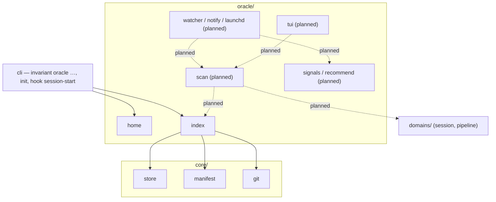

# The Session Oracle

A machine-wide view of every running session in every invariant project. It
says which one needs you and recommends the exact next command for each one
(IDEA_012). The decisions behind it are recorded in ADR-007.

The oracle is built in seven increments, and each one lands on its own. This
page describes what has shipped. Everything marked **planned** is design that
was approved in the plan but has no code yet. Treat it as intent, not as a
description of the current behaviour.

| # | Increment | Status |
|---|---|---|
| 1 | Home, project index, `oracle projects` commands, auto-registration | **shipped** |
| 2 | Attention sidecar and the `Notification` hook | planned |
| 3 | Read-only scan, `classify`, `recommend`, `oracle list` | planned |
| 4 | Watcher, rising-edge de-dup ledger, notifier, `watch --once`, `notify-test` | planned |
| 5 | Gate cache for recommendation detail | planned |
| 6 | launchd `install` / `uninstall` | planned |
| 7 | Textual TUI behind the `invariant[oracle]` extra | planned |

## Where it sits

**The dependency rule.** `oracle/` is a layer above `domains/` and below the
CLI. Nothing in `core/`, `domains/` or `adapters/` imports it, and a test scans
those packages to enforce this. The engine therefore behaves identically
whether the oracle is used or not.

The SessionStart registration is wired in the CLI's `hook` command and not in
`hosts/claude_code`. That keeps the host adapter free of the new layer.
Increment 2 will decide whether the hook's attention writes need a
`hosts → oracle` arrow. That decision is recorded in ADR-007 when it is taken.

## Shipped: home and project index

### `oracle/home`

`oracle_home()` returns `$INVARIANT_HOME` when it is set and not empty, and
`~/.invariant` otherwise. The value is resolved on every call and never cached.
The function only names the directory: it does not create it and does not read
it.

The test suite sets `INVARIANT_HOME` to a fresh temporary directory for every
test (`tests/conftest.py`). The variable is exported, so a hook shim that a
test runs as a subprocess inherits it too. No test can write the developer's
real index.

### `oracle/index`

`ProjectIndex(home)` manages `projects.json`. The format and its invariants
are specified in [state_model.md](state_model.md), "User-level state". In
summary:

- An entry is `{key, root, name, via}`. `key` is `Manifest.state_root`, so all
  of a repository's worktrees, and several manifests in one repository,
  collapse to one entry.
- `root` is the main checkout's spelling of the project. A registration made
  from inside a linked worktree records the same relative position in the main
  checkout, provided a manifest exists there.
- No clock times. The format also keeps keys it does not know, and refuses a
  newer `version` instead of rewriting it.
- Writes take `JsonStore.locked`. The home holds only `projects.json` and
  `locks/`. A project state root's `sessions/` and `pipelines/` are never laid
  out here.

| Operation | Behaviour |
|---|---|
| `register(manifest, via)` | Reads first. Locks only when the key is missing, and checks again under the lock. Returns `(entry, added)`. An existing entry is returned unchanged. |
| `match(selector)` / `remove(selector)` | Tries the selector as a key, then a root (relative or absolute), then a name. The first rung with a hit wins. A name shared by several entries is refused, and so is a selector that matches nothing. |
| `prune(dry_run)` | Drops the entries whose `root` no longer has a manifest. The manifest is checked again under the lock. If nothing is stale, no lock is taken. |

### How a project gets in

| Route | `via` | Failure handling |
|---|---|---|
| `invariant init` (not `--dry-run`) | `init` | A failure is reported in the output and the JSON `oracle` key. The command still succeeds, because the project is initialised. |
| `invariant hook session-start` (not the probe) | `session-start` | A failure is swallowed. The hook's response is computed first and cannot change. |
| `invariant oracle projects add [PATH]` | `manual` | This is the command, so a failure is its error: exit 2 for no manifest, exit 3 for a broken index. |

The CLI surface is in [cli.md](cli.md), "Oracle".

## Planned

The plan approved on 2026-10-22 sets out the shape below. Each part is written
up properly when it ships.

- **Attention sidecar** (increment 2). A per-project
  `<state_root>/attention/<host-id>.json` holding `waiting`, `blocked`,
  `turn`, `ended`, `pid` and `degraded`. It has a single writer and is replaced
  atomically. It is written from a new `Notification` hook and from
  PreToolUse(AskUserQuestion), PostToolUse, UserPromptSubmit, Stop and
  SessionEnd. Every write is guarded and can never change a hook verdict. The
  probe stays inert.
- **Scan, signals, recommend** (increment 3). A read-only snapshot over
  `InertStore` for every registered project. A broken project becomes an error
  row and never hides the others. `classify` and `recommend` are pure
  functions with an injected clock, and they produce the waiting, blocked,
  stuck, finished and error conditions. `invariant oracle list [--json]`.
- **Watcher and alerts** (increment 4). A 5-second tick writes
  `snapshot.json` under the oracle home. A rising-edge de-dup ledger
  (`alerts.json`) makes sure the same edge never alerts twice. Notifications
  go through a notifier seam (osascript). Adds `watch --once` and
  `notify-test`.
- **Gate cache** (increment 5). Gates are evaluated only when the fingerprint
  changes and the session is idle. The result feeds recommendation detail and
  never raises an alert.
- **launchd** (increment 6). A plist with an absolute interpreter and an
  explicit PATH, installed through a seam. `doctor` checks the interpreter.
- **TUI** (increment 7). A Textual app behind the `invariant[oracle]` extra.
  Every action asks for confirmation first, in a modal that shows the exact
  argv and cwd. It never answers a permission prompt.

Known gap, documented and not fixed: a host session rooted in another
repository is attributed to the wrong place (BUG_040). It will show up as an
orphan host row.
