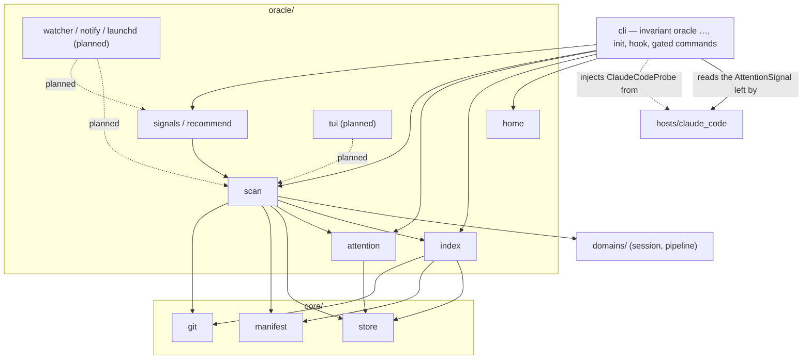

# The Session Oracle

A machine-wide view of every running session in every invariant project. It
says which one needs you and recommends the exact next command for each one
(IDEA_012). The decisions behind it are recorded in ADR-007.

The oracle is built in seven increments, and each one lands on its own. This
page describes what has shipped. Everything marked **planned** is design that
was approved in the plan but has no code yet. Treat it as intent, not as a
description of the current behaviour.

| # | Increment | Status |
|---|---|---|
| 1 | Home, project index, `oracle projects` commands, auto-registration | **shipped** |
| 2 | Attention sidecar and the `Notification` hook | **shipped** |
| 3 | Read-only scan, `classify`, `recommend`, `oracle list` | **shipped** |
| 4 | Watcher, rising-edge de-dup ledger, notifier, `watch --once`, `notify-test` | planned |
| 5 | Gate cache for recommendation detail | planned |
| 6 | launchd `install` / `uninstall` | planned |
| 7 | Textual TUI behind the `invariant[oracle]` extra | planned |

## Where it sits

**The dependency rule.** `oracle/` is a layer above `domains/` and below the
CLI. Nothing in `core/`, `domains/` or `adapters/` imports it, and a test scans
those packages to enforce this. The engine therefore behaves identically
whether the oracle is used or not.

The SessionStart registration and the attention writes are both wired in the
CLI's `hook` command and not in `hosts/claude_code`. That keeps the host
adapter free of the new layer: the host says what an event means, and the CLI
writes it (ADR-007 D6). A test scans `hosts/` for oracle imports, beside the
one that scans `core/`, `domains/` and `adapters/`.

## Shipped: home and project index

### `oracle/home`

`oracle_home()` returns `$INVARIANT_HOME` when it is set and not empty, and
`~/.invariant` otherwise. The value is resolved on every call and never cached.
The function only names the directory: it does not create it and does not read
it.

The test suite sets `INVARIANT_HOME` to a fresh temporary directory for every
test (`tests/conftest.py`). The variable is exported, so a hook shim that a
test runs as a subprocess inherits it too. No test can write the developer's
real index.

### `oracle/index`

`ProjectIndex(home)` manages `projects.json`. The format and its invariants
are specified in [state_model.md](state_model.md), "User-level state". In
summary:

- An entry is `{key, root, name, via}`. `key` is `Manifest.state_root`, so all
  of a repository's worktrees, and several manifests in one repository,
  collapse to one entry.
- `root` is the main checkout's spelling of the project. A registration made
  from inside a linked worktree records the same relative position in the main
  checkout, provided a manifest exists there.
- No clock times. The format also keeps keys it does not know, and refuses a
  newer `version` instead of rewriting it.
- Writes take `JsonStore.locked`. The home holds only `projects.json` and
  `locks/`. A project state root's `sessions/` and `pipelines/` are never laid
  out here.

| Operation | Behaviour |
|---|---|
| `register(manifest, via)` | Reads first. Locks only when the key is missing, and checks again under the lock. Returns `(entry, added)`. An existing entry is returned unchanged. |
| `match(selector)` / `remove(selector)` | Tries the selector as a key, then a root (relative or absolute), then a name. The first rung with a hit wins. A name shared by several entries is refused, and so is a selector that matches nothing. |
| `prune(dry_run)` | Drops the entries whose `root` no longer has a manifest. The manifest is checked again under the lock. If nothing is stale, no lock is taken. |

### How a project gets in

| Route | `via` | Failure handling |
|---|---|---|
| `invariant init` (not `--dry-run`) | `init` | A failure is reported in the output and the JSON `oracle` key. The command still succeeds, because the project is initialised. |
| `invariant hook session-start` (not the probe) | `session-start` | A failure is swallowed. The hook's response is computed first and cannot change. |
| `invariant oracle projects add [PATH]` | `manual` | This is the command, so a failure is its error: exit 2 for no manifest, exit 3 for a broken index. |

The CLI surface is in [cli.md](cli.md), "Oracle".

## Shipped: the attention sidecar

### `oracle/attention`

`AttentionStore(store)` reads and writes
`<state_root>/attention/<host-id>.json`, one record per host session. The
format is specified in [state_model.md](state_model.md), "Attention and host
liveness". In summary:

- `waiting` is `{kind, message, since}`, where `kind` is `permission`,
  `question` or `idle`, and `message` is the host's raw text. `blocked` is
  `{rules, surface, since}`, where `surface` is `stop` or `cli`. Then `turn`
  (`running` or `ended`) and `turn_since`, `ended`, `pid`, and `degraded`
  (`{event, error, since}`).
- The store is built on the caller's `JsonStore`, so the probe's inert store
  discards these writes along with every other.
- One writer per file, atomic replace, no lock. Unknown keys are kept. A
  record that cannot be read is replaced by the next write.
- A host id must be a plain name before it becomes a file name.

### What writes it

The host adapter turns each hook event into an `AttentionSignal`. The CLI
applies the signal through one guarded helper, `_record_attention`.

| Event | Signal | Effect on the record |
|---|---|---|
| `Notification` (new, the 7th hook) | `waiting` | `waiting` set. `notification_type` `permission_prompt` → `permission`, `elicitation_dialog` → `question`, `idle_prompt` → `idle`. When the type is missing or unknown, the message is matched instead. A notification that matches nothing writes nothing. |
| `PreToolUse`, `AskUserQuestion` | `waiting` | `waiting: question`, with the first question's text. Not when the hook denies the call. |
| `PostToolUse` | `answered` | `waiting` cleared. Reads first, and writes only if something was waiting. |
| `UserPromptSubmit` | `prompt` | `turn: running`. `waiting`, `blocked` and `degraded` cleared, `ended: false`. |
| `Stop` | `turn-ended` | `turn: ended`, `waiting` cleared. `blocked` set to the closeout's blocking rule ids, or, on a clean stop, cleared if the Stop had set it. A CLI block is kept. |
| `SessionEnd` | `host-ended` | `ended: true`. Everything else cleared, including `pid`. |
| `invariant hook` handler raised | — | `degraded` set, with the event and the error. |
| `pipeline advance`, `session transition` / `review` / `merge` refused | — | `blocked: {surface: cli}` on the bound host's record, if the session has a live host. Cleared when one of those commands later succeeds. |

`SessionStart` writes nothing. The rule that a hook must not write on every
start still holds.

### The two guarantees

**A failed write never changes a verdict.** The helper runs after the response
is computed and before it is printed. It neither reads nor returns the
response, and it swallows every failure. The suite checks this by breaking the
store and comparing the output byte for byte (ADR-007 D10).

**The probe writes nothing.** `doctor`'s probe payloads, including the new
`Notification` one, skip the helper outright. They are run against the inert
store anyway.

### The host pid

The hook records `CLAUDE_PID` whenever the environment carries it. Without it,
a pid already recorded stands, and a host with no pid yet walks the parent
chain with `ps` to the first process named `claude`
(`claude_code_launch.find_host_pid`). Both paths exist because both were seen
on this machine (ADR-007 D7). The CLI refusal path records no pid.

## Shipped: the scan, the signals and the recommendations

### `oracle/scan`

`scan_project(entry, clock, cache)` reads one registered project and returns a
`ProjectSnapshot`; `scan_all(index, clock, cache, select)` does it for every
project, or for the one `select` names (by key, root or name, as `projects
remove` matches). Nothing in a scan writes:

- sessions, pipelines and attention records are read through an `InertStore`
  on the entry's key, the state root, with the domains' own record types and
  lookups;
- the manifest is loaded from the recorded root only, never by walking upward,
  so a root that lost its manifest is an error and not some enclosing
  project's sessions;
- git is asked `worktree list` and nothing else.

The suite builds three projects and five live sessions and fingerprints every
file under every state root and the oracle home before and after two scans
(path, size, mtime). Nothing moves.

**Rows.** One shape, four kinds, so the classifier reads them all the same way.

| Kind | What it is |
|---|---|
| `session` | A live session: any state the project's session machine does not call terminal or abandoned. The registry is not consulted; `sessions/*.json` is enumerated, because the registry can lag the records. Its hosts are nested under it, the current binding first and then `hosts`, oldest first. |
| `host` | An orphan host: an attention record or a transcript that no live session claims, shown while the host is alive or for 24 hours after its last sign of life. A host bound only to an ended session counts, and the row names that session. A record whose host said `SessionEnd` does not. The row lists the project's live, not-stranded sessions with no live binding as `adoptable`. |
| `worktree` | A linked worktree on disk that no live session records. |
| `error` | A project that cannot be read (no manifest at the root, a manifest that does not parse, a machine that does not load), or one session record that cannot be. One error row never hides another row. |

**Stages, not state names.** A project may shadow the session machine, so the
scan never names a state. `session_stages(machine)` derives where each state
sits from the machine's structure:

| Stage | Derived as | Shipped machine |
|---|---|---|
| `ended` | terminal, or carrying the `abandon` role | `torn_down`, `abandoned` |
| `landed` | the merge — the state whose entry gates include `session.ff_merge_target` — and every non-terminal state reachable after it | `merged`, `pushed` |
| `reviewed` | a state with an edge into the merge | `reviewed` |
| `working` | a state with an edge into a reviewed one | `working` |
| `early` | everything else | `registered`, `isolated` |

A pipeline is read the same way: `landed` is terminal and not the abandon
state, and the red phase is the machine's `red_phase` (else `red`, the rule's
own fallback).

**Host liveness.** A host is alive when its recorded pid exists (`os.kill(pid,
0)`, every scan) and the process is still the host (a process-name check, kept
for 60 seconds and dropped the moment the pid is seen dead). A reused pid is
therefore "not alive", and a host that died without `SessionEnd` stops reading
as waiting. No pid recorded means liveness is unknown (`null`), which no
signal treats as gone.

**Last activity** is the latest of the host transcripts' modification times,
the attention records' modification times, the session's `heartbeat` and its
`plan_touched`. The times are read, never stored, so the "no stored clock
time" rule is untouched.

**Host facts are injected** (ADR-007 D11). Which transcripts belong to a
project and whether a pid is `claude` are Claude Code knowledge. The scan
defines `HostProbe` (`transcripts(root)`, `is_host_process(pid)`), the CLI
injects `hosts/claude_code_launch.ClaudeCodeProbe`, and the oracle imports
nothing from `hosts/`. Without a probe the scan still runs: no transcripts,
and a live pid counts as the host.

**Cheap on the next pass.** `ScanCache` keeps the git-backed answers — each
project's worktree list and its transcript source, whose construction asks git
for the project's worktrees — and the process-name checks for 60 seconds. A
repeat scan re-reads only small JSON files and directory listings. Measured:
the suite's three projects and five sessions scan in about 0.1 s cold and
0.04 s warm, and this machine's two real projects in 0.11 s and 0.29 s each.

### `oracle/signals`

`classify(row, now, thresholds)` is pure: the row and the clock it is handed,
nothing else. Alerts come first in the list it returns.

| Signal | Alert | Severity | Raised when | Key discriminator |
|---|---|---|---|---|
| `waiting` | yes | high; medium after 6 h | the current host's `waiting.kind` is `permission` or `question`, and the host is not known to be gone | `<kind>@<since>` |
| `gate_blocked` | yes | medium | `blocked` is set and `turn` is `ended` (ADR-007 D8) | the sorted rule ids |
| `stuck` | yes | medium | the host is not known to be gone, `turn` is `running`, nothing is waiting, and the last activity is older than 20 minutes | `turn_since` |
| `finished` | yes | low | the session is in its reviewed stage (`cause: reviewed`), or in its working stage with a complete plan and a landed pipeline (`cause: ready`) | `reviewed` / `ready` |
| `error` | yes | high | the last test run failed, was not read as red, and was not in the red phase (`tests`); a hook recorded `degraded` (`degraded`); the row is an error row (`scan`) | `tests:<run count>`, `degraded@<since>`, `scan` |
| `your_turn` | no | info | `waiting.kind` is `idle` and the host is not gone | — |
| `host_gone` | no | info | the recorded pid is not alive, and neither the binding nor the record says the host ended | — |
| `parked` | no | info | the session's binding is spent and its worktree is there | — |
| `stranded` | no | info | the session's recorded worktree is gone | — |
| `teardown_pending` | no | info | the session is in its landed stage | — |
| `orphan_host` | no | info | a `host` row | — |
| `leaked_worktree` | no | info | a `worktree` row | — |

Only the current host's record is read; the hosts a session had before are
history. Every signal carries `key = project|subject|kind|discriminator`, where
the subject is the session id, `host:<id>`, `worktree:<path>` or `project`. The
discriminator changes exactly when the condition is a new occurrence — a new
prompt, a different set of refusing rules, another test run, a new turn — so
increment 4's ledger can alert once per rising edge.

A failed run in the red phase is the proof `test.new_test_fails` asks for, not
an error, which is why the red phase is excluded alongside `read_as_red`.

### `oracle/recommend`

`recommend(row, signals)` names one next step: a label, the exact `argv` and
`cwd`, and a kind — `run` (an `invariant` command), `terminal` (one that
belongs in a new host session) or `info` (nothing to run). The first row of the
table that holds wins.

| Condition | Kind | Command | Run in |
|---|---|---|---|
| `waiting` | info | none: answer it in its own terminal. The oracle never answers a prompt | — |
| error row | info | none: what stops the read | — |
| leaked worktree | info | none: inspect it, remove it with git if spent | — |
| orphan host, alive, exactly one adoptable session | run | `invariant session adopt <host> --id <session>` | project root |
| orphan host, otherwise | info | none: start or resume a session from that host | — |
| failed tests | run | `invariant pipeline test`, with `INVARIANT_SESSION_ID` | worktree, else root |
| `gate_blocked` | run | `invariant pipeline gates`, with `INVARIANT_SESSION_ID` | worktree, else root |
| `stuck` | run | `invariant context --id <session>` | worktree, else root |
| `finished`, reviewed | run | `invariant session merge --id <session>` | project root (the merge runs from the main checkout) |
| `finished`, ready | run | `invariant session review --id <session>` | worktree, else root |
| `teardown_pending` | run | `invariant session teardown --id <session>` | project root |
| `stranded` | run | `invariant session reap --dry-run` (look before reaping) | project root |
| `parked` | terminal | `invariant session resume --id <session>` | its origin, else root |
| `host_gone` | terminal | `invariant session resume --id <session> --force` | its origin, else root |
| `error`, degraded | run | `invariant doctor` | project root |
| `your_turn` | info | none | — |

`pipeline gates` and `pipeline test` take no `--id`, so the session is pinned
through `INVARIANT_SESSION_ID`, the explicit route session resolution already
honours. Adopt is offered only for a host known to be alive: a project that
just tore several sessions down has several transcript-only hosts, and each
would otherwise be told to adopt the same session. The suite parses every
`argv` in the table with the real CLI parser.

`assess(snapshots, now, thresholds)` joins each row with its signals and its
recommendation. It is the `invariant oracle list --json` document and what the
watcher will write.

### `invariant oracle list`

A one-shot scan of every registered project, or of `--project NAME`, printed
as a status table: a project line with its scan time, then one line per row
flagged `ALERT`, `note` or `ok` with its signals, and a `next` line with the
recommended command and where to run it. No `Context` is built, so it runs
from any directory. See [cli.md](cli.md), "Oracle".

### Known gap: a host rooted in another repository (BUG_040)

A host session is attributed to the project its hooks resolve, and its
transcript to the project directory it was started in. A host started in one
repository that works on a session of another therefore has its attention
record and transcript in the wrong project: it shows up there as an orphan
`host` row, and the session it serves shows no host. This is documented, not
fixed; BUG_040 owns it.

## Planned

The plan approved on 2026-10-22 sets out the shape below. Each part is written
up properly when it ships.

- **Watcher and alerts** (increment 4). A 5-second tick writes
  `snapshot.json` under the oracle home. A rising-edge de-dup ledger
  (`alerts.json`) makes sure the same edge never alerts twice. Notifications
  go through a notifier seam (osascript). Adds `watch --once` and
  `notify-test`.
- **Gate cache** (increment 5). Gates are evaluated only when the fingerprint
  changes and the session is idle. The result feeds recommendation detail and
  never raises an alert.
- **launchd** (increment 6). A plist with an absolute interpreter and an
  explicit PATH, installed through a seam. `doctor` checks the interpreter.
- **TUI** (increment 7). A Textual app behind the `invariant[oracle]` extra.
  Every action asks for confirmation first, in a modal that shows the exact
  argv and cwd. It never answers a permission prompt.
