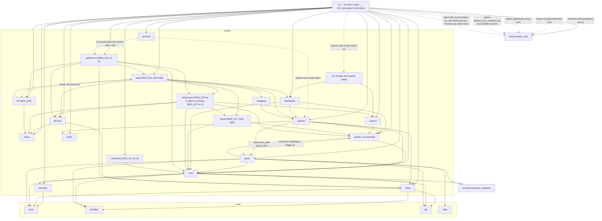
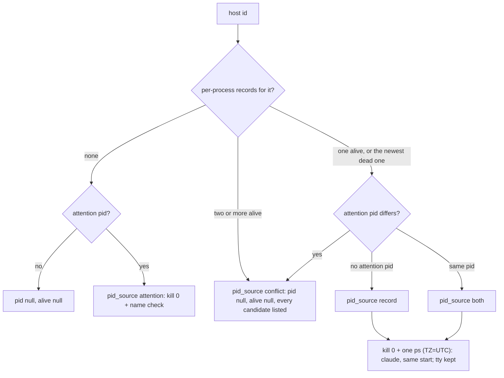
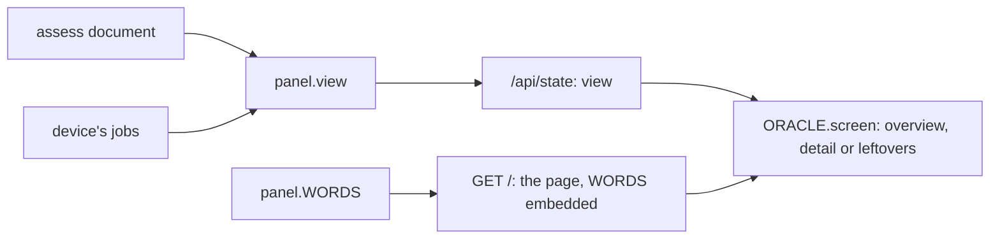
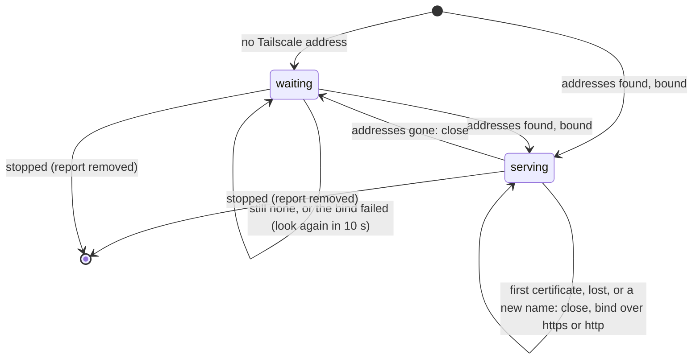

# The Session Oracle

A machine-wide view of every running session in every invariant project. It
says which one needs you and recommends the exact next command for each one
(IDEA_012). The decisions behind it are recorded in ADR-007.

The oracle was built in seven increments, each landing on its own. All seven
have shipped, so v1 is complete and this page describes the current
behaviour. The follow-ons (phone push, a status line, web and artifact
dashboards, more actions, an idle alert) are their own ideas, IDEA_013 to
IDEA_018, and IDEA_023, the web dashboard over Tailscale, whose three
increments have shipped: the page, confirm-first actions from it, and the
page served always by a second LaunchAgent ("Shipped: the web page" below,
ADR-008). IDEA_026 serves that page over HTTPS with Tailscale's certificate
("Over HTTPS" below, ADR-008 D19–D24). IDEA_027 is turning that page into a
mobile control panel: its increments 3, the plain-language panel, 4, the
home-screen app, 5, failure reasons, and 6, orphan classes and close host,
have shipped ("The control panel" below, ADR-009), and increment 7 is to
come.

| # | Increment | Status |
|---|---|---|
| 1 | Home, project index, `oracle projects` commands, auto-registration | **shipped** |
| 2 | Attention sidecar and the `Notification` hook | **shipped** |
| 3 | Read-only scan, `classify`, `recommend`, `oracle list` | **shipped** |
| 4 | Watcher, rising-edge de-dup ledger, notifier, `watch`, `notify-test` | **shipped** |
| 5 | Gate cache for recommendation detail | **shipped** |
| 6 | launchd `install` / `uninstall` / `status` | **shipped** |
| 7 | Textual TUI behind the `invariant[oracle]` extra, confirm-first actions | **shipped** |

## Where it sits



**The dependency rule.** `oracle/` is a layer above `domains/` and below the
CLI. Nothing in `core/`, `domains/` or `adapters/` imports it, and a test scans
those packages to enforce this. The engine therefore behaves identically
whether the oracle is used or not.

The SessionStart registration and the attention writes are both wired in the
CLI's `hook` command and not in `hosts/claude_code`. That keeps the host
adapter free of the new layer: the host says what an event means, and the CLI
writes it (ADR-007 D6). A test scans `hosts/` for oracle imports, beside the
one that scans `core/`, `domains/` and `adapters/`.

## Shipped: home and project index

### `oracle/home`

`oracle_home()` returns `$INVARIANT_HOME` when it is set and not empty, and
`~/.invariant` otherwise. The value is resolved on every call and never cached.
The function only names the directory: it does not create it and does not read
it.

The test suite sets `INVARIANT_HOME` to a fresh temporary directory for every
test (`tests/conftest.py`). The variable is exported, so a hook shim that a
test runs as a subprocess inherits it too. No test can write the developer's
real index.

### `oracle/index`

`ProjectIndex(home)` manages `projects.json`. The format and its invariants
are specified in [state_model.md](state_model.md), "User-level state". In
summary:

- An entry is `{key, root, name, via}`. `key` is `Manifest.state_root`, so all
  of a repository's worktrees, and several manifests in one repository,
  collapse to one entry.
- `root` is the main checkout's spelling of the project. A registration made
  from inside a linked worktree records the same relative position in the main
  checkout, provided a manifest exists there.
- No clock times. The format also keeps keys it does not know, and refuses a
  newer `version` instead of rewriting it.
- Writes take `JsonStore.locked`, through `HomeStore`, the home's store,
  which the watcher shares. The home holds `projects.json`, `locks/` and the
  watcher's `oracle/`. A project state root's `sessions/` and `pipelines/` are
  never laid out here.

| Operation | Behaviour |
|---|---|
| `register(manifest, via)` | Reads first. Locks only when the key is missing, and checks again under the lock. Returns `(entry, added)`. An existing entry is returned unchanged. |
| `match(selector)` / `remove(selector)` | Tries the selector as a key, then a root (relative or absolute), then a name. The first rung with a hit wins. A name shared by several entries is refused, and so is a selector that matches nothing. |
| `prune(dry_run)` | Drops the entries whose `root` no longer has a manifest. The manifest is checked again under the lock. If nothing is stale, no lock is taken. |

### How a project gets in

| Route | `via` | Failure handling |
|---|---|---|
| `invariant init` (not `--dry-run`) | `init` | A failure is reported in the output and the JSON `oracle` key. The command still succeeds, because the project is initialised. |
| `invariant hook session-start` (not the probe) | `session-start` | A failure is swallowed. The hook's response is computed first and cannot change. |
| `invariant oracle projects add [PATH]` | `manual` | This is the command, so a failure is its error: exit 2 for no manifest, exit 3 for a broken index. |

The CLI surface is in [cli.md](cli.md), "Oracle".

## Shipped: the attention sidecar

### `oracle/attention`

`AttentionStore(store)` reads and writes
`<state_root>/attention/<host-id>.json`, one record per host session. The
format is specified in [state_model.md](state_model.md), "Attention and host
liveness". In summary:

- `waiting` is `{kind, message, since}`, where `kind` is `permission`,
  `question` or `idle`, and `message` is the host's raw text. `blocked` is
  `{rules, surface, since}`, where `surface` is `stop` or `cli`. Then `turn`
  (`running` or `ended`) and `turn_since`, `ended`, `pid`, and `degraded`
  (`{event, error, since}`).
- The store is built on the caller's `JsonStore`, so the probe's inert store
  discards these writes along with every other.
- One writer per file, atomic replace, no lock. Unknown keys are kept. A
  record that cannot be read is replaced by the next write.
- A host id must be a plain name before it becomes a file name.

### What writes it

The host adapter turns each hook event into an `AttentionSignal`. The CLI
applies the signal through one guarded helper, `_record_attention`.

| Event | Signal | Effect on the record |
|---|---|---|
| `Notification` (new, the 7th hook) | `waiting` | `waiting` set. `notification_type` `permission_prompt` → `permission`, `elicitation_dialog` → `question`, `idle_prompt` → `idle`. When the type is missing or unknown, the message is matched instead. A notification that matches nothing writes nothing. |
| `PreToolUse`, `AskUserQuestion` | `waiting` | `waiting: question`, with the first question's text. Not when the hook denies the call. |
| `PostToolUse` | `answered` | `waiting` cleared. Reads first, and writes only if something was waiting. |
| `UserPromptSubmit` | `prompt` | `turn: running`. `waiting`, `blocked` and `degraded` cleared, `ended: false`. |
| `Stop` | `turn-ended` | `turn: ended`, `waiting` cleared. `blocked` set to the closeout's blocking rule ids, or, on a clean stop, cleared if the Stop had set it. A CLI block is kept. |
| `SessionEnd` | `host-ended` | `ended: true`. Everything else cleared, including `pid`. |
| `invariant hook` handler raised | — | `degraded` set, with the event and the error. |
| `pipeline advance`, `session transition` / `review` / `merge` refused | — | `blocked: {surface: cli}` on the bound host's record, if the session has a live host. Cleared when one of those commands later succeeds. |

`SessionStart` writes nothing. The rule that a hook must not write on every
start still holds.

### The two guarantees

**A failed write never changes a verdict.** The helper runs after the response
is computed and before it is printed. It neither reads nor returns the
response, and it swallows every failure. The suite checks this by breaking the
store and comparing the output byte for byte (ADR-007 D10).

**The probe writes nothing.** `doctor`'s probe payloads, including the new
`Notification` one, skip the helper outright. They are run against the inert
store anyway.

### The host pid

The hook records `CLAUDE_PID` whenever the environment carries it. Without it,
a pid already recorded stands, and a host with no pid yet walks the parent
chain with `ps` to the first process named `claude`
(`claude_code_launch.find_host_pid`). Both paths exist because both were seen
on this machine (ADR-007 D7). The CLI refusal path records no pid.

## Shipped: the scan, the signals and the recommendations

### `oracle/scan`

`scan_project(entry, clock, cache)` reads one registered project and returns a
`ProjectSnapshot`; `scan_all(index, clock, cache, select)` does it for every
project, or for the one `select` names (by key, root or name, as `projects
remove` matches). Nothing in a scan writes:

- sessions, pipelines and attention records are read through an `InertStore`
  on the entry's key, the state root, with the domains' own record types and
  lookups;
- the manifest is loaded from the recorded root only, never by walking upward,
  so a root that lost its manifest is an error and not some enclosing
  project's sessions;
- git is asked `worktree list` and nothing else.

The suite builds three projects and five live sessions and fingerprints every
file under every state root and the oracle home before and after two scans
(path, size, mtime). Nothing moves.

**Rows.** One shape, four kinds, so the classifier reads them all the same way.

| Kind | What it is |
|---|---|
| `session` | A live session: any state the project's session machine does not call terminal or abandoned. The registry is not consulted; `sessions/*.json` is enumerated, because the registry can lag the records. Its hosts are nested under it, the current binding first and then `hosts`, oldest first. |
| `host` | An orphan host: an attention record or a transcript that no live session claims, shown while the host is alive or for 24 hours after its last sign of life. A host bound only to an ended session counts, and the row names that session. A record whose host said `SessionEnd` does not. The row lists the project's live, not-stranded sessions with no live binding as `adoptable`. |
| `worktree` | A linked worktree on disk that no live session records. |
| `error` | A project that cannot be read (no manifest at the root, a manifest that does not parse, a machine that does not load), or one session record that cannot be. One error row never hides another row. |

**Stages, not state names.** A project may shadow the session machine, so the
scan never names a state. `session_stages(machine)` derives where each state
sits from the machine's structure:

| Stage | Derived as | Shipped machine |
|---|---|---|
| `ended` | terminal, or carrying the `abandon` role | `torn_down`, `abandoned` |
| `landed` | the merge — the state whose entry gates include `session.ff_merge_target` — and every non-terminal state reachable after it | `merged`, `pushed` |
| `reviewed` | a state with an edge into the merge | `reviewed` |
| `working` | a state with an edge into a reviewed one | `working` |
| `early` | everything else | `registered`, `isolated` |

A pipeline is read the same way: `landed` is terminal and not the abandon
state, and the red phase is the machine's `red_phase` (else `red`, the rule's
own fallback).

**Host liveness.** A host is alive when its pid exists (`os.kill(pid, 0)`,
every scan) and the process is still the host (a process-name check, kept
for 60 seconds and dropped the moment the pid is seen dead). A reused pid is
therefore "not alive", and a host that died without `SessionEnd` stops reading
as waiting. No pid known means liveness is unknown (`null`), which no signal
treats as gone.

**Where the pid comes from** (IDEA_024). Two sources name a host's pid: its
attention record, written by the hooks, and Claude Code's per-process record,
`<claude home>/sessions/<pid>.json`, which every running Claude Code process
keeps whatever hooks it ran. The scan joins the second to the hosts it already
knows by host session id (the record's `sessionId`), so a host that never
wrote an attention record still has a pid. The join adds no host: a project's
hosts are still its attention records and its transcripts, so attribution
stays transcript-based, and the record's `cwd` is shown, not used to place a
host.

A recorded pid gets one check more than an attention pid. One `ps -o
tty=,lstart=,comm=` (`ClaudeCodeProbe.process_facts`) answers the name, the
process's start and its terminal; when the record's `procStart` and the
process table both give a start, they must be equal, because a reused pid can
be another `claude`. Claude Code writes `procStart` in UTC and `ps` prints
`lstart` in local time, so `ps` runs with `TZ=UTC` (the rest of its
environment unchanged) and both sides spell one instant the same way; neither
is converted between zones (BUG_086: compared across zones, every live host
on a machine outside UTC read as a reused pid). A start either side cannot read (another locale's
spelling, a missing field) is not compared. The facts are kept for 60 seconds
and dropped when the pid is seen dead, as the name check is. A live pid `ps`
cannot describe is unknown, not gone.



**The oracle never picks one silently.** When both sources name a pid and the
pids differ, or two records for one host are both alive, the row carries
`pid_source: conflict` and `pid_conflict`, each candidate with its own
liveness, and `pid` and `alive` stay `null`. Unknown liveness is what no
signal reads as gone, so a conflict never raises `host_gone` and never offers
adopt. The TUI says `pids disagree: attention 3 (gone), record 4 (alive)`.

A host row also keeps the record's `launched_name` (the session name it was
started with), `cwd`, `started` (epoch seconds) and `process_start` (the
start token, so a later action can compare it again at the moment it acts),
and the verified process's `tty`. The tty is what close host needs to find
the terminal tab the host runs in ("Close host" below). It keeps the
record's `status` too, as written (Claude Code writes `busy`, `idle` or
`waiting`), and only when the record joined the host: `signals.turn_state`
decides what it means ("Mid-turn" below, BUG_087). A conflict row has no
status, as it has no pid.

**Where an orphan was started** (IDEA_027 increment 6). An orphan host row's
view also carries `rooted_here`: whether its record's `cwd` is the project's
root, a folder under it, or one of its worktrees (the ones git lists and the
ones its session records name), compared by whole path components after
resolving; `null` without a `cwd`. And once every project is read,
`scan.mark_claims` names on each orphan row the project whose live session
lists the same host, as `claimed_elsewhere`: a project's own live sessions
never leave an orphan, so such a host is one another project attributed to
it, BUG_040's case. `assess` calls it first. Both are evidence close host
needs, and neither changes a signal.

**When the records are not used.** They are Claude Code internals, not a
contract, so the reader (`claude_code_launch.read_host_processes`) is strict:
only `<digits>.json` is opened (the `<pid>.<hash>.key` files beside them never
are), a record must be a JSON object of at most 64 KiB whose `pid` is the
positive integer the file is named after, with a non-empty `sessionId`, and a
`pidDomain` other than this platform is skipped. Optional fields of the wrong
type read as `null`. A missing directory, or files of which none parse, raise,
and so does a probe that cannot read them; the scan then uses no record, every
host's pid is the attention record's or `null` as before, and each project of
the document says so under `host_processes`: `{used, records, detail}`. `oracle
list` prints `host process records: not used: <why>` under its table. An empty
directory is a source with nothing running. The records are read once per 60
seconds, like the other cached answers.

**Last activity** is the latest of the host transcripts' last turns, the
attention records' modification times, the session's `heartbeat` and its
`plan_touched`. The times are read, never stored, so the "no stored clock
time" rule is untouched.

A transcript's last turn is the `timestamp` of its newest `user` or
`assistant` entry, not the file's modification time (BUG_078). Claude Code
keeps appending bookkeeping lines (`last-prompt`, `cost-state`,
`bridge-session`, `system`, `attachment`) to a conversation that has gone
quiet, so the mtime moved while the host did nothing: an orphan idle for ten
days read as active minutes ago, never left the 24-hour window, and `stuck`
was judged against a clock that kept being reset. A `user` entry that only
carries a tool result counts as a turn, because a tool finishing is the host
working, and that is what `stuck` asks during a running turn. A subagent's
(`isSidechain`) entry counts too.

The read is `hosts/claude_code_telemetry.last_turn`, behind the probe's
`activity()`. It reads the transcript backwards from its end in 32 KiB
blocks, joins a line split across blocks, and stops at the first turn. It
skips the bytes after the last newline (a line still being written) and any
line that does not parse, and reads at most 2 MiB. **The mtime is the
fallback**, used only when no turn is found within that budget: a transcript
with no turn yet, or one whose tail is a single line longer than 2 MiB. A
file is only written after its last turn, so the fallback errs towards
"active", as the old formula always did. The reader also returns the turn's
role and its text (capped at 4000 characters), and takes a predicate, so
IDEA_029 can ask it for the newest entry with text.

**Host facts are injected** (ADR-007 D11). Which transcripts belong to a
project and whether a pid is `claude` are Claude Code knowledge. The scan
defines `HostProbe` (`transcripts(root)`, `is_host_process(pid)`, and, since
IDEA_024, `host_processes()` and `process_facts(pid)`), the CLI injects
`hosts/claude_code_launch.ClaudeCodeProbe`, and the oracle imports nothing
from `hosts/`. The start token in a record and in `process_facts` is one
UTC spelling, `YYYY-MM-DDTHH:MM:SS`: `procStart` is UTC as Claude Code writes
it, and `process_facts` runs `ps` with `TZ=UTC`. The oracle compares the two
for equality and never parses them.
Without a probe the scan still runs: no transcripts, no records, and a live
pid counts as the host. A probe without the two newer methods is a probe whose
records are not used.

**Cheap on the next pass.** `ScanCache` keeps the git-backed answers — each
project's worktree list and its transcript source, whose construction asks git
for the project's worktrees — and the process-name checks for 60 seconds. A
repeat scan re-reads only small JSON files, directory listings and the tails of
the transcripts that changed: the source remembers each transcript's last turn
against its size and mtime. Measured:
the suite's three projects and five sessions scan in about 0.1 s cold and
0.04 s warm, and this machine's two real projects in 0.11 s and 0.29 s each.

### `oracle/signals`

`classify(row, now, thresholds)` is pure: the row and the clock it is handed,
nothing else. Alerts come first in the list it returns.

| Signal | Alert | Severity | Raised when | Key discriminator |
|---|---|---|---|---|
| `waiting` | yes | high; medium after 6 h | the current host is waiting on the person (`turn_state` `waiting`): its `waiting.kind` is `permission` or `question`, or Claude Code's own status says `waiting` (cause `input` when the hooks recorded no prompt; always high, it carries no time) | `<kind>@<since>`, or `input` |
| `gate_blocked` | yes | medium | `blocked` is set and `turn` is `ended` (ADR-007 D8) | the sorted rule ids |
| `stuck` | yes | medium | `turn` is `running`, the host is mid-turn and working (`turn_state` `busy`, "Mid-turn" below), and the last activity is older than 20 minutes | `turn_since` |
| `finished` | yes | low | the session is in its reviewed stage (`cause: reviewed`), or in its working stage with a complete plan and a landed pipeline (`cause: ready`) | `reviewed` / `ready` |
| `error` | yes | high | the last test run failed, was not read as red, and was not in the red phase (`tests`); a hook recorded `degraded` (`degraded`); the row is an error row (`scan`) | `tests:<run count>`, `degraded@<since>`, `scan` |
| `your_turn` | no | info | `waiting.kind` is `idle`, the host is not gone, and it is not mid-turn (`turn_state` `idle`) | — |
| `host_gone` | no | info | the recorded pid is not alive, and neither the binding nor the record says the host ended | — |
| `parked` | no | info | the session's binding is spent and its worktree is there | — |
| `stranded` | no | info | the session's recorded worktree is gone | — |
| `teardown_pending` | no | info | the session is in its landed stage | — |
| `orphan_host` | no | info | a `host` row; its `cause` is the class: `gone`, `unknown`, `active`, `leftover`, `unmanaged` (`orphan_class`, IDEA_025) | — |
| `leaked_worktree` | no | info | a `worktree` row | — |

**Mid-turn** (BUG_087). Whether a host is mid-turn is one answer,
`turn_state(host, last_activity, now, thresholds)`: `busy` (working),
`waiting` (on the person) or `idle` (not mid-turn). The orphan class, the
`waiting`, `stuck` and `your_turn` signals, the gate cache's "Never while a
turn runs" and the panel's Working group all read it, so none can contradict
another. `mid_turn` is "not `idle`". `assess` writes it on each row as
`turn_state`, the field the panel reads.

| Evidence, first that holds | Answer |
|---|---|
| no current host, or it is known to be gone | `idle` |
| alive, and Claude Code's per-process record joined it with a `status` of `busy`, `idle` or `waiting` | that status: the record outranks the attention record |
| the attention record waits on a `permission` or a `question` | `waiting` |
| the attention record waits on an `idle` prompt (notified after the last prompt was submitted, so newer than the turn), or its `turn` is not `running` | `idle` |
| a `running` turn, heard from within `orphan_idle_minutes` (60), or with no activity known | `busy` |
| a `running` turn quiet longer than that | `idle`: stale, because a Stop that never arrived leaves `running` for ever |

The record's status is used only when the host is alive by the record's own
check, so a reused or unverified pid never speaks for the host; an unknown
or missing status falls back to the attention record. Without a record a
`running` turn reads `stuck` between 20 and 60 minutes of silence and then
stops counting; with one, `busy` stays `stuck` however long, and `idle`
never is. Six Heap hosts idle 14 to 44 hours read `orphan_host` `active`,
five of them "idle at the prompt" and one "stuck for 880 min", because the
Stop hook never wrote `turn-ended` for them while their records said `idle`.

**Waiting on the person is never closeable.** A host whose record says
`waiting` is `active`, and raises the existing `waiting` alert rather than a
signal of its own: `recommend`'s first row then offers nothing to run, the
panel puts it in Needs you with no button (ADR-009 D8), and the TUI's and
the page's `refusal` refuses a step on it. When the hooks recorded the
prompt, the alert keeps their kind and text; otherwise its cause is `input`
and its discriminator `input`. A record that says `idle` or `busy` silences
an attention prompt left behind by a missed `PostToolUse` or Stop.

Only the current host's record is read; the hosts a session had before are
history. Every signal carries `key = project|subject|kind|discriminator`, where
the subject is the session id, `host:<id>`, `worktree:<path>` or `project`. The
discriminator changes exactly when the condition is a new occurrence — a new
prompt, a different set of refusing rules, another test run, a new turn — so
the watcher's ledger can alert once per rising edge.

A failed run in the red phase is the proof `test.new_test_fails` asks for, not
an error, which is why the red phase is excluded alongside `read_as_red`.

### `oracle/recommend`

`recommend(row, signals, gates)` names one next step: a label, the exact `argv` and
`cwd`, and a kind — `run` (an `invariant` command), `terminal` (one that
belongs in a new host session) or `info` (nothing to run). The first row of the
table that holds wins.

| Condition | Kind | Command | Run in |
|---|---|---|---|
| `waiting` | info | none: answer it in its own terminal. The oracle never answers a prompt | — |
| error row | info | none: what stops the read | — |
| leaked worktree | info | none: inspect it, remove it with git if spent | — |
| orphan host, `leftover` and every close guard holds | run | `invariant oracle close-host <host> --pid N --start TOKEN [--tty ttysNNN]` | project root |
| orphan host, alive, exactly one adoptable session, and no other live orphan host here could take it (`adopt_rivals` 0) | run | `invariant session adopt <host> --id <session>` | project root |
| orphan host, `unmanaged` and every close guard holds | run | `invariant oracle close-host …`, as above | project root |
| orphan host, otherwise | info | none: start or resume a session from that host | — |
| failed tests | run | `invariant pipeline test`, with `INVARIANT_SESSION_ID` | worktree, else root |
| `gate_blocked` | run | `invariant pipeline gates`, with `INVARIANT_SESSION_ID` | worktree, else root |
| `stuck` | run | `invariant context --id <session>` | worktree, else root |
| `finished`, reviewed | run | `invariant session merge --id <session>` | project root (the merge runs from the main checkout) |
| `finished`, ready | run | `invariant session review --id <session>` | worktree, else root |
| `teardown_pending` | run | `invariant session teardown --id <session>` | project root |
| `stranded` | run | `invariant session reap --dry-run` (look before reaping) | project root |
| `parked` | terminal | `invariant session resume --id <session>` | its origin, else root |
| `host_gone` | terminal | `invariant session resume --id <session> --force` | its origin, else root |
| `error`, degraded | run | `invariant doctor` | project root |
| `your_turn` | info | none | — |

The close guards are ADR-009 D7's and D15's: the host is alive by Claude
Code's record (`pid_source` `record` or `both`), with a start token and no
`pid_conflict`; it is `rooted_here`; and no other project's live session
claims it (`claimed_elsewhere`). A gone, active or unknown orphan is never
offered close, and an active one includes a host Claude Code says is busy or
waiting ("Mid-turn" above).

**Attach only when the match is unique both ways.** `assess` calls
`scan.mark_rivals` on each project after `mark_claims`: an orphan host row
with exactly one adoptable session gets `adopt_rivals`, the number of the
project's other orphan hosts known alive (`alive` true) that list the same
session. Adopt is the step only when the host is alive, has exactly one
adoptable session, and has no rivals. Six idle hosts each told to adopt the
one session a project has were offered something none of them could take,
and it hid their Close: now each host that every close guard lets go is
offered Close, and one that fails a guard is offered nothing to run. A gone
host, or one whose liveness is unknown, is nobody's rival. The close guards
themselves are unchanged. A row carries one step; offering Close beside
Attach waits for the panel's second action ([oracle-panel.md](oracle-panel.md),
"As built in increment 6").

`pipeline gates` and `pipeline test` take no `--id`, so the session is pinned
through `INVARIANT_SESSION_ID`, the explicit route session resolution already
honours. Adopt is offered only for a host known to be alive: a project that
just tore several sessions down has several transcript-only hosts, and each
would otherwise be told to adopt the same session. The suite parses every
`argv` in the table with the real CLI parser.

`assess(snapshots, now, thresholds, gates)` joins each row with its signals
and its recommendation, with the gate cache's answer for it under `gates`
(`null` when there is none), and with its current host's `turn_state`. It is the `invariant oracle list --json`
document, and the body of the watcher's snapshot. How the gate answer changes
a recommendation is in "Shipped: the gate cache" below.

### `invariant oracle list`

A one-shot scan of every registered project, or of `--project NAME`, printed
as a status table: a project line with its scan time, then one line per row
flagged `ALERT`, `note` or `ok` with its signals, and a `next` line with the
recommended command and where to run it. No `Context` is built, so it runs
from any directory. See [cli.md](cli.md), "Oracle".

## Shipped: the watcher and the notifier

### `oracle/watcher`

`Watcher(index, notifier, clock, interval, cache, thresholds)` runs one tick
at a time. A tick does four things in order:

1. **Scan** every registered project with `scan_all`, read-only as before.
2. **Assess** it with `assess`, the same document `oracle list --json` prints.
3. **Write the snapshot**, `<oracle home>/oracle/snapshot.json`. It is that
   document plus `home`, `version`, `generated`, `watcher_pid` and
   `interval`, written atomically, so a reader never sees half of one.
4. **De-duplicate and notify** through the ledger,
   `<oracle home>/oracle/alerts.json`.

`run(once, max_ticks, on_tick)` repeats the tick and sleeps so that ticks
start one `interval` apart. A tick that raises is logged to stderr, and the
loop goes on. `watch --once` calls one tick directly, so a failure there is the
command's error.

**The ledger makes "once" true.** It maps each alert's signal key
(`project|subject|kind|discriminator`, see "oracle/signals") to `{since,
notified}`. Each tick applies these rules:

| Case | What happens |
|---|---|
| A key not in the ledger | A rising edge. It is added, notified, and reported. |
| A key already there, `notified: true` | Not news. Nothing is sent. |
| A key already there, `notified: false` | Owed. Either there was no notifier (`--no-notify`) or delivery failed. The next tick that can deliver it does. |
| A key the tick no longer sees | Dropped, so the same condition coming back alerts again. |
| A key of a project this tick could not read | Kept. "Cannot read" is not "cleared", and a broken manifest must not re-alert everything in the project once it is fixed. |
| The same condition, recurring as a new occurrence | Has a new discriminator, so it is a new key and alerts again. Examples are a new prompt, another failed test run, or a different set of refusing rules. |

Only alerts notify. Markers never do. There is no repeat timer in v1. The
read-modify-write runs under the home's lock (`locks/alerts.lock`), so the
daemon and a `watch --once` cannot both announce one edge. After the first
failed delivery in a tick, the rest of that tick's edges are left owed instead
of being tried one by one.

**Both files are derived and safe to delete.** Deleting the snapshot costs
nothing, because the next tick writes it again. Deleting the ledger costs at
most one repeat of each live alert. A ledger that is not a JSON object, or
that has another `version` or shape, is replaced, not refused, because it is
the watcher's own derived state and not a record anybody else writes. The
formats are in [state_model.md](state_model.md), "User-level state".

**The latency budget.** A permission prompt is written to the sidecar by the
`Notification` hook at once. The next tick sees it, so the time from prompt
to ping is at most one `interval` (5 s) plus one tick. Measured on this
machine: the suite's three projects with five sessions each, all waiting, took
0.10 s for a cold tick and 0.04 s warm, and the suite asserts under 2 s. This
repository's real state root took 0.09 s for a cold `watch --once`. That is
well inside IDEA_012's 30-second acceptance, and inside the plan's "under 10 s"
with room to spare.

### `oracle/notify`

`Notifier` is a protocol with one method, `notify(Notification)`. A
`Notification` has a `title`, a `message`, an optional `subtitle` and an
optional `sound`.

- `OsascriptNotifier` runs `osascript -e 'display notification … with title
  … subtitle … sound name …'`. The script is one argument, with no shell in
  between. A refusal or a missing `osascript` raises `NotifyError`, which
  exits 1.
- `RecordingNotifier` keeps what it was asked to send. It is for tests, and
  its `fail` flag makes it refuse.

The watcher titles a notification `invariant: <project>`. The subtitle is the
row's label, which is the label `oracle list` prints (`recommend.row_label`,
one spelling for both). The message is the signal's detail. A high or medium
alert plays `Glass`, and a low one (finished) is a silent banner.

**The quoting is injected** (ADR-007 D13). Turning text into an AppleScript
string literal already has an owner: `hosts/claude_code_launch.applescript_string`.
The oracle may not import `hosts/`, so `OsascriptNotifier` takes the quoting
function as an argument. The CLI's `_oracle_notifier` seam passes in the
host's function. This is the `HostProbe` shape again. The suite replaces the
seam with a recorder for every test, and a `conftest.py` guard makes
`subprocess.Popen` refuse `osascript` unless a test is marked
`real_osascript`. The one test that runs it evaluates a string literal and
posts nothing.

### `invariant oracle watch` and `notify-test`

`watch` runs the loop until it is interrupted. In text mode it prints only the
ticks that have news. With `--json` it prints one line per tick. `--once` runs
a single tick and prints its result. `--no-notify` sends nothing, and the edges
it sees stay owed to a watcher that does notify. `notify-test` posts one
notification through the same seam. See [cli.md](cli.md), "Oracle".

## Shipped: the gate cache

### `oracle/gates`

A row says a gate refused only when a refusal was actually met: `blocked` in
the attention sidecar (ADR-007 D8). It cannot say which gates are owed now, or
what each wants, and without that the best recommendation is "run `pipeline
gates`". `GateCache` supplies the detail by running
`PipelineDomain.evaluate_gates_by_destination`, the evaluation `pipeline gates`
prints, and keeps the answer in memory.

| Rule | How |
|---|---|
| **Never a write** | The domains are built on an `InertStore` over the row's state root. The manifest is the session worktree's own (the main checkout's if the worktree has none), because the rules resolve the paths they compare against the manifest's root. The rules run with `cwd` set to the worktree, so their git questions are asked there, and inside `core/git.without_optional_locks()`, so every one runs with `GIT_OPTIONAL_LOCKS=0`: a plain `git diff` cannot refresh the index stat cache and take `index.lock` under the host working there (ADR-007 D16). |
| **Never while a turn runs** | A host mid-turn is using that worktree, and its own git commands must not meet ours. Mid-turn is `signals.turn_state`'s answer, the one the signals read ("Mid-turn" above): a host Claude Code says is busy or waiting, one waiting on a prompt, or a `running` turn heard from within an hour is never evaluated. A session whose host is not mid-turn is evaluated at once when its `turn` is `ended`, and otherwise after 2 minutes without activity: no turn known, a gone host, a record that says `idle`, or a `running` turn gone stale. |
| **Only when something moved** | The fingerprint is the session's `state` and `heartbeat`, the pipeline's `state` and transition count, and the pipeline record's `st_mtime_ns`. Evidence is recorded without a transition, so the write time is what moves for a new test run or a doc read. The scan supplies all five (`PipelineView.transitions`, `written_ns`), so fingerprinting costs no extra read. |
| **Skipped when there is nothing to ask** | A row that is not a session, has no pipeline or a terminal one, is stranded, or whose worktree (else root) is not a directory. |
| **Bounded** | Each evaluation runs in a daemon thread, at most 2 at once across every project, with a 10-second timeout. A worker that timed out keeps its slot until it really ends, so a hung `git` cannot multiply threads. A result later than the timeout is dropped. |
| **A failure keeps the last answer** | A timeout or an error keeps the previous result, flagged `timed_out` or with `error`, and that fingerprint is not tried again. The next change of fingerprint is. |
| **In memory** | Nothing is persisted. The watcher's cache lives across its ticks; a restarted watcher evaluates again. The answer reaches the snapshot only as part of the assessed document. |

`refresh(snapshots, now, wait)` starts what is owed, waits up to `wait`
seconds and returns a `GateReport` per `(state root, session id)`: the gates
not met, once each, blocking first, each with its level, the first line of
its message, its first fix and every edge out of the state that owes it. A
report whose fingerprint has moved since is `stale`. The answers of sessions
that are no longer live in a scanned project are forgotten.

**It feeds the recommendation, never an alert.** `recommend(row, signals,
gates)` takes the report as an argument, so it stays pure, and `classify`
never sees it: the signals, and so the ledger and the notifications, are the
same with or without it. The suite checks that.

| Row | What the report adds |
|---|---|
| `gate_blocked` (or failed tests on a refused row) | `detail`: `owed: <rule> (<level>, to <edges>): <message>; …`. A stale report is prefixed `as of <pipeline state>,`. A report with nothing owed says the refusal may already be cleared. A report with only a timeout or an error adds nothing. |
| Any other session row with a step | `detail`: `next owed: <blocking rules> (to <first edge>)`, from a current report only. |
| A session row with no step | The same hint becomes its step, an `info` one with no command. |

**Where it is wired.**

| Caller | Wait |
|---|---|
| `Watcher(gates=…, gate_wait=0)` | The loop never waits: a tick starts what is owed and reports what has finished. An evaluation that finishes between ticks is the next tick's. |
| `oracle watch --once` | Waits up to the timeout, because it is a one-shot like `list`. |
| `oracle list` | Evaluates the eligible sessions once and waits up to the timeout. |

The CLI reaches the cache through the `_oracle_gates` seam, as it does the scan
cache. The text output prints the detail on its own line under `next`.

**Measured** on this repository's real state root, against a scratch
`INVARIANT_HOME`, on 2026-10-22: one live session, evaluated in 0.02 s in its
worker. Watcher ticks with the gate cache took 0.11 s cold and about 0.03 s
warm, the same as without it, and a `watch --once` that waited for the gates
took 0.12 s. The suite stalls an evaluation and checks that the tick still
returns in under 2 s.

## Shipped: the launchd agent

### `oracle/launchd`

The watcher is useful only while it runs, so on macOS it is a user
LaunchAgent: `~/Library/LaunchAgents/dev.invariant.oracle.plist`, loaded into
the person's GUI domain, `gui/<uid>`. It is the first long-lived process this
library starts (ADR-007 D17).

`plist_for(python, home, interval, path, pin_home)` builds the property list,
and `plist_bytes` writes it with `plistlib`:

| Key | Value | Why |
|---|---|---|
| `Label` | `dev.invariant.oracle` | One agent per user. |
| `ProgramArguments` | `[<python>, -m, invariant, oracle, watch, --interval, N]` | The absolute interpreter that ran `install`, unresolved. A virtual environment's `python` is a symlink and finds its environment from its own path, so resolving it would lose the environment. `-m invariant`, not the console script, so nothing depends on `PATH`. |
| `RunAtLoad`, `KeepAlive` | `true` | Starts at login and is restarted if it exits. |
| `StandardOutPath`, `StandardErrorPath` | `<oracle home>/oracle/watcher.log` | Both streams. The watcher prints only ticks with news and failed ticks, so the log grows slowly. `install` creates the directory, because launchd does not. |
| `EnvironmentVariables` | `PATH`, and `INVARIANT_HOME` only if it was set | launchd's `PATH` is minimal. This one is the directories `git` and `osascript` are found in now, then `/usr/bin:/bin:/usr/sbin:/sbin`. An unset `INVARIANT_HOME` stays unset, so it keeps meaning `~/.invariant`. |

`LaunchdInstaller(agents_dir, uid, run, sleep)` owns the plist file and the
`launchctl` calls. `launchctl` is reached only through `run`, an injected
`(argv) -> (status, text)`; the CLI passes `run_launchctl`, which runs
`/bin/launchctl`.

| Operation | Calls |
|---|---|
| `install(plist)` | `print gui/<uid>/dev.invariant.oracle` to see whether it is loaded. If it is: `bootout` that service, then `print` until it is gone (up to 5 s), because `bootout` returns before the process has left and launchd refuses to bootstrap a label still loaded. Then the plist is written atomically and `bootstrap gui/<uid> <plist>` loads it. A refusal is a `LaunchdError` (exit 1) that names the plist. |
| `uninstall()` | `print`; `bootout` and wait, if loaded; remove the plist, if present. Nothing installed is nothing to do. A `bootout` that fails because the agent already left is not an error. |
| `--dry-run` of either | Only the `print`, so the steps reported are the ones a real run would make. No file is written, no directory created, nothing loaded or unloaded. |
| `status()` | Whether the plist exists, whether `print` finds the agent, the interpreter it names and whether that still exists, and its interval. |
| `interpreter_check()` | `doctor`'s row. Reads the plist only, asks launchd nothing. `None` with no plist. |

`RecordingLaunchctl` is a fake launchd for tests: it records every call,
keeps a loaded set, can refuse a verb, and can keep an agent "exiting" for a
number of `print` calls after its `bootout`. `recording_installer(dir)` pairs
it with a temporary directory and a sleep that does not sleep.

### `invariant oracle install`, `uninstall` and `status`

`install [--interval 5] [--dry-run]` writes and loads the agent; a second
`install` replaces it cleanly. `uninstall [--dry-run]` unloads it and removes
the plist. `status` reports the agent and the snapshot: the snapshot's age is
its modification time (`watcher.snapshot_status`), and it is **stale** when it
is older than three of its own intervals, or missing. `doctor` adds one row
when the plist exists: `oracle agent interpreter`, failing when the
interpreter has moved. See [cli.md](cli.md), "Oracle".

The CLI reaches the installer through the `_oracle_installer` seam. The suite
replaces it for every test with a recording installer over a temporary
`LaunchAgents` directory, and the `conftest.py` guard makes `subprocess.Popen`
refuse `launchctl` outright, with no marker that admits it. Real `launchctl`
never runs in the suite.

**The guard** raises `RefusedProgram`, a `BaseException`, so code under test
that catches `Exception` (the watcher's notify path does, on purpose) cannot
swallow it. It reads the program from an argument list, a bare string, bytes
or a path (`os.fspath`), an `executable=` override, and, best effort, a shell
command string: `shell=True`, or `sh`/`bash`/`zsh -c`, where each command's
first word after assignments and `exec`/`env` wrappers is checked, one level
of nested `sh -c` included.

## Shipped: the dashboard

`invariant oracle tui` is a live terminal dashboard. It is a Textual app, and
Textual ships as the `invariant[oracle]` extra, so the core install does not
carry it (ADR-007 D19). The command imports `oracle/tui` inside itself and
nowhere else; without Textual it is a usage error naming the extra.

Three modules, split so that only the drawing needs Textual:

| Module | Owns | Never does |
|---|---|---|
| `dashboard` | `load(home, now, scan)`: the watcher's snapshot while it is fresh, else the `scan` it is handed, behind a banner. `lines(document)`: each row as a table line, each line's tone, the status flag `oracle list` prints too | Import Textual; run anything |
| `actions` | `Step`, a row's recommendation as the confirm modal shows it; `confirm_lines`; `refusal`; `child_env`; `Actions`, the dispatch on a confirmed step through an injected runner and terminal launcher; `run_subprocess`, the real runner; `RecordingRunner` for tests | Import `hosts/`; run a step nobody confirmed; answer a prompt |
| `tui` | `OracleApp`, the table and its refresh, and three modals: `ConfirmScreen`, `InfoScreen`, `OutputScreen` | Decide anything the two modules above decide |

**Where the rows come from.** `load` asks `watcher.snapshot_status`, the rule
`oracle status` reports. A snapshot that exists, is not older than three of
its own intervals, and parses as the `assess` document is shown as it is. One
that is missing, stale or unreadable makes the dashboard scan in-process,
through the same `scan_all` and `assess` path as `oracle list`, and show a
banner: "watcher not running", why, and that `oracle install` keeps one
running. The in-process read asks the gate cache without waiting, so gate
detail appears from the next refresh on. Either way the table refreshes on
the snapshot's interval (5 s by default), in a worker thread, and keeps the
cursor on the row it was on.

**It always refreshes** (ADR-008 D6). The timer is armed when the app mounts,
at 5 s, before the first read, and re-armed when a snapshot names another
interval. A read that fails shows its error in the banner and leaves the
timer running, so a first read that fails is retried on the next tick. A line
under the banner says `updated N s ago`, every second: the rows' age when
read (the snapshot's age, or 0 for an in-process scan) plus the time since.
It turns red with `STALE` once that is older than three intervals.
`dashboard.freshness` words it, and the web page and `oracle status` use the
same rule.

**The table.** Project by project: each live session, with its hosts nested
under it (current first, then earlier ones), then the orphan hosts, the
leaked worktrees and the error rows.

| Column | Shows |
|---|---|
| project | the project's name (blank on a nested host line) |
| session | `row_label`, the name `oracle list` and the notifications use |
| stage / lane | a session's stage and its pipeline, as `working · tdd:green`; `orphan host · alive, pid N` (its liveness as the status column words it), `leaked worktree`, `unreadable`; a nested host's `current host` or `earlier host` |
| status | `ALERT`, `note` or `ok`; a nested host's liveness, its pid (or the pids its sources disagree on) and what it waits on |
| signals | each signal and its detail: a high alert red, any other alert amber, a marker dim |
| next | the recommended command, or the step's label when there is nothing to run |

A row with a high alert is drawn red throughout, and a host waiting on a
permission prompt or a question is a high alert. Measured with the suite's
three projects and five sessions, from a stale snapshot so it scans
in-process: the first render took 0.4 s, inside the 5-second acceptance.

### Confirm-first actions

Enter (or `a`) on a line acts on its row; a nested host line acts for its
session. Nothing runs from the key itself (ADR-007 D18):

| Step | The modal | On `y` or Run |
|---|---|---|
| `info` | The label and detail. No Run button | nothing; any key closes it |
| `run` | `run <argv>`, `in <cwd>`, each variable `env` adds, and a note that host markers and `INVARIANT_SESSION_ID` are removed. Cancel is focused | the runner starts it: no shell, no stdin, a 600 s limit. The output and exit status are shown, and the table refreshes |
| `terminal` | The same, plus the exact line a new Terminal window will run | a `session handoff` launch: `claude --name <session> --remote-control <session>` in the `cwd`, whose first prompt asks it to run the step's command. It counts once the successor is seen alive. No note is recorded and no host is ended |
| refused | Why it will not run | nothing |

`refusal` refuses a runnable step on a row whose host is waiting on a prompt:
the oracle never answers one, and a waiting row recommends nothing to run in
the first place. It also refuses an `argv` that is not an `invariant`
command, a `cwd` that does not exist, and a kind it does not know, because
the snapshot is a file and a file is not a reason to run a program.

**The host facts are injected.** Which variables are host markers
(`without_host_markers`) and how a terminal is opened (`_handoff_launcher`,
`plan_launch` and the successor watch) are `hosts/claude_code_launch`'s. The
CLI's `_oracle_actions` hands them to `Actions`, so the oracle still imports
nothing from `hosts/`. The runner is reached through `_oracle_runner`. The
suite replaces both seams for every test with recorders (`RecordingRunner`,
and an inert launcher), and the `osascript` guard stays the backstop.

**Setting it up.** See the installation guide's "The Session Oracle" section:
`pip install 'invariant[oracle]'` (or add Textual to a uv tool install), then
`invariant oracle install` and `invariant oracle tui`.

## Shipped: the web page (IDEA_023 increment 1)

`invariant oracle web` serves the dashboard to a phone over the person's
tailnet, with the TUI's confirm-first actions, each confirmed on the page
(increment 2), and `oracle install --web` keeps it served by a second
LaunchAgent (increment 3, "The page, always on" below). The decisions are
ADR-008's. The person-facing setup is the guide's
[The oracle on your phone](../guide/oracle-web.md).

| Module | Owns | Never does |
|---|---|---|
| `web` | Which addresses to bind (`discover_addresses`, `choose_bind`), the `Host` check, the page's view of the `assess` document (`view`, which is `panel.view`, with the device's recent jobs) and its freshness fields, `WebApp` (request in, response out, no socket: the routes, the token, the `Origin` rules, the action body), `WebServer` (one `ThreadingHTTPServer` per address, with its timeout and caps; with a `Served`, TLS per connection in that connection's thread, and a `307` to the https name for plain HTTP), the HTTPS rules (only the certificate's name as `Host`, the `https` origin, the `Secure` cookie), the plain-HTTP warning, and `RecordingWeb` for tests | Bind the wildcard; read anything for an unpaired request; decide what may run; import `hosts/` or Textual |
| `panel` | The control panel's view model (IDEA_027, ADR-009): the attention groups and their order, the summary strip's counts, the leftovers, each session's detail, and the one wording table (`WORDS`, chips, sentences, lanes and phases, `step_words`, `confirm_words`, `result_words`, `why_words`, `copy_line`). Pure: the `assess` document in, words out | Import `actions`, `webactions` or `hosts/`; show an engine name, a path, an argv, a pid or a host id outside a detail's "Technical details"; give a fact it does not know a phrase |
| `webactions` | The remote confirm on top of `actions`: `RemoteActions` (the confirm view, with the sheet's words from `panel`, the action, the job with its result's words, and its polling), `Confirms` (the nonce book), `AuditLog` (`web/actions.log`), `find_row`; the failure summary (`evidence`, `summarise`): a failed job's invariant-written line and last meaningful line, worded by `panel.why_words` | Run a step the server did not derive itself; add a refusal of its own; read anything a client sends but the row key and the nonce; import `hosts/`; name a cause the output does not state |
| `webpage` | The HTML: the self-contained control panel with its token CSS and its script (the overview, detail and leftovers screens, the confirm and result bottom sheets, copy), `WORDS` embedded from `panel`, and the "not paired", pairing-form and message pages; the home-screen app's `<head>`, its manifest (`manifest`) and its icons (`icon`, PNGs drawn from the tokens) | Fetch anything from another origin; build an element from markup; post anything but a row key and a nonce; hold a word of its own |
| `devices` | `<oracle home>/web/devices.json`: one-time pairing codes and paired devices' token hashes; issue, redeem, verify, list, revoke | Keep a token or a code in the clear; let a device in when the file cannot be read; create the file readable by anyone else |
| `webservice` | `WebService`, the loop behind `oracle web --wait`: wait for a tailnet address, bind it, follow it, retry a failed bind; keep the certificate due, swap a renewal into the listener, listen again over HTTPS or plain HTTP when that changes; its report, `oracle/web.json`; `web_status`, `cert_text` and their wording, which `oracle status` and `doctor` read | Bind an address outside Tailscale's ranges; exit for a missing tailnet; ask launchd anything |
| `tls` | The page's certificate (IDEA_026): `issue`, Tailscale's CLI asked through stdout; `split_pem` and `cert_info`, the chain, the key, the names and the expiry, read with the standard library; `Certificates`, the kept `web/tls/oracle.pem` and when to ask again; `Served`, the certificate and context a listener serves, swapped together; `RecordingIssuer` for tests | Run `tailscale` except through its injected runner; write the key anywhere but its owner-only file; replace a good pair with one that does not load |

### Where it listens

<!-- invariant: allow-privacy -->
Only on the Mac's Tailscale addresses: those in `100.64.0.0/10` or
`fd7a:115c:a1e0::/48`, as `tailscale ip` reports them, else as `ifconfig`
lists them on a tunnel interface (`utun*`, `tailscale*`). Both run through
`web.run_program`, which gives the program `TERM=dumb` when the environment
has no `TERM` (see "Over HTTPS"). Never the wildcard.
With none, `oracle web` refuses to start (exit 1). `--allow-loopback` serves
on `127.0.0.1` instead, only when no tailnet address exists. Over HTTPS, a
request whose `Host` is not the certificate's name gets a 421 naming the
https URL. Over plain HTTP, one whose `Host` is not a bound address, a
`*.ts.net` name or, on loopback, `localhost`, gets a 421 (ADR-008 D1, D2,
D22).

### Who gets an answer

| Request | Unpaired | Paired |
|---|---|---|
| `GET /pair?code=…` | the pairing form, code filled in; spends nothing | the same |
| `POST /pair` (form, same origin) | redeems the code: a 303 to `/` with the cookie, else 403 | the same |
| `GET /` | 401, a minimal "not paired" page | the page |
| `GET /api/state` | 401, the same page | `{document, view, freshness, jobs}`; a read that raises is a 503 with its error, and the next read runs |
| `GET /api/confirm?row=<key>` | 401 | what the confirm shows: `{row, subject, kind, lines, words, refused, nonce, expires_in}`; no `row` is a 400, a row not there a 404 |
| `POST /api/act` (JSON or form: `row`, `nonce`) | 401 | needs a same-origin `Origin`: 202 with the job, else 403 (origin, nonce), 409 (refused, changed, busy), 503 (no read, no audit) |
| `GET /api/job?id=<id>` | 401 | the job, to the device that started it; else 404 |
| `GET /manifest.webmanifest` | 401 | the home-screen app's manifest, `application/manifest+json` (IDEA_027 inc 4, ADR-009 D10); reads nothing |
| `GET /icon-180.png`, `/icon-192.png`, `/icon-512.png` | 401 | the app's icon at that size, `image/png`, drawn by `webpage.icon`; reads nothing |
| anything else | 401 | 404, or 405 for a method that is not `GET` |

The token is the `invariant_oracle` cookie (`HttpOnly; SameSite=Strict`, and
`Secure` over HTTPS), or an `Authorization: Bearer` header. The token is checked before anything is
read, so an unpaired request costs no scan. Every response is `no-store`,
`nosniff` and `Referrer-Policy: same-origin`: a referrer, and a `?code=` in
it, never leaves the origin, while the page's own form `POST` keeps its real
`Origin`. Under `no-referrer` a browser sent that `POST` with `Origin: null`
and the pairing form refused itself (BUG_079, ADR-008 D5). The page's
Content-Security-Policy admits only its own nonce-tagged script and style,
`connect-src 'self'`, and, for the home-screen app, `manifest-src 'self'`
and `img-src 'self'` (ADR-009 D10).

**The home-screen app** (IDEA_027 increment 4, ADR-009 D10). The panel's
`<head>` links the manifest with `crossorigin="use-credentials"`, so the
browser sends the device's cookie with that fetch, and `/icon-180.png` as
the `apple-touch-icon`, and carries `apple-mobile-web-app-capable`, a
`black-translucent` status bar, the app's title and a `theme-color`. The
manifest (`webpage.manifest`) names the app from `panel.WORDS` ("Session
Oracle", short name "Oracle"), opens `/` standalone within scope `/`, takes
its background and theme colour from the `bg` token, and lists the 192- and
512-pixel icons. The icons are PNGs `webpage.icon` writes with `zlib` from the
tokens, the summary strip's four accents as a two-by-two grid on the page's
ground, inside a maskable icon's safe circle; nothing is fetched or shipped
as a file. All four routes sit behind the token like every other (ADR-008
D4), so an unpaired device gets the "not paired" page for them too. Every
page sets `viewport-fit=cover` and pads by `env(safe-area-inset-*)`, and the
bottom sheet pads by the bottom and side insets. The "not paired" page links
`/pair`, so a home-screen app that does not share the browser's cookie can be
paired from inside itself. On an iPhone (2026-10-25) iOS sent the
cookie when it fetched the touch icon, and the home-screen app kept Safari's
pairing, so the token rule needs no exception ([oracle-panel.md](oracle-panel.md)).

### What the page shows

`document` is `oracle list --json`'s, read through `dashboard.load` (the
snapshot while fresh, else a scan, behind its banner). One read runs at a
time. `view` is `panel.view` of it, the control panel's view model
(IDEA_027 increment 3, ADR-009 D2–D5, D8): the summary strip's four tiles,
the groups in attention order (needs you, problems, working, idle) with
their cards, the leftovers card and screen, and each session's detail,
keyed by its row key. `jobs` are the device's last 20 actions, each with its
result in words. `freshness` is `{source, age, interval, stale_after, stale,
text, served_at, banner}`. The screens, components, tokens and every word are
specified in [oracle-panel.md](oracle-panel.md); this section says how they
are served.



**The page holds no vocabulary** (ADR-009 D3). The fixed strings are
`panel.WORDS`, embedded in the script as JSON when `GET /` is served (with
`<`, `>` and `&` escaped, so no word can end the script). Every other word,
the chips, sentences, button labels, ages and the leftovers' lines, arrives
in `view`. The default view, the strip, the cards and the leftovers card,
holds no path, argv, pid, host id or engine state name, which a test checks
against the machine fixture. Those live in a detail's "Technical details".

**Drawing.** The script's `ORACLE` object owns the loop and every screen's
drawing: `ORACLE.screen(view, ui, h, on, now)` takes an element builder `h`
and the actions `on`, so the suite runs it, and the whole script against a
fake document, under `node` or macOS's `jsc` (`tests/test_oracle_webpage.py`).
The detail and leftovers screens are views inside the page, not routes, and
`history.pushState` makes the phone's back gesture return to the overview at
the scroll position it left. A detail whose session has gone falls back to
the overview.

**Refresh.** The script fetches `/api/state` on a timer at the snapshot's
interval, with no meta refresh. After a failure it waits the interval
doubled per failure, up to 60 s, says so under the header, and never stops.
The freshness line says `Live · updated N s ago` and turns red, `Stale ·
updated N s ago`, once the rows are older than `stale_after`, three
intervals. A refresh redraws the screen the person is on and keeps the open
detail, every open disclosure and the scroll position. An open sheet is not
redrawn by a refresh.

### Actions from the page

A card in needs you or problems whose step is `run` or `terminal` has a
primary button named from the wording table ("Re-run tests…", "Merge…",
"Resume…"), and so does the step in its detail. An `info` step, a row with no
step and a step the table does not know have none. A row waiting on a prompt
has no button at all: its card opens its detail (ADR-009 D8). The actions are
the TUI's, under the TUI's rules (ADR-007 D18, ADR-008 D8–D13):

| Step | What happens |
|---|---|
| press the button | `GET /api/confirm`: the server scans afresh, finds the row by its key, derives the step and answers `refusal`'s reason, or the `info` text, or the TUI's confirm lines and a nonce, with `words`: `panel.confirm_words`, the sheet's title, sentence, deed, the command as one shell line, the place in plain words, the exact folder, each added variable and a terminal's launch line (previewed once). The bottom sheet shows the question, the command with Copy, the rest behind "Exact folder and environment", the deed over Cancel, which is focused, and the nonce counting down; at zero the deed is disabled and "Look again" asks for a new confirm. A destructive step (`session teardown`) lists what it deletes, puts Cancel first and the command behind "Exact command". Nothing has run |
| press the deed ("Run tests", "Merge", "Open window") | `POST /api/act` with `{row, nonce}` and nothing else. The nonce is spent; the server scans again, checks every refusal again and that the step is the one confirmed (`command_of`), reserves the row, writes the audit start line, and answers 202 with a job. A thread runs `Actions.perform` |
| afterwards | the sheet polls `/api/job` every second until the job is done, then shows its `words` (`panel.result_words`: "Done in N s", "Failed, exit N", "Opened in a new window"), for a failure a "Why" panel with `words.why`, and the output's last 64 KiB, unchanged, behind a closed "Show full output". The state loop keeps refreshing throughout, and `/api/state` carries the device's last 20 jobs, which a session's detail lists under "Recent", so a reload still shows the result |

**Copy.** The detail's step and every confirm carry Copy, which puts
`panel.copy_line` on the clipboard: `shlex.join` of the argv, its pinned
variables leading as `NAME=value`. It runs nothing and spends no nonce. Over
plain HTTP the clipboard is not available, so the command is shown and
selected instead (ADR-009 D5).

| Refused when | Answer |
|---|---|
| the row waits on a prompt, the argv is not `invariant`, the cwd does not exist, the kind is unknown | the confirm shows the reason and offers no deed; an action is a 409 with it |
| the nonce is unknown, spent, expired, another device's or another row's | 403; it is spent either way |
| the step changed since the confirm, the row is gone, the row's last action still runs, four already run | 409 |
| no `Origin`, a foreign one (another host, port or scheme: an `http://` origin on the HTTPS page), or `Sec-Fetch-Site` other than `same-origin` | 403, before the body is read |
| the audit start line cannot be written | 503; nothing ran |

**The audit log.** `<oracle home>/web/actions.log`, owner-only from
creation. It gets a JSON line when an action starts and one when it ends:
when, which device, which row, the kind, the `argv` and `cwd`, and at the end
the exit status, whether it succeeded and how long it took. It holds no
token, nonce, environment or output. It is a record, not derived state, so
it lives in `web/`. The format is in [state_model.md](state_model.md),
"User-level state".

**What the server never does.** It does not run an `argv`, `cwd` or
environment a client sent, and it does not trust the snapshot for an action.
It does not answer a permission prompt, and it does not run a step on a row
that waits on one.

**The listener.** Each connection reads with a 10-second socket timeout,
carries at most 40 headers (431 past that), and at most 32 are served at
once. More are closed unanswered. A malformed `Content-Length` is a 400
(ADR-008 D14).

### Pairing

`oracle web pair` issues a 10-character code that lives 5 minutes
(`--ttl`) and works once, and prints it as two groups of five,
`ABCDE-FGHJK` (`devices.display_code`), in the text and in its link
(`/pair?code=ABCDE-FGHJK`; redeeming drops the dash). It prints the link: the https name once a valid
certificate is kept, else a plain-HTTP link per tailnet address. Ten wrong
codes in a row cancel every pending one. The pairing form's `POST` refuses a
foreign `Origin` and lets a missing one through: the code, not the cookie, is
its credential (ADR-008 D11). `oracle web devices` lists the
paired devices and `oracle web revoke <id>` forgets one. The store is
specified in [state_model.md](state_model.md), "User-level state".

### The seams

The CLI reaches discovery through `_oracle_web_addresses`, the server
through `_oracle_web_server` and the certificate through
`_oracle_web_certificates`, and the suite replaces all three for every test
(`RecordingWeb`, and a `RecordingIssuer` that refuses until a test hands it a
self-signed fixture from `tests/fixtures/tls`). The server seam is
`WebServer`'s constructor, `(app, addresses, port, *, served,
request_timeout, max_connections)`: everything after the port is
keyword-only, the CLI passes `served=` by name, and `RecordingWeb`'s factory
takes the same signature, which a test holds equal to the real one. Before
that, the CLI passed the certificate holder fourth, it landed in
`request_timeout`, and every HTTPS connection raised while the recorder
accepted the call (BUG_083). The one TLS test that opens a
socket serves a fixture on loopback. An action leaves through the TUI's own seams,
`_oracle_runner` and `_handoff_launcher`, which the suite replaces with
recorders, so no test runs a command or opens a window. The `conftest.py` program guard refuses `tailscale`. Its
socket guard refuses any `bind`, `connect`, `connect_ex` or `sendto` past
loopback, and any reverse lookup, because macOS asks for Local Network
permission the first time a process reaches past loopback. The server's bind
skips the standard library's `getfqdn` for the same reason. A real serve on
the tailnet may need that permission granted to the Python interpreter that
serves it, in System Settings > Privacy & Security > Local Network (ADR-008
D7).

### The page, always on (increment 3)

`invariant oracle install --web [--port 7341]` installs a second
LaunchAgent, `dev.invariant.oracle.web`, whose plist runs `oracle web --port
N --wait`. The watcher's agent is untouched by it; `oracle uninstall --web`
removes the page alone and `oracle uninstall` removes both (ADR-008 D15).

| Key | Value | Why |
|---|---|---|
| `Label` | `dev.invariant.oracle.web` | Its own agent: a listener that fails takes no notification with it, and the page stays opt-in. |
| `ProgramArguments` | `[<python>, -m, invariant, oracle, web, --port, N, --wait]` | The watcher's rules for the interpreter. Never `--allow-loopback`. |
| `RunAtLoad`, `KeepAlive` | `true` | As the watcher's. `--wait` means it never exits for a missing tailnet, so launchd has no crash to restart. |
| `StandardOutPath`, `StandardErrorPath` | `<oracle home>/oracle/web.log` | The loop's state changes only: waiting, serving, a changed address, a failed bind. Requests are never logged, because a request line can carry a pairing code. |
| `EnvironmentVariables` | `PATH`, and `INVARIANT_HOME` only if set | `PATH` finds `invariant` (an action runs it), git, osascript and `tailscale`, then the interpreter's own directory, then the system directories. No `TERM`, which launchd does not set either: `web.run_program` gives Tailscale's CLI one (BUG_084, "Over HTTPS"). |

`LaunchdInstaller` takes the label, so both agents are written, loaded,
replaced and checked by one code path. The CLI reaches the second through
`_oracle_web_installer`, which the suite replaces with a recording installer
over the watcher's temporary directory and the same recording launchctl.

**The loop** (`oracle/webservice.WebService`, ADR-008 D16):



Discovery is the foreground's (`_oracle_web_addresses`), filtered to
Tailscale's ranges again inside the loop. Each listener gets a fresh `WebApp`
bound to its addresses, for the `Host` check, and all of them share one
`RemoteActions`, so jobs survive a rebind. The pause is the
`_oracle_web_wait` seam, which the suite replaces with a scripted recorder,
so no test sleeps.

**The report.** On each change of state the loop writes
`<oracle home>/oracle/web.json` (the format is in
[state_model.md](state_model.md), "User-level state"). `web_status` reads it,
checks its pid with `scan.pid_exists`, counts the paired devices and reads the
audit log's last line (`AuditLog.last`, the last 8 KiB only). `oracle status`
prints that under the watcher's lines, and `doctor` adds `oracle web
interpreter` and `oracle web page` when the web plist exists, asking launchd
nothing (ADR-008 D17).

**The certificate, inside the loop** (IDEA_026, ADR-008 D19–D23). With the
tailnet up, each look also calls `Certificates.ensure`: it reads the kept
`web/tls/oracle.pem` and asks Tailscale through the seam only when fewer than
30 days remain or there is none, at most hourly while the answer stays the
same (every 10 minutes with none). A renewal for the same name is swapped
into the running listener's `Served`, so the next connection gets it with no
restart. A first certificate, a lost one (expired, renewal failing) or one
for a new name makes the loop listen again: over HTTPS on the same port,
whose plain-HTTP requests get only a `307` to the https name, or over plain
HTTP with the page's warning. The report gains `scheme` and `certificate`,
which `oracle status` prints as `certificate  <name> expires <when> (in N
days)` and `doctor` checks as `oracle web certificate`.

**The page recovers.** The refresh loop never stops (D6), so a listener or
agent restart is recovered by itself within the backoff. A look at the page
(visible again, focus, restored, back online) cuts the backoff short and
reads at once, with no second read while one is in flight. A job the
restarted server no longer knows (`/api/job` 404) is reported lost, with a
pointer to the audit log, instead of being polled forever (D18). A page open
over plain HTTP when the listener moves to HTTPS gets the redirect on its
next read, which it does not follow; it reloads, and the browser follows the
redirect to the https name (D23).

### Over HTTPS (IDEA_026)

The page is served with the Let's Encrypt certificate Tailscale issues for the
Mac's MagicDNS name, once the person turns on HTTPS Certificates in the
Tailscale admin console (ADR-008 D19–D24).

Tailscale's CLI is asked through `web.run_program`, the runner address
discovery uses too. The Mac App Store and standalone apps' binary starts its
GUI instead of answering when `TERM` is missing, and launchd sets none, so
the runner adds `TERM=dumb` to the environment it passes on when `TERM` is
missing or empty, and keeps one it was given. The plist does not carry it:
the runner is the one place every call passes, the agent's and a foreground
run's alike (BUG_084, ADR-008 D19).

```mermaid
sequenceDiagram
    participant Loop as WebService (oracle web --wait)
    participant Certs as tls.Certificates
    participant TS as Tailscale CLI (via the seam)
    participant Srv as WebServer listener
    Loop->>Certs: ensure() each look while the tailnet is up
    Certs->>Certs: read web/tls/oracle.pem; due if < 30 days or none
    Note over Certs,TS: web.run_program, with TERM=dumb when the environment has none
    Certs->>TS: status --json (CertDomains, else Self.DNSName)
    Certs->>TS: cert --cert-file - --key-file - <name>
    TS-->>Certs: chain then key, on stdout
    Certs->>Certs: write candidate 0600, load it, rename over oracle.pem
    Certs-->>Loop: Certificate(name, not_after)
    alt same name, newer certificate
        Loop->>Srv: Served.renew(cert, fresh SSLContext): next connection
    else first, lost, or a new name
        Loop->>Srv: close; bind again over https, or http with a warning
    end
    Loop->>Loop: report scheme and certificate in oracle/web.json
```

| Case | What is served |
|---|---|
| A valid certificate | HTTPS on the port, at the certificate's name only. A plain-HTTP request gets `307` to `https://<name>:<port>/` and nothing else. The cookie is `Secure`; the `Origin` must be `https` |
| None to be had | Plain HTTP, as before, with a red warning on the page and the pairing form, `PLAIN HTTP` on `oracle web`'s output, `certificate NONE` in `oracle status` and a failing `doctor` row. Asked for again every 10 minutes |
| A renewal fails | The kept certificate while it is valid, the failure in `status` and the log; `doctor` fails 14 days before expiry |
| Tailscale answers `status --json` with something that is not JSON | Treated as no certificate; the error quotes the answer's first line (`did not print JSON; it said: …`) |
| `--allow-loopback` | Plain HTTP on loopback, no warning, nothing asked of Tailscale |

## The control panel (IDEA_027)

The web page above is being redesigned as a mobile control panel. The
decisions are ADR-009's, and the design of record (screens, components,
tokens, wording, the increment plan) is
[oracle-panel.md](oracle-panel.md).

- **Increment 3 has shipped**: the plain-language panel. `oracle/panel`
  groups the rows by attention, counts them for the summary strip, and words
  every label from one table; `web.view` is its view, `webactions` reads its
  confirm and result words, and `webpage` draws the overview, the session
  detail, the leftovers screen and the bottom sheets ("What the page shows"
  and "Actions from the page" above).
- **Increment 4 has shipped**: the home-screen app, a manifest and icons
  served under the same token and a CSP that adds only `manifest-src 'self'`
  and `img-src 'self'`, the iOS standalone tags, and safe-area padding
  ("Who gets an answer" above). Both iOS behaviours D10 named were
  verified on an iPhone on 2026-10-25 ([oracle-panel.md](oracle-panel.md)).
- **Increment 5 has shipped**: a one-line reason for a failed action
  (ADR-009 D9). When a job ends, `webactions.summarise` reads its kept
  output for the line invariant's CLI writes for its own errors
  (`invariant: <message>`) and for the last meaningful line, skipping blank
  lines, traceback frames, progress bars and rules; `panel.why_words` words
  them. A cause is named only from invariant's own line ("invariant could
  not find a value for destination_id."); anything else reads "Failed, exit
  N. <last line>". The job's dict gains only `words.why`, and the output is
  unchanged behind "Show full output".
- **Increment 6 has shipped**: orphan classes and close host (IDEA_025,
  ADR-009 D15), the oracle's first destructive power. This amends ADR-007's
  read-only premise (ADR-009 D1): the scan, the watcher and the gate cache
  stay read-only, and only a confirmed `invariant oracle close-host` signals
  anything ("Close host" below).
- **Increment 7** adds the clean-up and unstick actions (IDEA_017). Each
  destructive action is confirmed, re-checks its precondition at confirm
  time, runs as an `invariant` command with no refusal override, and is
  never offered on a row BUG_040 (below) may have misattributed. Both facts
  they waited for have shipped: BUG_078 (true last activity) and IDEA_024
  (every live host's pid, its start token and its terminal, "Host liveness"
  above).

This section and the graph in "Where it sits" are updated as each increment
ships.

### Close host (IDEA_027 increment 6)

The leftovers screen's "Close…" runs `invariant oracle close-host <host-id>
--pid N --start TOKEN [--tty ttysNNN]`, the recommendation of a closeable
orphan, as a `run` step in the project root: the server derives it from a
fresh scan for the confirm and again for the action, like every step, and
the client sends only the row key and the nonce. The decisions are ADR-009
D15's; the words are [oracle-panel.md](oracle-panel.md)'s.

| Module | Owns | Never does |
|---|---|---|
| `closehost` | `CloseRequest`, `HostSeams`, `close_host` (the checks again, the SIGTERM and the wait, the tab), `binding_refusal`, `send_sigterm`, and the outcome lines | Import `hosts/`; send any signal but one SIGTERM to one positive pid; close a tab before Claude has exited |
| `hosts/claude_code_launch` | `runs_in_terminal_app` (Terminal.app in the parent chain), `TerminalTabCloser` and `TERMINAL_TAB_SCRIPT` | Interpolate the tty into the script; start Terminal; decide whether to close |

```mermaid
sequenceDiagram
    participant Page as Phone (leftovers)
    participant Srv as webactions
    participant Cmd as oracle close-host
    participant Seams as HostSeams (the CLI injects Claude Code's)
    Page->>Srv: GET /api/confirm?row=K|host:ID
    Srv-->>Page: destructive sheet: This ends, Checked just now, nonce
    Page->>Srv: POST /api/act {row, nonce}
    Srv->>Srv: fresh scan, same step? (else 409, nothing runs)
    Srv->>Cmd: run argv in the project root
    Cmd->>Seams: record for pid: same session id, same start?
    Cmd->>Seams: kill 0; ps: claude, same start, same tty?
    Cmd->>Cmd: fresh scan of every project: no live session lists it?
    Note over Cmd: any mismatch: "nothing was done: …", exit 1
    Cmd->>Seams: Terminal.app in the parent chain?
    Cmd->>Seams: SIGTERM once; poll kill 0 up to 10 s
    Note over Cmd: still alive: "Claude did not exit … nothing else was done", exit 1
    Cmd->>Seams: osascript with /dev/TTY as its argument: close the tab if only its shell is left
    Cmd-->>Srv: last line: what happened, exit 0
    Srv-->>Page: result sheet: What happened, or Why
```

| Check, at the moment it runs | Refusal (nothing is signalled) |
|---|---|
| `--pid` is a positive number, the host id a plain name | a process id must be a positive number / is not a host id |
| Claude Code's per-process records can be read, and one has this pid | the records cannot be read / no record of process N any more |
| that record's `sessionId` is the host id, its `procStart` the `--start` | now belongs to another Claude session / a newer process than the one confirmed |
| `kill 0` finds the pid | process N has already exited |
| `ps` describes it, as `claude`, started at `--start`, on `--tty` (or on none when no `--tty`) | cannot describe / not Claude any more / started at another time / runs on another terminal |
| no live session in any registered project lists the host (a fresh `scan_all` and `assess`) | a live invariant session uses this Claude window now (<project>, session <id>) |

**Ending Claude.** One SIGTERM, then `kill 0` every 0.25 s for up to 10 s.
A pid that is gone before the signal counts as ended. No SIGKILL, ever: a
Claude still running after the wait is the failure "Claude did not exit
within 10 s of being asked to; nothing else was done", and its window is not
touched.

**Closing the tab.** Only once Claude has exited, only with a tty, and only
when the parent chain read before the signal shows Terminal.app (Claude
under the tab's shell, under `login`, under Terminal). `osascript` runs
`TERMINAL_TAB_SCRIPT` with `/dev/<tty>` as its argument, without the host
markers, and with a 30-second timeout. The script returns at once when
Terminal is not running, so it never starts it. It finds the tab whose
`tty` is the argument; a tab that is `busy`, or whose `processes` hold
anything but a login shell, is left; the only tab of a window closes with
the window; one tab of several is closed alone, which Terminal may refuse.

| Answer | The last line |
|---|---|
| `closed_tab` / `closed_window` | Claude ended, and its Terminal tab closed. / … window closed. |
| no tty | Claude ended; the window was left open because it has no terminal (it runs over Remote Control or inside an editor). |
| not Terminal / cannot tell | … because it does not run in Terminal (another app, such as VS Code or iTerm, owns it). / … because invariant could not tell which app owns it. |
| `busy <processes>` | … because something else is running in its tab (<processes>). |
| `no_tab` / `not_running` | … because no Terminal tab is on <tty>. |
| `tab_not_closable` | … because Terminal would not close one tab of several from a script (<error>). |
| `not_allowed` (error -1743, "Not authorized", or a prompt nobody answered in 30 s) | Claude ended; macOS has not allowed the oracle to control Terminal, so the window was left open. Allow it in System Settings > Privacy & Security > Automation … |
| anything else | … because Terminal could not be asked (<error>). |

**The seams.** The CLI reaches every host fact and effect through
`_oracle_host_seams`, a `HostSeams` of Claude Code's: `ClaudeCodeProbe`'s
`host_processes` and `process_facts`, `scan.pid_exists`,
`closehost.send_sigterm`, `runs_in_terminal_app` and
`TerminalTabCloser().close`. The binding check reads through
`_oracle_cache`. The suite replaces `_oracle_host_seams` for every test with
seams that know no process, so the command refuses before it signals
anything. Beside the `osascript` guard, the `conftest.py` guard refuses
`os.kill` and `os.killpg` with any signal but 0 unless the pid is a child
the test itself spawned through `subprocess.Popen`, and raises
`RefusedProgram`. The one test that sends a real SIGTERM sends it to a
`python -c "sleep"` child of its own.

## Known gap: a host rooted in another repository (BUG_040)

A host session is attributed to the project its hooks resolve, and its
transcript to the project directory it was started in. A host started in one
repository that works on a session of another therefore has its attention
record and transcript in the wrong project: it shows up there as an orphan
`host` row, and the session it serves shows no host. This is documented, not
fixed; BUG_040 owns it. Close host is never offered on such a row: a host
another project's live session lists is marked `claimed_elsewhere`, one whose
record `cwd` is not in the project is not `rooted_here`, and `oracle
close-host` refuses a host any live session lists at the moment it runs.

