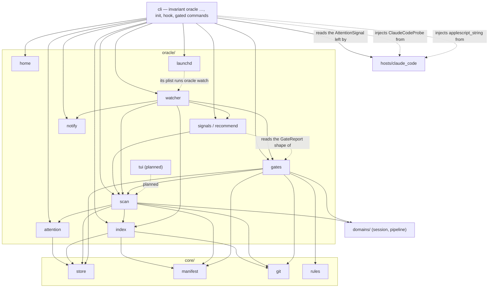

# The Session Oracle

A machine-wide view of every running session in every invariant project. It
says which one needs you and recommends the exact next command for each one
(IDEA_012). The decisions behind it are recorded in ADR-007.

The oracle is built in seven increments, and each one lands on its own. This
page describes what has shipped. Everything marked **planned** is design that
was approved in the plan but has no code yet. Treat it as intent, not as a
description of the current behaviour.

| # | Increment | Status |
|---|---|---|
| 1 | Home, project index, `oracle projects` commands, auto-registration | **shipped** |
| 2 | Attention sidecar and the `Notification` hook | **shipped** |
| 3 | Read-only scan, `classify`, `recommend`, `oracle list` | **shipped** |
| 4 | Watcher, rising-edge de-dup ledger, notifier, `watch`, `notify-test` | **shipped** |
| 5 | Gate cache for recommendation detail | **shipped** |
| 6 | launchd `install` / `uninstall` / `status` | **shipped** |
| 7 | Textual TUI behind the `invariant[oracle]` extra | planned |

## Where it sits

**The dependency rule.** `oracle/` is a layer above `domains/` and below the
CLI. Nothing in `core/`, `domains/` or `adapters/` imports it, and a test scans
those packages to enforce this. The engine therefore behaves identically
whether the oracle is used or not.

The SessionStart registration and the attention writes are both wired in the
CLI's `hook` command and not in `hosts/claude_code`. That keeps the host
adapter free of the new layer: the host says what an event means, and the CLI
writes it (ADR-007 D6). A test scans `hosts/` for oracle imports, beside the
one that scans `core/`, `domains/` and `adapters/`.

## Shipped: home and project index

### `oracle/home`

`oracle_home()` returns `$INVARIANT_HOME` when it is set and not empty, and
`~/.invariant` otherwise. The value is resolved on every call and never cached.
The function only names the directory: it does not create it and does not read
it.

The test suite sets `INVARIANT_HOME` to a fresh temporary directory for every
test (`tests/conftest.py`). The variable is exported, so a hook shim that a
test runs as a subprocess inherits it too. No test can write the developer's
real index.

### `oracle/index`

`ProjectIndex(home)` manages `projects.json`. The format and its invariants
are specified in [state_model.md](state_model.md), "User-level state". In
summary:

- An entry is `{key, root, name, via}`. `key` is `Manifest.state_root`, so all
  of a repository's worktrees, and several manifests in one repository,
  collapse to one entry.
- `root` is the main checkout's spelling of the project. A registration made
  from inside a linked worktree records the same relative position in the main
  checkout, provided a manifest exists there.
- No clock times. The format also keeps keys it does not know, and refuses a
  newer `version` instead of rewriting it.
- Writes take `JsonStore.locked`, through `HomeStore`, the home's store,
  which the watcher shares. The home holds `projects.json`, `locks/` and the
  watcher's `oracle/`. A project state root's `sessions/` and `pipelines/` are
  never laid out here.

| Operation | Behaviour |
|---|---|
| `register(manifest, via)` | Reads first. Locks only when the key is missing, and checks again under the lock. Returns `(entry, added)`. An existing entry is returned unchanged. |
| `match(selector)` / `remove(selector)` | Tries the selector as a key, then a root (relative or absolute), then a name. The first rung with a hit wins. A name shared by several entries is refused, and so is a selector that matches nothing. |
| `prune(dry_run)` | Drops the entries whose `root` no longer has a manifest. The manifest is checked again under the lock. If nothing is stale, no lock is taken. |

### How a project gets in

| Route | `via` | Failure handling |
|---|---|---|
| `invariant init` (not `--dry-run`) | `init` | A failure is reported in the output and the JSON `oracle` key. The command still succeeds, because the project is initialised. |
| `invariant hook session-start` (not the probe) | `session-start` | A failure is swallowed. The hook's response is computed first and cannot change. |
| `invariant oracle projects add [PATH]` | `manual` | This is the command, so a failure is its error: exit 2 for no manifest, exit 3 for a broken index. |

The CLI surface is in [cli.md](cli.md), "Oracle".

## Shipped: the attention sidecar

### `oracle/attention`

`AttentionStore(store)` reads and writes
`<state_root>/attention/<host-id>.json`, one record per host session. The
format is specified in [state_model.md](state_model.md), "Attention and host
liveness". In summary:

- `waiting` is `{kind, message, since}`, where `kind` is `permission`,
  `question` or `idle`, and `message` is the host's raw text. `blocked` is
  `{rules, surface, since}`, where `surface` is `stop` or `cli`. Then `turn`
  (`running` or `ended`) and `turn_since`, `ended`, `pid`, and `degraded`
  (`{event, error, since}`).
- The store is built on the caller's `JsonStore`, so the probe's inert store
  discards these writes along with every other.
- One writer per file, atomic replace, no lock. Unknown keys are kept. A
  record that cannot be read is replaced by the next write.
- A host id must be a plain name before it becomes a file name.

### What writes it

The host adapter turns each hook event into an `AttentionSignal`. The CLI
applies the signal through one guarded helper, `_record_attention`.

| Event | Signal | Effect on the record |
|---|---|---|
| `Notification` (new, the 7th hook) | `waiting` | `waiting` set. `notification_type` `permission_prompt` → `permission`, `elicitation_dialog` → `question`, `idle_prompt` → `idle`. When the type is missing or unknown, the message is matched instead. A notification that matches nothing writes nothing. |
| `PreToolUse`, `AskUserQuestion` | `waiting` | `waiting: question`, with the first question's text. Not when the hook denies the call. |
| `PostToolUse` | `answered` | `waiting` cleared. Reads first, and writes only if something was waiting. |
| `UserPromptSubmit` | `prompt` | `turn: running`. `waiting`, `blocked` and `degraded` cleared, `ended: false`. |
| `Stop` | `turn-ended` | `turn: ended`, `waiting` cleared. `blocked` set to the closeout's blocking rule ids, or, on a clean stop, cleared if the Stop had set it. A CLI block is kept. |
| `SessionEnd` | `host-ended` | `ended: true`. Everything else cleared, including `pid`. |
| `invariant hook` handler raised | — | `degraded` set, with the event and the error. |
| `pipeline advance`, `session transition` / `review` / `merge` refused | — | `blocked: {surface: cli}` on the bound host's record, if the session has a live host. Cleared when one of those commands later succeeds. |

`SessionStart` writes nothing. The rule that a hook must not write on every
start still holds.

### The two guarantees

**A failed write never changes a verdict.** The helper runs after the response
is computed and before it is printed. It neither reads nor returns the
response, and it swallows every failure. The suite checks this by breaking the
store and comparing the output byte for byte (ADR-007 D10).

**The probe writes nothing.** `doctor`'s probe payloads, including the new
`Notification` one, skip the helper outright. They are run against the inert
store anyway.

### The host pid

The hook records `CLAUDE_PID` whenever the environment carries it. Without it,
a pid already recorded stands, and a host with no pid yet walks the parent
chain with `ps` to the first process named `claude`
(`claude_code_launch.find_host_pid`). Both paths exist because both were seen
on this machine (ADR-007 D7). The CLI refusal path records no pid.

## Shipped: the scan, the signals and the recommendations

### `oracle/scan`

`scan_project(entry, clock, cache)` reads one registered project and returns a
`ProjectSnapshot`; `scan_all(index, clock, cache, select)` does it for every
project, or for the one `select` names (by key, root or name, as `projects
remove` matches). Nothing in a scan writes:

- sessions, pipelines and attention records are read through an `InertStore`
  on the entry's key, the state root, with the domains' own record types and
  lookups;
- the manifest is loaded from the recorded root only, never by walking upward,
  so a root that lost its manifest is an error and not some enclosing
  project's sessions;
- git is asked `worktree list` and nothing else.

The suite builds three projects and five live sessions and fingerprints every
file under every state root and the oracle home before and after two scans
(path, size, mtime). Nothing moves.

**Rows.** One shape, four kinds, so the classifier reads them all the same way.

| Kind | What it is |
|---|---|
| `session` | A live session: any state the project's session machine does not call terminal or abandoned. The registry is not consulted; `sessions/*.json` is enumerated, because the registry can lag the records. Its hosts are nested under it, the current binding first and then `hosts`, oldest first. |
| `host` | An orphan host: an attention record or a transcript that no live session claims, shown while the host is alive or for 24 hours after its last sign of life. A host bound only to an ended session counts, and the row names that session. A record whose host said `SessionEnd` does not. The row lists the project's live, not-stranded sessions with no live binding as `adoptable`. |
| `worktree` | A linked worktree on disk that no live session records. |
| `error` | A project that cannot be read (no manifest at the root, a manifest that does not parse, a machine that does not load), or one session record that cannot be. One error row never hides another row. |

**Stages, not state names.** A project may shadow the session machine, so the
scan never names a state. `session_stages(machine)` derives where each state
sits from the machine's structure:

| Stage | Derived as | Shipped machine |
|---|---|---|
| `ended` | terminal, or carrying the `abandon` role | `torn_down`, `abandoned` |
| `landed` | the merge — the state whose entry gates include `session.ff_merge_target` — and every non-terminal state reachable after it | `merged`, `pushed` |
| `reviewed` | a state with an edge into the merge | `reviewed` |
| `working` | a state with an edge into a reviewed one | `working` |
| `early` | everything else | `registered`, `isolated` |

A pipeline is read the same way: `landed` is terminal and not the abandon
state, and the red phase is the machine's `red_phase` (else `red`, the rule's
own fallback).

**Host liveness.** A host is alive when its recorded pid exists (`os.kill(pid,
0)`, every scan) and the process is still the host (a process-name check, kept
for 60 seconds and dropped the moment the pid is seen dead). A reused pid is
therefore "not alive", and a host that died without `SessionEnd` stops reading
as waiting. No pid recorded means liveness is unknown (`null`), which no
signal treats as gone.

**Last activity** is the latest of the host transcripts' modification times,
the attention records' modification times, the session's `heartbeat` and its
`plan_touched`. The times are read, never stored, so the "no stored clock
time" rule is untouched.

**Host facts are injected** (ADR-007 D11). Which transcripts belong to a
project and whether a pid is `claude` are Claude Code knowledge. The scan
defines `HostProbe` (`transcripts(root)`, `is_host_process(pid)`), the CLI
injects `hosts/claude_code_launch.ClaudeCodeProbe`, and the oracle imports
nothing from `hosts/`. Without a probe the scan still runs: no transcripts,
and a live pid counts as the host.

**Cheap on the next pass.** `ScanCache` keeps the git-backed answers — each
project's worktree list and its transcript source, whose construction asks git
for the project's worktrees — and the process-name checks for 60 seconds. A
repeat scan re-reads only small JSON files and directory listings. Measured:
the suite's three projects and five sessions scan in about 0.1 s cold and
0.04 s warm, and this machine's two real projects in 0.11 s and 0.29 s each.

### `oracle/signals`

`classify(row, now, thresholds)` is pure: the row and the clock it is handed,
nothing else. Alerts come first in the list it returns.

| Signal | Alert | Severity | Raised when | Key discriminator |
|---|---|---|---|---|
| `waiting` | yes | high; medium after 6 h | the current host's `waiting.kind` is `permission` or `question`, and the host is not known to be gone | `<kind>@<since>` |
| `gate_blocked` | yes | medium | `blocked` is set and `turn` is `ended` (ADR-007 D8) | the sorted rule ids |
| `stuck` | yes | medium | the host is not known to be gone, `turn` is `running`, nothing is waiting, and the last activity is older than 20 minutes | `turn_since` |
| `finished` | yes | low | the session is in its reviewed stage (`cause: reviewed`), or in its working stage with a complete plan and a landed pipeline (`cause: ready`) | `reviewed` / `ready` |
| `error` | yes | high | the last test run failed, was not read as red, and was not in the red phase (`tests`); a hook recorded `degraded` (`degraded`); the row is an error row (`scan`) | `tests:<run count>`, `degraded@<since>`, `scan` |
| `your_turn` | no | info | `waiting.kind` is `idle` and the host is not gone | — |
| `host_gone` | no | info | the recorded pid is not alive, and neither the binding nor the record says the host ended | — |
| `parked` | no | info | the session's binding is spent and its worktree is there | — |
| `stranded` | no | info | the session's recorded worktree is gone | — |
| `teardown_pending` | no | info | the session is in its landed stage | — |
| `orphan_host` | no | info | a `host` row | — |
| `leaked_worktree` | no | info | a `worktree` row | — |

Only the current host's record is read; the hosts a session had before are
history. Every signal carries `key = project|subject|kind|discriminator`, where
the subject is the session id, `host:<id>`, `worktree:<path>` or `project`. The
discriminator changes exactly when the condition is a new occurrence — a new
prompt, a different set of refusing rules, another test run, a new turn — so
the watcher's ledger can alert once per rising edge.

A failed run in the red phase is the proof `test.new_test_fails` asks for, not
an error, which is why the red phase is excluded alongside `read_as_red`.

### `oracle/recommend`

`recommend(row, signals, gates)` names one next step: a label, the exact `argv` and
`cwd`, and a kind — `run` (an `invariant` command), `terminal` (one that
belongs in a new host session) or `info` (nothing to run). The first row of the
table that holds wins.

| Condition | Kind | Command | Run in |
|---|---|---|---|
| `waiting` | info | none: answer it in its own terminal. The oracle never answers a prompt | — |
| error row | info | none: what stops the read | — |
| leaked worktree | info | none: inspect it, remove it with git if spent | — |
| orphan host, alive, exactly one adoptable session | run | `invariant session adopt <host> --id <session>` | project root |
| orphan host, otherwise | info | none: start or resume a session from that host | — |
| failed tests | run | `invariant pipeline test`, with `INVARIANT_SESSION_ID` | worktree, else root |
| `gate_blocked` | run | `invariant pipeline gates`, with `INVARIANT_SESSION_ID` | worktree, else root |
| `stuck` | run | `invariant context --id <session>` | worktree, else root |
| `finished`, reviewed | run | `invariant session merge --id <session>` | project root (the merge runs from the main checkout) |
| `finished`, ready | run | `invariant session review --id <session>` | worktree, else root |
| `teardown_pending` | run | `invariant session teardown --id <session>` | project root |
| `stranded` | run | `invariant session reap --dry-run` (look before reaping) | project root |
| `parked` | terminal | `invariant session resume --id <session>` | its origin, else root |
| `host_gone` | terminal | `invariant session resume --id <session> --force` | its origin, else root |
| `error`, degraded | run | `invariant doctor` | project root |
| `your_turn` | info | none | — |

`pipeline gates` and `pipeline test` take no `--id`, so the session is pinned
through `INVARIANT_SESSION_ID`, the explicit route session resolution already
honours. Adopt is offered only for a host known to be alive: a project that
just tore several sessions down has several transcript-only hosts, and each
would otherwise be told to adopt the same session. The suite parses every
`argv` in the table with the real CLI parser.

`assess(snapshots, now, thresholds, gates)` joins each row with its signals
and its recommendation, and with the gate cache's answer for it under `gates`
(`null` when there is none). It is the `invariant oracle list --json`
document, and the body of the watcher's snapshot. How the gate answer changes
a recommendation is in "Shipped: the gate cache" below.

### `invariant oracle list`

A one-shot scan of every registered project, or of `--project NAME`, printed
as a status table: a project line with its scan time, then one line per row
flagged `ALERT`, `note` or `ok` with its signals, and a `next` line with the
recommended command and where to run it. No `Context` is built, so it runs
from any directory. See [cli.md](cli.md), "Oracle".

## Shipped: the watcher and the notifier

### `oracle/watcher`

`Watcher(index, notifier, clock, interval, cache, thresholds)` runs one tick
at a time. A tick does four things in order:

1. **Scan** every registered project with `scan_all`, read-only as before.
2. **Assess** it with `assess`, the same document `oracle list --json` prints.
3. **Write the snapshot**, `<oracle home>/oracle/snapshot.json`. It is that
   document plus `home`, `version`, `generated`, `watcher_pid` and
   `interval`, written atomically, so a reader never sees half of one.
4. **De-duplicate and notify** through the ledger,
   `<oracle home>/oracle/alerts.json`.

`run(once, max_ticks, on_tick)` repeats the tick and sleeps so that ticks
start one `interval` apart. A tick that raises is logged to stderr, and the
loop goes on. `watch --once` calls one tick directly, so a failure there is the
command's error.

**The ledger makes "once" true.** It maps each alert's signal key
(`project|subject|kind|discriminator`, see "oracle/signals") to `{since,
notified}`. Each tick applies these rules:

| Case | What happens |
|---|---|
| A key not in the ledger | A rising edge. It is added, notified, and reported. |
| A key already there, `notified: true` | Not news. Nothing is sent. |
| A key already there, `notified: false` | Owed. Either there was no notifier (`--no-notify`) or delivery failed. The next tick that can deliver it does. |
| A key the tick no longer sees | Dropped, so the same condition coming back alerts again. |
| A key of a project this tick could not read | Kept. "Cannot read" is not "cleared", and a broken manifest must not re-alert everything in the project once it is fixed. |
| The same condition, recurring as a new occurrence | Has a new discriminator, so it is a new key and alerts again. Examples are a new prompt, another failed test run, or a different set of refusing rules. |

Only alerts notify. Markers never do. There is no repeat timer in v1. The
read-modify-write runs under the home's lock (`locks/alerts.lock`), so the
daemon and a `watch --once` cannot both announce one edge. After the first
failed delivery in a tick, the rest of that tick's edges are left owed instead
of being tried one by one.

**Both files are derived and safe to delete.** Deleting the snapshot costs
nothing, because the next tick writes it again. Deleting the ledger costs at
most one repeat of each live alert. A ledger that is not a JSON object, or
that has another `version` or shape, is replaced, not refused, because it is
the watcher's own derived state and not a record anybody else writes. The
formats are in [state_model.md](state_model.md), "User-level state".

**The latency budget.** A permission prompt is written to the sidecar by the
`Notification` hook at once. The next tick sees it, so the time from prompt
to ping is at most one `interval` (5 s) plus one tick. Measured on this
machine: the suite's three projects with five sessions each, all waiting, took
0.10 s for a cold tick and 0.04 s warm, and the suite asserts under 2 s. This
repository's real state root took 0.09 s for a cold `watch --once`. That is
well inside IDEA_012's 30-second acceptance, and inside the plan's "under 10 s"
with room to spare.

### `oracle/notify`

`Notifier` is a protocol with one method, `notify(Notification)`. A
`Notification` has a `title`, a `message`, an optional `subtitle` and an
optional `sound`.

- `OsascriptNotifier` runs `osascript -e 'display notification … with title
  … subtitle … sound name …'`. The script is one argument, with no shell in
  between. A refusal or a missing `osascript` raises `NotifyError`, which
  exits 1.
- `RecordingNotifier` keeps what it was asked to send. It is for tests, and
  its `fail` flag makes it refuse.

The watcher titles a notification `invariant: <project>`. The subtitle is the
row's label, which is the label `oracle list` prints (`recommend.row_label`,
one spelling for both). The message is the signal's detail. A high or medium
alert plays `Glass`, and a low one (finished) is a silent banner.

**The quoting is injected** (ADR-007 D13). Turning text into an AppleScript
string literal already has an owner: `hosts/claude_code_launch.applescript_string`.
The oracle may not import `hosts/`, so `OsascriptNotifier` takes the quoting
function as an argument. The CLI's `_oracle_notifier` seam passes in the
host's function. This is the `HostProbe` shape again. The suite replaces the
seam with a recorder for every test, and a `conftest.py` guard makes
`subprocess.Popen` refuse `osascript` unless a test is marked
`real_osascript`. The one test that runs it evaluates a string literal and
posts nothing.

### `invariant oracle watch` and `notify-test`

`watch` runs the loop until it is interrupted. In text mode it prints only the
ticks that have news. With `--json` it prints one line per tick. `--once` runs
a single tick and prints its result. `--no-notify` sends nothing, and the edges
it sees stay owed to a watcher that does notify. `notify-test` posts one
notification through the same seam. See [cli.md](cli.md), "Oracle".

## Shipped: the gate cache

### `oracle/gates`

A row says a gate refused only when a refusal was actually met: `blocked` in
the attention sidecar (ADR-007 D8). It cannot say which gates are owed now, or
what each wants, and without that the best recommendation is "run `pipeline
gates`". `GateCache` supplies the detail by running
`PipelineDomain.evaluate_gates_by_destination`, the evaluation `pipeline gates`
prints, and keeps the answer in memory.

| Rule | How |
|---|---|
| **Never a write** | The domains are built on an `InertStore` over the row's state root. The manifest is the session worktree's own (the main checkout's if the worktree has none), because the rules resolve the paths they compare against the manifest's root. The rules run with `cwd` set to the worktree, so their git questions are asked there, and inside `core/git.without_optional_locks()`, so every one runs with `GIT_OPTIONAL_LOCKS=0`: a plain `git diff` cannot refresh the index stat cache and take `index.lock` under the host working there (ADR-007 D16). |
| **Never while a turn runs** | A host mid-turn is using that worktree, and its own git commands must not meet ours. A session is evaluated when its current host's `turn` is `ended`. With no turn known, or a running turn whose host is known to be gone, it is evaluated after 2 minutes without activity. A running turn on a live host, or one whose liveness is unknown, is never evaluated. |
| **Only when something moved** | The fingerprint is the session's `state` and `heartbeat`, the pipeline's `state` and transition count, and the pipeline record's `st_mtime_ns`. Evidence is recorded without a transition, so the write time is what moves for a new test run or a doc read. The scan supplies all five (`PipelineView.transitions`, `written_ns`), so fingerprinting costs no extra read. |
| **Skipped when there is nothing to ask** | A row that is not a session, has no pipeline or a terminal one, is stranded, or whose worktree (else root) is not a directory. |
| **Bounded** | Each evaluation runs in a daemon thread, at most 2 at once across every project, with a 10-second timeout. A worker that timed out keeps its slot until it really ends, so a hung `git` cannot multiply threads. A result later than the timeout is dropped. |
| **A failure keeps the last answer** | A timeout or an error keeps the previous result, flagged `timed_out` or with `error`, and that fingerprint is not tried again. The next change of fingerprint is. |
| **In memory** | Nothing is persisted. The watcher's cache lives across its ticks; a restarted watcher evaluates again. The answer reaches the snapshot only as part of the assessed document. |

`refresh(snapshots, now, wait)` starts what is owed, waits up to `wait`
seconds and returns a `GateReport` per `(state root, session id)`: the gates
not met, once each, blocking first, each with its level, the first line of
its message, its first fix and every edge out of the state that owes it. A
report whose fingerprint has moved since is `stale`. The answers of sessions
that are no longer live in a scanned project are forgotten.

**It feeds the recommendation, never an alert.** `recommend(row, signals,
gates)` takes the report as an argument, so it stays pure, and `classify`
never sees it: the signals, and so the ledger and the notifications, are the
same with or without it. The suite checks that.

| Row | What the report adds |
|---|---|
| `gate_blocked` (or failed tests on a refused row) | `detail`: `owed: <rule> (<level>, to <edges>): <message>; …`. A stale report is prefixed `as of <pipeline state>,`. A report with nothing owed says the refusal may already be cleared. A report with only a timeout or an error adds nothing. |
| Any other session row with a step | `detail`: `next owed: <blocking rules> (to <first edge>)`, from a current report only. |
| A session row with no step | The same hint becomes its step, an `info` one with no command. |

**Where it is wired.**

| Caller | Wait |
|---|---|
| `Watcher(gates=…, gate_wait=0)` | The loop never waits: a tick starts what is owed and reports what has finished. An evaluation that finishes between ticks is the next tick's. |
| `oracle watch --once` | Waits up to the timeout, because it is a one-shot like `list`. |
| `oracle list` | Evaluates the eligible sessions once and waits up to the timeout. |

The CLI reaches the cache through the `_oracle_gates` seam, as it does the scan
cache. The text output prints the detail on its own line under `next`.

**Measured** on this repository's real state root, against a scratch
`INVARIANT_HOME`, on 2026-10-22: one live session, evaluated in 0.02 s in its
worker. Watcher ticks with the gate cache took 0.11 s cold and about 0.03 s
warm, the same as without it, and a `watch --once` that waited for the gates
took 0.12 s. The suite stalls an evaluation and checks that the tick still
returns in under 2 s.

## Shipped: the launchd agent

### `oracle/launchd`

The watcher is useful only while it runs, so on macOS it is a user
LaunchAgent: `~/Library/LaunchAgents/dev.invariant.oracle.plist`, loaded into
the person's GUI domain, `gui/<uid>`. It is the first long-lived process this
library starts (ADR-007 D17).

`plist_for(python, home, interval, path, pin_home)` builds the property list,
and `plist_bytes` writes it with `plistlib`:

| Key | Value | Why |
|---|---|---|
| `Label` | `dev.invariant.oracle` | One agent per user. |
| `ProgramArguments` | `[<python>, -m, invariant, oracle, watch, --interval, N]` | The absolute interpreter that ran `install`, unresolved. A virtual environment's `python` is a symlink and finds its environment from its own path, so resolving it would lose the environment. `-m invariant`, not the console script, so nothing depends on `PATH`. |
| `RunAtLoad`, `KeepAlive` | `true` | Starts at login and is restarted if it exits. |
| `StandardOutPath`, `StandardErrorPath` | `<oracle home>/oracle/watcher.log` | Both streams. The watcher prints only ticks with news and failed ticks, so the log grows slowly. `install` creates the directory, because launchd does not. |
| `EnvironmentVariables` | `PATH`, and `INVARIANT_HOME` only if it was set | launchd's `PATH` is minimal. This one is the directories `git` and `osascript` are found in now, then `/usr/bin:/bin:/usr/sbin:/sbin`. An unset `INVARIANT_HOME` stays unset, so it keeps meaning `~/.invariant`. |

`LaunchdInstaller(agents_dir, uid, run, sleep)` owns the plist file and the
`launchctl` calls. `launchctl` is reached only through `run`, an injected
`(argv) -> (status, text)`; the CLI passes `run_launchctl`, which runs
`/bin/launchctl`.

| Operation | Calls |
|---|---|
| `install(plist)` | `print gui/<uid>/dev.invariant.oracle` to see whether it is loaded. If it is: `bootout` that service, then `print` until it is gone (up to 5 s), because `bootout` returns before the process has left and launchd refuses to bootstrap a label still loaded. Then the plist is written atomically and `bootstrap gui/<uid> <plist>` loads it. A refusal is a `LaunchdError` (exit 1) that names the plist. |
| `uninstall()` | `print`; `bootout` and wait, if loaded; remove the plist, if present. Nothing installed is nothing to do. A `bootout` that fails because the agent already left is not an error. |
| `--dry-run` of either | Only the `print`, so the steps reported are the ones a real run would make. No file is written, no directory created, nothing loaded or unloaded. |
| `status()` | Whether the plist exists, whether `print` finds the agent, the interpreter it names and whether that still exists, and its interval. |
| `interpreter_check()` | `doctor`'s row. Reads the plist only, asks launchd nothing. `None` with no plist. |

`RecordingLaunchctl` is a fake launchd for tests: it records every call,
keeps a loaded set, can refuse a verb, and can keep an agent "exiting" for a
number of `print` calls after its `bootout`. `recording_installer(dir)` pairs
it with a temporary directory and a sleep that does not sleep.

### `invariant oracle install`, `uninstall` and `status`

`install [--interval 5] [--dry-run]` writes and loads the agent; a second
`install` replaces it cleanly. `uninstall [--dry-run]` unloads it and removes
the plist. `status` reports the agent and the snapshot: the snapshot's age is
its modification time (`watcher.snapshot_status`), and it is **stale** when it
is older than three of its own intervals, or missing. `doctor` adds one row
when the plist exists: `oracle agent interpreter`, failing when the
interpreter has moved. See [cli.md](cli.md), "Oracle".

The CLI reaches the installer through the `_oracle_installer` seam. The suite
replaces it for every test with a recording installer over a temporary
`LaunchAgents` directory, and the `conftest.py` guard makes `subprocess.Popen`
refuse `launchctl` outright, with no marker that admits it. Real `launchctl`
never runs in the suite.

**The guard** raises `RefusedProgram`, a `BaseException`, so code under test
that catches `Exception` (the watcher's notify path does, on purpose) cannot
swallow it. It reads the program from an argument list, a bare string, bytes
or a path (`os.fspath`), an `executable=` override, and, best effort, a shell
command string: `shell=True`, or `sh`/`bash`/`zsh -c`, where each command's
first word after assignments and `exec`/`env` wrappers is checked, one level
of nested `sh -c` included.

## Known gap: a host rooted in another repository (BUG_040)

A host session is attributed to the project its hooks resolve, and its
transcript to the project directory it was started in. A host started in one
repository that works on a session of another therefore has its attention
record and transcript in the wrong project: it shows up there as an orphan
`host` row, and the session it serves shows no host. This is documented, not
fixed; BUG_040 owns it.

## Planned

The plan approved on 2026-10-22 sets out the shape below. Each part is written
up properly when it ships.

- **TUI** (increment 7). A Textual app behind the `invariant[oracle]` extra.
  Every action asks for confirmation first, in a modal that shows the exact
  argv and cwd. It never answers a permission prompt.
