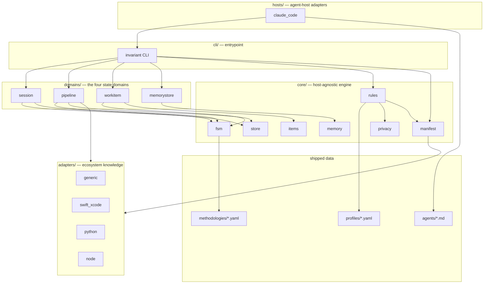
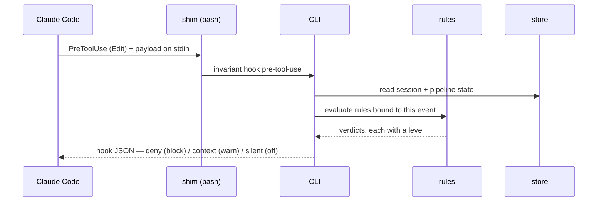
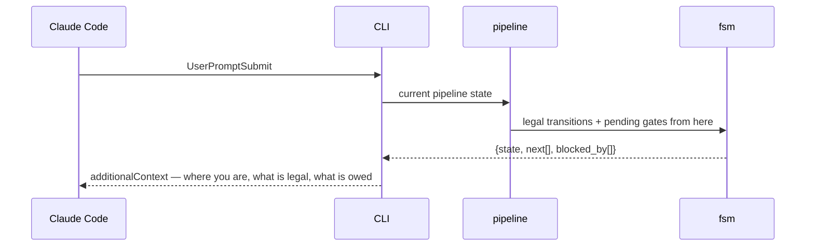

# Architecture overview

`invariant` turns agent-workflow discipline from prose the model is asked to
remember into state a script owns. See `docs/adr/ADR-001` for why.

This document is the authoritative map of the components and their
dependencies. Per the library's own docs-first rule, read it before changing
code, and update it when a structural relationship changes.

## Layers



**Dependency rule:** arrows point down and never back up. `core/` knows
nothing about hosts, adapters, or the CLI. `adapters/` know their ecosystem
and nothing about state. `hosts/` know their agent host and reach the engine
only through the CLI. This is what makes the Claude Code binding replaceable.

## Component responsibilities

### `core/`

| Module | Owns | Never does |
|---|---|---|
| `fsm` | Loading a declarative state-machine definition; validating a proposed transition; computing legal next states and pending gates | Persist anything; know what a session or a bug is |
| `store` | Atomic, concurrency-safe JSON persistence under the state root; locking the cross-session registry | Interpret the contents |
| `manifest` | Parsing and validating the project manifest; merging profile defaults with per-rule overrides; resolving adapter selection | Read state; run commands |
| `rules` | The rule registry: each rule is an id, a bound host event, an evaluation function, and a level | Decide policy — levels come from the manifest |
| `items` | The work-item model and the pluggable store backends that read and write it | Know an item's lifecycle — that is `domains/workitem` |
| `memory` | Memory file schema, parsing, dedup detection, index generation, link validation | Decide what is worth remembering |
| `privacy` | Pattern-based detection of personal data in text | Know which files matter |

### `domains/`

Each domain binds a state machine to a store and exposes the operations that
advance it. They are the only place where "what a session is" is encoded.

- **`session`** — identity, isolation, the push barrier, teardown. Multiple
  sessions coexist on one machine, so this is the only domain with genuine
  cross-process concurrency, mediated by the locked registry.
- **`pipeline`** — one task's progress through the configured methodology.
  Scoped to a session; a session runs pipelines in sequence.
- **`workitem`** — ideas and bugs, their statuses, and the transitions between
  them. Persisted through `core/items` into whichever backend the project uses.
- **`memorystore`** — validation, dedup, and index regeneration over the
  memory directory. Not an FSM; a set of invariants plus repair operations.

### `adapters/`

An adapter supplies ecosystem knowledge the manifest should not have to spell
out: how to build, how to test a single unit, how to read a coverage number,
how to tell a real failure from a tooling failure. Adapters are selected in the
manifest and may be stacked; `generic` is the always-present fallback that
executes literal commands from the manifest and parses nothing.

The `swift_xcode` adapter exists first because the originating project needs
it, and because it carries the most instructive ecosystem traps — a build tool
whose exit codes can silently drop whole test suites, and a destination
argument whose convenient form resolves to the wrong thing.

### `hosts/`

A host adapter translates between an agent host's extension points and the
CLI. For Claude Code that means hook payload parsing, the hook JSON response
shape (`permissionDecision`, `additionalContext`), agent and command file
installation, and `settings.json` wiring. Nothing above `hosts/` is aware of
hook schemas.

## The two flows that matter

### Enforcing a transition



A rule at `block` returns a denial the host enforces. The same rule at `warn`
returns the same reasoning as injected context and lets the call through. This
is why D10 and D11 compose: level is a property of the verdict's *delivery*,
not of the rule's logic, so a project retunes policy without touching code.

### Injecting state instead of rules



The injected text is a projection of state. It is short because it describes
one node of a graph rather than the whole rulebook, and it cannot go stale
relative to what actually happened, because it is read from the record of what
actually happened.

## Where things live at rest

```
<project>/
  .claude/
    invariant.yaml          the manifest — the only project-aware artifact
    invariant/
      state/                gitignored; per-session JSON + locked registry
    hooks/                  thin shims that exec the CLI
    agents/                 library agents installed as shims; local agents as files
  docs/                     architecture docs the docs-first gate reads
```

Configuration and knowledge are committed. Runtime state never is — it is
machine-local, session-scoped, and would conflict constantly between
concurrent sessions.
