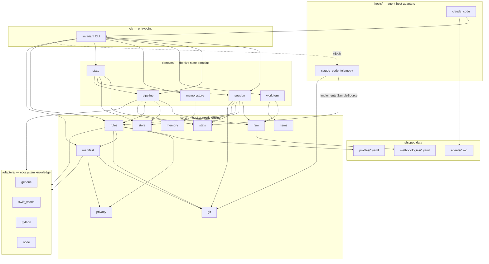
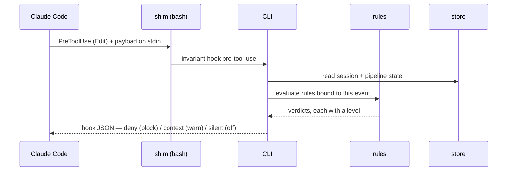
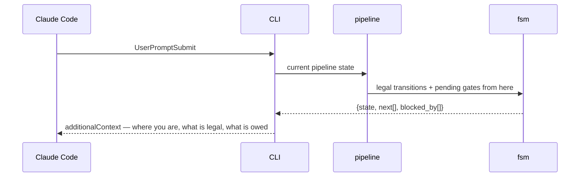

# Architecture overview

`invariant` turns agent-workflow discipline from prose the model is asked to
remember into state a script owns. See `docs/adr/ADR-001` for why.

This document is the authoritative map of the components and their
dependencies. Per the library's own docs-first rule, read it before changing
code, and update it when a structural relationship changes.

## Layers



The two `domains → core/rules` arrows are how a state machine's gates get
evaluated: a gate names a rule id, and the domain that owns the transition asks
the registry for the verdicts. `PipelineDomain.advance` has worked this way
from the start; `SessionDomain._advance` joined it when AUD-05 found the
session machine's gates were read by two hardcoded CLI call sites instead of by
the one function every transition passes through. `MANIFEST → PRIVACY` carries
exactly one name — `DEFAULT_PATTERNS`, the single authoritative default
pattern set — so the manifest's default and a bare `PrivacyScanner()` cannot
drift apart (AUD-15).

The four arrows into `git` were drawn late. The module has been imported by
`core/rules`, `core/manifest`, `domains/session` and the telemetry host since
long before this document named it — the narrowing discussion below even
appeals to "`core/git` for the worktrees placed beside it" — while the diagram
and the component table, which this document calls the authoritative map, left
it out. A dependency a reader cannot see is one a design argues from without
being checked.

`RULES → GIT` is the newest of them and carries the most weight, because it is
how a gate screens **what landed rather than what announced itself**.
`privacy.clean` used to read only the payload of an edit tool, so a write made
through a shell — a heredoc, a `sed -i`, a `cp`, a generator emitting a
document — reached history unscreened while the gate reported that nothing in
scope had been written (BUG_027). Widening the list of tool names could not fix
that, because the next route is not a tool name either. Reading the *staged
content* at the commit does fix it, for every route at once, including the ones
nobody has enumerated: nothing in a staged blob records which tool produced it.
The same asymmetry as everywhere else governs the unanswerable case — a commit
whose staged content cannot be read FAILS, because this is the one gate whose
subject cannot be recovered afterwards. Nothing un-writes an identifier out of
a published history.

**Dependency rule:** arrows point down and never back up. `core/` knows
nothing about hosts or the CLI. `adapters/` know their ecosystem and nothing
about state. `hosts/` know their agent host, implement the protocols `core/`
defines, and reach the engine only through the CLI. This is what makes the
Claude Code binding replaceable.

`core/ → adapters/` is downward and therefore allowed, and it is how a rule
asks a question only an ecosystem can answer. `coverage.meets_floor` is the
case that shows the shape: an absent coverage row means either "never
measured" — the thing the gate exists to catch — or "nothing to measure",
which a bare protocol or an enum of cases can never escape. Only something
that knows the language can tell those apart, so the rule asks
`Adapter.carries_executable_code`, and an adapter with no opinion answers
`None`, which relaxes nothing. The rule keeps the policy; the adapter supplies
the fact. (`MANIFEST → adapters`, for command and rule-level defaults, is the
same arrow and predates it.)

What the adapter owes is a fact about the ECOSYSTEM: its language, and which
of its file kinds a compiler ever sees. The Swift one has been wrong about the
first half twice, in the same direction both times: it read a declaration as a
statement. A stored-property-only type was the first case
(BUG_025); a type-level constant — `static let name = Notification.Name("…")`
in an extension — was the second, and the file that exposed it is seven bare
protocols and four such constants, absent from all ten targets of the consuming
project's coverage report. The discriminator is not "is there an initialiser"
but WHERE the binding lives: a `static` or global binding is emitted as a
lazily initialised global and earns no row, while an INSTANCE stored property's
initialiser is emitted into every `init` the type has and does. Anything the
reader cannot resolve to a literal — a call to a lowercase member, a value read
from another symbol, arithmetic, a closure — goes on meaning "carries code",
because this answer's asymmetry runs the same way as the rule's: a spurious
block is visible, and a file wrongly called inert passes unmeasured code in
silence.

The second half is coarser and was simply missing. That reader answers about a
Swift file's CONTENTS, so every other path answered "cannot tell" — correctly
refusing to relax, and leaving a consuming project blocked over `Info.plist`,
a kind `xccov` cannot report on however it is written, in a change where the
property list was the load-bearing edit and the production Swift count was
zero (BUG_039). Both of the gate's own suggestions were dead ends: no test
clears it, and dropping the file from the declared set hides the change in
order to describe it. So the adapter now answers the kind question too, as an
**allowlist** of resource types — property lists and entitlements, strings and
string catalogs, storyboards and nibs, asset catalogs, build configuration
files — plus the directory bundles whose every payload is a resource, which is
the half that matters in practice: a touched path more often names a file
several components inside a catalog than the catalog itself.

Four properties keep it as narrow as the reader beside it. Compiled kinds are
listed explicitly and tested first, so neither a later allowlist entry nor the
directory rule can reach a kind that list names. That guarantee is exactly as
wide as the list and no wider, which is worth stating plainly because it was
once written as though it were absolute: the C++ spellings `.hxx`, `.ipp`,
`.inl`, `.cp` and `.c++` were missing, and a compiled kind the table does not
name falls straight through to the directory rule (BUG_042). They are listed
now. The property is maintained by keeping the table complete, not by the
ordering alone.
An extension absent from the allowlist answers `None`, because inverting this
into "any extension I do not recognise is inert" is precisely the silent pass
the base `None` exists to prevent. Documentation and configuration
suffixes are deliberately absent from it: `core/rules` already holds `.md`,
`.rst`, `.json`, `.yaml` and `.toml` out of the changed-source set for every
ecosystem, and the same judgement written down in two layers is the
duplication that drifts.

And the fourth, which is about the QUESTION rather than the tables. The
directory rule is a statement about the project's own layout, so it is asked on
the **project-relative** spelling and abstains without one. Asked on an absolute
path it scans components above the repository root — a checkout that happens to
sit inside a directory named `*.docc` or `*.xcodeproj` would then relax the
coverage floor for every unlisted compiled file underneath it. Its neighbour
`is_test_file` had been safe from this since BUG_019, but only because of a
comment at a call site in `core/rules`; the guarantee lived where the
implementer could not see it, and the next ancestor-scanning rule written
walked into it. `Adapter.carries_executable_code` now takes both spellings and
says which answers which — the resolvable path for the reader that OPENS the
file, the project-relative one for anything reading a directory convention.

An absent row has a *third* cause, and it is about the project rather than the
file: the reporter was configured never to look there. A Python project setting
`[tool.coverage.run] source` to its package directory can never produce a row
for a test file, so a session touching its own tests was handed a demand no
work could satisfy (BUG_019). That is the same seam and the same shape —
`Adapter.measured_scope` supplies the reporter's configured directories, `None`
means "cannot tell" and relaxes nothing, and `coverage.meets_floor` keeps the
policy of what to do about it.

The two questions must stay separate. A test file *does* carry executable code,
so answering `carries_executable_code` with `False` to relax the gate would be
a lie told to a rule — the exact failure the base `None` exists to prevent.
What is true of a test file is that nothing was ever pointed at it, which is a
different fact and now has its own question.

Note that `measured_scope`'s asymmetry runs the *opposite* way to
`carries_executable_code`'s, because its answer is used to shrink what the gate
demands rather than to explain one file. Overstating the scope costs a spurious
block, which is visible; understating it excuses a file the reporter really
does measure. So an adapter that cannot resolve every configured entry must
answer `None` rather than the part of the scope it worked out.

A *fourth* question is about neither the file nor the project but the CHANGE:
a diff that rewrote only comments altered no line a coverage run could measure,
so the floor is asking it for work that cannot move the number being demanded
(BUG_026). `Adapter.executable_text` reduces a revision to what a coverage tool
would count, the rule compares the base and working revisions through it, and
`None` relaxes nothing as before. It carries `measured_scope`'s asymmetry, for
the same reason — reducing too little costs a spurious block, reducing too much
calls a real code change cosmetic. The Swift implementation is where that has
teeth: it must copy string literals VERBATIM, because the reader that answers
`carries_executable_code` blanks their contents and would make `"a"` and `"b"`
compare equal.

Alongside it sits the one lever that is policy rather than fact —
`methodology.gates.coverage_exclude`, glob patterns a project states in its
manifest. Both hold paths out of the FLOOR and never out of the MEASUREMENT,
both run AFTER the no-row check so neither can hide a path-spelling mismatch,
and both name what they set aside in the verdict. An exclusion nobody can see
is indistinguishable from a gate that did not run.

That ordering is deliberate and it left a question nothing could answer. "Not
held to the floor" presumes a row exists to hold; a path that is not code at
all fails one step earlier, at the missing-row check, where `coverage_exclude`
by construction cannot reach it. The engine answers that itself wherever it can
— prose, configuration, markup, stylesheets and vector art are held out of the
changed-source set for every ecosystem, and an adapter reporting a file
inert or a reporter's configured scope excluding it are both positive evidence.
What none of those reaches is a kind that is real source SOMEWHERE and an asset
HERE: a Swift project versioning Claude Design bundles beside the code they
specify was blocked by `coverage.meets_floor` on their `.jsx`, on the bundle
directory itself, and on markup, with no manifest key that could say so and no
test anybody could write to clear it. `methodology.gates.non_source` is that
key. It is the project asserting what the engine cannot check, so it is applied
where the built-in suffixes are, it is empty by default, and every path it
holds out is named in the verdict with the pattern that spent it.

A third lever answers a question neither of those can: the floor is right for
new code and wrong for old. A file months below it blocks a two-line, fully
covered, net-negative edit, so the gate refuses precisely the change that
improves it. `methodology.gates.coverage_baseline` names a recorded per-file
shortfall — the same idiom as `scripts/arch_layering_baseline.txt` — and the
floor is RATCHETED against it: at or above the record is a pre-existing
shortfall and does not block, below the record is a regression and gets its own
verdict rather than the floor's, and no record at all fails exactly as before,
because the relaxation must rest on evidence somebody wrote down. It is asked
LAST, of files the floor has already rejected, so a record cannot buy a pass for
a path with no coverage row and a stale entry cannot become a second, higher
floor for a file that already clears the first. A record read only in PART is an
error, never a smaller record: a dropped entry stops being enforced and stops
being honoured at the same time, with nothing in any verdict to say so.

The two labelled arrows around `stats` — `CLI -. injects .-> CCTEL`, dotted,
and `CCTEL -- implements SampleSource --> STATS`, solid — are the same rule
applied to a case that could easily have inverted it (ADR-002 D2). Reading a host's
transcripts is host knowledge, and the arithmetic over what is read is not —
so `core/stats` declares a `SampleSource` protocol, `hosts/` implements it, and
the CLI injects the implementation. Had the domain imported the reader
directly, the arrow would have run `domains → hosts` and the binding would have
stopped being replaceable. The precedent is `core/items`, which already defines
a model with pluggable backends.

`domains/stats → domains/session` and `→ domains/pipeline` are horizontal, not
upward. The join from a host session to an invariant session is knowledge of
*what a session is*, which this document reserves to a domain; putting it in
the CLI would have traded a documentation edit for an architecture violation.

## Component responsibilities

### `core/`

| Module | Owns | Never does |
|---|---|---|
| `fsm` | Loading a declarative state-machine definition; validating a proposed transition; computing legal next states and pending gates | Persist anything; know what a session or a bug is |
| `store` | Atomic, concurrency-safe JSON persistence under the state root; locking the cross-session registry | Interpret the contents |
| `manifest` | Parsing and validating the project manifest; merging profile defaults with per-rule overrides; resolving adapter selection | Read state; run commands |
| `rules` | The rule registry: each rule is an id, a bound host event, an evaluation function, and a level | Decide policy — levels come from the manifest |
| `items` | The work-item model and the pluggable store backends that read and write it | Know an item's lifecycle — that is `domains/workitem` |
| `memory` | Memory file schema, parsing, dedup detection, index generation, link validation | Decide what is worth remembering |
| `privacy` | Pattern-based detection of personal data in text; the exemption marker and how far it reaches | Know which files matter |
| `git` | Read-only queries about the repository — worktrees, branches, the staged set and the bytes staged for a path | Decide what an answer means; a question it cannot answer returns `None` and relaxes nothing |
| `stats` | Telemetry record types, the price table, the arithmetic, and the `SampleSource` / `WatermarkSource` protocols | Read a transcript; know any host's on-disk format |

### `domains/`

Each domain binds a state machine to a store and exposes the operations that
advance it. They are the only place where "what a session is" is encoded.

- **`session`** — identity, isolation, the push barrier, teardown. Multiple
  sessions coexist on one machine, so this is the only domain with genuine
  cross-process concurrency, mediated by the locked registry.
- **`pipeline`** — one task's progress through the configured methodology.
  Scoped to a session; a session runs pipelines in sequence.
- **`workitem`** — ideas and bugs, their statuses, and the transitions between
  them. Persisted through `core/items` into whichever backend the project uses.
- **`memorystore`** — validation, dedup, and index regeneration over the
  memory directory. Not an FSM; a set of invariants plus repair operations.
- **`stats`** — what a session took and what it cost. Not an FSM either, for
  the same reason `memorystore` is not: there is no lifecycle to advance, but
  there is a store with invariants over it and operations that repair them.
  Owns the join from a host session to an invariant session, the rebuildable
  raw store, and the rendered report. See ADR-002.

### `adapters/`

An adapter supplies ecosystem knowledge the manifest should not have to spell
out: how to build, how to test a single unit, how to test SEVERAL, how to read
a coverage number, what that coverage run was even pointed at, how to tell a
real failure from a tooling failure. Adapters are selected in the manifest and
may be stacked; `generic` is the always-present fallback that executes literal
commands from the manifest and parses nothing.

"How to read a coverage number" is the layer's quietest duty and the one whose
failures travel furthest, because everything downstream of it behaves correctly
on whatever picture it supplies. The Xcode adapter's row parser matched a
literal `.swift`, so an Objective-C file `xccov` had genuinely measured arrived
at `coverage.meets_floor` looking exactly like a file no run had touched — the
rule then correctly refused to relax over a compiled kind, and the gate blocked
with no test anyone could write to clear it (BUG_041). The extensions it
accepts are now read from the same `_COMPILED_SUFFIXES` table the kind question
uses, so the two cannot drift; note that the asymmetry inverts between them. For
the kind question, a suffix wrongly listed would RELAX a gate, so the table is
conservative. For the row pattern, a suffix wrongly listed matches nothing while
one omitted drops a real measurement — so the parser takes the whole table.

`join_selectors` is the newest of those questions and carries the layer's
usual asymmetry. Whether several test selectors are a space-separated list of
positional arguments or a repeated FLAG is a fact about the tool the manifest's
`commands.test_one` template invokes, and the template is a project's to
rewrite — so an adapter with no confident answer returns `None`, the domain
refuses the request, and the caller runs them one at a time. Guessing would
build a well-formed command against the wrong scope, which is the exact defect
the question exists to close: a repeated `--selector` used to keep only the
last, and report a healthy green for a scope nobody asked for (BUG_031).

The `swift_xcode` adapter exists first because the originating project needs
it, and because it carries the most instructive ecosystem traps — a build tool
whose exit codes can silently drop whole test suites, and a destination
argument whose convenient form resolves to the wrong thing.

### `hosts/`

A host adapter translates between an agent host's extension points and the
CLI. For Claude Code that means hook payload parsing, the hook JSON response
shape (`permissionDecision`, `additionalContext`), agent and command file
installation, and `settings.json` wiring.

`hosts/` own hook *transport* — payload parsing, response shape, settings
wiring. A normalised payload dict travels upward, and `cli/` and `core/rules`
read documented keys from it; no layer above `hosts/` knows the hook
*protocol*. The keys are the contract, and they are listed in exactly one
place — `core.rules.NORMALISED_PAYLOAD_KEYS` — so that this document and the
host adapters cannot drift apart about what a host owes the engine.

This rule replaces a stronger one, "Nothing above `hosts/` is aware of hook
schemas", which the code had already departed from. `Context.session_for_payload`
reads `tool_input.file_path` and `RuleContext` reads `tool_name`, `tool_input`
and `target_path`; all are above `hosts/`. The departure was deliberate and a
shipped fix depends on it — BUG_010's fix (faa4de0) attributes a hook's
evidence to the right project *by the path the call itself names*, which is
only available from the payload. Leaving the old sentence standing meant the
authoritative map stated a rule a reader enforcing it would have used to
"correct" a working fix by reverting it (BUG_022). What a host adapter owes is
now an explicit normalisation obligation rather than an implied one, which is
what a second agent host would need in order to be written at all. The
restatement is recorded as ADR-003 D4.

The arrow runs the other way too, and one case makes it load-bearing. When a
host adapter DECIDES something a rule will later re-decide, the question has to
be asked through the rule's own helper rather than reimplemented next to it.
`_post_tool_use` needs to know whether a `Read` it is about to discard would
have been evidence for `docs.read_architecture`, so it calls
`core.rules.is_architecture_doc` — the same function the gate matches with.
Two local answers to "is this an architecture doc" is exactly the disjointness
BUG_046 was: two steps preferring opposite spellings of one file, with a
`block` gate closed against every read the track could perform in between.

The contract has been widened once since, deliberately and for the same class
of reason. `agent_type` — the acting agent, which Claude Code stamps on every
hook payload including a subagent's own — was added because a subagent that
creates its own session and pipeline dispatches *before* either exists, so the
design agent that created a pipeline could never be evidence for it (BUG_028).
No layering rule could recover that; only a fact the host already knows and
now hands upward. A host that cannot say who is acting omits the key.

`claude_code_telemetry` is a second, deliberately separate module for the same
host. It is a different relationship: `claude_code` *drives* the host through
hooks and installed assets, while this one *reads back* what the host already
wrote down — its per-project JSONL transcripts. A reader has no business in a
module about hook payload schemas, and the split keeps a change to one from
touching the other.

It is also the library's only dependency on another program's **undocumented**
format, and that shapes the code: every field access tolerates absence, an
unparseable record is skipped rather than fatal, and the file is a cache keyed
on a content fingerprint. A format change degrades a report and never breaks a
session.

Narrowing those transcripts to one project is where that format bites hardest.
The host names a project directory after the path it ran in, with separators
replaced — a **lossy** mangling, in which `<root>/app/v2` and `<root>/app-v2`
are one string. A worktree of the project must be counted and an unrelated
sibling checkout must not, so the reader resolves the ambiguity with evidence
rather than with the name: the filesystem for paths below the project, and
`core/git` for the worktrees placed beside it. Both are downward reads for a
fact only they hold, the same shape as `core/ → adapters/` above.

**The narrowing runs in both directions, and the origin is resolved upward
first.** A session worktree is a *place the project is being worked on*, not a
project, so its report is the project's: `ClaudeCodeTranscripts.roots()`
resolves the origin up to the repository's main checkout before narrowing.
Without that, an origin inside a worktree narrowed to the worktree — whose
mangled name is *longer* than the parent's — so the parent's transcripts failed
the prefix test and nothing above the worktree was visible at all. Since the
methodology mandates that a session run isolated, per-state attribution had
effectively never functioned under the only workflow the library permits
(BUG_017). Resolving upward hands the narrowing the main checkout's prefix,
which is the input the main-checkout case always got, so a sibling checkout
stays excluded by the same evidence (BUG_015).

One asymmetry survives deliberately. A torn-down worktree placed by the default
sibling convention (`<root>-wt-<id>`) loses its attribution permanently: the
path is gone, git no longer lists it, and its single-dash name is not the
hidden-directory spelling the naming heuristic recognises. A torn-down worktree
under the hidden worktrees directory stays attributed. That is evidence-honest
rather than a second defect — the alternative is admitting a name no evidence
supports, which is how BUG_015 happened.

## The two flows that matter

### Enforcing a transition



A rule at `block` returns a denial the host enforces. The same rule at `warn`
returns the same reasoning as injected context and lets the call through. This
is why D10 and D11 compose: level is a property of the verdict's *delivery*,
not of the rule's logic, so a project retunes policy without touching code.

### Injecting state instead of rules



The injected text is a projection of state. It is short because it describes
one node of a graph rather than the whole rulebook, and it cannot go stale
relative to what actually happened, because it is read from the record of what
actually happened.

## Where things live at rest

```
<project>/
  .claude/
    invariant.yaml          the manifest — the only project-aware artifact
    invariant/
      state/                gitignored; per-session JSON + locked registry
        stats/              one raw telemetry record per host session;
                            REBUILDABLE from the host's transcripts, except
                            where `stats archive` has promoted it
    hooks/                  thin shims that exec the CLI
    agents/                 \
    commands/                > managed host assets: library copies carry an
    skills/<name>/SKILL.md  /  in-frontmatter content hash; project-owned files
                               are checked for LOADABILITY but never for drift
  docs/                     architecture docs the docs-first gate reads
    conf.py                 Sphinx config (MyST + mermaid); renders docs/ as
                            one site — architecture, ADRs, audits. `docs/_build/`
                            is gitignored: the site is derived, not committed.
    reports/                paths.reports — the rendered, committed telemetry
                            report. Scrubbed: session names and bare dates,
                            never a host identifier (ADR-002 D7)
```

Configuration and knowledge are committed. Runtime state never is — it is
machine-local, session-scoped, and would conflict constantly between
concurrent sessions.

The report store is the one place those two meet, which is why it is declared
in the manifest rather than assumed: the raw records stay in the private state
root and the *rendering* of them is committed, so what leaves the machine is
decided by a renderer that can be read rather than by a directory somebody
remembered to gitignore.
