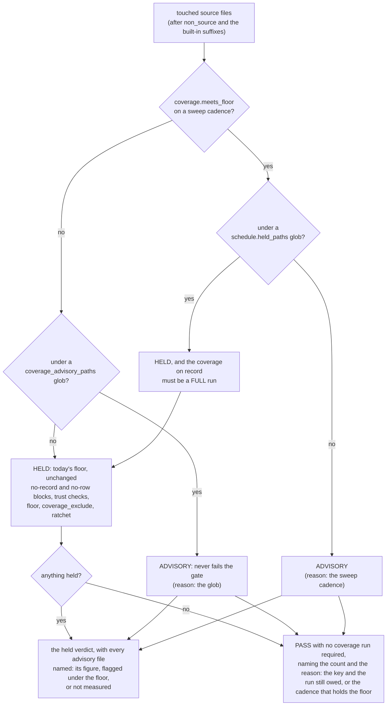
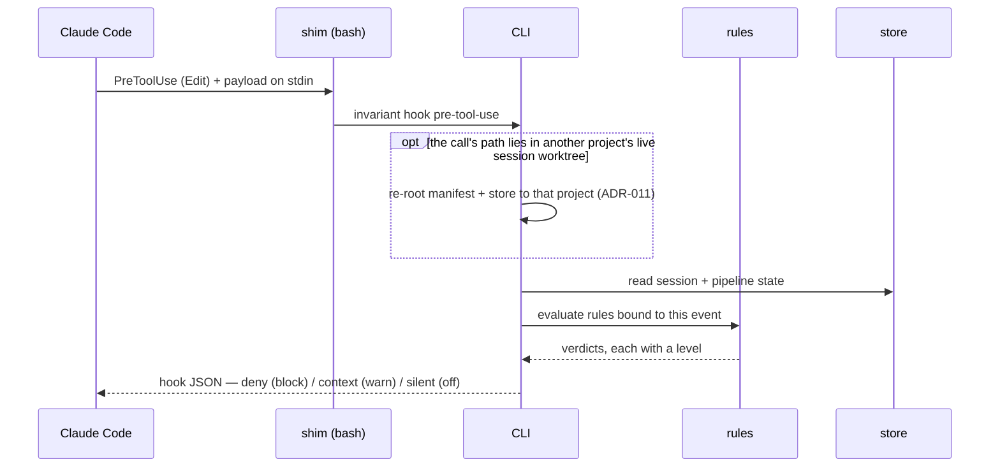
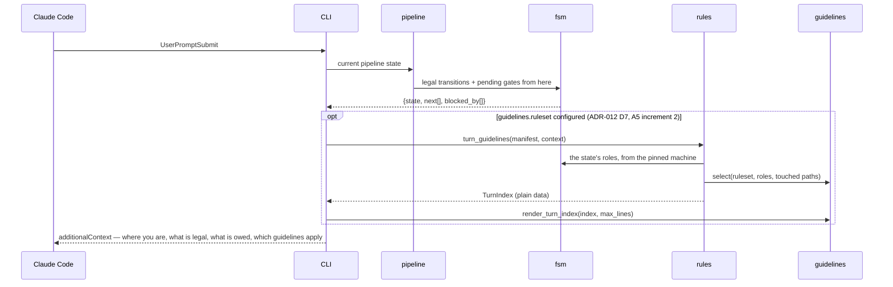

# Architecture overview

`invariant` turns agent-workflow discipline from prose the model is asked to
remember into state a script owns. See `docs/adr/ADR-001` for why.

This document is the authoritative map of the components and their
dependencies. Per the library's own docs-first rule, read it before changing
code, and update it when a structural relationship changes.

## Layers

```mermaid
graph TD
    subgraph host["hosts/ — agent-host adapters"]
        CC[claude_code]
        CCTEL[claude_code_telemetry]
        CCLAUNCH[claude_code_launch]
        CCASSETS["assets: the managed-asset format and its one classifier"]
    end

    subgraph cli["cli/ — entrypoint"]
        CLI[invariant CLI]
        CREPLAY["conformance replay"]
        CONBOARD["onboarding: init's docs offers, the plan (ADR-016 D4, D5)"]
        CPROMPTS["prompts (ADR-016 D4)"]
    end

    subgraph oracle["oracle/ — machine-wide view (ADR-007)"]
        OHOME[home]
        OINDEX[index]
        OATTN[attention]
        OSCAN[scan]
        OSIG["signals / recommend"]
        OWATCH[watcher]
        OGATES[gates]
        ONOTIFY[notify]
        OLAUNCHD[launchd]
        ODASH[dashboard]
        OACT[actions]
        OTUI["tui (Textual)"]
        OWEB["web (ADR-008)"]
        OPAGE[webpage]
        OWACT[webactions]
        OWSVC[webservice]
        OTLS["tls (IDEA_026)"]
        ODEV[devices]
        OCLOSE["closehost (IDEA_027 inc 6)"]
    end

    subgraph core["core/ — host-agnostic engine"]
        FSM[fsm]
        STORE[store]
        MANIFEST[manifest]
        RULES[rules]
        ITEMS[items]
        MEMORY[memory]
        PRIVACY[privacy]
        STATS[stats]
        GIT[git]
        PLAN[plan]
        CSWEEP["sweep (ADR-010)"]
        CONF["conformance (ADR-012 D11)"]
        CGUIDE["guidelines (ADR-012 D3)"]
        CFIND["findings (ADR-012 D4, A3.3)"]
        CVERD["verdicts (ADR-012 D5, A4.1 to A4.7)"]
        CAGENTS["agents (ADR-012 D8, D9, A6.2, A6.3, A7.1)"]
        CHOME["home (ADR-014 D3)"]
        CIDENT["identity (ADR-014 D4)"]
        CSTORES["stores (ADR-014 D2)"]
        CDOCFMT["docformat (ADR-016 D1)"]
        CQUEST["questionnaire (ADR-017 D1, D2)"]
    end

    subgraph domains["domains/ — the eight state domains"]
        SESSION[session]
        PIPELINE[pipeline]
        WORKITEM[workitem]
        MEMDOMAIN[memorystore]
        STATSDOMAIN[stats]
        SWEEPD["sweep (ADR-010)"]
        GDOM["guidelines (ADR-012 D12)"]
        DOCSD["docs (ADR-016 D1, D2)"]
    end

    subgraph adapters["adapters/ — ecosystem knowledge"]
        GENERIC[generic]
        SWIFT[swift_xcode]
        PY[python]
        NODE[node]
    end

    subgraph data["shipped data"]
        METH[methodologies/*.yaml]
        PROF[profiles/*.yaml]
        AGENTS["agents/*.md (host-neutral sources)"]
        SCAFFOLD[scaffold/*.md]
        CONFDATA["conformance/*/"]
        QCAT["questionnaire/catalogue.yaml"]
    end

    CC --> CLI
    CC --> PLAN
    CC --> RULES
    CC -. reads the claim token named by .-> CCLAUNCH
    CC -- "subagent_model: the audit's one bounded read" --> CCTEL
    CC -- "plan_assets: every install, doctor, uninstall" --> CCASSETS
    CLI --> SESSION
    CLI --> PIPELINE
    CLI --> WORKITEM
    CLI --> MEMDOMAIN
    CLI --> STATSDOMAIN
    CLI --> SWEEPD
    CLI --> RULES
    CLI --> MANIFEST
    CLI --> PLAN
    CLI -. injects .-> CCTEL
    CLI -. launches and watches the successor through .-> CCLAUNCH
    CLI --> OINDEX
    CLI --> OHOME
    CLI --> OATTN
    CLI --> OSCAN
    CLI --> OSIG
    CLI -. injects ClaudeCodeProbe .-> CCLAUNCH
    CLI --> OWATCH
    CLI --> ONOTIFY
    CLI -. injects applescript_string .-> CCLAUNCH
    OWATCH --> OSCAN
    OWATCH --> OSIG
    OWATCH --> OINDEX
    OWATCH --> ONOTIFY
    CLI --> OGATES
    OWATCH --> OGATES
    OGATES --> OSCAN
    OGATES --> PIPELINE
    OGATES --> SESSION
    OGATES --> STORE
    OGATES --> MANIFEST
    OGATES --> RULES
    OGATES --> GIT
    OGATES -- reads turn_state --> OSIG
    OSIG -. reads the GateReport shape of .-> OGATES
    CLI --> OLAUNCHD
    CLI -. imports only inside oracle tui .-> OTUI
    CLI --> ODASH
    CLI --> OACT
    CLI -. injects without_host_markers and the handoff launcher .-> CCLAUNCH
    OTUI --> ODASH
    OTUI --> OACT
    ODASH --> OWATCH
    ODASH --> OSIG
    ODASH --> OSCAN
    OACT --> OSIG
    CLI --> OWEB
    CLI --> ODEV
    OWEB --> ODASH
    OWEB --> ODEV
    OWEB --> OPAGE
    OWEB --> OSCAN
    OWEB --> OWATCH
    OPAGE --> OWATCH
    ODEV --> OINDEX
    ODEV --> OHOME
    OWEB --> OWACT
    OWEB --> OSIG
    OWACT --> OACT
    OWACT --> ODEV
    OWACT --> OSCAN
    OWACT --> OSIG
    OWACT --> OHOME
    CLI --> OWSVC
    OLAUNCHD -. its second plist runs oracle web --wait .-> OWSVC
    OWSVC --> OWEB
    OWSVC --> ODEV
    OWSVC --> OWACT
    OWSVC --> OSCAN
    OWSVC --> OINDEX
    CLI --> OTLS
    OWSVC --> OTLS
    OTLS --> OWEB
    OTLS --> OHOME
    CLI -- close-host and the handoff closer --> OCLOSE
    OCLOSE --> OSCAN
    CLI -. injects the record reader, ps, SIGTERM and the Terminal tab closer from .-> CCLAUNCH
    CCLAUNCH --> CCTEL
    OATTN --> STORE
    OINDEX --> STORE
    OINDEX --> MANIFEST
    OINDEX --> GIT
    OSIG --> OSCAN
    OSCAN --> OINDEX
    OSCAN --> OATTN
    OSCAN --> SESSION
    OSCAN --> PIPELINE
    OSCAN --> STORE
    OSCAN --> MANIFEST
    OSCAN --> FSM
    OSCAN --> GIT

    SESSION --> FSM
    PIPELINE --> FSM
    WORKITEM --> FSM
    SESSION --> STORE
    PIPELINE --> STORE
    SESSION --> RULES
    PIPELINE -- evaluate, grant_outcomes, the family gate records kept at the landing --> RULES
    WORKITEM --> ITEMS
    MEMDOMAIN --> MEMORY
    STATSDOMAIN --> STATS
    STATSDOMAIN --> STORE
    STATSDOMAIN --> SESSION
    STATSDOMAIN --> PIPELINE
    SESSION --> STATS
    SESSION --> PLAN
    SESSION --> PRIVACY
    PIPELINE --> STATS
    SWEEPD -- the run-and-read seam --> PIPELINE
    SWEEPD -- list and new --> WORKITEM
    SWEEPD --> CSWEEP
    SWEEPD --> STORE
    SWEEPD --> GIT
    SWEEPD --> PRIVACY
    SWEEPD -- sweep_below_floor --> RULES
    SWEEPD --> adapters
    CSWEEP --> GIT
    CSWEEP -- project_relative --> MANIFEST
    RULES -- the last sweep and its age --> CSWEEP
    CCTEL -- implements SampleSource --> STATS

    FSM --> METH
    RULES --> PROF
    RULES --> PRIVACY
    RULES --> MANIFEST
    RULES --> adapters
    RULES --> GIT
    SESSION --> GIT
    WORKITEM --> GIT
    MANIFEST --> GIT
    MANIFEST -- "load_user_config: the user level, 5a" --> CHOME
    OHOME -- "invariant_home: the one resolution of the home" --> CHOME
    CIDENT -- "set_local_config: writes invariant.id" --> GIT
    MANIFEST -- "locate: read_pointer, find_store, store_levels" --> CSTORES
    MANIFEST -- "repo_identity" --> CIDENT
    CSTORES -- "the user level, repos:; the home's stores/" --> CHOME
    CSTORES -- "repo_identity, ensure the local ID" --> CIDENT
    CSTORES -- "init_repository: a new store" --> GIT
    CLI -- "store init, link, status; docs adopt's settings: write_repo_settings, write_store_settings" --> CSTORES
    CCTEL --> GIT
    MANIFEST -- DEFAULT_PATTERNS, parse_allow --> PRIVACY
    PRIVACY -. project_relative, glob_matches, imported at call time .-> MANIFEST
    MANIFEST --> adapters
    PIPELINE --> adapters
    CC -- reads the sources --> AGENTS
    CC -- "parse, merge, AgentSource: plan_assets renders every agent with its overlay" --> CAGENTS
    CC -- "agents.library, agents.overlays, agents.tiers, host.tier_map; project_relative" --> MANIFEST
    CC -- "the overlay's privacy scan" --> PRIVACY
    CC -- "is_exempt_path: an overlay is policy (D10); agents_currency, AgentCopy, AGENTS_REPAIR: the library agents current and agent tier hints rows" --> RULES
    CLI -- "AgentSource, for agents show and its section list" --> CAGENTS
    CAGENTS -- the neutral format it parses --> AGENTS
    MANIFEST -- "TIERS: the vocabulary agents.tiers and host.tier_map are checked against" --> CAGENTS
    AGENTS -. names commands, each parsed by a test .-> CLI
    CLI --> SCAFFOLD
    CREPLAY -- drives in-process --> CLI
    CREPLAY --> CONF
    CONF -- get_rule --> RULES
    CONF -- PREDICATES and the standing names --> CVERD
    CONF --> CONFDATA
    RULES -- load, the render plan, the ruleset and drift gates, parse_baseline, definition_of; phases_for, select, and the TurnIndex, EditAdvisory and EditGuidelines it answers --> CGUIDE
    CC -- render_turn_index, render_edit: the pure renderers it only wraps --> CGUIDE
    CGUIDE -- project_relative, glob_matches --> MANIFEST
    RULES -- evaluate, with the bytes, masks, references and the change's history as callables; ratchet, growth; na_answer, for the verdict plan --> CFIND
    CFIND -- Guideline and NaCondition, the ruleset model it evaluates; BaselineEntry; matches, meets, path_exception --> CGUIDE
    CFIND -- project_relative --> MANIFEST
    CLI --> GDOM
    CLI -. injects INSTRUCTION_FILES and agent_copies into the rule context, PIPELINE and OGATES from .-> CC
    GDOM -- render_checklist, split_managed, for show; ROLE_PHASES, phases_for, select, render_selected, for show --phase --> CGUIDE
    GDOM -- plan_render, plan_baseline, ruleset_or_refuse, touched_paths --> RULES
    GDOM -- plan_verdicts, read_standings --> RULES
    GDOM -- record_verdicts --> PIPELINE
    RULES -- plan_verdicts asks parse_submission and check_all, read_standings asks standings and unowed, every read handed in as Facts --> CVERD
    CVERD -- NaAnswer --> CFIND
    CVERD -- Guideline, Ruleset, digest_of, meets --> CGUIDE
    CVERD -- project_relative --> MANIFEST
    CLI -- "docs assess, docs adopt, doctor's docs adoption row" --> DOCSD
    RULES -. "docs.assessment, docs.area_documented, imported at call time" .-> DOCSD
    DOCSD -- "headings, links: the reader for docs.format; detect_format" --> CDOCFMT
    DOCSD -- "docs.assess, docs.adopt, ADOPT_MODES, path_for, project_relative, glob_matches" --> MANIFEST
    DOCSD -- source_areas --> adapters
    DOCSD -- tracked_files --> GIT
    CLI -- "init's offers, docs assess --plan" --> CONBOARD
    CLI -- "_init_prompter: a terminal, or nobody" --> CPROMPTS
    CONBOARD -- "say, choose, ask" --> CPROMPTS
    CONBOARD -- "plan_deliverables, setting_lines" --> DOCSD
    CONBOARD -- "init_store, link_repo, write_store_settings" --> CSTORES
    CONBOARD -- "start parked, plan_add" --> SESSION
    CONBOARD -- "start the docs pipeline" --> PIPELINE
    CONBOARD -- "exists_at: does the base carry the manifest" --> GIT
    CLI -- "init's configuration report: load_catalogue, core_report, render_report" --> CQUEST
    CQUEST --> QCAT
    CQUEST -- "levels, get, source_of, profile_names, DEFAULTS, RECORD_LOCATIONS" --> MANIFEST
    CQUEST -- "PROJECT_SPECIFIC: what the user level refuses" --> CHOME
    CQUEST -- "POINTER_KEYS: what a pointer holds" --> CSTORES
    CQUEST -- "PATTERNS: privacy_patterns choices" --> PRIVACY
    CQUEST -- "available: ecosystems choices" --> adapters
```

`MANIFEST --> CHOME` is the user level of the configuration (ADR-014 D3,
increment 2): `core/home` reads `~/.invariant/config.yaml`, and the manifest
merges its `defaults` below the project's own settings. `OHOME --> CHOME`
keeps one resolution of the home directory: the oracle's `oracle_home` asks
`core/home`, because nothing in `core/` may import the oracle and the
manifest now needs the home too. `core/identity` (D4) is a repository's
identity, read from the git common directory's config without a subprocess;
its one write, `invariant.id`, goes through `core/git`. `MANIFEST -->
CSTORES` is `Manifest.locate` (D2): at a git top level with no in-repo
manifest it asks `core/stores` for the repo's pointer and its store, and
for the store's levels, refused unless the store lists the repo. `CLI -->
CSTORES` is `invariant store init`, `link` and `status`; the write a link
makes, the user level's `repos:` and the linked-identity index, lives in
`core/stores` beside the reads it must agree with. The oracle's existence
checks ask `Manifest.is_project_root` (D10), over the arrows from `OINDEX`,
`OSCAN` and `OGATES` to `MANIFEST` that already exist.

`CC --> PLAN` and `CC --> RULES` are the host adapter reading `core/` directly,
which the dependency rule below permits — arrows point down — and which the
diagram had recorded for neither. `CC --> CGUIDE` is the third such arrow
(ADR-012's A5 ruling D8): the turn index and everything an edit carries are
written by pure renderers in `core/guidelines`, and the host only indents or
wraps their lines, so a second host writes the same text. `RULES` was the older of the two and went
undrawn: `build_context` has asked `standdown_in_force` whether enforcement is
held since the stand-down shipped. `PLAN` is new, and it is the arrow that
keeps the turn projection honest. The host prints how far along a session's
plan is, and so do `session resume` and `session plan show`; three
hand-assembled renderings of one list is three chances for a printed total to
disagree with the numbers the commands take, so the arithmetic lives once in
`core/plan` and the callers sit above it. The two readers there are separate on
purpose — `render_lines` answers a question somebody asked and lists every
entry, `summary_lines` is injected into every turn and is capped at two lines —
but they count from the same `progress()`, which is what makes them unable to
disagree.

`CC --> CAGENTS` is the fourth arrow of that kind (ADR-012 D8, A6
increment 2). A library agent is shipped as a host-neutral source.
`CAGENTS --> AGENTS` is the format `core/agents` parses; the host reads the
file and hands it the text. `hosts/claude_code.render_agent` turns the parsed
`AgentSource` into this host's agent file: capabilities become a `tools:`
line, the section anchors are dropped, and no model line is written.
`plan_assets` renders every agent through it, so the classifier judges an
installed copy against the render. `CLI --> CAGENTS` is `agents show`, which
prints the render or, with `--sections`, the source's anchor ids.
`core/agents` imports no host, which `tests/test_agents.py` scans for.

A6 increment 3 adds the overlay. `core/agents.merge` applies a project's
overlay, whose text the host reads and hands in, to the parsed source, so
the merge stays pure. The host now takes the manifest: `CC --> MANIFEST` is
`agents.library`, the list an install covers, `agents.overlays`, and
`project_relative`, which refuses an overlay path outside the project.
`CC --> RULES` gains `is_exempt_path`, the isolation rule's own question,
because an overlay is policy and may not be exempt (ADR-012 D10).
`CC --> PRIVACY` is the scan of the merged text, which refuses only what
the overlay brings.

A6 increment 4 adds the drift rule, `agents.rendered_current` (ADR-012 D8,
the A6 ruling 10). Its answer has to be the install plan, so "current" means
what `agents install --dry-run` says, and the plan is the host's. So the
host answers it as `ClaudeCodeHost.agent_copies`, one `AgentCopy` per agent
read off `plan_assets`, and the CLI hands that method down as
`RuleContext.host_agent_plan`, beside the instruction files: on every rule
context, to `PipelineDomain` and to the oracle's gate cache (`CLI -. injects
INSTRUCTION_FILES and agent_copies ... .-> CC`). A `host.kind` with no
adapter gets `None`, the rule is N/A, and `core/machines` leaves it off the
landing. The judgement is `core.rules.agents_currency`, and the host's own
`library agents current` row asks it of the same plan (`CC --> RULES`), so
`doctor` and the landing gate cannot disagree. `uninstall --remove-assets`
no longer refuses on an agent whose render is refused: its plan judges that
copy against the render without the overlay, and keeps one it cannot judge.

A6 increment 5 moves the agent bodies onto the engine (ADR-012 D8, the A6
rulings 9 and 14). `AGENTS -. names commands .-> CLI` is how a body
reaches the engine. It is dotted because a body is text an agent follows,
not code that imports. `feature-architect` reads `invariant
guidelines show --phase design --touched` before it plans, and
`compliance-reviewer` runs `guidelines show --phase review --touched`, `check
guidelines.mechanical_clean`, `guidelines verdicts show` and one `guidelines
verdict` per owed rule, then pastes the standings into its report. On the
line `guidelines show` prints with no ruleset, both fall back to the checklist
under `paths.docs`. The commands are literal text, so the render never reads
a ruleset. `tests/test_agent_bodies.py` parses every command a shipped body
names with the CLI's own parser, so a renamed flag fails a test rather than
leaving an instruction nobody can run. No gate asks whether the design agent
read its rules (ruling 14).

A7 increment 1 adds the capability tiers' vocabulary (ADR-012 D9, the A7 rulings
1, 4 and 14). `core/agents` owns `TIERS`, three names with no order, so "at least
deep" cannot be said. A source may state one as its default. `MANIFEST --
TIERS --> CAGENTS` is how `agents.tiers` and the keys of `host.tier_map` are
checked against that one list. `core/agents` imports nothing back and stays free
of anything doing I/O. A `tier_map` value is one line of text the engine never
interprets.

A7 increment 2 renders the hint (ADR-012 D9, the A7 rulings 1 to 6). `CC -->
MANIFEST` gains `agents.tiers` and `host.tier_map`, and no other arrow moves.
`ClaudeCodeHost.tier_hint` resolves an agent to its tier (`agents.tiers`, then the
source's, then none) and that to the map's value, and `render_agent` writes the
value as one `model` line after `tools:`. So the render is no longer model-free
when a project has a map, and with an empty one it is byte for byte what it was.
A copy differing from the render only in that line is `tier hint moved`, a
state of `assets.classify` for the agent kind. The host reports such a copy as
current on its `AgentCopy`, so `agents_currency` and everything behind it never
see the state, and no gate can read a hint. `doctor`'s `agent tier hints` row is
the host's own and is outside every gate.

A7 increment 3 adds the audit record (ADR-012 rulings 9 to 11), and one arrow:
`CC --> CCTEL`, labelled for the one name it carries. `claude_code` asks
`subagent_model` for the model a subagent run's own transcript shows, the first
time that run acts in a pipeline and at a verdict stamp. The two modules stay
apart for the reason given below, where `claude_code_telemetry` is described: the
hook owns when to ask and what the answer is for, and the reader owns the
undocumented format. Both are one host's modules, so no layer boundary is crossed
and nothing needs injecting, as with `CC -. reads the claim token named by .->
CCLAUNCH`. It adds no import weight to the hook path, since `claude_code` already
reached the reader through `claude_code_launch`. `core/rules.RuleContext` removes
`evidence.audit` when it is built, so no rule can see the record, whoever builds
the context.

`DOCSD` is `domains/docs`, the assessment of the architecture docs (ADR-016
D1 to D3, increment 1). It is not an FSM, like `stats`: `assess` reads the
docs at the resolved `paths.docs` and returns their gaps by check
(`sections`, `areas`, `links`) with a digest of every input, and writes
nothing; only adoption writes (below). `DOCSD --> CDOCFMT` is how it reads a doc: `core/docformat` holds
one reader per `docs.format` (markdown in increment 1), pure, answering
headings and links with their lines; a format with no reader is "not
assessable", never a pass. `DOCSD --> adapters` is the `source_areas` hook
(D2), which takes the tracked files as a parameter because an adapter asks
git nothing, so `DOCSD --> GIT` is `tracked_files`. `CLI --> DOCSD` is
`invariant docs assess`, and `invariant docs adopt` (D7, D8, increment
4), the one route by which the domain writes: `plan_adoption` decides what
an adoption in place or by copy would do and refuses what it must,
`copy_adoption` copies into the docs location and writes the receipt
`.invariant-adoption.yaml` there (never the original), and
`adoption_drift` names each original file moved since, for `docs assess`
and `doctor`'s `docs adoption` row alike. The settings it decides are
written by the CLI at the project's own level, through `core/stores`
(`CLI --> CSTORES`): `write_repo_settings` for the in-repo manifest,
`write_store_settings` for this repository's block in its store; both
refuse to rewrite a file holding comments. `doctor`'s `docs assessment` row asks the rule
`docs.assessment` directly, and the rule asks the domain: `RULES -.->
DOCSD` points up, against the dependency rule below, and is drawn dotted
because the import is made at call time inside the rule, exactly as the
memory rules have long imported `domains/memorystore`. ADR-016 draws this
arrow (`RULES --> DOCS`). No machine names that rule. The one pipeline
route into the domain is `docs.area_documented` (ADR-016 D6, increment 3),
injected at the landing only under `docs.onboarding: incremental`: it asks
the domain for the assessment of the session's tree and for the area each
touched source file lies in, through the same dotted arrow.

`CONBOARD` is `cli/onboarding` (ADR-016 D4, D5, increment 2): `init`'s
docs offers and the all-at-once plan, in the CLI layer because it joins
three domains and a store write, as `cli/conformance` sits there to drive
the CLI. It asks every question through `CPROMPTS`, `cli/prompts`, whose
`Prompter` protocol the suite answers from a script; `cli/main`'s
`_init_prompter` is the one place a `TerminalPrompter` is made, and only
when `prompts.interactive` allows (no `--dry-run`, no `--json`, a terminal
on both sides). The store choice reaches `core/stores` (`init_store` or
`link_repo`, then `write_store_settings` into the repository's block), the
plan reaches `domains/docs.plan_deliverables` for its lines and the session
and pipeline domains, through the CLI's context, for a session started
parked with a `docs` pipeline. `CONBOARD --> GIT` asks whether the base
carries the manifest (ruling 9).

**Built ([ADR-017](../adr/ADR-017-init-asks-the-configuration-as-a-questionnaire-and-configure-asks-it-again.md), increment 1).** `CQUEST` is
`core/questionnaire`'s reading half (D1, D2). `CQUEST --> QCAT` is the
shipped catalogue, `data/questionnaire/catalogue.yaml`: sections of
questions, each over one manifest key, and the three steps the engine asks by
code (`commands`, `docs`, `store`), checked as it loads (`load_catalogue`).
`resolve` answers each question with its default, the value the
configuration resolves to now, and that value's provenance label, both read
from the `Manifest` exactly as `config show --provenance` reads them, so the
two cannot disagree (`CQUEST --> MANIFEST`). It also gives the question's
current value at the target level, read from `Manifest.levels`, the config
levels as read, lowest first, each with its label; the levels allowed to
hold its key, read off the rules the levels enforce at load (`CQUEST -->
CHOME` for what the user level refuses, `CQUEST --> CSTORES` for what a
pointer holds); and its choices, from the shipped profiles
(`manifest.profile_names`), the pipeline machines
(`core/machines.pipeline_ids`, the shipped machines and
`methodology.extra_machines` of kind `pipeline`; `core/machines` is not drawn
here, as for its other readers), the adapters, the privacy patterns and the
record locations. It prompts for nothing and writes nothing. `CLI -->
CQUEST` is the one caller in increment 1: after a non-interactive `init`,
its report lists each core question's resolved value and provenance
(`core_report`, `render_report`) and, under `--json`, carries them as
`configuration` (cli.md, `init`).

**Accepted, not yet built (ADR-017, increments 2 to 4).** `core/questionnaire`
gains the check of an answer through `core/manifest`'s validation and the
command shape (D6), the write plan by level (D4, D5) and the catalogue with
the levels' `questionnaire` settings applied (D11). `cli/configure` joins and
drives a run for `init` and `invariant configure`: it asks through
`CPROMPTS`, calls `CONBOARD` for the docs step and the store placement, and
applies the plan through `core/stores` and `core/home`'s writers. This
diagram gains it, and its arrows, in increment 2.

`oracle/` is the newest layer and the only one whose state is not a
project's. It sits below the CLI and beside `domains/`, and the arrows into it
come from the CLI alone: **nothing in `core/`, `domains/`, `adapters/` or
`hosts/` imports it**. This repository's own guidelines ruleset holds that as
the boundary rule `layers.only-the-cli-imports-the-oracle`, checked at the
landing by `guidelines.mechanical_clean`, which this repository's manifest
raises to `block` (`docs/guidelines/ruleset.yaml`, IDEA_031 A3 increment 9),
beside the import scan in
`tests/test_oracle_index.py` that predates it. The
engine therefore works identically whether or not the oracle is ever used, and
the oracle can read every project without any project knowing it exists.
`OINDEX --> STORE` reuses `JsonStore`'s atomic write and advisory lock for the
user-level index, `OINDEX --> MANIFEST` is how a project's key is found — its
`state_root` — and `OINDEX --> GIT` resolves a worktree's root to the main
checkout's spelling. The registration on SessionStart is wired in the CLI's
`hook` command rather than in `hosts/claude_code`, so the host adapter gains
no import and the "hosts reach the engine only through the CLI" rule is
untouched. See [oracle.md](oracle.md) and ADR-007.

`CLI --> OATTN` and `OATTN --> STORE` are the attention sidecar (ADR-007 D5,
D6). The writes run in the same `hook` command, for the same reason. The host
adapter turns each event into an `AttentionSignal` (a normalised fact, the
`NORMALISED_PAYLOAD_KEYS` shape) and leaves it on `ClaudeCodeHost.attention`.
A Stop also has a signal before any work runs, `arrival_attention`, which the
CLI records before calling the handler (BUG_095). The CLI applies each
signal through `oracle/attention` to the hook's own `JsonStore`.
That store is why the file lands in the project's state root, and why the
probe's inert store discards it. The gated CLI commands write a refusal the
same way. The host pid the record carries comes from `claude_code_launch`
(`host_pid`, else `find_host_pid`), which is the existing dotted
`CLI → CCLAUNCH` arrow carrying two more names. The same ruleset rule and a
test both scan `hosts/` for oracle imports, so no `hosts → oracle` arrow can
appear unnoticed.

`OSCAN` is the read the whole oracle rests on (increment 3), and its arrows
are all reads. `OSCAN --> SESSION` and `OSCAN --> PIPELINE` reuse the domains'
own record types and lookups over an `InertStore` (`OSCAN --> STORE`) built on
the project's state root, so a scan answers with exactly what the domains
would say and can write nothing. `OSCAN --> MANIFEST` loads each project's
manifest from its recorded root, and `OSCAN --> FSM` is how a session's stage
is derived from the project's own session machine rather than from state
names. `OSCAN --> GIT` is `git worktree list`, for leaked worktrees. `OSIG -->
OSCAN` is the pure half: `classify` and `recommend` read the scan's rows and
nothing else.

What the oracle needs to know about Claude Code — which transcripts are a
project's, and whether a live pid is still `claude` — reaches it the way
telemetry reaches `domains/stats`: the scan defines the shape it reads
(`HostProbe`), `hosts/claude_code_launch` implements it as `ClaudeCodeProbe`,
and the CLI injects it (`CLI -. injects ClaudeCodeProbe .-> CCLAUNCH`). No
`oracle → hosts` arrow exists either: the ruleset rule
`layers.oracle-never-imports-hosts` forbids one at the landing, and
`tests/test_oracle_scan.py` scans for one too (ADR-007 D11). `CCLAUNCH --> CCTEL` is the probe composing the
transcript reader that already knew the host's on-disk layout; it is an arrow
inside `hosts/`.

`OWATCH` is the oracle's only loop (increment 4). Its arrows are the tick in
order: `OWATCH --> OSCAN` and `OWATCH --> OSIG` scan and assess exactly as
`oracle list` does, `OWATCH --> OINDEX` is the project list plus `HomeStore`,
the home's store, through which the snapshot and the de-dup ledger are written
atomically and the ledger is locked, and `OWATCH --> ONOTIFY` is the seam an
alert leaves through. The watcher names a notifier protocol and never a
channel. The real channel, `osascript`, needs AppleScript quoting, which
`claude_code_launch.applescript_string` already owns for `session handoff`.
So the CLI hands that function to `OsascriptNotifier`
(`CLI -. injects applescript_string .-> CCLAUNCH`), the same dotted injection
as the probe, and still no `oracle → hosts` arrow exists (ADR-007 D13).

`OGATES` is the gate cache (increment 5), and the one place the oracle runs
the engine's own evaluation rather than reading a record. `OGATES -->
PIPELINE` is `evaluate_gates_by_destination`, the call `pipeline gates`
makes, so the oracle cannot answer differently from the command it would
recommend; `OGATES --> SESSION` reads the session record the rules are handed,
and `OGATES --> STORE` is the `InertStore` both domains are built on, so a
rule path that writes writes nothing. `OGATES --> MANIFEST` loads the session
worktree's manifest, `OGATES --> RULES` is the `Evaluated` verdicts it
summarises, and `OGATES --> OSCAN` reads the rows it fingerprints. `CLI -->
OGATES` and `OWATCH --> OGATES` are its two callers, through the CLI's
`_oracle_gates` seam. The dotted `OSIG -. reads the GateReport shape of .->
OGATES` is a type only: `recommend` takes the report as data and stays pure,
and nothing the cache answers reaches `classify`, so it can never raise an
alert (ADR-007 D8, D16). `OGATES --> GIT` is one call,
`git.without_optional_locks()`, around the evaluation: every git read the
rules make in a worktree a host is working in runs with
`GIT_OPTIONAL_LOCKS=0`, so it cannot take `index.lock` there. The scope is a
context variable inside `core/git`, so the engine's own commands, which run
in their own turn and worktree, are unchanged. `PipelineDomain.relpath` is public for this reader:
the fingerprint watches the pipeline record's write time, and must name the
file the domain writes rather than a second spelling of it.

`OLAUNCHD` is the LaunchAgent that keeps `oracle watch` running (increment
6). `CLI --> OLAUNCHD` is its only arrow: the module builds the plist with
`plistlib` and runs `launchctl` through an injected runner, and imports
nothing else from the oracle. The plist runs `python -m invariant oracle
watch`, so the daemon is the CLI again rather than a new entry point, and no
arrow from `OLAUNCHD` to `OWATCH` exists. The CLI reaches it through the
`_oracle_installer` seam, which the suite replaces (ADR-007 D17).

`OTUI` is the dashboard (increment 7), and the only module in the library
that needs a dependency beyond PyYAML: Textual, the `invariant[oracle]`
extra (ADR-007 D19). The arrow into it is dotted because the CLI imports it
only inside `oracle tui`, so nothing else ever loads it, and a missing extra
is a usage error. What the dashboard decides lives beside it in two modules
that import no toolkit: `ODASH` (`OTUI --> ODASH`) chooses the document,
the watcher's snapshot while `ODASH --> OWATCH`'s `snapshot_status` calls it
fresh, else an in-process scan, and turns rows into lines, naming them by
`recommend.row_label` (`ODASH --> OSIG`). `OACT` turns a recommendation into
the step a confirm modal shows and dispatches it once confirmed. `CLI -->
ODASH` is also `oracle list`'s status flag, so the two surfaces spell it
once. The host facts an action needs, which variables are host markers and
how a terminal is opened, are `claude_code_launch`'s, so the CLI hands them
to `OACT` (`CLI -. injects without_host_markers and the handoff launcher .->
CCLAUNCH`), the probe's shape a third time. A terminal step reuses the
`session handoff` launch, its launcher seam and its successor watch, and no
`oracle → hosts` arrow appears (ADR-007 D18).

`OCLOSE` is `oracle close-host`, the oracle's first destructive power
(IDEA_027 increment 6, ADR-009 D1, D15): the step a closeable leftover host
recommends, run like any other through `OACT`. `CLI --> OCLOSE` is the
subcommand, and since BUG_100 also the handoff's detached closer
(`cli/host_close`), which ends its own host through the same
`end_then_close_tab`; `OCLOSE --> OSCAN` is the process shapes it checks and the
session row kind its binding check reads from a fresh `scan_all` and
`assess`. Every host fact and effect it needs, Claude Code's per-process
records and `ps`, the signal, which app owns the window and the AppleScript
that closes the tab, arrives as `HostSeams` (`CLI -. injects the record reader, ps, SIGTERM and the
Terminal tab closer from .-> CCLAUNCH`), the probe's shape once more, so still no `oracle → hosts` arrow.

`OWEB` is the oracle's web page (IDEA_023, ADR-008), the first network
listener in the library. `CLI --> OWEB` serves it in the foreground. The
server binds only the Mac's Tailscale addresses and answers only paired
devices. `OWEB --> ODASH` reads the document exactly as the TUI does
(`dashboard.load`) and draws its rows with `dashboard.lines` and its
`freshness` rule. `OWEB --> OSCAN` is the row kinds it folds into a summary,
and `OWEB --> OWATCH` and `OPAGE --> OWATCH` are the staleness constants.
`OPAGE` is the self-contained HTML. `ODEV` is the paired-device store under
the home: `ODEV --> OINDEX` is `HomeStore`, the home's locked store, again.
`CLI --> ODEV` is `oracle web pair`, `devices` and `revoke`. Address discovery
and the server are reached through two CLI seams the suite replaces, and the
web modules import neither `hosts/` nor Textual. `OWEB --> OWACT` is the
page's confirm-first actions (increment 2). `OWACT --> OACT` is the TUI's own
`step_for`, `refusal`, `describe` and `perform`, so the page adds a transport
and no rule. `OWACT --> OSCAN` is the stable row key the page names a row by.
`OWACT --> OHOME` and `ODEV --> OHOME` are the owner-only files under the home:
the audit log and the paired devices, created private (ADR-008 D9–D14). The
action reaches the runner and the terminal launcher through the `Actions` the
CLI builds, so still no `oracle → hosts` arrow appears.

`OWSVC` is the loop the web page's LaunchAgent runs (`oracle web --wait`,
ADR-008 D15–D18): it waits for the tailnet, binds it through `OWEB`, follows
it, and reports in `oracle/web.json`; `OWSVC --> ODEV`, `OWACT` and `OINDEX`
are what `web_status` reads for `oracle status` and `doctor`. It went
undrawn here when increment 3 shipped, though `oracle.md` had it. `OTLS` is
the page's HTTPS certificate (IDEA_026, ADR-008 D19–D24): `OTLS --> OWEB` is
the address discovery's own lookup for Tailscale's CLI and its runner, and
`OTLS --> OHOME` the owner-only file the key is kept in. `OWSVC --> OTLS`
keeps the certificate due and swaps a renewal into the listener, and `CLI -->
OTLS` is the foreground's certificate, `oracle web pair`'s https link, and
the `_oracle_web_certificates` seam the suite replaces.

`CONF` and `CREPLAY` are the conformance harness's engine layer (IDEA_031 A1,
ADR-012 D11). A scenario is package data under `CONFDATA`: a `scenario.yaml`
(the manifest the replay runs under, its steps and its known answer) and a
`tree/` that seeds a fresh repository. `core/conformance` loads and validates
one (`CONF --> CONFDATA`), reduces what a replay printed to a gate status per
rule per destination, compares that with the known answer and renders the
difference. Its first arrow into the engine, `CONF --> RULES`, is `get_rule`: a
known answer naming an unregistered rule is refused at load. Its second,
`CONF --> CVERD` (A1 increment 4, A4 increment 7), is vocabulary only:
`PREDICATES`, the names a refused verdict submission gives (`pipeline`,
`submission`, `shape`, P1 to P6), which a known answer's refusal may name
beside a rule, and the standing names (`missing`, `stale`, `engine`, and a
current verdict's status) a known answer's `verdicts` holds per step that
showed them. It never evaluates a rule or a verdict. Every status it reads is
one the CLI reported through `pipeline gates --json`, `pipeline advance
--json`, a refused `guidelines verdict --json` or `guidelines verdicts submit
--json`, and `guidelines verdicts show --json`, so the harness cannot answer
differently from the engine. A `verdicts` step submits its entries in bulk
from a file the replay writes beside the repository, never into it. The
replay drives the CLI, and `core/`
knows nothing about the CLI, so it sits in `cli/conformance`
(`CREPLAY -- drives in-process --> CLI`). It takes `main` as a parameter, so
its tests can put a recorder in its place. A replay strips every `INVARIANT_*`
and `CLAUDE_*` variable, gives the oracle a home of its own, and keeps git
away from the machine's configuration, so two replays in fresh trees must
agree. The suite proves they do.

`CGUIDE` is the guidelines ruleset (IDEA_031 A2, ADR-012 D3): a project's
coding guidelines as one YAML file, by default `docs/guidelines/ruleset.yaml`,
named by the manifest's `guidelines.ruleset`. `core/guidelines` holds the
schema (version 1), the model (`Ruleset`, `Guideline`, `Check`) and the
validation, which collects every problem and refuses the ruleset whole, and
the content hash a pipeline pins at `start`. All five check kinds are validated:
`engine`, `pattern`, `boundary` (`forbid` or `only`, never both),
`cochange` (`pair` or `registry`) and `judgement` (ADR-012's check-kind
amendment). A `registry` cochange names a registry file of invariant's own
format, which is read and refused with the ruleset, so a missing or invalid
registry fails the same gate. It reads those files and nothing else, and it
imports nothing from `core/rules`: `RULES --> CGUIDE` is the one arrow, and
the registered rule ids an `engine` check must name are handed down as a
parameter rather than imported back up. So is the tree a registry path is
resolved against, which is the tree in hand. `CGUIDE --> MANIFEST` is
`project_relative`, so a target glob, a template's derived path, a
registry path and a registry entry's paths are spelled the way every other
declared path is, and one that climbs out of the project is refused, and
`glob_matches`, the one glob matcher. `core/guidelines` owns the one reading
of whether a file brings a rule into play (`matches`, `path_exception`,
`meets`, moved down from `core/findings` in IDEA_031 A5 increment 1), so the
findings, the verdicts owed and the phase selection cannot disagree about it.
It also selects the rules a state sees (`select`, ADR-012 D7): a state's
roles map to rule phases (`ROLE_PHASES`, `phases_for`; a state carrying none
of the selection's roles is a build state and sees design and always rules,
a review state sees review, landing and always, a landing or abandon state
nothing), and `meets` narrows them to a file scope. It is pure and reads no
history. `guidelines.ruleset_valid` is the
rule; it reads the ruleset from the tree in hand, answers N/A with no ruleset
configured, and fails, never skips, on one that is configured and does not
load. `core/machines` injects it at the landing state's entry only when a
ruleset is configured, so a project that has not opted in sees no change, and
`doctor` prints the same verdict as a row.

`CFIND` is `core/findings`, the evaluators of the mechanical guidelines
(IDEA_031 A3 increments 3 and 4, ADR-012 D4, D5 and the A3 rulings DN-2 to
DN-4 and DN-13). It holds `Finding`, the `fingerprint` every pattern and
boundary finding and every exception is named by (the first twelve hex digits
of SHA-256 over the rule id and a kind-specific key, never a line number), and
the `pattern`, `boundary` and `cochange` evaluators. It is pure: the file
bytes, the adapters' lexical mask, their references and what git knows about
the change (`History`) arrive as callables, and it makes no file read and no
`git` call. `RULES --> CFIND` is the one caller, `guidelines.mechanical_clean`,
which does every read from the tree in hand, over the changed files alone
(`_changed_set`). `CFIND --> CGUIDE` is the ruleset model it evaluates, and
`CFIND --> MANIFEST` is the one spelling of a declared path (`project_relative`).
Its globs are matched through `core/guidelines`' `matches`, over the one glob
matcher (`glob_matches`, lifted out of `core/rules`' `_first_matching_glob`),
so a guideline's globs match exactly as every other declared glob does. A pattern matches each line of the masked text, one
finding per matching line. A boundary checks each reference a changed file
under `applies_to` makes against its `forbid` or `only` list. A cochange
`pair` triggers on a changed file under `applies_to` (`any`, `added` on the
branch, or an `executable` change through the adapters' `executable_text`,
optionally narrowed by an added line matching `when.match` through the mask
its `in` names), and is a finding when what `then` names did not change with
it: a file satisfies `then` only when it is in the changed set and git shows
it changed, so declaring a file is not changing it. A cochange `registry`
finding is a changed file listed in an open entry of its registry, as the
change leaves the registry, at the outcome the entry's class maps to and with
that class's fix. A cochange finding describes the change and not the tree,
so it has no line and no fingerprint, and no baseline can hold it (DN-4). A
file no adapter can mask, answer references for or reduce to executable text,
and a fact git cannot give, is a failing finding, never a pass; a file that
is not UTF-8 is not text, so no pattern or `when.match` applies, and the
verdict names it. The rule fails on a new or unanswerable finding of a
blocker guideline, or of a registry class mapped to blocker, and reports a
warn finding inside a pass. It warns in `loose` and `standard` and blocks in
`strict`, and `core/machines` injects it beside the other guidelines gates at
the landing. The findings are printed in D5's record shape on the verdict
(`invariant check guidelines.mechanical_clean --json`), and kept only in the
landing's guidelines record (A4 increment 6, below).

`CFIND` also answers a judgement rule's mechanical N/A conditions (A4
increment 2, ADR-012 D5 item 5, DN-A12), through `na_answer`, as a
`NaAnswer`: true, false naming each file and line that makes it so, or
unanswerable naming why. `no_added_match` asks whether a line the change
added to a rule file matches its regex, through the mask its `in` names;
`no_executable_change` asks whether any rule file's `executable_text`
differs from the merge base's. The rule's files are A4's DN-3 set (`meets`):
changed files present in the tree, under `applies_to`, not path-excepted.
Both read the change through the same `_ChangeFacts` the cochange `pair`
trigger reads it through, so "its executable code changed" and "an added
line matches" mean one thing in both. A fact git or an adapter cannot give is
unanswerable, never true; a file that is not UTF-8 has no added line to
match and is named. `ruleset_valid` refuses a `no_added_match.in` of `code`,
`comments` or `strings` unless a configured adapter offers `mask`, as it
refuses a cochange `when.in`.

The ratchet (A3 increment 5, ADR-012 D6) is `CFIND`'s too, as arithmetic
only: `ratchet` takes the findings and the baseline entries `core/rules`
read, and for each (rule, path, fingerprint) of a touched file, F findings
against N recorded give min(F, N) `baselined`, never counted, F - N new, and
N - F stale. A baselined finding does not block whether or not its file is
touched (ruling 5); a cochange finding has no fingerprint, so it is never
baselined (DN-4). Stale entries are named in the verdict's detail and do not
fail it; failing them is `guidelines.baseline_only_shrinks`' (DN-5, below).
The baseline's format is `CGUIDE`'s
(`parse_baseline`, `render_baseline`, `baseline_rule_problems`): one entry
per line, `rule-id  path  fingerprint  count`, read in full or not at all,
so a line that does not parse, a duplicate, a path outside the project, a
rule the ruleset lacks and a rule that is not pattern or boundary each fail
every gate that reads it rather than shrinking the record. `core/rules`
reads it from the tree in hand (`load_baseline`), as it reads the ruleset.
With `guidelines.baseline` null there is no baseline, and every pattern or
boundary finding is new (DN-1).

`guidelines.baseline_only_shrinks` holds the baseline to D6's "only shrinks"
(A3 increment 6). It compares the baseline in the change with the base
branch's committed copy, read through git at the merge base, at the path the
base's own manifest names, so pointing the key at a new file is no amnesty.
`CFIND`'s `growth` is the arithmetic: both sides keyed by where a path ends
up after the change's renames (`renamed_files`, DN-7), and an added entry or
a raised count is growth. `core/rules` admits growth only as DN-6 allows: the
base configured no baseline, or the entry's rule is absent from the base's
ruleset or has a different `applies_to`, `check` or `exceptions` there,
compared through `CGUIDE`'s `definition_of` on the validated model, never as
text. The base ruleset is parsed as the merge base held it, its registries
read there through `parse`'s `read` callable. A stale entry fails it too
(DN-5), by `ratchet`'s arithmetic over the touched files, with `invariant
guidelines baseline --prune` as the fix. A base copy that does not parse, or
that git cannot give, fails it rather than admitting everything. It blocks in
every profile, and `core/machines` injects it at the landing entry only when
a baseline is configured beside the ruleset (`BASELINE_GATES`).

`RULES --> GIT` carries the cochange kind's reads (A3 increment 4), each a
thin query that answers `None` when git cannot: `merge_base`, the commit the
branch left its base at; `exists_at`, whether a path was a file there, which
keeps "absent" apart from "unreadable", the two answers `file_at` merges;
`blob_at`, a path's exact bytes there, unstripped; and `changed_lines`, every
file the change touched from the merge base to the working tree, with the
lines it added, untracked files counted whole. `core/rules` makes every one of
these calls, from the tree in hand, and hands the answers to `core/findings`
as `History`. A3 increment 5 adds one more, `tracked_files`, every file the
index tracks, which `guidelines baseline --record` scans, and A3 increment 6
another, `renamed_files`, every rename git detects from the merge base to the
working tree (old path to new), which `baseline_only_shrinks` and `guidelines
baseline --prune` follow an entry through.

`GDOM` is `domains/guidelines`, the effects the ruleset has on the tree
(IDEA_031 A2 increment 3, ADR-012 D12). It is not an FSM, like `stats` and
`sweep`. It has two effects, `guidelines render` and the ratchet baseline
(below). Render writes the human checklist in `docs.format`, whose first line is a managed marker holding the digest of the
rest (`<!-- invariant-managed: … -->` or `.. invariant-managed: …`). What the
text is belongs to `core/guidelines`, which stays pure. What render would
write is the **render plan**, `core.rules.plan_render`, and the domain writes
what the plan decided (`GDOM -- plan_render --> RULES`). The plan sits in
`core/rules` rather than in the domain because a rule asks it too:
`guidelines.generated_current` compares every generated output with the same
plan (A2 increment 5), so the drift gate and `render --dry-run` cannot
disagree about "current", and `core/` may not import a domain. The plan
reuses three answers rather than keeping copies of them: `load_ruleset`
(through `ruleset_or_refuse`), so render refuses exactly what the gate fails;
the tree in hand (`guidelines_tree`, `guidelines_relpath`), so the checklist
lands in the tree its ruleset was read from; and `is_exempt_path`, so a
generated file can never sit where isolation would let it land unreviewed,
whether `session.exempt_paths` or a declared store would exempt it (ruling
13). It privacy-scans the rendered text before anything is written, through
the existing `RULES --> PRIVACY`, and a finding refuses the render whole.
`GDOM --> CGUIDE` is what is left in the domain: `render_checklist` and
`split_managed` for `guidelines show`, and `select` and `render_selected` for
`guidelines show --phase` (A5 increment 1), whose `--touched` scope is
`core/rules`' `touched_paths`, the session's declared plus changed files
through `_changed_set`. The CLI's write scope names this
class, generated files the manifest declares (cli.md, Conventions).

The second effect is the ratchet baseline (A3 increment 5, ADR-012 D6):
`guidelines baseline --record` and `--prune` write the file
`guidelines.baseline` names, and nothing else, from a plan `core/rules`
decides (`plan_baseline`, the same shape as `plan_render`, `GDOM --
plan_baseline --> RULES`). `--record` scans every file the index tracks
under each pattern and boundary rule with the evaluator the gate uses, so a
record holds exactly what the gate then finds; `--prune` recomputes the
files the change touched and only ever lowers or drops, moving an entry
whose file the change renamed to its new path first (DN-7). The plan refuses
before any write: no `guidelines.baseline` (DN-1), a target outside the
project, exempt from isolation or another guidelines file, a rule that cannot
be baselined, a scan with an unanswerable file, and a privacy finding in the
text. The file carries no managed marker, and the engine never writes it at
the landing: the gates only read it.

The same render keeps one managed block, `guidelines/index`, in each
instruction file (A2 increment 4, ADR-012 D3 and DN-C): the rule index plus
the `always` rules, capped by `guidelines.injection.max_lines`, between a
begin marker holding the body's digest and an end marker. `core/guidelines`
renders the body and reads the pairs back (`render_index_block`,
`find_blocks`, `block_state`, `replace_block`, `append_block`), refusing a
malformed pair by line. The render plan decides the rest: a block is
inserted only on `--insert`, a hand-edited one is skipped unless
`--overwrite-local` (the `classify_installed` three-way rule), and every
output is decided and privacy-scanned before the first write, so a refusal
writes nothing. Which file a host reads as standing instructions is the
host's answer, so `hosts/claude_code` names it (`INSTRUCTION_FILES`,
CLAUDE.md). Nothing below the CLI imports a host, so the CLI supplies it as
`RuleContext.host_instruction_files`, the default of
`guidelines.instruction_files`, everywhere the plan can be asked: on every
rule context it builds (so `guidelines render`, `invariant check` and
`doctor`), to `PipelineDomain`, whose landing gates hand it on, and to the
oracle's gate cache (`CLI -. injects INSTRUCTION_FILES into the rule context,
PIPELINE and OGATES from .-> CC`). `guidelines show` prints the checklist
text without writing it, and the capped block's last line points there.

`guidelines.generated_current` is the drift gate (ADR-012 D3, "Drift is a
rule"; A2 increment 5). It asks the render plan what render would do now and
reports a checklist that is missing, stale or edited by hand, and a block that
is stale or edited by hand, each by file, with `invariant guidelines render`
as the fix and `--overwrite-local` for an edited block. A block nobody
inserted is no finding. A refusal of the plan fails it too, since render could
not fix that drift. It only reports; nothing renders at the landing.
`core/machines` injects it beside `ruleset_valid` at the landing entry when a
ruleset is configured, it warns in every profile (ruling 7), and `doctor`
prints it as the `guidelines generated` row, which warns on drift and never
fails the diagnosis. ADR-012 D12 draws where the family sits.

The same plan answers whether the block's standing layer is missing (A5
increment 4, the A5 ruling D12). The plan carries the ids of the ruleset's
`always` rules. When there are some and no instruction file holds a
`guidelines/index` block, `generated_current` adds a note to its detail
naming the count, the files it looked in and `invariant guidelines render
--insert guidelines/index`, and does not fail on it: the turn index still
lists the always rules on every turn. `doctor` prints the same text as a
`guidelines always layer` row that warns (`core.rules.always_layer_summary`).
A block that is present counts whatever its state, since a stale or edited
one is the gate's own finding. With no always rules, with a block present,
or with a plan that is refused, there is no row and no note. The files are
the plan's, so `guidelines.instruction_files` or the host adapter's default
on the rule context; with neither, the fix names that key. The core never
names a host's file.

The ruleset is pinned on the pipeline at `start` (A2 increment 6), as the
methodology is. `PIPELINE --> RULES` carries one more name, `ruleset_pin`,
which reads the ruleset through `load_ruleset` from the tree in hand and
answers its path and digest, or why it could not be loaded; the record keeps
that answer, and the pipeline starts either way (ruling DN-D). A pipeline that
pinned one keeps the `guidelines.*` landing gates whatever the manifest says
later (`load_pipeline_machine`'s `guidelines` flag). The gate that compares
the pinned digest with the current one is `guidelines.verdicts_complete`, for
verdicts (A4 increment 3, below): a verdict submission refuses a tree whose
digest differs, and the gate reads every recorded verdict as stale while it
differs. See the state model, "Domain: pipeline".

`CVERD` is `core/verdicts`, the judgement verdict (IDEA_031 A4 increment 1,
ADR-012 D5 and the A4 rulings DN-1 to DN-12). A judgement guideline is
answered by a cited verdict submitted through `invariant guidelines verdict`
or, in bulk, `invariant guidelines verdicts submit`. `core/verdicts` holds the
record (`VerdictRecord`), the parsing of a submission and one pure check per
D5 predicate. P1: the rule is a judgement guideline, the tree's ruleset is the
pinned one (DN-6), the change meets its `applies_to` through a changed file
present in the tree and not path-excepted (DN-3), and the state is a
review-role state owing the rule (DN-2). P2: the evidence kinds the rule
allows. P3: each citation is a real range of a touched UTF-8 file, meeting an
added line for `scope: diff` (DN-4, DN-5). P4: each test is a selector a
recorded run named exactly, green for a pass (DN-8). P5: an `na` names a
declared condition; a claim is the agent's pick, and a mechanical one holds
only when the engine finds it true over the change (A4 increment 2). P6: the
note is capped by `guidelines.verdicts.note_max_chars` and privacy-scanned.
It is pure (DN-1): the bytes, the added lines, the test runs, the pin, the
scan and the engine's answer to a mechanical condition arrive as `Facts`.
`CVERD --> CFIND` is two names: `meets`, the one reading of DN-3 (a changed
file present in the tree, under `applies_to`, not path-excepted), so a
judgement rule's globs match as a mechanical rule's do, and `NaAnswer`, the
engine's answer P5 reads;
`CVERD --> CGUIDE` is the ruleset model and `digest_of`, the blob a citation
records; `CVERD --> MANIFEST` is `project_relative`, the spelling a citation
must already have.

`core.rules.plan_verdicts` is the one validation (`RULES --> CVERD`): it makes
every read from the tree in hand (the ruleset, the pin, the machine's roles,
`_changed_set`, `git.changed_lines`, the pipeline's `test_runs`, the privacy
scanner, and for the mechanical N/A conditions the reads and the change's
history `guidelines.mechanical_clean` hands `core/findings`) and records
nothing. `domains/guidelines`
performs the submit (`GDOM -- plan_verdicts --> RULES`) and records what the
plan accepted through `PipelineDomain.record_verdicts` (`GDOM --> PIPELINE`,
horizontal, on the `stats --> session` precedent) into the append-only
`evidence["verdicts"]`. A submission is recorded whole or refused whole,
every problem named per entry with its predicate and fix, exit 1 (DN-11).

`guidelines.verdicts_complete` is the landing gate over those records (A4
increment 3, ADR-012 D5 "The gate"). It reads the same `Facts` the plan
gathers (`_verdict_facts`) and asks `core/verdicts` one question,
`standings` (the second name `RULES --> CVERD` carries). `owed` is the set
of judgement rules the change owes a verdict: phases naming review, landing
or always (DN-2), met by a changed file present in the tree outside the path
exceptions (DN-3, `meets`), so a deleted file owes nothing. A mechanical N/A
condition the engine finds true answers a rule itself and no verdict is owed
(D5 item 5); a pass or fail recorded on that rule is set aside, because the
gate is over applicable rules, and named in the detail. Every other owed rule
is answered by its latest record, read back as the submission it was
(`resubmitted`) and put through `check` again with every predicate but the
review-role one, which is submission's (DN-2). A cited file whose blob
changed, a ruleset that is not the pin (DN-6), a test whose latest run is not
green (DN-8), a mechanical N/A no longer true, or a record that no longer
parses makes it stale, and stale is missing (D5, "Staleness"). An earlier
record is never brought back over a stale latest one. The gate fails on a
missing or stale verdict and on a current `fail` at blocker severity; a
`fail` at warn is reported inside a pass. It is N/A with no ruleset or no
pipeline, fails on a ruleset that does not load and on a changed set that
cannot be established, and never reads the acting agent (D1 item 2, DN-12).
`core/machines` injects it in `GUIDELINES_GATES` beside `mechanical_clean`;
it warns in `loose` and `standard` and blocks in `strict` (ruling 7).

A grant naming a judgement guideline (A4 increment 5) is A3.7's grant, read
by this gate instead of `mechanical_clean`: `core.rules.guideline_grants`
splits the live grants by the guideline's kind, so each family gate reads and
names only its own, and `guideline_family_gate` is the one reading of which
gate a guideline's grant passes. `core/verdicts.standings` takes the grants
and marks each failing standing of a granted rule with the grant's reason
(`Standing.override`): no verdict, a stale one, a current fail, at either
severity (DN-9). The engine's N/A still answers the rule first. A marked
standing does not block, and `unused_grants` names each grant that passed
nothing. `read_standings` carries the grants and the unused ones, so the
gate and `guidelines verdicts show` print the same override. Both family
gates report what a grant passed in `Verdict.overridden`, and `cli/main`
spends from it on one path after an advance the grant decided. No new
arrow: `RULES --> CVERD` carries the grants as values.

A landing keeps what the family decided (A4 increment 6, ADR-012 DN-7).
`PipelineDomain.advance`, entering a state with the `landing` role
(`core/machines.LANDING_ROLE`), appends one entry to
`evidence["guidelines_landings"]` in the same save that moves the state,
built by `guidelines_landing` from the verdicts that advance evaluated: each
`guidelines.*` gate's outcome and level, the digest it judged against
(`Verdict.ruleset`), `mechanical_clean`'s findings, `verdicts_complete`'s
standings (`Verdict.standings`, each `Standing.record`, the form `guidelines
verdicts show --json` prints too), and each grant either gate read
(`Verdict.grants`), spent or held. Spent or held is
`core.rules.grant_outcomes`, which `cli/main`'s spend asks as well, so the
record and the spend cannot disagree. That is the label on `PIPELINE -->
RULES`; no arrow is new. A refused advance records nothing, a forced one
records the same shape with `forced: true`, and the record holds no clock
time and is read by no rule. See the state model, "Domain: pipeline".

`invariant guidelines verdicts show` prints what that gate sees (A4
increment 4). The gate's reads are one function, `core.rules.read_standings`,
and its verdict is `standings_verdict` over that read. The command asks the
same read through `domains/guidelines` (`GDOM -- read_standings --> RULES`),
so the two cannot disagree. Besides each owed rule's `Standing`, the read
carries `core/verdicts.unowed`: the recorded verdicts on rules the change no
longer owes, each with why, from `not_owed`, which is also the reading `owed`
asks. It writes nothing.

`CLI --> SCAFFOLD` is `init` reading the one piece of shipped text that is
not a host asset: the starter architecture doc it writes when `paths.docs`
does not exist. It is read by the CLI rather than installed by the host
adapter because a project's docs are host-agnostic — the gate that reads
them is `core/rules`' — and it is shipped as a file under `data/` rather than
a string in `cli/` for the reason the agents and machines are: text somebody
will edit by eye belongs where it can be read by eye.

Two arrows are still missing from this diagram and are **not** drawn here
because drawing them would assert something this document has not decided:
`claude_code` imports `ambiguity_message` from `domains/session` and
`NO_PIPELINE` / `VIA_ACTOR` from `domains/pipeline`. Both are downward, and
both sit against the sentence "`hosts/` … reach the engine only through the
CLI". Whether that sentence means "no `domains/` import at all" or "no driving
of the engine" is a question for whoever answers it, not for a diagram edit
made in passing.

The two `domains → core/rules` arrows are how a state machine's gates get
evaluated: a gate names a rule id, and the domain that owns the transition asks
the registry for the verdicts. `PipelineDomain.advance` has worked this way
from the start; `SessionDomain._advance` joined it when AUD-05 found the
session machine's gates were read by two hardcoded CLI call sites instead of by
the one function every transition passes through. `MANIFEST → PRIVACY` carries
two names. `DEFAULT_PATTERNS`, the single authoritative default pattern set,
so the manifest's default and a bare `PrivacyScanner()` cannot drift apart
(AUD-15). And `parse_allow`, so a malformed `privacy.allow` entry refuses the
manifest at load rather than at the first scan (manifest.md, Privacy allow).
The dashed `PRIVACY → MANIFEST` is the other direction of the same pair: a
path-scoped allow entry is compared through `project_relative` and
`glob_matches`, the one spelling and the one matcher every declared path goes
through, rather than a third copy of either. It is imported at call time, as
`MANIFEST → GIT` is, because the module-level arrow already runs the other
way.

`SWEEPD` and `CSWEEP` are the sweep (IDEA_032 increments 3 and 4, ADR-010 D4,
D6, D9): the whole suite run once on a cadence from the main checkout, its
findings filed and its own record committed. The split is the `stats` one.
`core/sweep` is the arithmetic — the record type, the diff against the last
sweep, the settling of new reds by their isolated re-runs, the dedup and the
age — pure apart from reading committed records through `git` (`CSWEEP -->
GIT`, `git ls-tree` and `git show` on a ref), so `core/rules` asks about the
last sweep without importing a domain. `RULES --> CSWEEP` is that question:
`sweep.fresh` reads the last record on the session's base branch and its age,
and the advisory coverage verdict quotes that record's figure for each file.
`CSWEEP --> MANIFEST` is one name, `project_relative`, so `paths.sweeps` has the
one spelling every reader of it uses (`directory_of`), along with the cadence
and grace (`cadence_of`) that the domain's `status` and the rule both read.
The rule rides beside each scheduled gate because `core/machines` injects it
there by gate id (`Machine.inject_beside`), the by-id sibling of the by-role
injection docs-first uses. `domains/sweep` owns the effects,
and every arrow out of it reuses an owner rather than forking one.
`SWEEPD --> PIPELINE` is the run-and-read seam increment 2 extracted
(`run_command`, `measure_coverage`, `joined_selectors`), so a sweep spawns and
reads the suite exactly as `pipeline coverage` does, refusals included;
`SWEEPD --> WORKITEM` is `list` for the dedup read and `new` for filing;
`SWEEPD --> RULES` is one name, `sweep_below_floor`, the floor's own
`non_source`, `coverage_exclude` and baseline-ratchet policy, so a sweep and a
change cannot disagree about which file is held. `SWEEPD --> PRIVACY` scans
the record, the commit message and the filed items before the commit, and
`SWEEPD --> STORE` is one lock under the state root that keeps two sweeps from
filing at once. `SWEEPD --> GIT` carries the preconditions (main checkout, a
branch, no tracked change) and the module's one write, `commit_only`.

`WORKITEM --> GIT` is the newest arrow into `git` and carries one call,
`resolve_commit`. A ruled closure (`item transition --ruling --evidence`)
records the commit a maintainer's ruling rests on, and the domain resolves it
to a full hash before anything is written: a name that is no commit here is
refused, because evidence nothing can check is an assertion with a field name
(IDEA_019). Like every other reader of the module it treats "git could not
answer" as a refusal, never as a pass.

The four arrows into `git` before it were drawn late. The module has been imported by
`core/rules`, `core/manifest`, `domains/session` and the telemetry host since
long before this document named it — the narrowing discussion below even
appeals to "`core/git` for the worktrees placed beside it" — while the diagram
and the component table, which this document calls the authoritative map, left
it out. A dependency a reader cannot see is one a design argues from without
being checked.

`RULES → GIT` is the newest of them and carries the most weight, because it is
how a gate screens **what landed rather than what announced itself**.
`privacy.clean` used to read only the payload of an edit tool, so a write made
through a shell — a heredoc, a `sed -i`, a `cp`, a generator emitting a
document — reached history unscreened while the gate reported that nothing in
scope had been written (BUG_027). Widening the list of tool names could not fix
that, because the next route is not a tool name either. Reading the *staged
content* at the commit does fix it, for every route at once, including the ones
nobody has enumerated: nothing in a staged blob records which tool produced it.
The same asymmetry as everywhere else governs the unanswerable case — a commit
whose staged content cannot be read FAILS, because this is the one gate whose
subject cannot be recovered afterwards. Nothing un-writes an identifier out of
a published history.

The dependency carries two later corrections of the same shape, both of them
about asking git the RIGHT question rather than a plausible one. `git -C
<other> commit` names a different repository's index, and the gate read the
call's own and vouched for the commit anyway, so the repository is now resolved
from the command before either half of the rule runs (BUG_048). And a
transition hands the rule an empty payload, so at the review boundary named by
six machines it had no subject at all and screened nothing — it now reads what
this session would put into its base branch, through the same `_changed_set`
union three other end-of-phase gates already use (BUG_047).

**Dependency rule:** arrows point down and never back up. `core/` knows
nothing about hosts or the CLI. `adapters/` know their ecosystem and nothing
about state. `hosts/` know their agent host, implement the protocols `core/`
defines, and reach the engine only through the CLI. This is what makes the
Claude Code binding replaceable.

`core/ → adapters/` is downward and therefore allowed, and it is how a rule
asks a question only an ecosystem can answer. `coverage.meets_floor` is the
case that shows the shape: an absent coverage row means either "never
measured" — the thing the gate exists to catch — or "nothing to measure",
which a bare protocol or an enum of cases can never escape. Only something
that knows the language can tell those apart, so the rule asks
`Adapter.carries_executable_code`, and an adapter with no opinion answers
`None`, which relaxes nothing. The rule keeps the policy; the adapter supplies
the fact. (`MANIFEST → adapters`, for command and rule-level defaults, is the
same arrow and predates it.)

What the adapter owes is a fact about the ECOSYSTEM: its language, and which
of its file kinds a compiler ever sees. The Swift one has been wrong about the
first half twice, in the same direction both times: it read a declaration as a
statement. A stored-property-only type was the first case
(BUG_025); a type-level constant — `static let name = Notification.Name("…")`
in an extension — was the second, and the file that exposed it is seven bare
protocols and four such constants, absent from all ten targets of the consuming
project's coverage report. The discriminator is not "is there an initialiser"
but WHERE the binding lives: a `static` or global binding is emitted as a
lazily initialised global and earns no row, while an INSTANCE stored property's
initialiser is emitted into every `init` the type has and does. Anything the
reader cannot resolve to a literal — a call to a lowercase member, a value read
from another symbol, arithmetic, a closure — goes on meaning "carries code",
because this answer's asymmetry runs the same way as the rule's: a spurious
block is visible, and a file wrongly called inert passes unmeasured code in
silence.

The second half is coarser and was simply missing. That reader answers about a
Swift file's CONTENTS, so every other path answered "cannot tell" — correctly
refusing to relax, and leaving a consuming project blocked over `Info.plist`,
a kind `xccov` cannot report on however it is written, in a change where the
property list was the load-bearing edit and the production Swift count was
zero (BUG_039). Both of the gate's own suggestions were dead ends: no test
clears it, and dropping the file from the declared set hides the change in
order to describe it. So the adapter now answers the kind question too, as an
**allowlist** of resource types — property lists and entitlements, strings and
string catalogs, storyboards and nibs, asset catalogs, build configuration
files — plus the directory bundles whose every payload is a resource, which is
the half that matters in practice: a touched path more often names a file
several components inside a catalog than the catalog itself.

A third table answers by exact file NAME, because some kinds carry their fact
in no suffix at all. `Podfile` has none and `Podfile.lock`'s `.lock` says
nothing on its own, so a change touching CocoaPods' manifest was blocked with
both listed as unmeasured source (BUG_085). The table holds the dependency
manifests and lockfiles this ecosystem's resolvers read before a build —
CocoaPods and the Bundler that pins it, Carthage, SwiftPM's `Package.resolved`
— and none of them is an input to any target. It names files and never
directories: what the manifests RESOLVE, under `Pods/` or
`Carthage/Checkouts/`, is vendored source `xccov` measures (BUG_041) and keeps
answering by its own kind. `Package.swift` is a manifest too, but it is Swift,
so it keeps the content reader's answer.

Four properties keep it as narrow as the reader beside it. Compiled kinds are
listed explicitly and tested first, so neither a later allowlist entry nor the
directory rule can reach a kind that list names. That guarantee is exactly as
wide as the list and no wider, which is worth stating plainly because it was
once written as though it were absolute: the C++ spellings `.hxx`, `.ipp`,
`.inl`, `.cp` and `.c++` were missing, and a compiled kind the table does not
name falls straight through to the directory rule (BUG_042). They are listed
now. The property is maintained by keeping the table complete, not by the
ordering alone.
An extension or file name absent from the allowlist answers `None`, because inverting this
into "any extension I do not recognise is inert" is precisely the silent pass
the base `None` exists to prevent. Documentation and configuration
suffixes are deliberately absent from it: `core/rules` already holds `.md`,
`.rst`, `.json`, `.yaml` and `.toml` out of the changed-source set for every
ecosystem, and the same judgement written down in two layers is the
duplication that drifts.

And the fourth, which is about the QUESTION rather than the tables. The
directory rule is a statement about the project's own layout, so it is asked on
the **project-relative** spelling and abstains without one. Asked on an absolute
path it scans components above the repository root — a checkout that happens to
sit inside a directory named `*.docc` or `*.xcodeproj` would then relax the
coverage floor for every unlisted compiled file underneath it. Its neighbour
`is_test_file` had been safe from this since BUG_019, but only because of a
comment at a call site in `core/rules`; the guarantee lived where the
implementer could not see it, and the next ancestor-scanning rule written
walked into it. `Adapter.carries_executable_code` now takes both spellings and
says which answers which — the resolvable path for the reader that OPENS the
file, the project-relative one for anything reading a directory convention.

An absent row has a *third* cause, and it is about the project rather than the
file: the reporter was configured never to look there. A Python project setting
`[tool.coverage.run] source` to its package directory can never produce a row
for a test file, so a session touching its own tests was handed a demand no
work could satisfy (BUG_019). That is the same seam and the same shape —
`Adapter.measured_scope` supplies the reporter's configured directories, `None`
means "cannot tell" and relaxes nothing, and `coverage.meets_floor` keeps the
policy of what to do about it.

The two questions must stay separate. A test file *does* carry executable code,
so answering `carries_executable_code` with `False` to relax the gate would be
a lie told to a rule — the exact failure the base `None` exists to prevent.
What is true of a test file is that nothing was ever pointed at it, which is a
different fact and now has its own question.

Note that `measured_scope`'s asymmetry runs the *opposite* way to
`carries_executable_code`'s, because its answer is used to shrink what the gate
demands rather than to explain one file. Overstating the scope costs a spurious
block, which is visible; understating it excuses a file the reporter really
does measure. So an adapter that cannot resolve every configured entry must
answer `None` rather than the part of the scope it worked out.

A *fourth* question is about neither the file nor the project but the CHANGE:
a diff that rewrote only comments altered no line a coverage run could measure,
so the floor is asking it for work that cannot move the number being demanded
(BUG_026). `Adapter.executable_text` reduces a revision to what a coverage tool
would count, the rule compares the base and working revisions through it, and
`None` relaxes nothing as before. It carries `measured_scope`'s asymmetry, for
the same reason — reducing too little costs a spurious block, reducing too much
calls a real code change cosmetic. The Swift implementation is where that has
teeth: it must copy string literals VERBATIM, because the reader that answers
`carries_executable_code` blanks their contents and would make `"a"` and `"b"`
compare equal. The question takes the file's project-relative path, and an
adapter answers only for its own ecosystem's files. Without the path, the Swift
reducer answered first for every file in a project declaring `swift_xcode`
before another ecosystem, read the single-quoted `'http://a'` in a Python or
TypeScript line as a quote and a comment, and excused a real change (BUG_103).
The Python implementation goes through `tokenize`: comments, blank lines and
layout go, docstrings stay, so a comment-only Python edit is excused too and a
docstring edit is not (IDEA_031 A3.1).

Alongside it sits the one lever that is policy rather than fact —
`methodology.gates.coverage_exclude`, glob patterns a project states in its
manifest. Both hold paths out of the FLOOR and never out of the MEASUREMENT,
both run AFTER the no-row check so neither can hide a path-spelling mismatch,
and both name what they set aside in the verdict. An exclusion nobody can see
is indistinguishable from a gate that did not run.

That ordering is deliberate and it left a question nothing could answer. "Not
held to the floor" presumes a row exists to hold; a path that is not code at
all fails one step earlier, at the missing-row check, where `coverage_exclude`
by construction cannot reach it. The engine answers that itself wherever it can
— prose, configuration, markup, stylesheets and vector art are held out of the
changed-source set for every ecosystem, and an adapter reporting a file
inert or a reporter's configured scope excluding it are both positive evidence.
What none of those reaches is a kind that is real source SOMEWHERE and an asset
HERE: a Swift project versioning Claude Design bundles beside the code they
specify was blocked by `coverage.meets_floor` on their `.jsx`, on the bundle
directory itself, and on markup, with no manifest key that could say so and no
test anybody could write to clear it. `methodology.gates.non_source` is that
key. It is the project asserting what the engine cannot check, so it is applied
where the built-in suffixes are, it is empty by default, and every path it
holds out is named in the verdict with the pattern that spent it.

Extensionless repository metadata — `LICENSE`, `NOTICE`, `CODEOWNERS` and their
kin, matched by whole name — joins the built-in set, since no reporter in any
ecosystem has a row for one. `docs.updated` reads only part of this answer: the
prose suffixes, those names and `non_source`. "Nothing could measure it" is the
coverage question; "nothing could make a diagram wrong" is the docs question,
and configuration and markup pass the first while failing the second (BUG_064).
It also shares one hold-out the coverage gate makes: a path a declared
ecosystem's adapter claims through `is_test_file` is the suite, not the
architecture it measures, so a fix confined to test code lands without an
architecture-doc edit, each such path named in the verdict (BUG_102).

A third lever answers a question neither of those can: the floor is right for
new code and wrong for old. A file months below it blocks a two-line, fully
covered, net-negative edit, so the gate refuses precisely the change that
improves it. `methodology.gates.coverage_baseline` names a recorded per-file
shortfall — the same idiom as `scripts/arch_layering_baseline.txt` — and the
floor is RATCHETED against it: at or above the record is a pre-existing
shortfall and does not block, below the record is a regression and gets its own
verdict rather than the floor's, and no record at all fails exactly as before,
because the relaxation must rest on evidence somebody wrote down. It is asked
LAST, of files the floor has already rejected, so a record cannot buy a pass for
a path with no coverage row and a stale entry cannot become a second, higher
floor for a file that already clears the first. A record read only in PART is an
error, never a smaller record: a dropped entry stops being enforced and stops
being honoured at the same time, with nothing in any verdict to say so.

A fourth lever answers a question about WHERE the floor binds rather than what
a path is or what it once measured. A consuming project ruled that one
development phase lands new, flag-off code under two subtrees on scoped suites,
with the floor advisory there and blocking everywhere else, and one full
coverage pass owed when the phase ends. Its only coverage lane was a full-suite
run, so a milestone touching nothing but the new code could not land without
that run or a force. Dropping the gate from the methodology, the way `bugfix`
binds none, cannot tell shared code from new code, and was filed there as a
defect. `methodology.gates.coverage_advisory_paths` is the key. It splits the
touched source files, after the claims about what a path IS (`non_source`, the
built-in prose and configuration suffixes) and before any question about what
was measured, into ADVISORY and HELD:



The split happens on the way IN to the floor and the report on the way OUT, so
no branch of the held-file logic learned that advisory files exist — which is
the property that keeps every held-file guarantee intact. An advisory figure is
never invented: with no coverage recorded the file reads "not measured", with a
recording but no row it reads "no coverage row", and a run carrying an
overstating hazard says its figures may read high. The same `_first_matching_glob`
over `_declared_in_project` reads all three glob lists, so they cannot disagree
about what a pattern names. A glob matching nothing is not an error at gate
time; a configured list is instead an ACTIVE EXCEPTION row in `doctor`
(`core.rules.coverage_advisory_exception`, one wording for both readers),
informational for the reason the parked-session row is — the list is a
deliberate phase state, and its removal is what ends the phase.

A fifth lever arms the same split a second way. A consuming project ruled
that a change never runs the whole suite or whole-scheme coverage: a weekly
sweep does, and files what it finds. `methodology.gates.schedule` puts
`coverage.meets_floor` and `test.all_pass` on that cadence (ADR-010). A
scheduled floor makes every touched file advisory except those under
`schedule.held_paths`, which stay held and must be measured by a full run, so
`_split_advisory` is still the one place a file is classed and each advisory
entry carries its reason — a glob, or the cadence. The two arms exclude each
other at load: under a cadence every file is already advisory, so a
`coverage_advisory_paths` beside it would load and do nothing. A scheduled
`test.all_pass` keeps its logic and judges the change's scoped run, because a
scoped red is a real red; what moves to the sweep is only the claim that the
WHOLE suite is green. `sweep.no_full_run` reports a full run made on a change
anyway, exactly at the CLI and, through the adapter's `test_scope_of`, at the
hook. What holds the evidence is `invariant sweep run` (`core/sweep`,
`domains/sweep`): a held file under the floor at a sweep, and not under it at
the last one, is filed as a drop, judged by the floor's own policy. How old
that evidence is, is `sweep.fresh`, injected beside each scheduled gate: it
warns on no sweep or one past `cadence_days + grace_days` and never blocks,
and the advisory verdict names the last sweep's figure and commit for each
file it reports.

`SESSION → PLAN` is the newest arrow into `core/`, and it is drawn for the
reason `SESSION → STATS` is. The deliverable set a session owes is *stored* on
the session document and *mutated* by the domain, which owns the store, the
locking and the refusals — but the questions asked of it are arithmetic over a
list, and a rule will have to ask them. A rule lives in `core/rules`, and
`core/` may not import `domains/`, so a plan reader inside the domain would be
a question the layer above cannot reach and the layer below may not. The
precedent is exact: `core/stats.breakdown` does the arithmetic that
`domains/stats` renders.

`CLI --> PLAN` is the second caller that arrow was drawn for. `session plan
show` renders the checklist and `session status` and `session list` report how
far along it is, and all three read `core/plan` directly rather than through
the domain — the domain owns the mutations, and asking it to also own the
arithmetic would put a read-only question behind a store, a lock and a set of
refusals that have nothing to say about it. The CLI reaching past a domain into
`core/` is downward and therefore allowed, and it is the same shape as
`CLI --> RULES`.

What that arrow must not become is a second renderer. `core.plan.render_lines`
is the only place a plan is turned into lines, because the numbers it prints
are the numbers `session plan done <n>` takes, and two renderings of one list
is two chances for those to disagree.

One judgement in that module is worth naming here because it is the kind that
gets re-decided by accident. An **empty** plan is not a complete one — a
session with no deliverables is *unplanned*, not *finished* — and the obvious
inline spelling, `done == total`, is `True` for an empty list. Written at three
call sites it would be written wrong at one of them, so it is computed once, in
`core/plan.progress`, and every caller reads the answer.

`core/store` gained a responsibility that reads like a contradiction of its
own "never interprets the contents" and is not one: the round-trip contract
both per-session records honour, so that a build older than a field writes the
field back instead of deleting it (BUG_061, argued in the state model's
Storage layout). Preservation is the opposite of interpretation — the store
keeps those keys precisely because it cannot read them — and it lives here
rather than in the two domains because one rule written twice is two chances
for a build to honour half of it.

The two labelled arrows around `stats` — `CLI -. injects .-> CCTEL`, dotted,
and `CCTEL -- implements SampleSource --> STATS`, solid — are the same rule
applied to a case that could easily have inverted it (ADR-002 D2). Reading a host's
transcripts is host knowledge, and the arithmetic over what is read is not —
so `core/stats` declares a `SampleSource` protocol, `hosts/` implements it, and
the CLI injects the implementation. Had the domain imported the reader
directly, the arrow would have run `domains → hosts` and the binding would have
stopped being replaceable. The precedent is `core/items`, which already defines
a model with pluggable backends.

`CLI -. launches and watches the successor through .-> CCLAUNCH` is the same
shape as the telemetry injection and the newest dotted arrow: `session handoff`
is the one command that STARTS a host process, and the CLI is where the
host-specific launcher — and the watch that proves the launch started
something (BUG_075) — is chosen and handed the plan. The domain never sees it — `domains/session` vets
the note, derives the next session's name and records the handoff, and the
launch is a value the CLI builds from those answers and passes down (ADR-005
D3). `SESSION --> PRIVACY` is drawn for that vetting: the note is scanned with
the project's own `PrivacyScanner` before it is recorded or handed to a host
whose transcript this library cannot scrub.

`CC -. reads the claim token named by .-> CCLAUNCH` is horizontal, between two
modules of one host, and carries one name: `HANDOFF_ENV`. The launcher sets
that variable in front of `claude` with a token naming the recorded note, and
`claude_code` reads it back — from the environment the hook subprocess
inherited from its host — on the PostToolUse that binds the host's first
`session start` or `resume`, then asks `domains/session` to mark that note
claimed (IDEA_008, ADR-005 D6). One constant imported, rather than one string
spelled twice, because a launcher that writes a variable the reader no longer
looks for fails silently: the note just goes on being offered. The token's
FORMAT is not host knowledge and lives with the domain that parses it
(`handoff_token`); the arrow is dotted because what crosses it is a name, not
a call.

`domains/stats → domains/session` and `→ domains/pipeline` are horizontal, not
upward. The join from a host session to an invariant session is knowledge of
*what a session is*, which this document reserves to a domain; putting it in
the CLI would have traded a documentation edit for an architecture violation.

## Component responsibilities

### `core/`

| Module | Owns | Never does |
|---|---|---|
| `fsm` | Loading a declarative state-machine definition; validating a proposed transition; computing legal next states and pending gates; attaching gates to a machine by state role or beside a named gate | Persist anything; know what a session or a bug is |
| `store` | Atomic, concurrency-safe JSON persistence under the state root; the advisory lock a read-modify-write holds, as `locked` for the cross-session registry and as `lock` alone for a caller that may write nothing, which is how `domains/pipeline` guards each pipeline record (BUG_107); the round-trip contract a persisted record honours in both directions; the inert variant (`InertStore`) that reads the state root and discards every write, for a caller that must run the real path and leave no trace (BUG_059) | Interpret the contents |
| `manifest` | Finding the project and its config levels (`Manifest.locate`, the only entry point, ADR-014 D2), and the questions asked of it (`is_project_root`, `set_by_project`); parsing and validating the project manifest; merging profile defaults with per-rule overrides, and the user level's defaults below the project's own (ADR-014 D3, ruling 19), naming them (`user_level_values`); the `docs.assess`, `docs.onboarding` and `docs.adopt` keys and their refusals, `docs.adopt.source` refused at the user level (ADR-016 D9, ruling 11); the `records` block, its refusals, and reading a `store` record's path keys against the store root (`RECORD_PATH_KEYS`, `store_record_paths`, ADR-014 D1); resolving adapter selection; refusing a key it does not read, under `agents`, `guidelines` and `host` alike; the one canonical spelling of a declared path (`project_relative`) that every rule comparing a target against a declaration goes through, and the one matcher of a canonical glob against a path (`glob_matches`) | Read state; run commands; interpret a `host.tier_map` value, or hold a list of model names |
| `rules` | The rule registry: each rule is an id, a bound host event, an evaluation function, and a level; the guidelines render plan (`plan_render`, `RenderRefused`), because `guidelines.generated_current` asks what `guidelines render` would write; what a pipeline pins of the ruleset at `start` (`ruleset_pin`), read as `ruleset_valid` reads it; every read `guidelines.mechanical_clean` needs (the changed files from the tree in hand, their bytes, the adapters' masks, references and executable text, and the change's history from `git`), handed to `core/findings` as callables; the verdict plan (`plan_verdicts`, `VerdictPlan`, `VerdictRefused`, A4 increment 1), every read D5's checks need gathered as `core/verdicts`' `Facts`, nothing recorded; `guidelines.verdicts_complete` (A4 increment 3), which reads the same `Facts` and asks `core/verdicts` how each owed judgement rule stands, through `read_standings` and `standings_verdict`, the one read `guidelines verdicts show` prints too (`StandingsRead`, `StandingsRefused`, A4 increment 4); reading the ratchet baseline in full or failing (`load_baseline`), what `guidelines baseline` would write (`plan_baseline`, `BaselineRefused`), and `doctor`'s summary of it (`baseline_summary`); the always-layer warning (ADR-012 A5.4, the A5 ruling D12): when the ruleset has `always` rules and no instruction file's `guidelines/index` block carries them, `doctor`'s row (`always_layer_summary`) and the note `guidelines.generated_current` adds, both read from the render plan, whose instruction files are the manifest's or the host default the context carries; `guidelines.baseline_only_shrinks`' reads of the base branch at the merge base (its manifest's two `guidelines` paths, its baseline in full or failing, its ruleset with registries read there) and the admission of growth DN-6 allows; the edit-time advisory (`edit_advisory`, ADR-012 A3.8), a projection of `guidelines.mechanical_clean`'s pattern and boundary findings over one edited file with the ratchet applied, silent without a ruleset and never raising; the edit layer's statements (`edit_guidelines`, ADR-012 A5.3), the judgement rules the current state's phases select for one edited file through `core/guidelines.select`, silent without a ruleset or with `guidelines.injection.on_edit` false, and never raising; the file scope guideline selection reads (`touched_paths`, ADR-012 A5.1), the session's declared plus changed files project-relative, through `_changed_set`; the library agents' currency (`agents_currency`, `AgentCopy`, ADR-012 A6.4), the one judgement `agents.rendered_current` and the host's `library agents current` row give, over a host install plan handed in as a callable (`RuleContext.host_agent_plan`) | Decide policy — levels come from the manifest; write a generated file (`domains/guidelines` does); evaluate a guideline itself (`core/findings` does) |
| `items` | The work-item model and the pluggable store backends that read and write it; the ids a backend has spent across its open and declared closed store (`items.closed_path`), and minting from them; where a new entry is placed | Know an item's lifecycle, or which of its keys `item new` may set — that is `domains/workitem` |
| `memory` | Memory file schema, parsing, dedup detection, index generation, link validation | Decide what is worth remembering |
| `privacy` | Pattern-based detection of personal data in text; the exemption marker and how far it reaches; the structural excuses a match is judged by, each read from the match itself and the text right against it and never from the whole line (a row number, a duration word, an XML identifier, a scaled image name in the domain position, the portrait ratio as the whole of a quoted literal, the midnight bound); on the manifest's own path alone, a match exactly equal to a value its scoped entries declare (BUG_110); reading `privacy.allow` into plain values and path-scoped entries (`parse_allow`, `ScopedAllow`), and deciding whether an entry reaches a match at the path it was handed | Know which files matter: which paths are scanned is `privacy.scope`, decided by the caller, and a path reaches the scanner only to be compared with an allow entry |
| `git` | Queries about the repository — worktrees, branches, the staged set and the bytes staged for a path, the tracked changes, the files committed under a directory at a ref, the commit a revision names, and for the cochange kind the merge base (`merge_base`), whether a path was a file at a revision (`exists_at`, absent kept apart from unreadable), its exact bytes there (`blob_at`) and the lines a change added from the merge base to the working tree with untracked files counted whole (`changed_lines`); every file the index tracks (`tracked_files`), for `guidelines baseline --record`; every rename git detects from the merge base to the working tree (`renamed_files`), which a baseline entry follows (DN-7) — plus three writes, each named as such: `commit_only`, the sweep's own commit of exactly the paths it wrote; `set_local_config`, one key of the local git config (`invariant.id`, ADR-014 D4); and `init_repository`, a new store (ADR-014 D2) | Decide what an answer means; a question it cannot answer returns `None` and relaxes nothing; push |
| `home` | The user's home for invariant, `$INVARIANT_HOME` else `~/.invariant` (`invariant_home`, which the oracle's `oracle_home` asks); the user level of the configuration, `config.yaml` (`load_user_config`, `UserConfig`): its `defaults`, its `repos` map and its `store_naming`, each shape refused naming the file; a path spelled for a provenance label (`display_path`) (ADR-014 D3) | Merge a level into a configuration (`manifest` does); write the file; resolve a store |
| `stores` | Stores (ADR-014 D2): the pointer (`read_pointer`, which refuses a policy key), which store a repo names (`find_store`: the pointer, then the user level by identity, then by local ID, `StoreLink`), the store's levels (`store_levels`, `read_store_manifest`), refused unless `store.repos` lists the repo; naming under ruling 14 with its collision fallback (`plan_store_path`); and the link's writes, the user level's `repos:` entry, `invariant.id` and the linked-identity index (`link_repo`, `update_link`, `init_store`); merging settings into a store's own level or one repository's block (`write_store_settings`, ADR-016 D4), refused for a repository the store does not list, and never rewriting a file that holds a comment: it answers the block to add by hand instead (`StoreWrite`, `by_hand_block`); the same rule for an in-repo manifest (`write_repo_settings`, ADR-016 D7), which may append a block of its own to a commented file when it sets none of that block's top-level keys and the result reads back as the merge | Merge levels into a configuration (`manifest` does); clone, pull or push a store; know a host |
| `identity` | A repository's identity (ADR-014 D4): normalising an origin URL (`normalise_origin`, the host lowercased, the path too on GitHub, GitLab and Bitbucket), the git common directory read from `.git` and `commondir` (`common_dir_of`), a git config file parsed (`read_git_config`), and the identity itself (`repo_identity`, `Identity`), all without a subprocess; a fresh local ID (`new_local_id`) and its write (`write_local_id`, through `core/git`) | Follow a config `include`, or apply `insteadOf`; decide which store an identity uses |
| `stats` | Telemetry record types, the price table, the arithmetic, and the `SampleSource` / `WatermarkSource` protocols | Read a transcript; know any host's on-disk format |
| `plan` | Reading a session's deliverable set: the entries, the next number, how far along it is, and how to render it | Change one; know where the list is stored, or that a session is what holds it |
| `conformance` | The conformance scenario model (`Scenario`, `Step`, `Expected`) and where the shipped scenarios live (`data/conformance/`). Loading a scenario and refusing it whole: an unknown key, an unknown step kind, a known answer that names an unregistered rule (a refusal may also name a verdict predicate, `core/verdicts.PREDICATES`), or a `verdicts` expectation on a step that does not show the verdicts or naming an answer that is not a standing. Reducing a replay's `--json` documents to an `Outcome` (a status per rule per destination; the rules, and a refused verdict submission's predicates, each refusal named; and each judgement guideline's answer per step that showed the verdicts). Comparing an outcome with a known answer, or with another replay's outcome, and rendering the divergence (ADR-012 D11) | Evaluate a rule or a verdict, or run anything. The replay that drives the CLI is `cli/conformance`'s. Read prose |
| `guidelines` | The project's guidelines ruleset (ADR-012 D3): schema version 1, the model (`Ruleset`, `Section`, `Guideline`, `Check`, exceptions and amendments), the validation that collects every problem and refuses the ruleset whole, the sub-schemas of all five check kinds and which engines this build accepts, reading and validating the registry files a `cochange` rule names (`Registry`), and the content hash (`digest_of`, twelve hex); the generated checklist's text in each `docs.format` (`render_checklist`), its managed marker and reading one back (`split_managed`); the managed instruction-file block (`render_index_block`), its begin/end markers, finding the pairs and refusing a malformed one by line (`find_blocks`, `BlockError`), the three-way state (`block_state`), and rewriting or appending one (`replace_block`, `append_block`); the ratchet baseline's format (`BaselineEntry`, `parse_baseline`, `render_baseline`, and `baseline_rule_problems` against a ruleset), refused whole by line (`BaselineError`); what a rule's findings depend on, compared structurally between two copies of it (`definition_of`, DN-6); `parse` takes a `read` callable for a ruleset read as a revision held it; the one reading of whether a file brings a rule into play (`matches`, `path_exception`, `meets`, A4's DN-3, moved here in A5 increment 1); phase-scoped selection (ADR-012 D7, A5 increment 1): the state roles each rule phase reaches (`ROLE_PHASES`, `BUILD_PHASES`, `phases_for`: design and always for a design state and for a state carrying none of the selection's roles, review, landing and always for a review state, nothing for a landing or abandon state, the union over several roles), `select(ruleset, roles, paths)`, pure, filtering by `meets` with empty paths meaning no file filter, and `render_selected`, the selected rules' full text through the checklist's own per-rule writer; the injected texts' plain data and pure renderers (the A5 ruling D8): the turn index (`TurnIndex`, `render_turn_index`, A5.2) and what an edit carries (`AdvisedFinding`, `EditAdvisory`, `EditGuidelines`, `render_advisory`, moved down from the host, and `render_edit`, the findings then the statements under one cap, A5.3) | Import `core/rules` (the registered ids are a parameter); evaluate a check; write a file (`domains/guidelines` does), or decide where one goes (`core/rules`' render plan does); decide where the ruleset lives (the manifest says, and `core/rules` reads it) |
| `findings` | The mechanical guidelines' evaluation (ADR-012 D4, A3 increments 3 and 4): `Finding`, its record in D5's shape, `fingerprint` (twelve hex of SHA-256 over the rule id and a kind-specific key, shared with the ruleset's exceptions), the `pattern`, `boundary` and `cochange` evaluators over the changed files, an `each` template's derived path (`derive`), with path and fingerprint exceptions named and unanswerable files counted as findings; the ratchet's arithmetic (`ratchet`, `Stale`, `counted`, A3 increment 5) over the entries `core/rules` read; the only-shrinks arithmetic (`growth`, `Growth`, A3 increment 6) between the base branch's entries and the change's, through the change's renames; a judgement rule's mechanical N/A conditions (`na_answer`, `NaAnswer`, A4 increment 2), `no_added_match` and `no_executable_change` over the rule's files, read through `core/guidelines`' `meets` (A4's DN-3) | Read a file, call `git`, or ask an adapter directly: the bytes, the mask, the references and the change's history (`History`) arrive as callables. Give a cochange finding a fingerprint (DN-4). Decide a gate's verdict or level (`core/rules` does). Persist a finding (DN-16) |
| `verdicts` | The judgement verdict (ADR-012 D5, A4 increment 1, DN-1): `VerdictRecord` and `Citation`, the record `evidence["verdicts"]` holds (rule, status, citations with each file's blob, tests, na condition, note, ruleset, state, surface; no clock time; `agent`, the acting agent the host stamps, and `token`, the submission's, each written only when set and both dropped by `resubmitted`, A4 increment 8); a submission read into `Submitted` and `Cited` with every shape problem named (`parse_entry`, `parse_submission`); one pure check per D5 predicate, P1 to P6, each answering `Problem`s with the predicate and the fix, P5 accepting an `na` on a mechanical condition only when the engine's `NaAnswer` holds (A4 increment 2); `check` over one entry and `check_all` over a submission, one rule answered twice refused; each refused line as a `Refusal` naming its predicate, entry and rule apart from the prose, and `PREDICATES`, every name a refusal gives (A4 increment 7); for `guidelines.verdicts_complete` (A4 increment 3), the owed rules (`owed`, over `not_owed`, the one reading of why a rule is or is not owed), a record read back as a submission (`resubmitted`) and each owed rule's `Standing` (`standings`: current, missing, stale, or answered by the engine's N/A, a pass or fail on it set aside); for `guidelines verdicts show` (A4 increment 4), the recorded verdicts on rules no longer owed (`unowed`) | Read a file, call `git`, read the clock or scan for privacy itself: the bytes, the added lines, the test runs, the pin, the scan and the engine's answer to a mechanical N/A condition arrive as `Facts`. Evaluate an N/A condition itself (`core/findings` does). Record a verdict (`domains/pipeline` does). Read the note or the agent to decide anything (D5 item 6, D1 item 2) |
| `agents` | The host-neutral agent source (ADR-012 D8, A6 increment 2): the model (`AgentSource`, `Section`), the frontmatter of `name`, `description` and `capabilities` (read, edit, shell, dispatch), the whole-line section anchors an overlay targets, and `parse`, which refuses a source whole naming every problem (`AgentSourceError`); `model`, `tools` and `roles` refused by name. The tier vocabulary (`TIERS`, A7 increment 1, ADR-012 D9): `light`, `standard` and `deep`, read as the optional frontmatter `tier` and refused naming the three. The overlay (A6 increment 3): `merge` applies a versioned YAML overlay's `append`, `insert_after`, `replace` and `description_append` operations in order, and refuses it whole, each problem with its fix (`OverlayError`, `OverlayProblem`); `tier` in an overlay is refused, naming `agents.tiers` as the route | Rank or compare tiers; know a host or its tool names; read a file (the caller hands it the text, the overlay's too); render a host's file (that is `hosts/`); decide where an overlay may live or scan it for privacy (the host's plan does) |
| `docformat` | One reader per `docs.format` (ADR-016 D1, ruling 5): the file suffixes a doc carries, its headings and its links with their 1-based lines, fenced code skipped. Markdown in increment 1 (ATX and setext headings, inline and reference links, code spans skipped); `reader_for` answers `None` for a format without one; `normalise_heading`, whitespace collapsed and case folded; `detect_format` (increment 4), the format most of a set of file names carry, `.rst` as `sphinx`, a tie to the name sorting first, for `docs adopt` | Read a file; decide what a gap is (`domains/docs` does) |
| `sweep` | The sweep record (version 1) and its file name; the short hash every persisted hash is written as, and the prefix match a reader compares a recorded head by (BUG_090); where the records live (`directory_of`) and the cadence and grace (`cadence_of`); reading committed records from a git ref, and the last one on a branch (`last_on`); the finding keys; the diff against the last sweep (new, still broken, recovered, floor drops); settling new reds by their re-runs (flaky, the cap of 20); the dedup against open items; a record's age and whether it is overdue (ADR-010) | Run anything; file or commit anything; decide which file the floor holds (that is `core/rules`' `sweep_below_floor`) |
| `questionnaire` | The configuration questionnaire (ADR-017 D1, D2, increment 1): the shipped catalogue (`data/questionnaire/catalogue.yaml`) and its check at load (`load_catalogue`, `Catalogue`, `Entry`, `Section`); each question resolved against a project (`resolve`, `Question`): its default and provenance as `config show` reads them, its current value at the target level, the levels allowed to hold its key (`allowed_levels`, `targets`, `default_target`) and its choices; the commands and docs steps expanded into the questions they ask; the non-interactive `init` report (`core_report`, `render_report`, D9) | Prompt for anything; write any level; run a command; import above `core` |

### `domains/`

Each domain binds a state machine to a store and exposes the operations that
advance it. They are the only place where "what a session is" is encoded.

- **`session`** — identity, isolation, the push barrier, teardown, and the
  handoff note a session leaves for the next host session. Multiple
  sessions coexist on one machine, so this is the only domain with genuine
  cross-process concurrency, mediated by the locked registry. A session can
  be started parked (`start(parked=True)`, ADR-016 ruling 9): no host bound,
  a fresh identifier, recorded as put down so `resume` picks it up.
- **`pipeline`** — one task's progress through the configured methodology.
  Scoped to a session; a session runs pipelines in sequence. Its evidence
  holds the judgement verdicts too (`record_verdicts`, append-only, refusing
  records checked in a state it has since left), which
  `guidelines.verdicts_complete` reads at the landing. The one change a
  record ever takes is the host's set-once stamp of the acting agent
  (`stamp_verdict_agent`, by the submission's token, A4 increment 8), which
  no gate reads. Also owns the
  run-and-read seam — `run_command`, `child_env`, `measure_coverage`,
  `joined_selectors` — module-level, so the sweep (ADR-010) spawns and reads
  the suite exactly as a recorded run does.
- **`sweep`** — the whole suite on a cadence (ADR-010). Not an FSM, like
  `stats`. Refuses outside the main checkout, on a detached HEAD or with a
  tracked change; runs the suite once through `pipeline`'s seam; re-runs each
  new red alone (red again is a new red, green alone is flaky, beyond 20 one
  `suite:red`); files each new finding through `workitem` with `sweep_key` and
  `sweep_range`, never a key an open item holds; writes one record under
  `paths.sweeps`, scans it, and commits it with the items it filed, under a
  lock, never pushing. The first sweep on a branch is a baseline and files
  nothing; `--dry-run` writes nothing.
- **`workitem`** — ideas and bugs, their statuses, and the transitions between
  them, including a ruled transition whose rows record who ruled and on which
  commit; and what `item new` may set — an explicit id it checks is unspent,
  and the item's own keys it refuses (BUG_074). Persisted through
  `core/items` into whichever backend the project uses.
- **`guidelines`** — the effects of the project's guidelines ruleset (ADR-012
  D12). Not an FSM. Today it renders the human checklist and the managed
  `guidelines/index` block in each instruction file (`guidelines render`),
  and shows the checklist text without writing it (`guidelines show`). It
  writes what `core/rules`' render plan (`plan_render`) decided, from the
  ruleset in the tree in hand and into that tree. The plan refuses, before any
  write: a target outside the project, the ruleset itself, a suffix that
  disagrees with `docs.format`, a path exempt from isolation, an existing file
  without its marker, and rendered text with a privacy finding. It names
  whether the file it rewrote was current, stale, or hand-edited. In an
  instruction file it writes only between a block's markers: never a block
  nobody asked to insert, never over a hand edit without `--overwrite-local`,
  and nothing at all past a malformed pair. It also records and prunes the
  ratchet baseline (`guidelines baseline`), writing what `core/rules`'
  `plan_baseline` decided: never without `guidelines.baseline`, never to
  another guidelines file or an exempt path, never text with a privacy
  finding, and never from a scan nothing could answer. It writes only the
  generated-file class (cli.md). And it performs the verdict submission
  (`guidelines verdict`, `guidelines verdicts submit`, A4 increment 1): it
  asks `plan_verdicts`, refuses the whole submission on any problem, and
  records what the plan accepted into the pipeline's evidence through
  `PipelineDomain.record_verdicts`, writing nothing into the tree. Each
  accepted submission carries one random token (`new_submission_token`, A4
  increment 8) on every record, returned for the command to print. It shows
  how the verdicts stand (`guidelines verdicts show`, A4 increment 4) by
  returning `read_standings`, the gate's own read, and writes nothing. And it
  shows the rules one phase selects (`guidelines show --phase`, A5 increment
  1): it resolves the file scope, named files read against the working
  directory and, with `--touched`, `core/rules`' `touched_paths`, then asks
  `core/guidelines`' `select` and `render_selected`. It writes nothing, and
  refuses an unknown phase, `--touched` with no session and a named file
  outside the project (`SelectionRefused`).
- **`memorystore`** — validation, dedup, and index regeneration over the
  memory directory. Not an FSM; a set of invariants plus repair operations.
- **`docs`** — the architecture docs assessment (ADR-016 D1, D2, increment
  1), and adopting existing documentation (D7, D8, increment 4). Not an FSM. `assess(manifest)` returns an `Assessment`: the gaps by
  check (`Gap`), the source areas (`Area`) from the adapter's
  `source_areas`, from globs or from a declared list less `exclude`, the
  documents read in sorted order, and a digest of every input; rendered as
  text or as JSON. The assessment is read-only: it writes nothing, and a check set off is
  absent and says so. `plan_deliverables(assessment)` (increment 2) is the
  all-at-once plan's lines: a missing-sections line first, then `Document
  <area>` per unnamed area; recording them is `cli/onboarding`'s.
  `owning_area(areas, path)` (increment 3) places a project-relative file in
  the most specific area holding it, and `Assessment.unnamed()` and
  `doc_for(area)` say which areas no doc names and where one could be
  written; `docs.area_documented` reads all three. Adoption (increment 4,
  D7, D8) is its one write: `plan_adoption` answers an `Adoption` (the
  settings, the files, what a forced re-copy overwrites and the copies it
  keeps) or refuses; `copy_adoption` copies and writes the receipt,
  `.invariant-adoption.yaml`, in the docs location; `adoption_drift` reads
  the receipt back into a `Drift`, or `None` unless `docs.adopt.mode` is
  `copy`. It writes no configuration: the CLI does.
- **`stats`** — what a session took and what it cost. Not an FSM either, for
  the same reason `memorystore` is not: there is no lifecycle to advance, but
  there is a store with invariants over it and operations that repair them.
  Owns the join from a host session to an invariant session, the rebuildable
  raw store, and the rendered report. See ADR-002.

### `oracle/`

The Session Oracle: a machine-wide view of every session in every invariant
project (IDEA_012). Its seven increments have all shipped, and the web page
over Tailscale (IDEA_023) is shipping in increments; see
[oracle.md](oracle.md).

| Module | Owns | Never does |
|---|---|---|
| `home` | Where the user-level state lives: `$INVARIANT_HOME`, else `~/.invariant`; `private_dir`, `append_private` and `write_private`, which create a directory or file owner-only from the start | Create the home itself; read anything in it |
| `index` | `projects.json` — every registered project once, keyed by its state root; register, remove, prune | Read or write anything under a project's state root; store a clock time |
| `attention` | `<state_root>/attention/<host-id>.json` — what one host session is waiting on, how its turn ended, its pid, the background work its turn left running (BUG_094); the write and clear rules per event | Decide what a hook event means (the host adapter does); lock; raise into a hook (the CLI guards every call) |
| `scan` | One read-only snapshot per registered project: live sessions with their hosts nested, orphan hosts, leaked worktrees, and one error row per project or record that cannot be read; host liveness (pid exists, and is still the host); the cache that keeps a repeat scan cheap | Write anything; name a state; import `hosts/` (host facts arrive through the injected `HostProbe`) |
| `signals` | `classify(row, now, thresholds)`: alerts (waiting, gate blocked, stuck, finished, error) and markers, each with a stable key; `turn_state`, whether a host is mid-turn (busy, waiting, or background: its turn over while work it started runs on, BUG_094), the one answer the class, the signals, the gate cache and the panel read (BUG_087); `background_work`, what a background host waits on | Read a store, a process table or the wall clock |
| `recommend` | `recommend(row, signals)`: one next step as label, argv, cwd and kind; `assess` joins rows, signals and steps into the `oracle list --json` document; `row_label`, the one name a row is shown by | Run anything; answer a prompt |
| `watcher` | The tick: scan, assess, the atomic `oracle/snapshot.json`, and the rising-edge de-dup ledger `oracle/alerts.json` that decides what notifies; the loop that survives a failed tick | Decide what a signal means (`signals` does); know how a notification is delivered; write under a project's state root |
| `gates` | `GateCache`: what each idle session's pipeline owes (idle by `signals.turn_state`), evaluated by the domain over an inert store, off the tick, once per fingerprint, at most two at a time, with a timeout that keeps the last answer; `GateReport`, the data `recommend` reads | Write anything; evaluate while a turn runs; persist an answer; raise an alert |
| `notify` | The `Notifier` protocol and `Notification`; `OsascriptNotifier`, with the quoting injected; `RecordingNotifier` for tests | Import `hosts/`; decide what deserves a notification |
| `launchd` | The LaunchAgent: `plist_for` (absolute interpreter, explicit `PATH`, log under the home), `LaunchdInstaller` (install, reinstall, uninstall, status, the interpreter check `doctor` runs), `RecordingLaunchctl` for tests | Run `launchctl` except through its injected runner; import the watcher |
| `dashboard` | What `oracle tui` shows: the snapshot while it is fresh, else an in-process scan behind a banner; each row as a line with its tone; the `ALERT` / `note` / `ok` flag `oracle list` prints too | Import Textual; run anything |
| `actions` | A recommendation as a confirmable `Step`, the exact lines the confirm modal shows, the refusals (a waiting row, a non-`invariant` argv, a missing cwd), and the dispatch of a confirmed step to an injected runner or terminal launcher; `run_subprocess`, the real runner | Import `hosts/`; run a step nobody confirmed; answer a prompt |
| `tui` | The Textual app: the table, its refresh, and the confirm, info and output modals. Imported only by `oracle tui` | Decide what `dashboard` and `actions` decide |
| `web` | `oracle web`: the Tailscale-only bind and its discovery, the `Host` check, the page's view and freshness, `WebApp` (requests to responses, the `Origin` rules) and `WebServer` (the stdlib server, one per address, with a socket timeout and caps on headers and connections; over HTTPS, TLS per connection with the certificate `tls` keeps, and only a redirect for plain HTTP) | Bind the wildcard; answer an unpaired device with anything but "not paired"; decide what may run |
| `webactions` | The page's confirm-first actions over `actions`: the confirm view, the single-use nonce bound to device and row, the action re-derived from a fresh scan, one at a time per row, its polled result, and the audit log `web/actions.log` | Run an `argv`, `cwd` or environment a client sent; add a refusal of its own; answer a prompt |
| `webpage` | The page's HTML, inline CSS and script, with its self-refreshing loop, and the small "not paired" and pairing pages | Load anything from another origin; turn a row's text into markup |
| `devices` | `web/devices.json`: one-time pairing codes and paired devices' token hashes; issue, redeem, verify, list, revoke | Store a token or code in the clear; let a device in when the file cannot be read |
| `webservice` | The loop behind `oracle web --wait`: wait for the tailnet, bind and follow it, keep the certificate due and swap a renewal in; its report `oracle/web.json`, and the status and doctor wording | Bind outside Tailscale's ranges; exit for a missing tailnet; ask launchd anything |
| `tls` | The page's certificate from Tailscale's CLI, through stdout; the kept `web/tls/oracle.pem`, owner-only; when it is due; the certificate and context a listener serves, swapped together | Run `tailscale` except through its injected runner; replace a good pair with one that does not load |
| `closehost` | `oracle close-host` (IDEA_027 increment 6, ADR-009 D15): every fact of a leftover host checked again at the moment it runs, one SIGTERM and a bounded wait, then its Terminal tab closed when only its shell is left; `HostSeams`, the record reader, `ps`, `kill 0`, the signal and the tab closer, all injected | Import `hosts/`; send SIGKILL, or any signal to a group; close a tab before Claude has exited |

### `adapters/`

An adapter supplies ecosystem knowledge the manifest should not have to spell
out: how to build, how to test a single unit, how to test SEVERAL, how to read
a coverage number, what that coverage run was even pointed at, how to tell a
real failure from a tooling failure. Adapters are selected in the manifest and
may be stacked; `generic` is the always-present fallback that executes literal
commands from the manifest and parses nothing.

Stacking means the same thing on both halves of the engine. Classification
asks every declared adapter, and the first with an opinion answers. A run
goes to ONE ecosystem: the primary for a whole-suite run, or the ecosystem
whose adapter claims a scoped run's selectors (`owns_selector`). That
ecosystem's command runs it and that adapter reads it. The flat `commands.*`
are the primary's, and each further ecosystem has its own block (ADR-013).

`source_areas(root, tracked)` (ADR-016 D2) names a project's source areas,
the directories an architecture doc should name, for the docs assessment.
The base answer is the directories one level below each `measured_scope`
root holding a file `source_files` accepts; with no scope, the top-level
directories holding such a file among `tracked`, the tracked files the
caller hands in. Python overrides it with the subpackages of each top
package (the measured roots that are packages, else the packages under
`src/` and the root), falling back to the base. A directory whose name
starts with a dot is never an area, and `None` means "cannot tell", which
the assessment reports as a gap.

"How to read a coverage number" is the layer's quietest duty and the one whose
failures travel furthest, because everything downstream of it behaves correctly
on whatever picture it supplies. The Xcode adapter's row parser matched a
literal `.swift`, so an Objective-C file `xccov` had genuinely measured arrived
at `coverage.meets_floor` looking exactly like a file no run had touched — the
rule then correctly refused to relax over a compiled kind, and the gate blocked
with no test anyone could write to clear it (BUG_041). The extensions it
accepts are now read from the same `_COMPILED_SUFFIXES` table the kind question
uses, so the two cannot drift; note that the asymmetry inverts between them. For
the kind question, a suffix wrongly listed would RELAX a gate, so the table is
conservative. For the row pattern, a suffix wrongly listed matches nothing while
one omitted drops a real measurement — so the parser takes the whole table.

`test_scope_of` is the newest of those questions: given the tokens that follow
the project's own test or coverage template in a shell call, is that the whole
suite? It is asked by `sweep.no_full_run`, and only `"full"` fires the rule, so
an adapter claims it only on positive evidence and answers `None` for anything
it cannot read (ADR-010 D5).

`join_selectors` carries the layer's
usual asymmetry. Whether several test selectors are a space-separated list of
positional arguments or a repeated FLAG is a fact about the tool the manifest's
`commands.test_one` template invokes, and the template is a project's to
rewrite — so an adapter with no confident answer returns `None`, the domain
refuses the request, and the caller runs them one at a time. Guessing would
build a well-formed command against the wrong scope, which is the exact defect
the question exists to close: a repeated `--selector` used to keep only the
last, and report a healthy green for a scope nobody asked for (BUG_031).

`lexical_mask` answers the guidelines domain's question about a file's text
(ADR-012 D4): the same text, the same lines and columns, with every region
outside `code`, `comments` or `strings` blanked, so a `pattern` rule reads only
the region it names and reports a match where it sits. It is answered per
file, by the adapter whose ecosystem the file belongs to. Every other adapter
answers `None`, and so does the owner for a file it cannot read to the end.
Stacking is the classification rule: the first adapter with an answer wins. A
file nobody can mask has no mask. It is never matched as raw text, because
that would widen what the rule reads without anyone seeing it.
`references(path, relative, root)` answers the `imports` engine's question:
which project files does this file import? The answer is one `Reference` per
import, holding the target as a project-relative file, the line number and the
line's text, which a finding's fingerprint is taken from (ADR-012 D6). An
import that resolves outside the project, a third-party or standard-library
module, is outside the `boundary` kind and is not reported. `None` means the
file cannot be answered for, and a boundary rule then fails as unanswerable
rather than passing. The base answers `None`, and stacking is the same rule
again: the first adapter with an answer wins (`core/rules._references`, which
`guidelines.mechanical_clean` hands to `core/findings`).

`guideline_engines` is what an adapter offers the guidelines domain, a subset
of `mask` and `imports`. `guidelines.ruleset_valid` refuses a pattern rule
reading anything but `any` unless a configured adapter offers `mask`, and a
`boundary` rule unless one offers `imports` (DN-A14), so a ruleset cannot ask
for a reading the project's adapters cannot give.

Which adapters mask and read imports, and how:

| Adapter | `guideline_engines` | Mask and `executable_text` | `references` |
|---|---|---|---|
| `python` | `mask`, `imports` | Through `tokenize`, for `.py`. An f-string or t-string is one string region, replacement fields included, on every interpreter from 3.10, so a verdict never depends on which interpreter ran. | Through `ast`, for `.py`. Every import statement counts, at any depth. A relative import resolves by the file's package. An absolute one resolves against the first ancestor of the file with no `__init__.py`, then the project root, and is the project's when its first segment is a module, a package, or a directory holding Python there. `from pkg import name` is the submodule's file when `name` is one, else the package's `__init__.py`. A project import that does not resolve, and a syntax error, make the file unanswerable. |
| `swift_xcode` | `mask` | One region reader (`_swift_regions`) for `.swift`, consumed by the comment-and-string blanker, the coverage reducer and the mask. Known limits: a raw string's `#"…"#` delimiter and a quote inside a `\( )` interpolation are read as ordinary quotes. | `None`. A Swift module's layers are folder-to-type references, which need a symbol index (ADR-012 ruling 3). |
| `node`, `generic` | none | `None`. A node lexer is IDEA_038. | `None` (DN-9). |

Both questions take text, and text is what decodes as UTF-8. A file that does
not decode is not text: the caller asks no adapter about it, so it gets no
mask and no reduction, and nothing is relaxed. The comment-only exclusion
already reads the working copy that way; the pattern evaluator
(`core/findings`) reads every file it masks that way, and names each file it
set aside as not text.

The `swift_xcode` adapter exists first because the originating project needs
it, and because it carries the most instructive ecosystem traps — a build tool
whose exit codes can silently drop whole test suites, and a destination
argument whose convenient form resolves to the wrong thing.

### `hosts/`

A host adapter translates between an agent host's extension points and the
CLI. For Claude Code that means hook payload parsing, the hook JSON response
shape (`permissionDecision`, `additionalContext`), agent and command file
installation, and `settings.json` wiring.

`hosts/` own hook *transport* — payload parsing, response shape, settings
wiring. A normalised payload dict travels upward, and `cli/` and `core/rules`
read documented keys from it; no layer above `hosts/` knows the hook
*protocol*. The keys are the contract, and they are listed in exactly one
place — `core.rules.NORMALISED_PAYLOAD_KEYS` — so that this document and the
host adapters cannot drift apart about what a host owes the engine.

This rule replaces a stronger one, "Nothing above `hosts/` is aware of hook
schemas", which the code had already departed from. `Context.session_for_payload`
reads `tool_input.file_path` and `RuleContext` reads `tool_name`, `tool_input`
and `target_path`; all are above `hosts/`. The departure was deliberate and a
shipped fix depends on it — BUG_010's fix (faa4de0) attributes a hook's
evidence to the right project *by the path the call itself names*, which is
only available from the payload. ADR-011 extends the same reading across
projects: a call whose path lies in another project's live session worktree
is handled in that project. The CLI decides that (`Context.for_payload`)
before the host adapter sees the call. The adapter learns only that a call
was `unplaced`, which it says out loud and records nowhere. It never resolves
a second manifest itself. Leaving the old sentence standing meant the
authoritative map stated a rule a reader enforcing it would have used to
"correct" a working fix by reverting it (BUG_022). What a host adapter owes is
now an explicit normalisation obligation rather than an implied one, which is
what a second agent host would need in order to be written at all. The
restatement is recorded as ADR-003 D4.

The arrow runs the other way too, and one case makes it load-bearing. When a
host adapter DECIDES something a rule will later re-decide, the question has to
be asked through the rule's own helper rather than reimplemented next to it.
`_post_tool_use` needs to know whether a `Read` it is about to discard would
have been evidence for `docs.read_architecture`, so it calls
`core.rules.is_architecture_doc` — the same function the gate matches with.
Two local answers to "is this an architecture doc" is exactly the disjointness
BUG_046 was: two steps preferring opposite spellings of one file, with a
`block` gate closed against every read the track could perform in between.

The same direction carries the guidelines at an edit (ADR-012 ruling 9, D7,
A3 increment 8 and A5 increment 3). After an edit tool's call lands,
`_post_tool_use` asks the engine two things about the edited file:
`core.rules.edit_advisory`, what it adds at the landing gate
`guidelines.mechanical_clean` (its new pattern and boundary findings, with
the baseline ratchet applied, never a cochange), and
`core.rules.edit_guidelines`, the judgement rules whose statements it
carries (the A5 rulings D4 and D5: the current state's phases, the file
under `applies_to` and not set aside by a path exception, on every matching
edit, off when `guidelines.injection.on_edit` is false).
`core.guidelines.render_edit` writes both as one response, findings first:
one line per finding (rule id, severity, `path:line`, the matched line, the
fix), then one line per statement, under one cap,
`guidelines.injection.max_lines`, with one last line counting what was left
out and naming `invariant check guidelines.mechanical_clean`, `invariant
guidelines show --phase R --files <path>`, or both (D6). The adapter only
wraps the lines as `additionalContext`. It is never a `permissionDecision`.
The rule context is passed as a builder, built at most once, that the engine
calls only when a ruleset is configured, so a project without one pays
nothing. An edit outside the session's tree, a file no guideline covers and a
clean file with no judgement rule are silent; a file nobody could answer for,
a ruleset or baseline that does not load (one line, whichever half finds it),
and an exception inside either projection are one short line; an exception in
the adapter's own step is silence. None of it can fail the call, which has
already happened. A subagent's edits reach the same hook, so this is the
layer subagents get until A6 renders the agents (the A5 ruling D9).

The turn index travels the same direction (ADR-012 D7, A5 increment 2).
`build_context` asks `core.rules.turn_guidelines` and has
`core.guidelines.render_turn_index` write the answer, so the adapter only
indents it; the rule context is built from the session and pipeline the
projection already holds, and only once a ruleset is configured. See
"Injecting state instead of rules" below.

The contract has been widened once since, deliberately and for the same class
of reason. `agent_type` — the acting agent, which Claude Code stamps on every
hook payload including a subagent's own — was added because a subagent that
creates its own session and pipeline dispatches *before* either exists, so the
design agent that created a pipeline could never be evidence for it (BUG_028).
No layering rule could recover that; only a fact the host already knows and
now hands upward. A host that cannot say who is acting omits the key.

The same key now names who submitted a judgement verdict (ADR-012 DN-12, A4
increment 8), with no further widening. The verdict is recorded by the CLI
child of a shell call, which sees no payload. Each accepted submission
therefore puts one random token on its records and prints it.
`_stamp_verdict_agent` runs in `PostToolUse` for a verdict command whose
payload carries `agent_type`. It reads the token out of `tool_response`
inside `hosts/` (`_response_text`, shared with the session claim) and places
the session with `_actor_session`. It then passes the agent to
`PipelineDomain.stamp_verdict_agent` as an opaque string, through the CLI's
`Context` as `record_agent_run` is reached. The stamp is set once and never
overwrites. Audit only: no rule reads it.

It was widened a third time by one key that was already read: `tool_input.command`.
`privacy.clean` had always found a `git commit` in it, and `sweep.no_full_run`
reads it to find a full run of the configured suite made through the shell
rather than through `pipeline test` (ADR-010 D5). The rule never parses the
command more confidently than the ecosystem adapter can: only a definite
`"full"` from `test_scope_of` fires it.

It was widened a second time by two keys (IDEA_020). `tool_input.subagent_type`
is which agent a dispatch names: `agents.gated_dispatch_has_pipeline` warns at
PreToolUse before a design or review agent is dispatched with no pipeline
running. It is a rule so a project can retune it, so it reads the payload
through the contract. `tool_input.prompt` was already read above `hosts/`
(`Context.resolution_for_payload` finds the worktree a dispatch's brief names)
and the list had not said so. The same change moved `AGENT_TOOLS` and the
`dispatched_agent` reader into `core/rules`, beside `EDIT_TOOLS`, by the rule
in the previous paragraph: the PostToolUse recording and the PreToolUse
warning ask one question, so the host imports the rule's answer.

Installed assets have one format and one judgement. `hosts/assets` owns the
managed file: its frontmatter as the host reads it, the provenance marker,
the digest, loadability per kind, and `classify`, the only answer to how an
installed copy diverges from what is shipped (current, edited locally,
installed from an older version, absent, unreadable, and for an agent tier hint
moved; the marker is the body's own witness, BUG_106). `ClaudeCodeHost.plan_assets` is the one plan
over it, per target: `doctor`'s currency rows, `assets install`, `agents
install`, `init`, `uninstall --remove-assets` and, through `agent_copies`,
`agents.rendered_current` all read it, and only an edited copy is withheld
from a write. The asset commands reach the host
through the manifest's `host.kind`, and a kind with no adapter is refused by
name (ADR-012, "As built: A6 increment 1"; cli.md, "A managed file the
operator has edited").

A library agent is not shipped in this host's format. Its source is
host-neutral (`core/agents`), and `render_agent` is this host's rendering of
it: `CAPABILITY_TOOLS` maps each capability to tools, `TOOL_ORDER` fixes the
`tools:` line, the anchors are dropped, and a `host.tier_map` value becomes a
`model` line (ADR-012, "As built: A7 increment 2"). `HOST_VOCABULARY`, the tool names
plus the question tool, is what a test lints the neutral sources for, so this
host's words stay out of them (ADR-012, "As built: A6 increment 2").

A project amends a library agent with an overlay rather than an edited copy
(ADR-012, "As built: A6 increment 3"). The plan installs what
`agents.library` lists and never touches `agents.local`. For each agent it
reads the overlay `agents.overlays` names, refusing a path outside the
project, exempt from isolation or naming no file, has `core/agents.merge`
apply it, scans the merged text, and renders that. Every refusal is raised
while the plan is built, so nothing is written. The marker records three
digests: the source's, the overlay's and the body's own, the witness the
classifier reads. A stale copy's install names which input moved, the
library, the overlay or the renderer (`assets.changed_input`), and an edited
copy is skipped with the fix to move the edit into an overlay.

`claude_code_telemetry` is a second, deliberately separate module for the same
host. It is a different relationship: `claude_code` *drives* the host through
hooks and installed assets, while this one *reads back* what the host already
wrote down — its per-project JSONL transcripts. A reader has no business in a
module about hook payload schemas, and the split keeps a change to one from
touching the other. Besides the cost samples, it reads a transcript's newest
turn from the file's tail (`last_turn`, BUG_078), which the oracle's probe
takes as a host's last activity, its subagents' transcripts included
(BUG_096; [oracle.md](oracle.md), "Last activity"). `subagent_model` reads the
newest model from one subagent run's file by the same tail rules, for the audit
record (ADR-012 A7.3). That one name is the only thing `claude_code` imports from
here, and everything about the format stays on this side of it.

`claude_code_launch` is the third module for the same host, and the third
relationship: `claude_code` drives a running host, the telemetry reader reads
back what one wrote, and this one STARTS one. It turns a handoff into a
`LaunchPlan` — the `claude --name <slug> --remote-control <slug> "<note>"`
argv, a *launch file* holding that whole command, the
`cd <main checkout> && exec env -u <marker> … INVARIANT_HANDOFF=<token> /bin/sh <launch file>`
line quoted with `shlex` (the token is set only once the note is recorded), and
the AppleScript that types that line into a new macOS Terminal window — and
`TerminalLauncher` runs `osascript` on it. Claude Code has no flag for a
working directory or a window, so those two are this module's. The CLI reaches
it through one replaceable function, which is how the suite keeps every test
from opening a window (ADR-005).

**The note never rides the typed line (BUG_075).** `do script` TYPES the line
into the new window's tty before its shell has started line editing, and a tty
in canonical mode keeps at most `MAX_CANON` bytes of a line — 1024 on macOS.
A note over about 540 bytes was cut mid-quote and no `claude` ran. The note now
goes into the launch file: a three-line `/bin/sh` script, written by
`plan_launch` with `mkstemp` (mode 0600) into `launch_dir()` — a directory
under the user's temporary directory, mode 0700 and proved to be the user's
own, never under the project, so the file cannot be committed. The script
removes itself and then runs `claude`, so the note leaves the disk the
moment the successor holds it, and it stays ONE positional argument — the
initial prompt — quoted by `shlex` as before. The typed line `exec`s the
launch shell, so the window's own shell is replaced and the window ends
with Claude (IDEA_035); the launch file runs `claude` as its child so that a
failed Claude (a non-zero exit up to 128) can pause for Return at the
terminal before the window goes, and always exits 0. A program reads the file, not the window's shell, so the line means the
same in zsh, bash or fish. The typed line no longer grows with the note, and
`plan_launch` refuses one that would still exceed `MAX_CANON` (only a very
long checkout path can) rather than let the tty cut it. A launch file nobody
ran is removed by the CLI when the launch fails, and any older than
`LAUNCH_FILE_TTL_SECONDS` is swept the next time one is staged. A preview plan
(`stage=False`, for `--dry-run` and refusals) writes nothing, and `by_hand`
carries the self-contained line, note inline, for a person to paste into a
shell that is already up. `LaunchPlan` itself refuses an argv without
`--remote-control <name>`: Remote Control is not optional.

**A launch counts only once a successor is seen alive.** Terminal accepting
the script proves nothing about what the window then runs. `SuccessorWatch` is
a third seam, reached through `_handoff_successor`, and the real
`ProcessTableWatch` reads `ps -axo pid=,command=`: before the launch, for the
sessions of that name already running, which are never counted; after it, for
a NEW process whose argv runs `claude` with both `--name <slug>` and
`--remote-control <slug>`, within `SUCCESSOR_TIMEOUT_SECONDS`, and still there
`SUCCESSOR_GRACE_SECONDS` later. Without one the handoff exits non-zero, the
launch file is removed, and the closer is never reached. The suite replaces
the watch everywhere with one that finds nothing, matching a stub launcher
that starts nothing; a test about the launch that worked says so.

```mermaid
sequenceDiagram
    participant CLI as cli (session handoff)
    participant L as claude_code_launch
    participant T as Terminal window
    participant C as successor claude
    CLI->>L: plan_launch(stage) writes the 0600 launch file
    CLI->>L: watch.running(slug) before the launch
    CLI->>L: launcher.launch(plan)
    L->>T: osascript do script "cd … && exec env -u … /bin/sh <file>"
    T->>C: /bin/sh <file> (in place of the tab's shell): rm the file, run claude --name --remote-control "<note>"
    C-->>T: claude exits: a failure (1 to 128) at a terminal waits for Return; then exit 0 and the window ends
    CLI->>L: watch.wait_for(slug) — new pid, alive after the grace
    alt successor alive
        CLI->>L: closer.close(CLAUDE_PID) unless --keep-open
    else none
        CLI->>L: plan.discard(), exit 1, nothing signalled
    end
```

The module also owns `HOST_MARKERS`: the variables a running Claude Code
session sets for its children — `CLAUDECODE`, the `CLAUDE_CODE_*` session
markers, `CLAUDE_PID`, `AI_AGENT`, and `CLAUDE_EFFORT` and `GIT_EDITOR`,
which it exports for its own tool shells — and `COLORTERM`, which Terminal.app
never sets. `handoff` runs inside a host session, so without this the successor
inherited them and started as that session's child, with transcripts off and
colour its terminal could not draw (BUG_068), its effort level pinned, and
`GIT_EDITOR=true`, which makes git skip the editor, so a `git commit` without
`-m` finished silently (BUG_069). They are removed twice from one
list: `env -u` on the typed line, which cleans the successor even when
Terminal.app is already polluted, and the environment `osascript` is run with,
which keeps a Terminal.app the launch starts clean for every window opened
afterwards. The list is named rather than matched by prefix because
`CLAUDE_CODE_` also prefixes the user's own configuration, which the new
window's login shell re-exports before the typed line runs. The typed line
also unsets `INVARIANT_HANDOFF` (`LAUNCH_UNSET`), before setting a token of
its own when the launch recorded a note, so a window opened from a host that
was itself handed off never claims that host's note.

The plan is shared. `session handoff`, the oracle dashboard's terminal step
and `oracle start-session` (ADR-009 D16) open their window through one CLI
function, `_open_claude_window`, over this module's `plan_launch`, launcher
and successor watch. The first prompt is optional, and a plan refuses an
argv that carries a permission flag (`require_default_permissions`), as it
refuses one without Remote Control: every window invariant opens runs
Claude in its default permission mode.

It also ends the host that ran the handoff, once the launch has succeeded —
that is, once the watch has seen the successor alive (IDEA_009, BUG_075). `HostCloser` is a second seam beside `Launcher`, reached through
`_handoff_closer` the way the launcher is through `_handoff_launcher`, and the
suite replaces it everywhere, so no test signals a process. The real
`DetachedCloser` lives in the CLI layer (`cli/host_close`), because it joins
this module's facts to the oracle's `closehost`, which neither layer may
import from the other. It starts `python -m invariant.cli.host_close` in a
session of its own, holding none of the command's streams: `ps` on
`CLAUDE_PID` at once, `sleep CLOSE_DELAY_SECONDS`, `ps` again, and only for
the same `claude` (same start, same tty) `closehost.end_then_close_tab`,
the panel Close's own SIGTERM, wait and Terminal tab close (BUG_100). The
check runs at kill time because a pid can be reused while it sleeps. The CLI checks once
too, before scheduling, so a missing or foreign pid is reported instead of
being left to fail silently. `CLAUDE_PID` is read as `HOST_PID_ENV`, a constant
of its own: the same spelling is in `HOST_MARKERS`, but there it is a value the
successor must not inherit, and here it is the process to end.

The oracle's close of a leftover host (ADR-009 D15) reuses this module's
process primitives, `process_facts` and `is_claude_process_name`, for its own
check at the moment it acts, and adds two of its own: `runs_in_terminal_app`,
which walks the parent chain for Terminal.app, and `TerminalTabCloser`, which
runs `TERMINAL_TAB_SCRIPT` through `osascript` with the tty as the script's
argument, never as its text. It closes a Terminal tab only once Claude has
exited and only a login shell is left in it. Since BUG_100 the handoff's
closer closes the old host's tab through the same `end_then_close_tab`
(ADR-005 D7, amended), and `host_close.claude_code_seams` is the one place
both get Claude Code's seams from.

The telemetry reader is also the library's only dependency on another program's **undocumented**
format, and that shapes the code: every field access tolerates absence, an
unparseable record is skipped rather than fatal, and the file is a cache keyed
on a content fingerprint. A format change degrades a report and never breaks a
session.

Narrowing those transcripts to one project is where that format bites hardest.
The host names a project directory after the path it ran in, with separators
replaced — a **lossy** mangling, in which `<root>/app/v2` and `<root>/app-v2`
are one string. A worktree of the project must be counted and an unrelated
sibling checkout must not, so the reader resolves the ambiguity with evidence
rather than with the name: the filesystem for paths below the project, and
`core/git` for the worktrees placed beside it. Both are downward reads for a
fact only they hold, the same shape as `core/ → adapters/` above.

**The narrowing runs in both directions, and the origin is resolved upward
first.** A session worktree is a *place the project is being worked on*, not a
project, so its report is the project's: `ClaudeCodeTranscripts.roots()`
resolves the origin up to the repository's main checkout before narrowing.
Without that, an origin inside a worktree narrowed to the worktree — whose
mangled name is *longer* than the parent's — so the parent's transcripts failed
the prefix test and nothing above the worktree was visible at all. Since the
methodology mandates that a session run isolated, per-state attribution had
effectively never functioned under the only workflow the library permits
(BUG_017). Resolving upward hands the narrowing the main checkout's prefix,
which is the input the main-checkout case always got, so a sibling checkout
stays excluded by the same evidence (BUG_015).

One asymmetry survives deliberately. A torn-down worktree placed by the default
sibling convention (`<root>-wt-<id>`) loses its attribution permanently: the
path is gone, git no longer lists it, and its single-dash name is not the
hidden-directory spelling the naming heuristic recognises. A torn-down worktree
under the hidden worktrees directory stays attributed. That is evidence-honest
rather than a second defect — the alternative is admitting a name no evidence
supports, which is how BUG_015 happened.

## Compliance checklist

This project's canonical checklist is the engine's guidelines ruleset,
[`docs/guidelines/ruleset.yaml`](../guidelines/ruleset.yaml), which the
manifest names as `guidelines.ruleset`. `invariant guidelines render` writes
it out as [`docs/guidelines/checklist.md`](../guidelines/checklist.md); that
file is generated, so a rule changes in the ruleset and is never copied here.

Reviewers take the rules from the engine rather than from this page.
`invariant guidelines show --phase review --touched` prints the rules a
change's files bring into play, `invariant check guidelines.mechanical_clean`
evaluates the pattern, boundary and cochange rules over the change, and
`invariant guidelines verdicts show` lists the judgement rules still owed a
verdict, each submitted with `invariant guidelines verdict`.

Only a project with no ruleset reviews against a checklist written in its
architecture docs: there, `compliance-reviewer` and `feature-architect` mark
that checklist's rules by hand. This section deliberately holds no rules of
its own, so with the ruleset configured nothing here is reviewed beside it.

## The two flows that matter

### Enforcing a transition



The re-root step is what lets a host rooted in one project govern and record
work done in another project's session (ADR-011). It happens in the CLI, as
`Context.for_payload`, and it changes no arrow. The project is found from the
path itself, through `MANIFEST` and `SESSION`, which the CLI already reads. The
oracle's index is deliberately not consulted, so no
`CLI --> OINDEX` read joins the hook's critical path.

A rule at `block` returns a denial the host enforces. The same rule at `warn`
returns the same reasoning as injected context and lets the call through. This
is why D10 and D11 compose: level is a property of the verdict's *delivery*,
not of the rule's logic, so a project retunes policy without touching code.

### Injecting state instead of rules



The injected text is a projection of state. It is short because it describes
one node of a graph rather than the whole rulebook, and it cannot go stale
relative to what actually happened, because it is read from the record of what
actually happened.

The guidelines turn index is the same kind of projection (ADR-012 ruling 8,
D7, A5 increment 2). `build_context` appends it, so `UserPromptSubmit`, the
`SessionStart` greeting and `invariant context` carry the same lines.
`core/rules.turn_guidelines` decides it: with no `guidelines.ruleset` it asks
for nothing and reads nothing; otherwise it reads the state's roles from the
machine the pipeline was started under, the session's declared plus changed
files (`touched_paths`), the ruleset from the tree in hand and the pin, and
asks `core/guidelines.select`. The pure renderer `render_turn_index` beside it
writes ids and titles under one header, always rules first and listed
whatever the phase and the files (the A5 ruling D12), capped at
`guidelines.injection.max_lines` with one line naming the
`invariant guidelines show` command that prints the rest. It carries no
statement and no verdict standing (D10). No pipeline lists the always rules
alone; a landing or abandon state lists nothing. A ruleset that does not load,
a tree digest that differs from the pin (DN-6), and an exception inside the
projection are one line each; an exception in the host's own step is silence.

With that, all three of ruling 8's layers are built (ADR-012 D7; A5 closed
with increment 4):

| Layer | Carries | Where | Decided by | Written by |
|---|---|---|---|---|
| Block | the rule index, the `always` rules with their statements | the `guidelines/index` block in each instruction file, rendered by `guidelines render` (A2 increment 4) | `core/rules.plan_render` | `core/guidelines.render_index_block` |
| Turn | the always rules, then the current state's rules over the session's files, ids and titles | `UserPromptSubmit`, the `SessionStart` greeting and `invariant context` (A5 increment 2) | `core/rules.turn_guidelines` | `core/guidelines.render_turn_index` |
| Edit | the edit's new pattern and boundary findings, then the statements of the judgement rules the edited file brings into play | `PostToolUse`, after an edit lands (A3 increment 8, A5 increment 3) | `core/rules.edit_advisory`, `edit_guidelines` | `core/guidelines.render_edit` |

All three share the one cap, `guidelines.injection.max_lines`. When the
ruleset has always rules and no instruction file carries the block, `doctor`
and `guidelines.generated_current` say so (A5 increment 4), since only the
turn layer then carries them.

## Where things live at rest

```
<project>/
  .claude/
    invariant.yaml          the manifest — the only project-aware artifact
    invariant/
      state/                gitignored; per-session JSON + locked registry
        stats/              one raw telemetry record per host session;
                            REBUILDABLE from the host's transcripts, except
                            where `stats archive` has promoted it
    hooks/                  thin shims that exec the CLI
    agents/                 \
    commands/                > managed host assets: library copies carry an
    skills/<name>/SKILL.md  /  in-frontmatter marker (source, overlay and body
                               digests); project-owned files are checked for
                               LOADABILITY but never for drift
  docs/                     architecture docs the docs-first gate reads.
    architecture/           `init` scaffolds overview.md here ONLY when the
                            directory is absent — once, and no command
                            rewrites it afterwards; the file is the project's
    agents/<name>.yaml      by convention, an agent overlay agents.overlays
                            names (ADR-012 D8); never read unless named, and
                            never exempt from isolation
    conf.py                 Sphinx config (MyST + mermaid); renders docs/ as
                            one site — architecture, ADRs, audits. `docs/_build/`
                            is gitignored: the site is derived, not committed.
    reports/                paths.reports — the rendered, committed telemetry
                            report. Scrubbed: session names and bare dates,
                            never a host identifier (ADR-002 D7)
    sweeps/                 paths.sweeps — one committed JSON record per
                            sweep, `<date>-<12 hex>.json`: hashes, a bare
                            date, relative paths, a command key (ADR-010 D9)
```

One directory lives outside every project, and it is per USER rather than
per repository:

```
~/.invariant/               $INVARIANT_HOME overrides it (ADR-007)
  config.yaml               the user level of the config, when written:
                            defaults, repos, store_naming (ADR-014 D3)
  linked-repos.txt          every linked identity and local ID, one per
                            line, for a user-level hook shim (ADR-014 D11)
  stores/<name>/            a store, a git repository, when created by
                            `store init` without a path (ADR-014 D2)
  projects.json             the oracle's project index; one entry per state root
  locks/projects.lock       advisory lock for the index's read-modify-write
  locks/alerts.lock         advisory lock for the alert ledger
  oracle/snapshot.json      the watcher's last tick; derived, safe to delete
  oracle/alerts.json        the rising-edge de-dup ledger; derived, safe to delete
  oracle/watcher.log        the launchd agent's stdout and stderr
  web/devices.json          paired devices' token hashes and pending pairing
                            codes for `oracle web`; a source of truth, 0600
  web/actions.log           one line per start and end of an action from the
                            page; a record, never rewritten, 0600
  web/tls/oracle.pem        the page's HTTPS certificate chain and its key,
                            from Tailscale; 0600 in a 0700 directory, safe to
                            delete (asked for again)
  locks/devices.lock        advisory lock for its read-modify-write

~/Library/LaunchAgents/dev.invariant.oracle.plist
                            the agent `oracle install` writes; `uninstall` removes it
```

It holds no project's runtime state — only which projects exist, and what the
watcher derived from them. The one
thing of the oracle's inside a project is the attention sidecar,
`<state root>/attention/`, which that project's own hooks write.

**Built (ADR-014 increment 2): records in a store.** A project may place
each record type (docs, backlog, memory, reports, sweeps; guidelines from
increment 4) in a store, a separate git repository at any path,
`~/.invariant/stores/<name>/` by default, with its own `invariant.yaml`
(D1, D2). Such a project's repository carries nothing of invariant's, or only
a minimal pointer, `.invariant.yaml`; its git directory carries the identity
ID and the runtime state, neither tracked. The home holds `config.yaml`, the
user level of the configuration, when written: its `defaults` apply below
every project's own settings, in-repo projects included, and are named by
`config show` and `doctor`; its `repos` map takes a repo's identity to its
store. `invariant store init` and `store link` write it, with the index
`linked-repos.txt` beside it. The state root does not move: runtime state
stays in the repo's git common directory. In-repo stays the default, and an
in-repo project resolves as before. `core/home` resolves the home for the
manifest and the oracle alike.

**Accepted, not yet built ([ADR-014](../adr/ADR-014-a-project-s-records-can-live-in-a-store-outside-its-repository.md)).** The home gains `host/<host>/`, the
user-level host wiring (D11, increment 3).

Configuration and knowledge are committed. Runtime state never is — it is
machine-local, session-scoped, and would conflict constantly between
concurrent sessions.

The report store is the one place those two meet, which is why it is declared
in the manifest rather than assumed: the raw records stay in the private state
root and the *rendering* of them is committed, so what leaves the machine is
decided by a renderer that can be read rather than by a directory somebody
remembered to gitignore.

The sweep store (`paths.sweeps`) is the second, and the first the engine
commits itself: a sweep's record is derived from a run, carries nothing but
hashes, a bare date, relative paths and a command key, is scanned by the
project's own privacy scanner, and is committed with the items it filed so
that every clone reads the same baseline (ADR-010 D9).
