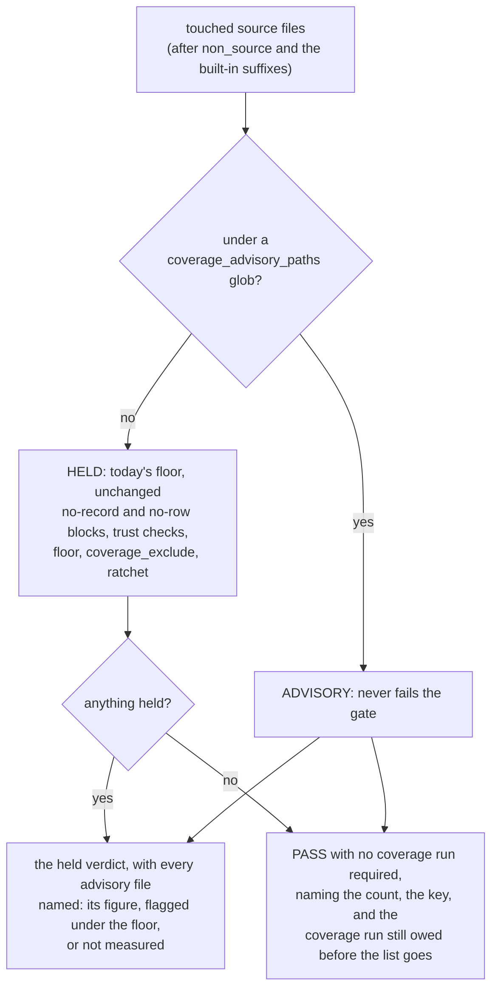
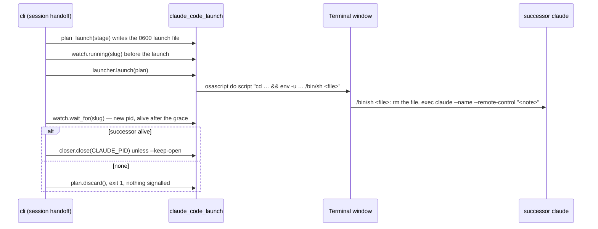
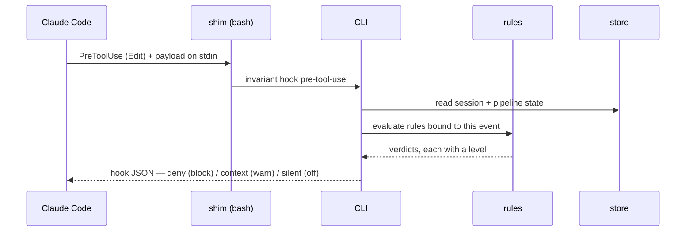
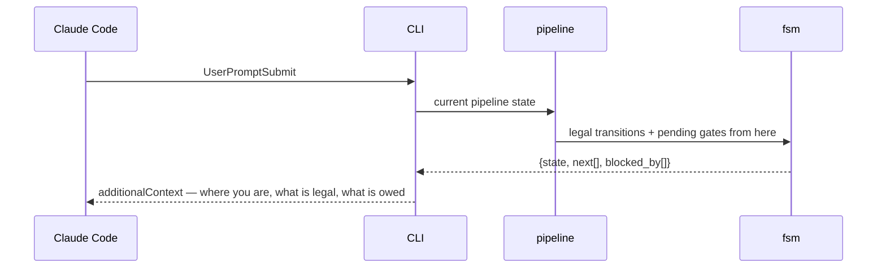

# Architecture overview

`invariant` turns agent-workflow discipline from prose the model is asked to
remember into state a script owns. See `docs/adr/ADR-001` for why.

This document is the authoritative map of the components and their
dependencies. Per the library's own docs-first rule, read it before changing
code, and update it when a structural relationship changes.

## Layers

```mermaid
graph TD
    subgraph host["hosts/ — agent-host adapters"]
        CC[claude_code]
        CCTEL[claude_code_telemetry]
        CCLAUNCH[claude_code_launch]
    end

    subgraph cli["cli/ — entrypoint"]
        CLI[invariant CLI]
    end

    subgraph oracle["oracle/ — machine-wide view (ADR-007)"]
        OHOME[home]
        OINDEX[index]
        OATTN[attention]
        OSCAN[scan]
        OSIG["signals / recommend"]
        OWATCH[watcher]
        OGATES[gates]
        ONOTIFY[notify]
        OLAUNCHD[launchd]
        ODASH[dashboard]
        OACT[actions]
        OTUI["tui (Textual)"]
        OWEB["web (ADR-008)"]
        OPAGE[webpage]
        OWACT[webactions]
        OWSVC[webservice]
        OTLS["tls (IDEA_026)"]
        ODEV[devices]
    end

    subgraph core["core/ — host-agnostic engine"]
        FSM[fsm]
        STORE[store]
        MANIFEST[manifest]
        RULES[rules]
        ITEMS[items]
        MEMORY[memory]
        PRIVACY[privacy]
        STATS[stats]
        GIT[git]
        PLAN[plan]
    end

    subgraph domains["domains/ — the five state domains"]
        SESSION[session]
        PIPELINE[pipeline]
        WORKITEM[workitem]
        MEMDOMAIN[memorystore]
        STATSDOMAIN[stats]
    end

    subgraph adapters["adapters/ — ecosystem knowledge"]
        GENERIC[generic]
        SWIFT[swift_xcode]
        PY[python]
        NODE[node]
    end

    subgraph data["shipped data"]
        METH[methodologies/*.yaml]
        PROF[profiles/*.yaml]
        AGENTS[agents/*.md]
        SCAFFOLD[scaffold/*.md]
    end

    CC --> CLI
    CC --> PLAN
    CC --> RULES
    CC -. reads the claim token named by .-> CCLAUNCH
    CLI --> SESSION
    CLI --> PIPELINE
    CLI --> WORKITEM
    CLI --> MEMDOMAIN
    CLI --> STATSDOMAIN
    CLI --> RULES
    CLI --> MANIFEST
    CLI --> PLAN
    CLI -. injects .-> CCTEL
    CLI -. launches and watches the successor through .-> CCLAUNCH
    CLI --> OINDEX
    CLI --> OHOME
    CLI --> OATTN
    CLI --> OSCAN
    CLI --> OSIG
    CLI -. injects ClaudeCodeProbe .-> CCLAUNCH
    CLI --> OWATCH
    CLI --> ONOTIFY
    CLI -. injects applescript_string .-> CCLAUNCH
    OWATCH --> OSCAN
    OWATCH --> OSIG
    OWATCH --> OINDEX
    OWATCH --> ONOTIFY
    CLI --> OGATES
    OWATCH --> OGATES
    OGATES --> OSCAN
    OGATES --> PIPELINE
    OGATES --> SESSION
    OGATES --> STORE
    OGATES --> MANIFEST
    OGATES --> RULES
    OGATES --> GIT
    OSIG -. reads the GateReport shape of .-> OGATES
    CLI --> OLAUNCHD
    CLI -. imports only inside oracle tui .-> OTUI
    CLI --> ODASH
    CLI --> OACT
    CLI -. injects without_host_markers and the handoff launcher .-> CCLAUNCH
    OTUI --> ODASH
    OTUI --> OACT
    ODASH --> OWATCH
    ODASH --> OSIG
    ODASH --> OSCAN
    OACT --> OSIG
    CLI --> OWEB
    CLI --> ODEV
    OWEB --> ODASH
    OWEB --> ODEV
    OWEB --> OPAGE
    OWEB --> OSCAN
    OWEB --> OWATCH
    OPAGE --> OWATCH
    ODEV --> OINDEX
    ODEV --> OHOME
    OWEB --> OWACT
    OWEB --> OSIG
    OWACT --> OACT
    OWACT --> ODEV
    OWACT --> OSCAN
    OWACT --> OSIG
    OWACT --> OHOME
    CLI --> OWSVC
    OLAUNCHD -. its second plist runs oracle web --wait .-> OWSVC
    OWSVC --> OWEB
    OWSVC --> ODEV
    OWSVC --> OWACT
    OWSVC --> OSCAN
    OWSVC --> OINDEX
    CLI --> OTLS
    OWSVC --> OTLS
    OTLS --> OWEB
    OTLS --> OHOME
    CCLAUNCH --> CCTEL
    OATTN --> STORE
    OINDEX --> STORE
    OINDEX --> MANIFEST
    OINDEX --> GIT
    OSIG --> OSCAN
    OSCAN --> OINDEX
    OSCAN --> OATTN
    OSCAN --> SESSION
    OSCAN --> PIPELINE
    OSCAN --> STORE
    OSCAN --> MANIFEST
    OSCAN --> FSM
    OSCAN --> GIT

    SESSION --> FSM
    PIPELINE --> FSM
    WORKITEM --> FSM
    SESSION --> STORE
    PIPELINE --> STORE
    SESSION --> RULES
    PIPELINE --> RULES
    WORKITEM --> ITEMS
    MEMDOMAIN --> MEMORY
    STATSDOMAIN --> STATS
    STATSDOMAIN --> STORE
    STATSDOMAIN --> SESSION
    STATSDOMAIN --> PIPELINE
    SESSION --> STATS
    SESSION --> PLAN
    SESSION --> PRIVACY
    PIPELINE --> STATS
    CCTEL -- implements SampleSource --> STATS

    FSM --> METH
    RULES --> PROF
    RULES --> PRIVACY
    RULES --> MANIFEST
    RULES --> adapters
    RULES --> GIT
    SESSION --> GIT
    WORKITEM --> GIT
    MANIFEST --> GIT
    CCTEL --> GIT
    MANIFEST --> PRIVACY
    MANIFEST --> adapters
    PIPELINE --> adapters
    CC --> AGENTS
    CLI --> SCAFFOLD
```



`CC --> PLAN` and `CC --> RULES` are the host adapter reading `core/` directly,
which the dependency rule below permits — arrows point down — and which the
diagram had recorded for neither. `RULES` was the older of the two and went
undrawn: `build_context` has asked `standdown_in_force` whether enforcement is
held since the stand-down shipped. `PLAN` is new, and it is the arrow that
keeps the turn projection honest. The host prints how far along a session's
plan is, and so do `session resume` and `session plan show`; three
hand-assembled renderings of one list is three chances for a printed total to
disagree with the numbers the commands take, so the arithmetic lives once in
`core/plan` and the callers sit above it. The two readers there are separate on
purpose — `render_lines` answers a question somebody asked and lists every
entry, `summary_lines` is injected into every turn and is capped at two lines —
but they count from the same `progress()`, which is what makes them unable to
disagree.

`oracle/` is the newest layer and the only one whose state is not a
project's. It sits below the CLI and beside `domains/`, and the arrows into it
come from the CLI alone: **nothing in `core/`, `domains/` or `adapters/` imports
it**, which `tests/test_oracle_index.py` enforces with an import scan. The
engine therefore works identically whether or not the oracle is ever used, and
the oracle can read every project without any project knowing it exists.
`OINDEX --> STORE` reuses `JsonStore`'s atomic write and advisory lock for the
user-level index, `OINDEX --> MANIFEST` is how a project's key is found — its
`state_root` — and `OINDEX --> GIT` resolves a worktree's root to the main
checkout's spelling. The registration on SessionStart is wired in the CLI's
`hook` command rather than in `hosts/claude_code`, so the host adapter gains
no import and the "hosts reach the engine only through the CLI" rule is
untouched. See [oracle.md](oracle.md) and ADR-007.

`CLI --> OATTN` and `OATTN --> STORE` are the attention sidecar (ADR-007 D5,
D6). The writes run in the same `hook` command, for the same reason. The host
adapter turns each event into an `AttentionSignal` (a normalised fact, the
`NORMALISED_PAYLOAD_KEYS` shape) and leaves it on `ClaudeCodeHost.attention`.
The CLI applies it through `oracle/attention` to the hook's own `JsonStore`.
That store is why the file lands in the project's state root, and why the
probe's inert store discards it. The gated CLI commands write a refusal the
same way. The host pid the record carries comes from `claude_code_launch`
(`host_pid`, else `find_host_pid`), which is the existing dotted
`CLI → CCLAUNCH` arrow carrying two more names. A test scans `hosts/` for
oracle imports, so no `hosts → oracle` arrow can appear unnoticed.

`OSCAN` is the read the whole oracle rests on (increment 3), and its arrows
are all reads. `OSCAN --> SESSION` and `OSCAN --> PIPELINE` reuse the domains'
own record types and lookups over an `InertStore` (`OSCAN --> STORE`) built on
the project's state root, so a scan answers with exactly what the domains
would say and can write nothing. `OSCAN --> MANIFEST` loads each project's
manifest from its recorded root, and `OSCAN --> FSM` is how a session's stage
is derived from the project's own session machine rather than from state
names. `OSCAN --> GIT` is `git worktree list`, for leaked worktrees. `OSIG -->
OSCAN` is the pure half: `classify` and `recommend` read the scan's rows and
nothing else.

What the oracle needs to know about Claude Code — which transcripts are a
project's, and whether a live pid is still `claude` — reaches it the way
telemetry reaches `domains/stats`: the scan defines the shape it reads
(`HostProbe`), `hosts/claude_code_launch` implements it as `ClaudeCodeProbe`,
and the CLI injects it (`CLI -. injects ClaudeCodeProbe .-> CCLAUNCH`). No
`oracle → hosts` arrow exists either, and `tests/test_oracle_scan.py` scans
for one (ADR-007 D11). `CCLAUNCH --> CCTEL` is the probe composing the
transcript reader that already knew the host's on-disk layout; it is an arrow
inside `hosts/`.

`OWATCH` is the oracle's only loop (increment 4). Its arrows are the tick in
order: `OWATCH --> OSCAN` and `OWATCH --> OSIG` scan and assess exactly as
`oracle list` does, `OWATCH --> OINDEX` is the project list plus `HomeStore`,
the home's store, through which the snapshot and the de-dup ledger are written
atomically and the ledger is locked, and `OWATCH --> ONOTIFY` is the seam an
alert leaves through. The watcher names a notifier protocol and never a
channel. The real channel, `osascript`, needs AppleScript quoting, which
`claude_code_launch.applescript_string` already owns for `session handoff`.
So the CLI hands that function to `OsascriptNotifier`
(`CLI -. injects applescript_string .-> CCLAUNCH`), the same dotted injection
as the probe, and still no `oracle → hosts` arrow exists (ADR-007 D13).

`OGATES` is the gate cache (increment 5), and the one place the oracle runs
the engine's own evaluation rather than reading a record. `OGATES -->
PIPELINE` is `evaluate_gates_by_destination`, the call `pipeline gates`
makes, so the oracle cannot answer differently from the command it would
recommend; `OGATES --> SESSION` reads the session record the rules are handed,
and `OGATES --> STORE` is the `InertStore` both domains are built on, so a
rule path that writes writes nothing. `OGATES --> MANIFEST` loads the session
worktree's manifest, `OGATES --> RULES` is the `Evaluated` verdicts it
summarises, and `OGATES --> OSCAN` reads the rows it fingerprints. `CLI -->
OGATES` and `OWATCH --> OGATES` are its two callers, through the CLI's
`_oracle_gates` seam. The dotted `OSIG -. reads the GateReport shape of .->
OGATES` is a type only: `recommend` takes the report as data and stays pure,
and nothing the cache answers reaches `classify`, so it can never raise an
alert (ADR-007 D8, D16). `OGATES --> GIT` is one call,
`git.without_optional_locks()`, around the evaluation: every git read the
rules make in a worktree a host is working in runs with
`GIT_OPTIONAL_LOCKS=0`, so it cannot take `index.lock` there. The scope is a
context variable inside `core/git`, so the engine's own commands, which run
in their own turn and worktree, are unchanged. `PipelineDomain.relpath` is public for this reader:
the fingerprint watches the pipeline record's write time, and must name the
file the domain writes rather than a second spelling of it.

`OLAUNCHD` is the LaunchAgent that keeps `oracle watch` running (increment
6). `CLI --> OLAUNCHD` is its only arrow: the module builds the plist with
`plistlib` and runs `launchctl` through an injected runner, and imports
nothing else from the oracle. The plist runs `python -m invariant oracle
watch`, so the daemon is the CLI again rather than a new entry point, and no
arrow from `OLAUNCHD` to `OWATCH` exists. The CLI reaches it through the
`_oracle_installer` seam, which the suite replaces (ADR-007 D17).

`OTUI` is the dashboard (increment 7), and the only module in the library
that needs a dependency beyond PyYAML: Textual, the `invariant[oracle]`
extra (ADR-007 D19). The arrow into it is dotted because the CLI imports it
only inside `oracle tui`, so nothing else ever loads it, and a missing extra
is a usage error. What the dashboard decides lives beside it in two modules
that import no toolkit: `ODASH` (`OTUI --> ODASH`) chooses the document,
the watcher's snapshot while `ODASH --> OWATCH`'s `snapshot_status` calls it
fresh, else an in-process scan, and turns rows into lines, naming them by
`recommend.row_label` (`ODASH --> OSIG`). `OACT` turns a recommendation into
the step a confirm modal shows and dispatches it once confirmed. `CLI -->
ODASH` is also `oracle list`'s status flag, so the two surfaces spell it
once. The host facts an action needs, which variables are host markers and
how a terminal is opened, are `claude_code_launch`'s, so the CLI hands them
to `OACT` (`CLI -. injects without_host_markers and the handoff launcher .->
CCLAUNCH`), the probe's shape a third time. A terminal step reuses the
`session handoff` launch, its launcher seam and its successor watch, and no
`oracle → hosts` arrow appears (ADR-007 D18).

`OWEB` is the oracle's web page (IDEA_023, ADR-008), the first network
listener in the library. `CLI --> OWEB` serves it in the foreground. The
server binds only the Mac's Tailscale addresses and answers only paired
devices. `OWEB --> ODASH` reads the document exactly as the TUI does
(`dashboard.load`) and draws its rows with `dashboard.lines` and its
`freshness` rule. `OWEB --> OSCAN` is the row kinds it folds into a summary,
and `OWEB --> OWATCH` and `OPAGE --> OWATCH` are the staleness constants.
`OPAGE` is the self-contained HTML. `ODEV` is the paired-device store under
the home: `ODEV --> OINDEX` is `HomeStore`, the home's locked store, again.
`CLI --> ODEV` is `oracle web pair`, `devices` and `revoke`. Address discovery
and the server are reached through two CLI seams the suite replaces, and the
web modules import neither `hosts/` nor Textual. `OWEB --> OWACT` is the
page's confirm-first actions (increment 2). `OWACT --> OACT` is the TUI's own
`step_for`, `refusal`, `describe` and `perform`, so the page adds a transport
and no rule. `OWACT --> OSCAN` is the stable row key the page names a row by.
`OWACT --> OHOME` and `ODEV --> OHOME` are the owner-only files under the home:
the audit log and the paired devices, created private (ADR-008 D9–D14). The
action reaches the runner and the terminal launcher through the `Actions` the
CLI builds, so still no `oracle → hosts` arrow appears.

`OWSVC` is the loop the web page's LaunchAgent runs (`oracle web --wait`,
ADR-008 D15–D18): it waits for the tailnet, binds it through `OWEB`, follows
it, and reports in `oracle/web.json`; `OWSVC --> ODEV`, `OWACT` and `OINDEX`
are what `web_status` reads for `oracle status` and `doctor`. It went
undrawn here when increment 3 shipped, though `oracle.md` had it. `OTLS` is
the page's HTTPS certificate (IDEA_026, ADR-008 D19–D24): `OTLS --> OWEB` is
the address discovery's own lookup for Tailscale's CLI and its runner, and
`OTLS --> OHOME` the owner-only file the key is kept in. `OWSVC --> OTLS`
keeps the certificate due and swaps a renewal into the listener, and `CLI -->
OTLS` is the foreground's certificate, `oracle web pair`'s https link, and
the `_oracle_web_certificates` seam the suite replaces.

`CLI --> SCAFFOLD` is `init` reading the one piece of shipped text that is
not a host asset: the starter architecture doc it writes when `paths.docs`
does not exist. It is read by the CLI rather than installed by the host
adapter because a project's docs are host-agnostic — the gate that reads
them is `core/rules`' — and it is shipped as a file under `data/` rather than
a string in `cli/` for the reason the agents and machines are: text somebody
will edit by eye belongs where it can be read by eye.

Two arrows are still missing from this diagram and are **not** drawn here
because drawing them would assert something this document has not decided:
`claude_code` imports `ambiguity_message` from `domains/session` and
`NO_PIPELINE` / `VIA_ACTOR` from `domains/pipeline`. Both are downward, and
both sit against the sentence "`hosts/` … reach the engine only through the
CLI". Whether that sentence means "no `domains/` import at all" or "no driving
of the engine" is a question for whoever answers it, not for a diagram edit
made in passing.

The two `domains → core/rules` arrows are how a state machine's gates get
evaluated: a gate names a rule id, and the domain that owns the transition asks
the registry for the verdicts. `PipelineDomain.advance` has worked this way
from the start; `SessionDomain._advance` joined it when AUD-05 found the
session machine's gates were read by two hardcoded CLI call sites instead of by
the one function every transition passes through. `MANIFEST → PRIVACY` carries
exactly one name — `DEFAULT_PATTERNS`, the single authoritative default
pattern set — so the manifest's default and a bare `PrivacyScanner()` cannot
drift apart (AUD-15).

`WORKITEM --> GIT` is the newest arrow into `git` and carries one call,
`resolve_commit`. A ruled closure (`item transition --ruling --evidence`)
records the commit a maintainer's ruling rests on, and the domain resolves it
to a full hash before anything is written: a name that is no commit here is
refused, because evidence nothing can check is an assertion with a field name
(IDEA_019). Like every other reader of the module it treats "git could not
answer" as a refusal, never as a pass.

The four arrows into `git` before it were drawn late. The module has been imported by
`core/rules`, `core/manifest`, `domains/session` and the telemetry host since
long before this document named it — the narrowing discussion below even
appeals to "`core/git` for the worktrees placed beside it" — while the diagram
and the component table, which this document calls the authoritative map, left
it out. A dependency a reader cannot see is one a design argues from without
being checked.

`RULES → GIT` is the newest of them and carries the most weight, because it is
how a gate screens **what landed rather than what announced itself**.
`privacy.clean` used to read only the payload of an edit tool, so a write made
through a shell — a heredoc, a `sed -i`, a `cp`, a generator emitting a
document — reached history unscreened while the gate reported that nothing in
scope had been written (BUG_027). Widening the list of tool names could not fix
that, because the next route is not a tool name either. Reading the *staged
content* at the commit does fix it, for every route at once, including the ones
nobody has enumerated: nothing in a staged blob records which tool produced it.
The same asymmetry as everywhere else governs the unanswerable case — a commit
whose staged content cannot be read FAILS, because this is the one gate whose
subject cannot be recovered afterwards. Nothing un-writes an identifier out of
a published history.

The dependency carries two later corrections of the same shape, both of them
about asking git the RIGHT question rather than a plausible one. `git -C
<other> commit` names a different repository's index, and the gate read the
call's own and vouched for the commit anyway, so the repository is now resolved
from the command before either half of the rule runs (BUG_048). And a
transition hands the rule an empty payload, so at the review boundary named by
six machines it had no subject at all and screened nothing — it now reads what
this session would put into its base branch, through the same `_changed_set`
union three other end-of-phase gates already use (BUG_047).

**Dependency rule:** arrows point down and never back up. `core/` knows
nothing about hosts or the CLI. `adapters/` know their ecosystem and nothing
about state. `hosts/` know their agent host, implement the protocols `core/`
defines, and reach the engine only through the CLI. This is what makes the
Claude Code binding replaceable.

`core/ → adapters/` is downward and therefore allowed, and it is how a rule
asks a question only an ecosystem can answer. `coverage.meets_floor` is the
case that shows the shape: an absent coverage row means either "never
measured" — the thing the gate exists to catch — or "nothing to measure",
which a bare protocol or an enum of cases can never escape. Only something
that knows the language can tell those apart, so the rule asks
`Adapter.carries_executable_code`, and an adapter with no opinion answers
`None`, which relaxes nothing. The rule keeps the policy; the adapter supplies
the fact. (`MANIFEST → adapters`, for command and rule-level defaults, is the
same arrow and predates it.)

What the adapter owes is a fact about the ECOSYSTEM: its language, and which
of its file kinds a compiler ever sees. The Swift one has been wrong about the
first half twice, in the same direction both times: it read a declaration as a
statement. A stored-property-only type was the first case
(BUG_025); a type-level constant — `static let name = Notification.Name("…")`
in an extension — was the second, and the file that exposed it is seven bare
protocols and four such constants, absent from all ten targets of the consuming
project's coverage report. The discriminator is not "is there an initialiser"
but WHERE the binding lives: a `static` or global binding is emitted as a
lazily initialised global and earns no row, while an INSTANCE stored property's
initialiser is emitted into every `init` the type has and does. Anything the
reader cannot resolve to a literal — a call to a lowercase member, a value read
from another symbol, arithmetic, a closure — goes on meaning "carries code",
because this answer's asymmetry runs the same way as the rule's: a spurious
block is visible, and a file wrongly called inert passes unmeasured code in
silence.

The second half is coarser and was simply missing. That reader answers about a
Swift file's CONTENTS, so every other path answered "cannot tell" — correctly
refusing to relax, and leaving a consuming project blocked over `Info.plist`,
a kind `xccov` cannot report on however it is written, in a change where the
property list was the load-bearing edit and the production Swift count was
zero (BUG_039). Both of the gate's own suggestions were dead ends: no test
clears it, and dropping the file from the declared set hides the change in
order to describe it. So the adapter now answers the kind question too, as an
**allowlist** of resource types — property lists and entitlements, strings and
string catalogs, storyboards and nibs, asset catalogs, build configuration
files — plus the directory bundles whose every payload is a resource, which is
the half that matters in practice: a touched path more often names a file
several components inside a catalog than the catalog itself.

A third table answers by exact file NAME, because some kinds carry their fact
in no suffix at all. `Podfile` has none and `Podfile.lock`'s `.lock` says
nothing on its own, so a change touching CocoaPods' manifest was blocked with
both listed as unmeasured source (BUG_085). The table holds the dependency
manifests and lockfiles this ecosystem's resolvers read before a build —
CocoaPods and the Bundler that pins it, Carthage, SwiftPM's `Package.resolved`
— and none of them is an input to any target. It names files and never
directories: what the manifests RESOLVE, under `Pods/` or
`Carthage/Checkouts/`, is vendored source `xccov` measures (BUG_041) and keeps
answering by its own kind. `Package.swift` is a manifest too, but it is Swift,
so it keeps the content reader's answer.

Four properties keep it as narrow as the reader beside it. Compiled kinds are
listed explicitly and tested first, so neither a later allowlist entry nor the
directory rule can reach a kind that list names. That guarantee is exactly as
wide as the list and no wider, which is worth stating plainly because it was
once written as though it were absolute: the C++ spellings `.hxx`, `.ipp`,
`.inl`, `.cp` and `.c++` were missing, and a compiled kind the table does not
name falls straight through to the directory rule (BUG_042). They are listed
now. The property is maintained by keeping the table complete, not by the
ordering alone.
An extension or file name absent from the allowlist answers `None`, because inverting this
into "any extension I do not recognise is inert" is precisely the silent pass
the base `None` exists to prevent. Documentation and configuration
suffixes are deliberately absent from it: `core/rules` already holds `.md`,
`.rst`, `.json`, `.yaml` and `.toml` out of the changed-source set for every
ecosystem, and the same judgement written down in two layers is the
duplication that drifts.

And the fourth, which is about the QUESTION rather than the tables. The
directory rule is a statement about the project's own layout, so it is asked on
the **project-relative** spelling and abstains without one. Asked on an absolute
path it scans components above the repository root — a checkout that happens to
sit inside a directory named `*.docc` or `*.xcodeproj` would then relax the
coverage floor for every unlisted compiled file underneath it. Its neighbour
`is_test_file` had been safe from this since BUG_019, but only because of a
comment at a call site in `core/rules`; the guarantee lived where the
implementer could not see it, and the next ancestor-scanning rule written
walked into it. `Adapter.carries_executable_code` now takes both spellings and
says which answers which — the resolvable path for the reader that OPENS the
file, the project-relative one for anything reading a directory convention.

An absent row has a *third* cause, and it is about the project rather than the
file: the reporter was configured never to look there. A Python project setting
`[tool.coverage.run] source` to its package directory can never produce a row
for a test file, so a session touching its own tests was handed a demand no
work could satisfy (BUG_019). That is the same seam and the same shape —
`Adapter.measured_scope` supplies the reporter's configured directories, `None`
means "cannot tell" and relaxes nothing, and `coverage.meets_floor` keeps the
policy of what to do about it.

The two questions must stay separate. A test file *does* carry executable code,
so answering `carries_executable_code` with `False` to relax the gate would be
a lie told to a rule — the exact failure the base `None` exists to prevent.
What is true of a test file is that nothing was ever pointed at it, which is a
different fact and now has its own question.

Note that `measured_scope`'s asymmetry runs the *opposite* way to
`carries_executable_code`'s, because its answer is used to shrink what the gate
demands rather than to explain one file. Overstating the scope costs a spurious
block, which is visible; understating it excuses a file the reporter really
does measure. So an adapter that cannot resolve every configured entry must
answer `None` rather than the part of the scope it worked out.

A *fourth* question is about neither the file nor the project but the CHANGE:
a diff that rewrote only comments altered no line a coverage run could measure,
so the floor is asking it for work that cannot move the number being demanded
(BUG_026). `Adapter.executable_text` reduces a revision to what a coverage tool
would count, the rule compares the base and working revisions through it, and
`None` relaxes nothing as before. It carries `measured_scope`'s asymmetry, for
the same reason — reducing too little costs a spurious block, reducing too much
calls a real code change cosmetic. The Swift implementation is where that has
teeth: it must copy string literals VERBATIM, because the reader that answers
`carries_executable_code` blanks their contents and would make `"a"` and `"b"`
compare equal.

Alongside it sits the one lever that is policy rather than fact —
`methodology.gates.coverage_exclude`, glob patterns a project states in its
manifest. Both hold paths out of the FLOOR and never out of the MEASUREMENT,
both run AFTER the no-row check so neither can hide a path-spelling mismatch,
and both name what they set aside in the verdict. An exclusion nobody can see
is indistinguishable from a gate that did not run.

That ordering is deliberate and it left a question nothing could answer. "Not
held to the floor" presumes a row exists to hold; a path that is not code at
all fails one step earlier, at the missing-row check, where `coverage_exclude`
by construction cannot reach it. The engine answers that itself wherever it can
— prose, configuration, markup, stylesheets and vector art are held out of the
changed-source set for every ecosystem, and an adapter reporting a file
inert or a reporter's configured scope excluding it are both positive evidence.
What none of those reaches is a kind that is real source SOMEWHERE and an asset
HERE: a Swift project versioning Claude Design bundles beside the code they
specify was blocked by `coverage.meets_floor` on their `.jsx`, on the bundle
directory itself, and on markup, with no manifest key that could say so and no
test anybody could write to clear it. `methodology.gates.non_source` is that
key. It is the project asserting what the engine cannot check, so it is applied
where the built-in suffixes are, it is empty by default, and every path it
holds out is named in the verdict with the pattern that spent it.

Extensionless repository metadata — `LICENSE`, `NOTICE`, `CODEOWNERS` and their
kin, matched by whole name — joins the built-in set, since no reporter in any
ecosystem has a row for one. `docs.updated` reads only part of this answer: the
prose suffixes, those names and `non_source`. "Nothing could measure it" is the
coverage question; "nothing could make a diagram wrong" is the docs question,
and configuration and markup pass the first while failing the second (BUG_064).

A third lever answers a question neither of those can: the floor is right for
new code and wrong for old. A file months below it blocks a two-line, fully
covered, net-negative edit, so the gate refuses precisely the change that
improves it. `methodology.gates.coverage_baseline` names a recorded per-file
shortfall — the same idiom as `scripts/arch_layering_baseline.txt` — and the
floor is RATCHETED against it: at or above the record is a pre-existing
shortfall and does not block, below the record is a regression and gets its own
verdict rather than the floor's, and no record at all fails exactly as before,
because the relaxation must rest on evidence somebody wrote down. It is asked
LAST, of files the floor has already rejected, so a record cannot buy a pass for
a path with no coverage row and a stale entry cannot become a second, higher
floor for a file that already clears the first. A record read only in PART is an
error, never a smaller record: a dropped entry stops being enforced and stops
being honoured at the same time, with nothing in any verdict to say so.

A fourth lever answers a question about WHERE the floor binds rather than what
a path is or what it once measured. A consuming project ruled that one
development phase lands new, flag-off code under two subtrees on scoped suites,
with the floor advisory there and blocking everywhere else, and one full
coverage pass owed when the phase ends. Its only coverage lane was a full-suite
run, so a milestone touching nothing but the new code could not land without
that run or a force. Dropping the gate from the methodology, the way `bugfix`
binds none, cannot tell shared code from new code, and was filed there as a
defect. `methodology.gates.coverage_advisory_paths` is the key. It splits the
touched source files, after the claims about what a path IS (`non_source`, the
built-in prose and configuration suffixes) and before any question about what
was measured, into ADVISORY and HELD:



The split happens on the way IN to the floor and the report on the way OUT, so
no branch of the held-file logic learned that advisory files exist — which is
the property that keeps every held-file guarantee intact. An advisory figure is
never invented: with no coverage recorded the file reads "not measured", with a
recording but no row it reads "no coverage row", and a run carrying an
overstating hazard says its figures may read high. The same `_first_matching_glob`
over `_declared_in_project` reads all three glob lists, so they cannot disagree
about what a pattern names. A glob matching nothing is not an error at gate
time; a configured list is instead an ACTIVE EXCEPTION row in `doctor`
(`core.rules.coverage_advisory_exception`, one wording for both readers),
informational for the reason the parked-session row is — the list is a
deliberate phase state, and its removal is what ends the phase.

`SESSION → PLAN` is the newest arrow into `core/`, and it is drawn for the
reason `SESSION → STATS` is. The deliverable set a session owes is *stored* on
the session document and *mutated* by the domain, which owns the store, the
locking and the refusals — but the questions asked of it are arithmetic over a
list, and a rule will have to ask them. A rule lives in `core/rules`, and
`core/` may not import `domains/`, so a plan reader inside the domain would be
a question the layer above cannot reach and the layer below may not. The
precedent is exact: `core/stats.breakdown` does the arithmetic that
`domains/stats` renders.

`CLI --> PLAN` is the second caller that arrow was drawn for. `session plan
show` renders the checklist and `session status` and `session list` report how
far along it is, and all three read `core/plan` directly rather than through
the domain — the domain owns the mutations, and asking it to also own the
arithmetic would put a read-only question behind a store, a lock and a set of
refusals that have nothing to say about it. The CLI reaching past a domain into
`core/` is downward and therefore allowed, and it is the same shape as
`CLI --> RULES`.

What that arrow must not become is a second renderer. `core.plan.render_lines`
is the only place a plan is turned into lines, because the numbers it prints
are the numbers `session plan done <n>` takes, and two renderings of one list
is two chances for those to disagree.

One judgement in that module is worth naming here because it is the kind that
gets re-decided by accident. An **empty** plan is not a complete one — a
session with no deliverables is *unplanned*, not *finished* — and the obvious
inline spelling, `done == total`, is `True` for an empty list. Written at three
call sites it would be written wrong at one of them, so it is computed once, in
`core/plan.progress`, and every caller reads the answer.

`core/store` gained a responsibility that reads like a contradiction of its
own "never interprets the contents" and is not one: the round-trip contract
both per-session records honour, so that a build older than a field writes the
field back instead of deleting it (BUG_061, argued in the state model's
Storage layout). Preservation is the opposite of interpretation — the store
keeps those keys precisely because it cannot read them — and it lives here
rather than in the two domains because one rule written twice is two chances
for a build to honour half of it.

The two labelled arrows around `stats` — `CLI -. injects .-> CCTEL`, dotted,
and `CCTEL -- implements SampleSource --> STATS`, solid — are the same rule
applied to a case that could easily have inverted it (ADR-002 D2). Reading a host's
transcripts is host knowledge, and the arithmetic over what is read is not —
so `core/stats` declares a `SampleSource` protocol, `hosts/` implements it, and
the CLI injects the implementation. Had the domain imported the reader
directly, the arrow would have run `domains → hosts` and the binding would have
stopped being replaceable. The precedent is `core/items`, which already defines
a model with pluggable backends.

`CLI -. launches and watches the successor through .-> CCLAUNCH` is the same
shape as the telemetry injection and the newest dotted arrow: `session handoff`
is the one command that STARTS a host process, and the CLI is where the
host-specific launcher — and the watch that proves the launch started
something (BUG_075) — is chosen and handed the plan. The domain never sees it — `domains/session` vets
the note, derives the next session's name and records the handoff, and the
launch is a value the CLI builds from those answers and passes down (ADR-005
D3). `SESSION --> PRIVACY` is drawn for that vetting: the note is scanned with
the project's own `PrivacyScanner` before it is recorded or handed to a host
whose transcript this library cannot scrub.

`CC -. reads the claim token named by .-> CCLAUNCH` is horizontal, between two
modules of one host, and carries one name: `HANDOFF_ENV`. The launcher sets
that variable in front of `claude` with a token naming the recorded note, and
`claude_code` reads it back — from the environment the hook subprocess
inherited from its host — on the PostToolUse that binds the host's first
`session start` or `resume`, then asks `domains/session` to mark that note
claimed (IDEA_008, ADR-005 D6). One constant imported, rather than one string
spelled twice, because a launcher that writes a variable the reader no longer
looks for fails silently: the note just goes on being offered. The token's
FORMAT is not host knowledge and lives with the domain that parses it
(`handoff_token`); the arrow is dotted because what crosses it is a name, not
a call.

`domains/stats → domains/session` and `→ domains/pipeline` are horizontal, not
upward. The join from a host session to an invariant session is knowledge of
*what a session is*, which this document reserves to a domain; putting it in
the CLI would have traded a documentation edit for an architecture violation.

## Component responsibilities

### `core/`

| Module | Owns | Never does |
|---|---|---|
| `fsm` | Loading a declarative state-machine definition; validating a proposed transition; computing legal next states and pending gates | Persist anything; know what a session or a bug is |
| `store` | Atomic, concurrency-safe JSON persistence under the state root; locking the cross-session registry; the round-trip contract a persisted record honours in both directions; the inert variant (`InertStore`) that reads the state root and discards every write, for a caller that must run the real path and leave no trace (BUG_059) | Interpret the contents |
| `manifest` | Parsing and validating the project manifest; merging profile defaults with per-rule overrides; resolving adapter selection; the one canonical spelling of a declared path (`project_relative`) that every rule comparing a target against a declaration goes through | Read state; run commands |
| `rules` | The rule registry: each rule is an id, a bound host event, an evaluation function, and a level | Decide policy — levels come from the manifest |
| `items` | The work-item model and the pluggable store backends that read and write it; the ids a backend has spent across its open and declared closed store (`items.closed_path`), and minting from them; where a new entry is placed | Know an item's lifecycle, or which of its keys `item new` may set — that is `domains/workitem` |
| `memory` | Memory file schema, parsing, dedup detection, index generation, link validation | Decide what is worth remembering |
| `privacy` | Pattern-based detection of personal data in text; the exemption marker and how far it reaches | Know which files matter |
| `git` | Read-only queries about the repository — worktrees, branches, the staged set and the bytes staged for a path, and the commit a revision names | Decide what an answer means; a question it cannot answer returns `None` and relaxes nothing |
| `stats` | Telemetry record types, the price table, the arithmetic, and the `SampleSource` / `WatermarkSource` protocols | Read a transcript; know any host's on-disk format |
| `plan` | Reading a session's deliverable set: the entries, the next number, how far along it is, and how to render it | Change one; know where the list is stored, or that a session is what holds it |

### `domains/`

Each domain binds a state machine to a store and exposes the operations that
advance it. They are the only place where "what a session is" is encoded.

- **`session`** — identity, isolation, the push barrier, teardown, and the
  handoff note a session leaves for the next host session. Multiple
  sessions coexist on one machine, so this is the only domain with genuine
  cross-process concurrency, mediated by the locked registry.
- **`pipeline`** — one task's progress through the configured methodology.
  Scoped to a session; a session runs pipelines in sequence.
- **`workitem`** — ideas and bugs, their statuses, and the transitions between
  them, including a ruled transition whose rows record who ruled and on which
  commit; and what `item new` may set — an explicit id it checks is unspent,
  and the item's own keys it refuses (BUG_074). Persisted through
  `core/items` into whichever backend the project uses.
- **`memorystore`** — validation, dedup, and index regeneration over the
  memory directory. Not an FSM; a set of invariants plus repair operations.
- **`stats`** — what a session took and what it cost. Not an FSM either, for
  the same reason `memorystore` is not: there is no lifecycle to advance, but
  there is a store with invariants over it and operations that repair them.
  Owns the join from a host session to an invariant session, the rebuildable
  raw store, and the rendered report. See ADR-002.

### `oracle/`

The Session Oracle: a machine-wide view of every session in every invariant
project (IDEA_012). Its seven increments have all shipped, and the web page
over Tailscale (IDEA_023) is shipping in increments; see
[oracle.md](oracle.md).

| Module | Owns | Never does |
|---|---|---|
| `home` | Where the user-level state lives: `$INVARIANT_HOME`, else `~/.invariant`; `private_dir`, `append_private` and `write_private`, which create a directory or file owner-only from the start | Create the home itself; read anything in it |
| `index` | `projects.json` — every registered project once, keyed by its state root; register, remove, prune | Read or write anything under a project's state root; store a clock time |
| `attention` | `<state_root>/attention/<host-id>.json` — what one host session is waiting on, how its turn ended, its pid; the write and clear rules per event | Decide what a hook event means (the host adapter does); lock; raise into a hook (the CLI guards every call) |
| `scan` | One read-only snapshot per registered project: live sessions with their hosts nested, orphan hosts, leaked worktrees, and one error row per project or record that cannot be read; host liveness (pid exists, and is still the host); the cache that keeps a repeat scan cheap | Write anything; name a state; import `hosts/` (host facts arrive through the injected `HostProbe`) |
| `signals` | `classify(row, now, thresholds)`: alerts (waiting, gate blocked, stuck, finished, error) and markers, each with a stable key | Read a store, a process table or the wall clock |
| `recommend` | `recommend(row, signals)`: one next step as label, argv, cwd and kind; `assess` joins rows, signals and steps into the `oracle list --json` document; `row_label`, the one name a row is shown by | Run anything; answer a prompt |
| `watcher` | The tick: scan, assess, the atomic `oracle/snapshot.json`, and the rising-edge de-dup ledger `oracle/alerts.json` that decides what notifies; the loop that survives a failed tick | Decide what a signal means (`signals` does); know how a notification is delivered; write under a project's state root |
| `gates` | `GateCache`: what each idle session's pipeline owes, evaluated by the domain over an inert store, off the tick, once per fingerprint, at most two at a time, with a timeout that keeps the last answer; `GateReport`, the data `recommend` reads | Write anything; evaluate while a turn runs; persist an answer; raise an alert |
| `notify` | The `Notifier` protocol and `Notification`; `OsascriptNotifier`, with the quoting injected; `RecordingNotifier` for tests | Import `hosts/`; decide what deserves a notification |
| `launchd` | The LaunchAgent: `plist_for` (absolute interpreter, explicit `PATH`, log under the home), `LaunchdInstaller` (install, reinstall, uninstall, status, the interpreter check `doctor` runs), `RecordingLaunchctl` for tests | Run `launchctl` except through its injected runner; import the watcher |
| `dashboard` | What `oracle tui` shows: the snapshot while it is fresh, else an in-process scan behind a banner; each row as a line with its tone; the `ALERT` / `note` / `ok` flag `oracle list` prints too | Import Textual; run anything |
| `actions` | A recommendation as a confirmable `Step`, the exact lines the confirm modal shows, the refusals (a waiting row, a non-`invariant` argv, a missing cwd), and the dispatch of a confirmed step to an injected runner or terminal launcher; `run_subprocess`, the real runner | Import `hosts/`; run a step nobody confirmed; answer a prompt |
| `tui` | The Textual app: the table, its refresh, and the confirm, info and output modals. Imported only by `oracle tui` | Decide what `dashboard` and `actions` decide |
| `web` | `oracle web`: the Tailscale-only bind and its discovery, the `Host` check, the page's view and freshness, `WebApp` (requests to responses, the `Origin` rules) and `WebServer` (the stdlib server, one per address, with a socket timeout and caps on headers and connections; over HTTPS, TLS per connection with the certificate `tls` keeps, and only a redirect for plain HTTP) | Bind the wildcard; answer an unpaired device with anything but "not paired"; decide what may run |
| `webactions` | The page's confirm-first actions over `actions`: the confirm view, the single-use nonce bound to device and row, the action re-derived from a fresh scan, one at a time per row, its polled result, and the audit log `web/actions.log` | Run an `argv`, `cwd` or environment a client sent; add a refusal of its own; answer a prompt |
| `webpage` | The page's HTML, inline CSS and script, with its self-refreshing loop, and the small "not paired" and pairing pages | Load anything from another origin; turn a row's text into markup |
| `devices` | `web/devices.json`: one-time pairing codes and paired devices' token hashes; issue, redeem, verify, list, revoke | Store a token or code in the clear; let a device in when the file cannot be read |
| `webservice` | The loop behind `oracle web --wait`: wait for the tailnet, bind and follow it, keep the certificate due and swap a renewal in; its report `oracle/web.json`, and the status and doctor wording | Bind outside Tailscale's ranges; exit for a missing tailnet; ask launchd anything |
| `tls` | The page's certificate from Tailscale's CLI, through stdout; the kept `web/tls/oracle.pem`, owner-only; when it is due; the certificate and context a listener serves, swapped together | Run `tailscale` except through its injected runner; replace a good pair with one that does not load |

### `adapters/`

An adapter supplies ecosystem knowledge the manifest should not have to spell
out: how to build, how to test a single unit, how to test SEVERAL, how to read
a coverage number, what that coverage run was even pointed at, how to tell a
real failure from a tooling failure. Adapters are selected in the manifest and
may be stacked; `generic` is the always-present fallback that executes literal
commands from the manifest and parses nothing.

"How to read a coverage number" is the layer's quietest duty and the one whose
failures travel furthest, because everything downstream of it behaves correctly
on whatever picture it supplies. The Xcode adapter's row parser matched a
literal `.swift`, so an Objective-C file `xccov` had genuinely measured arrived
at `coverage.meets_floor` looking exactly like a file no run had touched — the
rule then correctly refused to relax over a compiled kind, and the gate blocked
with no test anyone could write to clear it (BUG_041). The extensions it
accepts are now read from the same `_COMPILED_SUFFIXES` table the kind question
uses, so the two cannot drift; note that the asymmetry inverts between them. For
the kind question, a suffix wrongly listed would RELAX a gate, so the table is
conservative. For the row pattern, a suffix wrongly listed matches nothing while
one omitted drops a real measurement — so the parser takes the whole table.

`join_selectors` is the newest of those questions and carries the layer's
usual asymmetry. Whether several test selectors are a space-separated list of
positional arguments or a repeated FLAG is a fact about the tool the manifest's
`commands.test_one` template invokes, and the template is a project's to
rewrite — so an adapter with no confident answer returns `None`, the domain
refuses the request, and the caller runs them one at a time. Guessing would
build a well-formed command against the wrong scope, which is the exact defect
the question exists to close: a repeated `--selector` used to keep only the
last, and report a healthy green for a scope nobody asked for (BUG_031).

The `swift_xcode` adapter exists first because the originating project needs
it, and because it carries the most instructive ecosystem traps — a build tool
whose exit codes can silently drop whole test suites, and a destination
argument whose convenient form resolves to the wrong thing.

### `hosts/`

A host adapter translates between an agent host's extension points and the
CLI. For Claude Code that means hook payload parsing, the hook JSON response
shape (`permissionDecision`, `additionalContext`), agent and command file
installation, and `settings.json` wiring.

`hosts/` own hook *transport* — payload parsing, response shape, settings
wiring. A normalised payload dict travels upward, and `cli/` and `core/rules`
read documented keys from it; no layer above `hosts/` knows the hook
*protocol*. The keys are the contract, and they are listed in exactly one
place — `core.rules.NORMALISED_PAYLOAD_KEYS` — so that this document and the
host adapters cannot drift apart about what a host owes the engine.

This rule replaces a stronger one, "Nothing above `hosts/` is aware of hook
schemas", which the code had already departed from. `Context.session_for_payload`
reads `tool_input.file_path` and `RuleContext` reads `tool_name`, `tool_input`
and `target_path`; all are above `hosts/`. The departure was deliberate and a
shipped fix depends on it — BUG_010's fix (faa4de0) attributes a hook's
evidence to the right project *by the path the call itself names*, which is
only available from the payload. Leaving the old sentence standing meant the
authoritative map stated a rule a reader enforcing it would have used to
"correct" a working fix by reverting it (BUG_022). What a host adapter owes is
now an explicit normalisation obligation rather than an implied one, which is
what a second agent host would need in order to be written at all. The
restatement is recorded as ADR-003 D4.

The arrow runs the other way too, and one case makes it load-bearing. When a
host adapter DECIDES something a rule will later re-decide, the question has to
be asked through the rule's own helper rather than reimplemented next to it.
`_post_tool_use` needs to know whether a `Read` it is about to discard would
have been evidence for `docs.read_architecture`, so it calls
`core.rules.is_architecture_doc` — the same function the gate matches with.
Two local answers to "is this an architecture doc" is exactly the disjointness
BUG_046 was: two steps preferring opposite spellings of one file, with a
`block` gate closed against every read the track could perform in between.

The contract has been widened once since, deliberately and for the same class
of reason. `agent_type` — the acting agent, which Claude Code stamps on every
hook payload including a subagent's own — was added because a subagent that
creates its own session and pipeline dispatches *before* either exists, so the
design agent that created a pipeline could never be evidence for it (BUG_028).
No layering rule could recover that; only a fact the host already knows and
now hands upward. A host that cannot say who is acting omits the key.

It was widened a second time by two keys (IDEA_020). `tool_input.subagent_type`
is which agent a dispatch names: `agents.gated_dispatch_has_pipeline` warns at
PreToolUse before a design or review agent is dispatched with no pipeline
running. It is a rule so a project can retune it, so it reads the payload
through the contract. `tool_input.prompt` was already read above `hosts/`
(`Context.resolution_for_payload` finds the worktree a dispatch's brief names)
and the list had not said so. The same change moved `AGENT_TOOLS` and the
`dispatched_agent` reader into `core/rules`, beside `EDIT_TOOLS`, by the rule
in the previous paragraph: the PostToolUse recording and the PreToolUse
warning ask one question, so the host imports the rule's answer.

`claude_code_telemetry` is a second, deliberately separate module for the same
host. It is a different relationship: `claude_code` *drives* the host through
hooks and installed assets, while this one *reads back* what the host already
wrote down — its per-project JSONL transcripts. A reader has no business in a
module about hook payload schemas, and the split keeps a change to one from
touching the other. Besides the cost samples, it reads a transcript's newest
turn from the file's tail (`last_turn`, BUG_078), which the oracle's probe
takes as a host's last activity ([oracle.md](oracle.md), "Last activity").

`claude_code_launch` is the third module for the same host, and the third
relationship: `claude_code` drives a running host, the telemetry reader reads
back what one wrote, and this one STARTS one. It turns a handoff into a
`LaunchPlan` — the `claude --name <slug> --remote-control <slug> "<note>"`
argv, a *launch file* holding that whole command, the
`cd <main checkout> && env -u <marker> … INVARIANT_HANDOFF=<token> /bin/sh <launch file>`
line quoted with `shlex` (the token is set only once the note is recorded), and
the AppleScript that types that line into a new macOS Terminal window — and
`TerminalLauncher` runs `osascript` on it. Claude Code has no flag for a
working directory or a window, so those two are this module's. The CLI reaches
it through one replaceable function, which is how the suite keeps every test
from opening a window (ADR-005).

**The note never rides the typed line (BUG_075).** `do script` TYPES the line
into the new window's tty before its shell has started line editing, and a tty
in canonical mode keeps at most `MAX_CANON` bytes of a line — 1024 on macOS.
A note over about 540 bytes was cut mid-quote and no `claude` ran. The note now
goes into the launch file: a three-line `/bin/sh` script, written by
`plan_launch` with `mkstemp` (mode 0600) into `launch_dir()` — a directory
under the user's temporary directory, mode 0700 and proved to be the user's
own, never under the project, so the file cannot be committed. The script
removes itself and then `exec`s `claude`, so the note leaves the disk the
moment the successor holds it, it stays ONE positional argument — the initial
prompt — quoted by `shlex` as before, and the successor keeps the script's
pid. A program reads the file, not the window's shell, so the line means the
same in zsh, bash or fish. The typed line no longer grows with the note, and
`plan_launch` refuses one that would still exceed `MAX_CANON` (only a very
long checkout path can) rather than let the tty cut it. A launch file nobody
ran is removed by the CLI when the launch fails, and any older than
`LAUNCH_FILE_TTL_SECONDS` is swept the next time one is staged. A preview plan
(`stage=False`, for `--dry-run` and refusals) writes nothing, and `by_hand`
carries the self-contained line, note inline, for a person to paste into a
shell that is already up. `LaunchPlan` itself refuses an argv without
`--remote-control <name>`: Remote Control is not optional.

**A launch counts only once a successor is seen alive.** Terminal accepting
the script proves nothing about what the window then runs. `SuccessorWatch` is
a third seam, reached through `_handoff_successor`, and the real
`ProcessTableWatch` reads `ps -axo pid=,command=`: before the launch, for the
sessions of that name already running, which are never counted; after it, for
a NEW process whose argv runs `claude` with both `--name <slug>` and
`--remote-control <slug>`, within `SUCCESSOR_TIMEOUT_SECONDS`, and still there
`SUCCESSOR_GRACE_SECONDS` later. Without one the handoff exits non-zero, the
launch file is removed, and the closer is never reached. The suite replaces
the watch everywhere with one that finds nothing, matching a stub launcher
that starts nothing; a test about the launch that worked says so.



The module also owns `HOST_MARKERS`: the variables a running Claude Code
session sets for its children — `CLAUDECODE`, the `CLAUDE_CODE_*` session
markers, `CLAUDE_PID`, `AI_AGENT`, and `CLAUDE_EFFORT` and `GIT_EDITOR`,
which it exports for its own tool shells — and `COLORTERM`, which Terminal.app
never sets. `handoff` runs inside a host session, so without this the successor
inherited them and started as that session's child, with transcripts off and
colour its terminal could not draw (BUG_068), its effort level pinned, and
`GIT_EDITOR=true`, which makes git skip the editor, so a `git commit` without
`-m` finished silently (BUG_069). They are removed twice from one
list: `env -u` on the typed line, which cleans the successor even when
Terminal.app is already polluted, and the environment `osascript` is run with,
which keeps a Terminal.app the launch starts clean for every window opened
afterwards. The list is named rather than matched by prefix because
`CLAUDE_CODE_` also prefixes the user's own configuration, which the new
window's login shell re-exports before the typed line runs.

It also ends the host that ran the handoff, once the launch has succeeded —
that is, once the watch has seen the successor alive (IDEA_009, BUG_075). `HostCloser` is a second seam beside `Launcher`, reached through
`_handoff_closer` the way the launcher is through `_handoff_launcher`, and the
suite replaces it everywhere, so no test signals a process. The real
`DetachedCloser` starts `close_script` in a session of its own, holding none
of the command's streams: `sleep CLOSE_DELAY_SECONDS`, then `ps -p` to check
that `CLAUDE_PID` still names `claude`, then SIGTERM. The check runs at kill
time because a pid can be reused while the script sleeps. The CLI checks once
too, before scheduling, so a missing or foreign pid is reported instead of
being left to fail silently. `CLAUDE_PID` is read as `HOST_PID_ENV`, a constant
of its own: the same spelling is in `HOST_MARKERS`, but there it is a value the
successor must not inherit, and here it is the process to end.

The telemetry reader is also the library's only dependency on another program's **undocumented**
format, and that shapes the code: every field access tolerates absence, an
unparseable record is skipped rather than fatal, and the file is a cache keyed
on a content fingerprint. A format change degrades a report and never breaks a
session.

Narrowing those transcripts to one project is where that format bites hardest.
The host names a project directory after the path it ran in, with separators
replaced — a **lossy** mangling, in which `<root>/app/v2` and `<root>/app-v2`
are one string. A worktree of the project must be counted and an unrelated
sibling checkout must not, so the reader resolves the ambiguity with evidence
rather than with the name: the filesystem for paths below the project, and
`core/git` for the worktrees placed beside it. Both are downward reads for a
fact only they hold, the same shape as `core/ → adapters/` above.

**The narrowing runs in both directions, and the origin is resolved upward
first.** A session worktree is a *place the project is being worked on*, not a
project, so its report is the project's: `ClaudeCodeTranscripts.roots()`
resolves the origin up to the repository's main checkout before narrowing.
Without that, an origin inside a worktree narrowed to the worktree — whose
mangled name is *longer* than the parent's — so the parent's transcripts failed
the prefix test and nothing above the worktree was visible at all. Since the
methodology mandates that a session run isolated, per-state attribution had
effectively never functioned under the only workflow the library permits
(BUG_017). Resolving upward hands the narrowing the main checkout's prefix,
which is the input the main-checkout case always got, so a sibling checkout
stays excluded by the same evidence (BUG_015).

One asymmetry survives deliberately. A torn-down worktree placed by the default
sibling convention (`<root>-wt-<id>`) loses its attribution permanently: the
path is gone, git no longer lists it, and its single-dash name is not the
hidden-directory spelling the naming heuristic recognises. A torn-down worktree
under the hidden worktrees directory stays attributed. That is evidence-honest
rather than a second defect — the alternative is admitting a name no evidence
supports, which is how BUG_015 happened.

## The two flows that matter

### Enforcing a transition



A rule at `block` returns a denial the host enforces. The same rule at `warn`
returns the same reasoning as injected context and lets the call through. This
is why D10 and D11 compose: level is a property of the verdict's *delivery*,
not of the rule's logic, so a project retunes policy without touching code.

### Injecting state instead of rules



The injected text is a projection of state. It is short because it describes
one node of a graph rather than the whole rulebook, and it cannot go stale
relative to what actually happened, because it is read from the record of what
actually happened.

## Where things live at rest

```
<project>/
  .claude/
    invariant.yaml          the manifest — the only project-aware artifact
    invariant/
      state/                gitignored; per-session JSON + locked registry
        stats/              one raw telemetry record per host session;
                            REBUILDABLE from the host's transcripts, except
                            where `stats archive` has promoted it
    hooks/                  thin shims that exec the CLI
    agents/                 \
    commands/                > managed host assets: library copies carry an
    skills/<name>/SKILL.md  /  in-frontmatter content hash; project-owned files
                               are checked for LOADABILITY but never for drift
  docs/                     architecture docs the docs-first gate reads.
    architecture/           `init` scaffolds overview.md here ONLY when the
                            directory is absent — once, and no command
                            rewrites it afterwards; the file is the project's
    conf.py                 Sphinx config (MyST + mermaid); renders docs/ as
                            one site — architecture, ADRs, audits. `docs/_build/`
                            is gitignored: the site is derived, not committed.
    reports/                paths.reports — the rendered, committed telemetry
                            report. Scrubbed: session names and bare dates,
                            never a host identifier (ADR-002 D7)
```

One directory lives outside every project, and it is per USER rather than
per repository:

```
~/.invariant/               $INVARIANT_HOME overrides it (ADR-007)
  projects.json             the oracle's project index; one entry per state root
  locks/projects.lock       advisory lock for the index's read-modify-write
  locks/alerts.lock         advisory lock for the alert ledger
  oracle/snapshot.json      the watcher's last tick; derived, safe to delete
  oracle/alerts.json        the rising-edge de-dup ledger; derived, safe to delete
  oracle/watcher.log        the launchd agent's stdout and stderr
  web/devices.json          paired devices' token hashes and pending pairing
                            codes for `oracle web`; a source of truth, 0600
  web/actions.log           one line per start and end of an action from the
                            page; a record, never rewritten, 0600
  web/tls/oracle.pem        the page's HTTPS certificate chain and its key,
                            from Tailscale; 0600 in a 0700 directory, safe to
                            delete (asked for again)
  locks/devices.lock        advisory lock for its read-modify-write

~/Library/LaunchAgents/dev.invariant.oracle.plist
                            the agent `oracle install` writes; `uninstall` removes it
```

It holds no project's runtime state — only which projects exist, and what the
watcher derived from them. The one
thing of the oracle's inside a project is the attention sidecar,
`<state root>/attention/`, which that project's own hooks write.

Configuration and knowledge are committed. Runtime state never is — it is
machine-local, session-scoped, and would conflict constantly between
concurrent sessions.

The report store is the one place those two meet, which is why it is declared
in the manifest rather than assumed: the raw records stay in the private state
root and the *rendering* of them is committed, so what leaves the machine is
decided by a renderer that can be read rather than by a directory somebody
remembered to gitignore.
