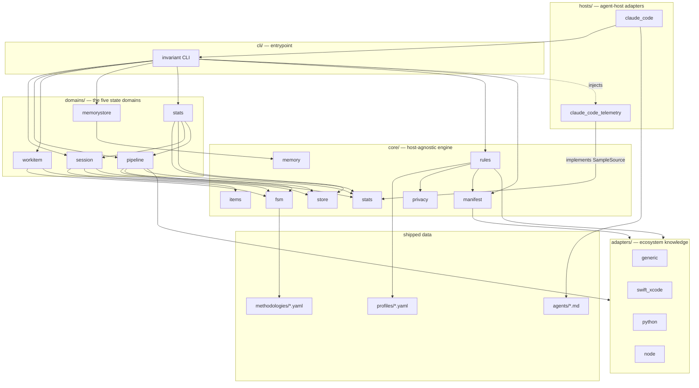
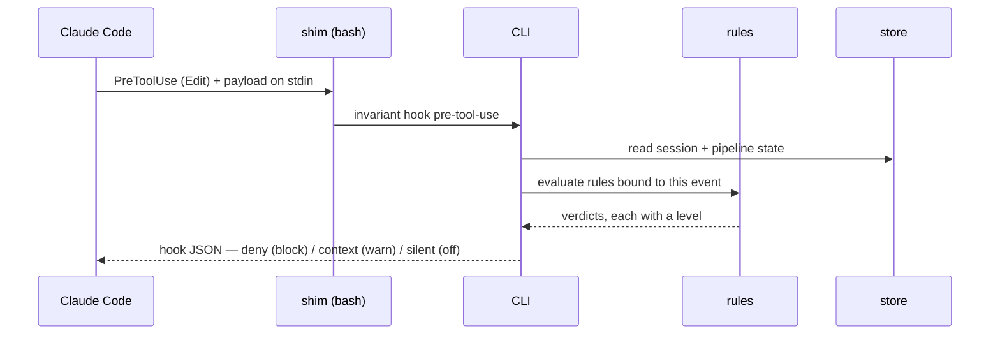
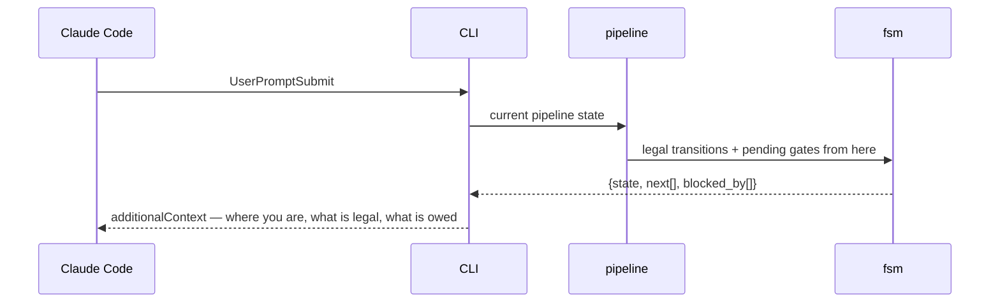

# Architecture overview

`invariant` turns agent-workflow discipline from prose the model is asked to
remember into state a script owns. See `docs/adr/ADR-001` for why.

This document is the authoritative map of the components and their
dependencies. Per the library's own docs-first rule, read it before changing
code, and update it when a structural relationship changes.

## Layers



**Dependency rule:** arrows point down and never back up. `core/` knows
nothing about hosts or the CLI. `adapters/` know their ecosystem and nothing
about state. `hosts/` know their agent host, implement the protocols `core/`
defines, and reach the engine only through the CLI. This is what makes the
Claude Code binding replaceable.

`core/ → adapters/` is downward and therefore allowed, and it is how a rule
asks a question only an ecosystem can answer. `coverage.meets_floor` is the
case that shows the shape: an absent coverage row means either "never
measured" — the thing the gate exists to catch — or "nothing to measure",
which a bare protocol or an enum of cases can never escape. Only something
that knows the language can tell those apart, so the rule asks
`Adapter.carries_executable_code`, and an adapter with no opinion answers
`None`, which relaxes nothing. The rule keeps the policy; the adapter supplies
the fact. (`MANIFEST → adapters`, for command and rule-level defaults, is the
same arrow and predates it.)

The two labelled arrows around `stats` — `CLI -. injects .-> CCTEL`, dotted,
and `CCTEL -- implements SampleSource --> STATS`, solid — are the same rule
applied to a case that could easily have inverted it (ADR-002 D2). Reading a host's
transcripts is host knowledge, and the arithmetic over what is read is not —
so `core/stats` declares a `SampleSource` protocol, `hosts/` implements it, and
the CLI injects the implementation. Had the domain imported the reader
directly, the arrow would have run `domains → hosts` and the binding would have
stopped being replaceable. The precedent is `core/items`, which already defines
a model with pluggable backends.

`domains/stats → domains/session` and `→ domains/pipeline` are horizontal, not
upward. The join from a host session to an invariant session is knowledge of
*what a session is*, which this document reserves to a domain; putting it in
the CLI would have traded a documentation edit for an architecture violation.

## Component responsibilities

### `core/`

| Module | Owns | Never does |
|---|---|---|
| `fsm` | Loading a declarative state-machine definition; validating a proposed transition; computing legal next states and pending gates | Persist anything; know what a session or a bug is |
| `store` | Atomic, concurrency-safe JSON persistence under the state root; locking the cross-session registry | Interpret the contents |
| `manifest` | Parsing and validating the project manifest; merging profile defaults with per-rule overrides; resolving adapter selection | Read state; run commands |
| `rules` | The rule registry: each rule is an id, a bound host event, an evaluation function, and a level | Decide policy — levels come from the manifest |
| `items` | The work-item model and the pluggable store backends that read and write it | Know an item's lifecycle — that is `domains/workitem` |
| `memory` | Memory file schema, parsing, dedup detection, index generation, link validation | Decide what is worth remembering |
| `privacy` | Pattern-based detection of personal data in text | Know which files matter |
| `stats` | Telemetry record types, the price table, the arithmetic, and the `SampleSource` / `WatermarkSource` protocols | Read a transcript; know any host's on-disk format |

### `domains/`

Each domain binds a state machine to a store and exposes the operations that
advance it. They are the only place where "what a session is" is encoded.

- **`session`** — identity, isolation, the push barrier, teardown. Multiple
  sessions coexist on one machine, so this is the only domain with genuine
  cross-process concurrency, mediated by the locked registry.
- **`pipeline`** — one task's progress through the configured methodology.
  Scoped to a session; a session runs pipelines in sequence.
- **`workitem`** — ideas and bugs, their statuses, and the transitions between
  them. Persisted through `core/items` into whichever backend the project uses.
- **`memorystore`** — validation, dedup, and index regeneration over the
  memory directory. Not an FSM; a set of invariants plus repair operations.
- **`stats`** — what a session took and what it cost. Not an FSM either, for
  the same reason `memorystore` is not: there is no lifecycle to advance, but
  there is a store with invariants over it and operations that repair them.
  Owns the join from a host session to an invariant session, the rebuildable
  raw store, and the rendered report. See ADR-002.

### `adapters/`

An adapter supplies ecosystem knowledge the manifest should not have to spell
out: how to build, how to test a single unit, how to read a coverage number,
how to tell a real failure from a tooling failure. Adapters are selected in the
manifest and may be stacked; `generic` is the always-present fallback that
executes literal commands from the manifest and parses nothing.

The `swift_xcode` adapter exists first because the originating project needs
it, and because it carries the most instructive ecosystem traps — a build tool
whose exit codes can silently drop whole test suites, and a destination
argument whose convenient form resolves to the wrong thing.

### `hosts/`

A host adapter translates between an agent host's extension points and the
CLI. For Claude Code that means hook payload parsing, the hook JSON response
shape (`permissionDecision`, `additionalContext`), agent and command file
installation, and `settings.json` wiring. Nothing above `hosts/` is aware of
hook schemas.

`claude_code_telemetry` is a second, deliberately separate module for the same
host. It is a different relationship: `claude_code` *drives* the host through
hooks and installed assets, while this one *reads back* what the host already
wrote down — its per-project JSONL transcripts. A reader has no business in a
module about hook payload schemas, and the split keeps a change to one from
touching the other.

It is also the library's only dependency on another program's **undocumented**
format, and that shapes the code: every field access tolerates absence, an
unparseable record is skipped rather than fatal, and the file is a cache keyed
on a content fingerprint. A format change degrades a report and never breaks a
session.

Narrowing those transcripts to one project is where that format bites hardest.
The host names a project directory after the path it ran in, with separators
replaced — a **lossy** mangling, in which `<root>/app/v2` and `<root>/app-v2`
are one string. A worktree of the project must be counted and an unrelated
sibling checkout must not, so the reader resolves the ambiguity with evidence
rather than with the name: the filesystem for paths below the project, and
`core/git` for the worktrees placed beside it. Both are downward reads for a
fact only they hold, the same shape as `core/ → adapters/` above.

## The two flows that matter

### Enforcing a transition



A rule at `block` returns a denial the host enforces. The same rule at `warn`
returns the same reasoning as injected context and lets the call through. This
is why D10 and D11 compose: level is a property of the verdict's *delivery*,
not of the rule's logic, so a project retunes policy without touching code.

### Injecting state instead of rules



The injected text is a projection of state. It is short because it describes
one node of a graph rather than the whole rulebook, and it cannot go stale
relative to what actually happened, because it is read from the record of what
actually happened.

## Where things live at rest

```
<project>/
  .claude/
    invariant.yaml          the manifest — the only project-aware artifact
    invariant/
      state/                gitignored; per-session JSON + locked registry
        stats/              one raw telemetry record per host session;
                            REBUILDABLE from the host's transcripts, except
                            where `stats archive` has promoted it
    hooks/                  thin shims that exec the CLI
    agents/                 \
    commands/                > managed host assets: library copies carry an
    skills/<name>/SKILL.md  /  in-frontmatter content hash; project-owned files
                               are checked for LOADABILITY but never for drift
  docs/                     architecture docs the docs-first gate reads
    reports/                paths.reports — the rendered, committed telemetry
                            report. Scrubbed: session names and bare dates,
                            never a host identifier (ADR-002 D7)
```

Configuration and knowledge are committed. Runtime state never is — it is
machine-local, session-scoped, and would conflict constantly between
concurrent sessions.

The report store is the one place those two meet, which is why it is declared
in the manifest rather than assumed: the raw records stay in the private state
root and the *rendering* of them is committed, so what leaves the machine is
decided by a renderer that can be read rather than by a directory somebody
remembered to gitignore.
