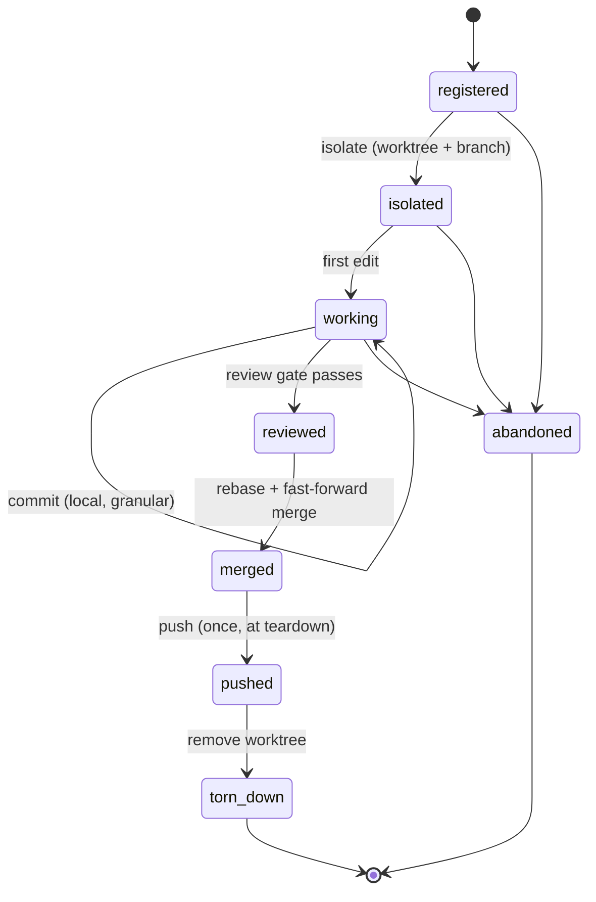
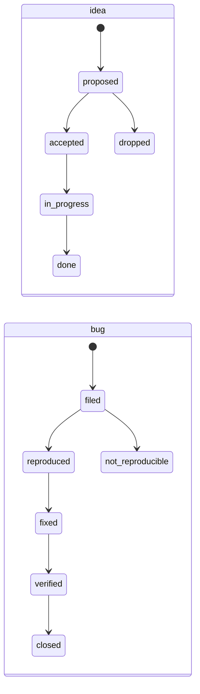

# State model

The four domains, their state machines, and the storage layout. This is the
specification the engine is implemented against.

## Declarative FSM format

A state machine is a YAML file. The same schema serves methodologies, session
lifecycle, and work-item lifecycles, so there is one loader and one validator.

```yaml
id: tdd
kind: pipeline
description: Test-driven development with a docs-first design phase.

initial: designing
terminal: [committed, abandoned]

states:
  designing:
    description: Understand the change against the architecture docs.
    entry_gates: [docs.read_architecture]
    next: [red, abandoned]
  red:
    description: A failing test that fails on the reported symptom.
    entry_gates: [test.suite_runs]
    exit_gates: [test.new_test_fails]
    next: [green, abandoned]
  green:
    description: Minimum change that makes the failing test pass.
    exit_gates: [test.all_pass]
    next: [refactor, reviewing, abandoned]
  refactor:
    description: Clean up under a green suite.
    exit_gates: [test.all_pass]
    next: [reviewing, red, abandoned]
  reviewing:
    exit_gates: [docs.updated, coverage.meets_floor, privacy.clean]
    next: [committed, red, abandoned]
  committed:
    description: Work is committed locally. Pushing is a session-level event.
```

Fields:

- **`initial`** — the state a fresh instance starts in.
- **`terminal`** — states from which no transition is required; reaching one
  completes the machine.
- **`next`** — the whitelist of legal successors. A transition to anything not
  listed is rejected by the engine regardless of enforcement level; this is
  structural validity, not policy.
- **`entry_gates`** / **`exit_gates`** — rule ids that must return clean before
  the state is entered or left. Whether a failing gate *blocks* or merely
  *warns* is policy, resolved from the manifest at evaluation time.

A gate names a rule id. The rule's implementation lives in `core/rules`, which
is the escape hatch for logic YAML cannot express (D5).

## Domain: session

Governs isolation and the push barrier. This is the domain with real
cross-process concurrency — several sessions may run against one checkout.



Invariants this domain enforces:

| Rule id | Meaning | Default |
|---|---|---|
| `session.isolated_before_edit` | No file edit while in `registered` — isolate first | block |
| `session.no_edit_in_main_checkout` | Edits land in the session worktree, never the shared checkout | block |
| `session.push_barrier` | At most one push per session, and only from `merged` | block |
| `session.ff_merge_target` | A fast-forward merge must be run from the main checkout, not inside the worktree | block |
| `session.own_file_set_only` | Commits touch only files this session declared | warn |
| `session.named_after_isolating` | Session has a task-derived name and color | warn |
| `session.teardown_complete` | Worktree removed after push | warn |

`session.ff_merge_target` deserves its comment: merging a branch while standing
inside that branch's own worktree merges it into itself and the follow-up push
pushes an unchanged target. Both commands exit zero. The failure is invisible
without a check, which is exactly the class of problem this library exists for.

## Domain: pipeline

One task's progress through the configured methodology. Scoped to a session;
a session runs pipelines one at a time.

Shipped methodologies:

| id | For | Shape |
|---|---|---|
| `tdd` | Default. Test-first development | designing → red → green → refactor → reviewing → committed |
| `spec-first` | Design-heavy work where the spec is the deliverable | designing → specified → implementing → reviewing → committed |
| `bugfix` | Proving a reported defect is real before fixing it | triaging → reproducing → fixing → verifying → committed |
| `chore` | Mechanical work with no design content | doing → reviewing → committed |
| `none` | Escape hatch — a single state, no gates | working |

`docs-first` is not in this list because it is not a methodology (D12). It is a
pair of gates — `docs.read_architecture` on entry to the first design state,
`docs.updated` on exit from review — that the engine injects into whichever
methodology is configured. A methodology cannot opt out of it; a project can
only retune the gates' level, and even that is discouraged.

## Domain: work item

Two item types with distinct lifecycles.



The `filed → reproduced` edge is load-bearing: a bug may not enter `fixed`
without having passed through `reproduced`, because a fix for an unreproduced
defect proves nothing. The repro-proving agent owns that transition and is the
only actor allowed to make it.

A separate field records *residue* — what remains owed after the status says
done, such as a device soak that has not been run. Status and residue are
distinct on purpose: a status of `fixed` with an unfulfilled residue is a
normal, honest state, and collapsing the two produces documents that claim
more than was proven.

## Domain: memory

Not an FSM. A store with invariants and repair operations.

| Invariant | Check | Repair |
|---|---|---|
| Every file parses | Valid frontmatter, known `type` | report only |
| The index matches the directory | Every file has an index line; every line resolves | regenerate index |
| No dead links | Every `[[link]]` resolves, or is flagged as intentional-forward | report only |
| No duplicates | No two files cover the same fact | report candidates |
| No personal data | Privacy patterns find nothing | report with offsets |

The index is a **generated artifact** (D-memory, per interview): regenerating
it is a command, not an editing task. A hand-maintained index over hundreds of
files drifts, and the drift is silent.

## Storage layout

```
.claude/invariant/state/
  registry.json           cross-session index; the only locked file
  sessions/<sid>.json     one file per session
  pipelines/<sid>.json    current + historical pipelines for a session
  locks/registry.lock     advisory lock file
```

**Concurrency.** Per-session files are written only by their owning session, so
they need atomicity but not locking: write to a temporary file in the same
directory, then `os.replace`, which is atomic on a single filesystem. The
registry is written by every session, so it is guarded by an advisory lock
(`flock`) held across a read-modify-write. Lock acquisition has a timeout; a
timeout is reported as a real error rather than waited out forever, because a
wedged lock must be visible.

**Recovery.** Everything is JSON, hand-inspectable, and hand-fixable.
`invariant state show` prints it; `invariant state repair` reconciles the
registry against the session files and against the actual worktrees on disk,
which is what a stale registry entry from a crashed session needs.

**Staleness.** A session file whose worktree no longer exists is stale. The
registry records a heartbeat updated on each transition; `repair` treats an
entry with no live worktree as abandoned rather than deleting it outright, so
that evidence of what happened survives the cleanup.
