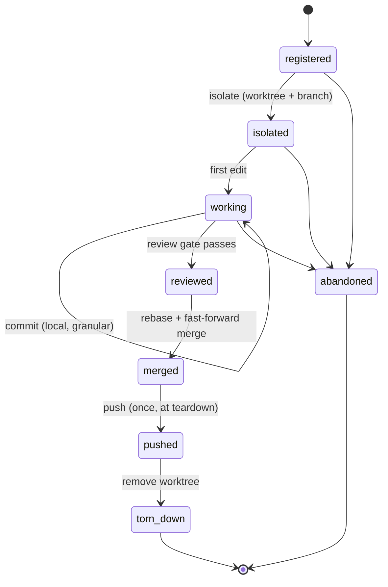
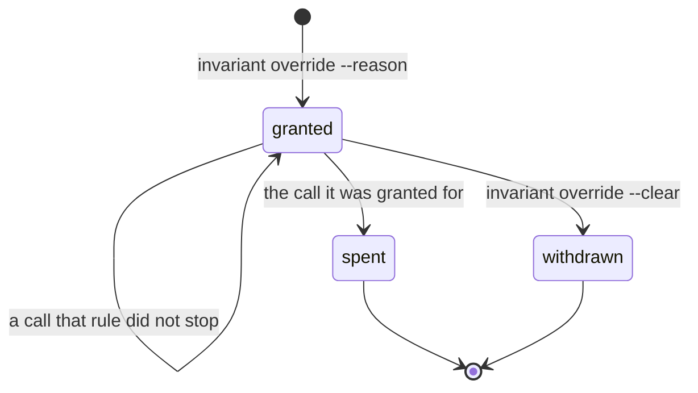
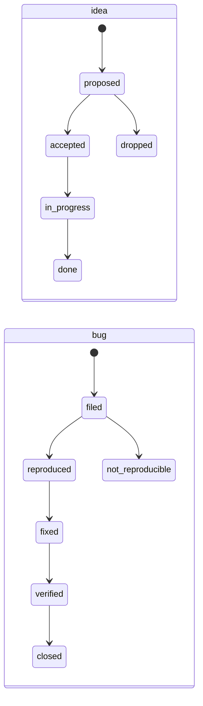

# State model

The five domains, their state machines, and the storage layout. This is the
specification the engine is implemented against.

Three of the five are genuine finite state machines. `memory` and `stats` are
not — each is a store with invariants over it and operations that repair them
— and they belong here for the same reason the machines do: what they hold
drifts silently, and drift is undetectable without a script that checks it.

## Declarative FSM format

A state machine is a YAML file. The same schema serves methodologies, session
lifecycle, and work-item lifecycles, so there is one loader and one validator.

```yaml
id: tdd
kind: pipeline
description: Test-driven development with a docs-first design phase.

initial: designing
terminal: [committed, abandoned]

states:
  designing:
    description: Understand the change against the architecture docs.
    roles: [design]          # the docs-first read gate attaches here
    next: [red, abandoned]
  red:
    description: A failing test that fails on the reported symptom.
    exit_gates: [test.new_test_fails]
    next: [green, abandoned]
  green:
    description: Minimum change that makes the failing test pass.
    exit_gates: [test.all_pass]
    next: [refactor, reviewing, abandoned]
  refactor:
    description: Clean up under a green suite.
    exit_gates: [test.all_pass]
    next: [reviewing, red, abandoned]
  reviewing:
    description: Review, coverage, docs, and privacy before committing.
    roles: [review]          # docs.updated and the agent-role gates attach here
    exit_gates: [test.all_pass, coverage.meets_floor, privacy.clean]
    next: [committed, red, refactor, abandoned]
  committed:
    description: Work is committed locally. Pushing is a session-level event.
  abandoned: {}
```

Every state, edge, gate and role above is quoted from the shipped `tdd.yaml`;
only the descriptions are abridged, and the two `#` notes are added here. The
structure is the part a reader checks against the engine, so the structure is
the part that is verbatim. Note what it does **not** contain: no
`docs.updated`, no `agents.*`. Those attach centrally
from the `design` and `review` roles, so forking a methodology cannot silently
drop them — a rule the suite pins, and a rule an inline example that declared
them would teach people to break.

Fields:

- **`initial`** — the state a fresh instance starts in.
- **`terminal`** — states from which no transition is required; reaching one
  completes the machine.
- **`next`** — the whitelist of legal successors. A transition to anything not
  listed is rejected by the engine regardless of enforcement level; this is
  structural validity, not policy.
- **`entry_gates`** / **`exit_gates`** — rule ids that must return clean before
  the state is entered or left. Whether a failing gate *blocks* or merely
  *warns* is policy, resolved from the manifest at evaluation time.
- **`red_phase`** — optional; which of this machine's states does
  proof-of-red. Only a machine declaring `test.new_test_fails` needs it, and
  only when that state is not literally called `red`.

`red_phase` exists because a rule cannot carry a state name that only one
machine has. `test.new_test_fails` selects its evidence by the phase a run was
recorded in, was written against `tdd` — which has a `red` state — and is
declared by `bugfix`, which runs `triaging → reproducing → fixing` and has no
legal transition to any state called `red`. Its own exit gate was therefore
satisfiable only by recording a run under a phase name the machine cannot
produce, which writes into durable evidence that the run happened in a state
the pipeline was never in (BUG_030). Renaming `reproducing` was rejected: the
state is named for what it proves, and a machine's vocabulary is not a
string comparison's to set. The rule now asks the machine, and a new
methodology answers the question by existing.

A gate names a rule id. The rule's implementation lives in `core/rules`, which
is the escape hatch for logic YAML cannot express (D5).

## Domain: session

Governs isolation and the push barrier. This is the domain with real
cross-process concurrency — several sessions may run against one checkout.



Invariants this domain enforces:

| Rule id | Meaning | Default |
|---|---|---|
| `session.isolated_before_edit` | No file edit while in `registered` — isolate first | block |
| `session.no_edit_in_main_checkout` | Edits land in the session worktree, never the shared checkout | block |
| `session.push_enabled` | Publishing is a session step at all (`session.push`, off by default) | block |
| `session.push_barrier` | At most one push per session, and only from `merged` | block |
| `session.ff_merge_target` | A fast-forward merge must be run from the main checkout, not inside the worktree | block |
| `session.own_file_set_only` | Commits touch only files this session declared | warn |
| `session.named_after_isolating` | Session has a task-derived name and color | warn |
| `session.teardown_complete` | Worktree removed after push | warn |

`session.ff_merge_target` deserves its comment: merging a branch while standing
inside that branch's own worktree merges it into itself and the follow-up push
pushes an unchanged target. Both commands exit zero. The failure is invisible
without a check, which is exactly the class of problem this library exists for.

Both it and `session.own_file_set_only` ask git a question, and "git could not
answer" is not an answer: the underlying helpers (`in_linked_worktree`,
`staged_files`) return `None` on an unreadable repository and the rules FAIL on
it, in the same do-not-relax convention as `branch_files` and `unpushed_files`.
They used to default to `False`/`[]`, which read as "running from the main
checkout" and "0 staged file(s), all declared" — a clean pass exactly when
nothing had been checked (AUD-07).

**The machine's gates hold on every route.** `SessionDomain._advance` — the
one function every session transition passes through, whether it was reached
by `session review`, `session merge`, `session isolate`, or the generic
`session transition` — evaluates the exit gates of the state being left and
the entry gates of the state being entered, exactly as `PipelineDomain.advance`
always has. The gates used to be read by two hardcoded CLI call sites only, so
`session transition reviewed` then `merged` walked the lifecycle with zero
gates, `session.named_after_isolating` was a gate no code path evaluated, and
`session.push_enabled` lived a second life as a hardcoded `if` inside the push
command (AUD-05). Three consequences of the one-route design:

- **An entry gate runs while the record still reads the previous state.** A
  rule attached as an entry gate must not abstain on the source state —
  `session.named_after_isolating` abstained on `registered` and so could never
  fire on the only edge it guards (AUD-14).
- **A forced transition past a blocking gate records the override** — which
  gates were forced, and why — on the session record, next to the structural
  overrides. Silent is not an option the API has.
- **Commands with an irreversible step ask first.** `session merge` and
  `session push` evaluate the same gate list through `SessionDomain.
  pending_gates` *before* touching git, because refusing the transition after
  the merge or push has run would leave git and the record disagreeing. The
  pre-flight and the transition read one list from the machine, so they cannot
  drift.

The rules that also fire from the pre-tool-use hook on raw git commands
(`session.ff_merge_target`, `session.push_barrier`) are told which question
they are being asked: a transition *entering* `merged` or `pushed` carries the
`merging` / `pushing` context, so those gates judge the machine transition
rather than parsing an empty command string and abstaining.

### The two override lists

The session record carries two, and the difference between them is tense.

| Field | Holds | Written by |
|---|---|---|
| `overrides` | overrides that have been **spent** | a forced transition, a structural edge walked deliberately, a one-shot token consumed at a hook |
| `pending_overrides` | grants nothing has spent **yet** | `invariant override <rule> --reason` |
| `standdown` | enforcement held for an **interval** | `invariant standdown --reason` — see below |

`overrides` is the audit trail and has always existed. `pending_overrides` is
the half that was missing, and it exists because of where the gates that stop
an agent actually live. Every gate the CLI evaluates could already be passed
with `--force --reason`; twelve rules are evaluated by *hooks*, and a blocking
verdict there was final — no flag, no marker, no prompt, no recorded exception
(BUG_049). A hook fires on a tool call, which carries no argument the operator
can add and no environment a running host will re-read, so the appeal has to be
something written down **before** the call and found by it.



The self-loop is the property worth stating: a grant is consumed only where the
verdict **actually stops the call**. A token burnt by a rule that was passing
anyway would be gone at the moment the operator needed it. Consumption happens
in the host adapter, at the delivery surface, and never inside
`core.rules.evaluate` — a rule is a question about the world, and asking it must
not change the world.

Spending one appends to `overrides` with the rule, the reason and the surface
that spent it, so the compliance record shows a gate passed deliberately rather
than a gate that quietly did not fire. An unspent grant prints in
`session status`, because a held override is enforcement the operator turned off
and may well have forgotten.

### Standing enforcement down

`Session.standdown` is the third of these fields and the only one that is a
state rather than a list. It answers the want the other two cannot: *stop
asking for the next while*.

None of the routes that looked like this were it. `loose` is an observation
mode and still blocks `session.no_edit_in_main_checkout` and `privacy.clean`,
correctly. `INVARIANT_DISABLE` takes exact ids with no wildcard and no `all`,
and an environment variable does not reach a hook mid-session anyway — the hook
subprocess inherits what the host was launched with. What was left was editing
committed project policy for the duration of one task, which either lands in a
commit by accident or quietly becomes the project's real policy (IDEA_003).

Three properties are what make it a control rather than a hole:

- **Expiry is derived, not stored.** `core.rules.standdown_in_force` recomputes
  on every evaluation whether the hold still applies, from the pipeline the
  scope names. Nothing has to run for it to lapse, which matters because an
  expiry that depends on a later command running is an expiry that does not
  happen. The default scope is the shortest useful one — the current pipeline,
  or, where none is running yet, the next one to start: a hold thrown for work
  outside a pipeline waits rather than expiring, because expiring on `pipeline
  start` would undo it before anything ran under it (BUG_052).
- **`privacy.clean` is held out unless named.** It is the one gate whose
  failure cannot be undone after the fact; nothing un-writes an identifier out
  of a published history. Folding it in costs `--include privacy.clean`, a
  separate sentence the operator wrote.
- **It is loud on every turn.** `build_context` puts it above the lifecycle
  lines, and each held rule reports `stood down — <reason>` rather than
  vanishing — so a held gate reads as a `[skip:BLOCK]` on the default verdict
  stream rather than as a pass.

### Host binding

A host session and an invariant session are **1:1**. The binding is what makes
attribution answerable at all: without it, several sessions running against one
repository are indistinguishable from the shared checkout.

It is made automatically. `session start` runs through a shell, and a shell
tool call carries no hook payload, so the CLI cannot see the host identifier —
the host adapter records it in `PostToolUse`, which has the identifier and
brackets the exact call that registered the session, reading the new session's
id out of that command's own output rather than guessing.

Enforced in both directions. A host session that already owns a live session
cannot start a second; a session bound to one host is not rebound to another
without `--force`. Rebinding silently would hand a pipeline, its evidence and
its declared file set to an owner that never did the work.

The binding is host-to-session and **never** host-to-worktree. Registering
without isolating is legitimate — a device soak owns no code — so a session
with no worktree is fully bound and fully valid.

Three kinds of session stop competing for attribution, because none of them was
ever a real answer:

| Excluded | Why it was never the caller |
|---|---|
| **Stranded** — worktree recorded, gone from disk | Cannot be worked in. Left in, it pads every ambiguity report forever. |
| **Host ended** — `SessionEnd` fired | Whoever is asking, it is not them. |
| **Bound elsewhere** | Under 1:1 that is a definite no, not an unknown. |

A host session that owns nothing is therefore **not ambiguous** — it owns
nothing. It is told to start a session, or to claim an unowned one, rather than
asked to pick from a list in which none of the entries is it.

`SessionEnd` marks the binding spent; it does **not** abandon the session. The
session may hold unmerged work in a live worktree, and destroying that because
a terminal closed would be the library doing the one thing it exists to
prevent. `invariant session reap` abandons a stranded session only once its
branch is gone too — a worktree can be removed while its branch still holds
recoverable commits, so the narrow condition is the safe one.

#### Teardown will not remove the ground under the caller

Teardown's other two preconditions are git questions — a clean tree, and a
safe `git branch -d`. Neither asks whether anything *outside* git is standing
in the directory, and git will remove one that is occupied (BUG_009). When the
occupant is an agent host the result is not an inconvenience: that host's own
worktree isolation refuses every subsequent shell call and orders the caller
back into the path just deleted, and the commands that would repair it sit
behind the same refusal. The deadlock is self-sealing, so this is a **refusal**
rather than a warning — there is no in-band recovery to scroll past it into.

The precondition is a conjunction, and each half is what keeps the other
honest:

| Half | Alone it would | Why it is measurable |
|---|---|---|
| The binding is **live** — `host_session_id` set, `host_ended` false | refuse every healthy teardown: a session ending the documented way is bound to the very host session running the teardown, and `SessionEnd` has not fired because that host is still alive | it is the model above, read from the record before anything is removed |
| The worktree is **occupied** — the caller is standing inside it | refuse a cleanup that only costs one `cd`, because with the binding already spent there is nobody left to strand | the caller's own working directory, which under a 1:1 binding identifies that session's host |

Occupancy is measured from the **caller's** working directory because that is
the only evidence there is. The binding is a scalar with no notion of where
its host stands (BUG_010), so a *different* host wedged in this worktree stays
invisible; closing that needs the binding to record a location, not a wider
predicate here. `--force` remains for the deliberate case, in the same shape
as every other override in this domain.

The reads must happen **before** the removal, which is a real constraint
rather than a stylistic one: teardown reads `host_session_id` afterwards
anyway — twice for the transition's telemetry watermark, once when the record
is serialised — and a check satisfied by those reads would be a precondition
that ran after the thing it was guarding.

### Attribution

Which session a tool call belongs to, most reliable first:

1. An explicit `INVARIANT_SESSION_ID` / `--id`.
2. The host's session identifier, when the caller supplies one.
3. The session whose worktree contains **the file the call names** — the
   destination of a write, or the path a read was aimed at.
4. The session whose worktree contains the working directory.
5. The single session registered at or above the working directory.

Steps 2 and 3 exist because step 4 cannot be relied on: a host runs hooks from
the project root and may reset the working directory between tool calls, so
with several sessions live, every one of them looks identical from the shared
checkout — attribution fails precisely when the isolation rules need it.

Step 3 is what keeps an edit attributable when step 2 is unavailable, which is
the common case rather than a rare one: a session registered before the host
identifier was recorded has none, and the documented fallback —
`INVARIANT_SESSION_ID` — is an environment variable that an edit tool call has
no way to carry. A destination path depends on neither.

The order matters. `target` sits *below* the host identifier so that who is
writing beats where the bytes land: a session writing into a peer's worktree
stays attributed to the writer, which is what makes that a detectable
violation instead of a silent reattribution. And a target that belongs to no
worktree is not an answer — resolution falls through, so an edit aimed at the
shared checkout still reaches `session.no_edit_in_main_checkout` with a session
to report against.

When step 3 succeeds and the session has no host identifier recorded, the
mapping is **learned**: the next call from that host session resolves by
identifier alone, including calls that carry no path at all. Only step 3 may
teach it. Learning from a weaker signal would bind the wrong pair permanently.
Learning is reserved to a call that *wrote* — a read is evidence of where the
reader was looking, not of who owns the worktree.

**A resolution is not automatically an identification.** Steps 1–4 name the
session from something the call itself carried; step 5 names the only session
left standing. Both return a session, and only the first four are evidence.
Writing evidence on step 5 is how a *foreign* session's agent came to sit in a
pipeline that never dispatched it: a curator run in the shared checkout, under
a host bound to nothing, resolved to whichever session happened to be the sole
attributable candidate — and the pipeline that received it would then clear a
block-level `agents.*_ran` gate on work that never happened in it (BUG_028).

So the evidence writers ask `Resolution.proven`, not `resolution.session is not
None`. Enforcement and display still use step 5: telling somebody where they
probably are is a fair use of a guess, and recording a fact against them is
not.

**A proof of identity is not a proof of place**, and an actor row needs both.
Step 2 deliberately outranks step 3 — who is acting beats where the bytes land
— so it answers identically for an architect writing inside its own worktree
and for a curator filing a bug in the shared checkout, because a subagent
shares its parent's host identifier. Both are `host`, both are proven, and only
one of them worked in the pipeline. A *dispatch* row can live with that: at
dispatch time there is no better evidence, and the row only claims the request
resolved here. An *actor* row claims the agent worked here, so for the host
route — and only for it — the location is asked for explicitly rather than
inferred. A session with no worktree passes on the binding alone, having no
location to contradict.

Where the location contradicts the binding, the location wins and the run is
recorded against the session it landed in. That is step 2 inverted, for the
same reason the dispatch route already inverts it when a brief names a
worktree: the host is not acting there, it is delegating into it, and the run
belongs to the delegate. One binding holds one session, so a parent driving two
tracks cannot represent the second — and refusing outright would leave that
track unable to record any agent that never names a path, which is the original
wedge from the other end. The inversion is safe because it applies only when
the host names an ACTOR, and a main-loop turn never does: a session reaching
into a peer's worktree by hand stays attributed to the reacher, and stays a
detectable crossing. When a *dispatch* cannot be recorded — the route was a guess, or the
session has no pipeline — the hook says so in the turn where it happened,
because the alternative is the caller discovering it at a blocking gate at the
end of the phase, when nothing it can do will satisfy it.

**One order, every recorded call.** Enforcement resolved through this order and
recording did not: a docs read and an agent dispatch used steps 2 and 4 only,
so a `Read` naming a file inside a session's worktree was not attributed to
that session while several were live — the payload carried the answer and the
recording pulled the same key out one line later purely to store it (BUG_010,
narrow half). Both now resolve here. A call carrying no path, which is every
agent dispatch, simply finds nothing at step 3 and continues; that is the
order working, not an exception to it. What this does **not** reach is a call
whose path lies in a *different repository*: the state root is per-repository
(see "Storage layout"), so a session in another project is not in the registry
being searched at all. Attribution is within one project by construction.

## Domain: pipeline

One task's progress through the configured methodology. Scoped to a session;
a session runs pipelines one at a time.

The methodology is **pinned to the pipeline at `start`**: the record carries
the machine id, and every later operation — `status`, `gates`, `advance`, and
the rules that read the record (`pipeline.complete`,
`session.work_would_be_stranded`) — resolves the machine from the record,
falling back to the manifest only for records that predate the pin. This is
what makes `pipeline start --methodology <id>` safe (the override used to
live only in the memory of the `start` call, wedging every later invocation —
AUD-02) and what makes the gate set un-swappable by a mid-pipeline edit to
`methodology.pipeline`, which is an isolation-exempt manifest line (AUD-03).
A pinned machine that can no longer be loaded fails the gates that need it
rather than skipping; the one permitted escape is `pipeline start`, which
archives the unusable record rather than discarding it.

Shipped methodologies:

| id | For | Shape |
|---|---|---|
| `tdd` | Default. Test-first development | designing → red → green → refactor → reviewing → committed |
| `spec-first` | Design-heavy work where the spec is the deliverable | designing → specified → implementing → reviewing → committed |
| `bugfix` | Proving a reported defect is real before fixing it | triaging → reproducing → fixing → verifying → committed (`red_phase: reproducing`) |
| `chore` | Mechanical work with no design content | doing → reviewing → committed |
| `docs` | Prose, records, backlog entries — nothing to test or diagram | drafting → reviewing → committed |
| `none` | Escape hatch — a single state, no gates | working |

`docs-first` is not in this list because it is not a methodology (D12). It is a
pair of gates the engine injects into whichever methodology is configured:
`docs.read_architecture` leaving the design state, `docs.updated` leaving
review. A methodology cannot opt out of it; a project can only retune the
gates' level, and even that is discouraged.

Two details that are load-bearing rather than incidental:

- **The read gate is an exit gate, not an entry gate.** A pipeline starts *in*
  its design state, so an entry gate there would be evaluated before any work
  had happened and could never fail — a gate that looks present and enforces
  nothing. The check that means something is "you may not leave design until
  you have read the docs."
- **Injection is by role, not by state name.** A methodology this library has
  never seen still receives the gates, provided it labels its states. A
  methodology that declares *no* design state — `chore` — is asserting there is
  no design content, and is exempt from the read gate but not from the review
  gate. That exemption is deliberate: forcing an architecture read onto a
  formatter pass makes `chore` useless and pushes people to `none`, which drops
  every gate. A narrower rule that gets used beats a broader one that gets
  bypassed.
- **An exit gate is asked its question after the commit.** Anything evaluated
  on leaving a state runs when that state's work is, by construction, already
  committed, so a gate that asks "what changed" by reading the working tree
  and the index alone sees nothing and returns *not applicable* — every time,
  in exactly the state it was written for. Three sources answer between them:
  the working tree and index (work in progress), the branch's own commits
  (work already committed in this phase), and the session's declared file set
  (the only one left when there is no base to diff against). All three, or the
  gate is inert where it matters most. This is `core/rules._changed_set`, read
  by `docs.updated`, `docs.diagrams_current` and `coverage.meets_floor`; it is
  one function rather than three because it was three, and two of them were
  wrong for as long as they existed (BUG_012).
- **An empty answer and an unanswerable question are different verdicts.**
  When no source could speak — the commits unreadable, nothing declared — the
  set is empty for a reason that is not "nothing changed". Those gates fail
  and say so instead of skipping, because a skip on a `block`-level gate reads
  as a pass, and an unanswered question is not a negative answer.

A note on `docs`, because the reasoning generalises. A documentation-only
change run through `tdd` blocks on three gates it cannot satisfy in principle —
no implementation means no test could have failed first, no code means nothing
to measure, and a change adding no component cannot honestly update a diagram —
and none can be acknowledged, because they block. `advance --force` was the
only route, and a tool that teaches `--force` as routine has spent the thing it
exists for.

Applicability is **declared, not inferred**. A caller choosing a methodology is
making a claim that can be wrong and can be reviewed; a rule reading the diff's
file extensions would be guessing, and would guess wrong on the change that adds
a doc and a schema together. Privacy still blocks and the docs are still read
and updated — only the diagram gate steps aside, and only for a pipeline that
has declared there is no structure to draw.

### Agent-role gates

A second pair rides the same injection, and **both leave the review state** —
`agents.review_agent_ran` and, despite its name, `agents.design_agent_ran`.
They read the subagent invocations the host recorded as pipeline evidence,
keyed by `agents.roles.<role>` in the manifest.

They exist because installing an agent and using one are different events, and
only the second changes any outcome. A project can carry four correctly
installed agents and never dispatch one.

Four properties, each deliberate:

- **Two events, not one: the dispatch and the actor.** A dispatch is observed
  from the *parent's* tool call. An agent that starts its own session and
  pipeline has neither at that moment, so the dispatch has no destination and
  no better lookup invents one — the agent that *created* a pipeline could not
  be evidence for it (BUG_028). The actor can be observed instead: Claude Code
  stamps the acting agent's type onto every hook payload, including the ones
  the subagent's own tool calls raise, so a `feature-architect` that runs
  `pipeline start` and then writes an ADR records itself in the pipeline it
  made. Both land in `agents_run`; `agents_run_how` keeps them apart, because
  `dispatch` proves somebody asked for the agent and `actor` proves the agent
  worked here, and only the second answers "did the design happen in this
  pipeline". A host that cannot name the actor omits the key and loses that
  route only.

- **The design gate does not guard the design state.** It cannot: the host
  records a dispatch when the subagent *returns*, so a design agent driving its
  own pipeline can never have its own dispatch on record before it advances out
  of designing. Placed there the gate was unsatisfiable for the one actor it
  names, and `--force` was the only route past it. The review state's exit is
  the earliest boundary a *different* actor drives, which is what makes the
  evidence available. The cost — the gate guards landing rather than leaving
  design — is accepted in ADR-003 D2. Contrast `docs.read_architecture`, which
  stays on the design state's exit because a read is recorded the moment it
  happens, while the agent is still running.

  The actor route weakens this premise and is recorded as doing so, rather
  than quietly acted on: an actor reading IS available while the agent is still
  running, exactly like a docs read, so the reason the gate sits on the review
  state no longer holds for a design agent that drives its own pipeline. It
  still holds for one dispatched into a pipeline it does not act in. Moving the
  gate is an ADR-003 D2 decision and has not been made here; what has changed
  is that it is now a choice rather than a constraint.

- **Advisory in every shipped profile, including `strict`.** The engine can
  prove an agent *ran*; it cannot prove one was *needed*. A one-line fix made
  inline is a legitimate exception, and a gate that legitimate work has to
  override routinely is what teaches people to reach for `--force` on the gates
  that do matter.
- **An unconfigured role skips rather than passes.** A project with no review
  agent should see the gate report "not applicable", not report green. Those
  are different facts and `Verdict.skipped` keeps them apart.
- **A wrong agent does not satisfy a role.** The failure names what did run, so
  "I dispatched the curator" reads as the miss it is rather than as silence.

## Domain: work item

Two item types with distinct lifecycles.



The `filed → reproduced` edge is load-bearing: a bug may not enter `fixed`
without having passed through `reproduced`, because a fix for an unreproduced
defect proves nothing. The repro-proving agent owns that transition and is the
only actor allowed to make it.

A separate field records *residue* — what remains owed after the status says
done, such as a device soak that has not been run. Status and residue are
distinct on purpose: a status of `fixed` with an unfulfilled residue is a
normal, honest state, and collapsing the two produces documents that claim
more than was proven. `item.residue_matches_status` guards the closing state
on **entry** in both machines — `bug.closed` and `idea.done`. Entry rather
than exit because both are terminal: nothing ever leaves them, so an exit gate
there is never evaluated and an entry could close owing three legs with the
gate named to prevent exactly that staying silent.

### The store the gates cannot sit in front of

Work items are data, and `items.exempt` holds them out of session isolation —
deliberately: every session touches the backlog, and routing it through a
branch produces conflicts with no review value. The cost is that the FSM's
invariants bind only callers who go through the CLI. Writing the file directly
never asks the machine, so it is never refused, and nothing records that
anything was skipped. Seven bugs in this library's own backlog reached `fixed`
with an empty history exactly that way.

`item.history_matches_status` covers the gap from the other side. It is bound
to the `stop` event rather than to any transition — there is no transition to
attach it to — and at turn end it re-derives each item's status by walking its
recorded history through that type's machine, reporting the ones that
disagree: a status no history explains, a history that ends somewhere else, an
edge the machine does not have. A `forced` entry is not drift; an override
went through the machine, was refused, and recorded a written reason, so
flagging it would report the audit trail working.

This is the same shape as the memory domain's index check below — not "you may
not do this", but "this store no longer says what it means".

## Domain: memory

Not an FSM. A store with invariants and repair operations.

| Invariant | Check | Repair |
|---|---|---|
| Every file parses | Valid frontmatter, known `type` | report only |
| The index matches the directory | Every file has an index line; every line resolves | regenerate index |
| No dead links | Every `[[link]]` resolves, or is flagged as intentional-forward | report only |
| No duplicates | No two files cover the same fact | report candidates |
| No personal data | Privacy patterns find nothing | report with offsets |

The index is a **generated artifact** (D-memory, per interview): regenerating
it is a command, not an editing task. A hand-maintained index over hundreds of
files drifts, and the drift is silent.

The first four rows are the four `memory.*` rules, and all four are bound to
the `stop` event and to nothing else. They are not pipeline gates on purpose:
memory hygiene is a property of a knowledge store every session shares, not of
the change under review, so holding a merge hostage to a stale index in a file
the branch never touched would be a gate answering about someone else's work.
Turn end is when the drift is worth naming and cheap to fix. They short-circuit
to "not applicable" where `memory.managed` is false, so a project that does not
use the domain hears nothing.

Before they carried that binding they were reachable by no code path at all —
graded by all three profiles, evaluated by none of them, which is an
enforcement level reported for a control that never ran.

## Domain: stats

Not an FSM either. A store with invariants and repair operations, added by
ADR-002.

| Invariant | Check | Repair |
|---|---|---|
| Every record parses | Readable JSON with a known shape | report only |
| Records match their source | Stored watermark equals the source's | `stats refresh` |
| Nothing is silently lost | A record whose transcript is gone is archived | `stats archive` |
| Every model is priced | No model outside the price table | report only |
| The report matches the store | Fingerprint in the artifact equals the store's | `stats report --write` |

### What a transition records

Each recorded pipeline and session transition carries three fields beyond
`{from, to, reason}`:

- **`elapsed`** — seconds spent in the state just left.
- **`usage`** — the cumulative token counts observed for that host session at
  that moment: a **watermark**.
- **`usage_host`** — the host session that watermark was counted against. The
  machine's baseline carries the same pair (`usage_at_start`,
  `usage_at_start_host`).

Per-state duration is `elapsed` directly. Per-state spend is the difference
between consecutive watermarks, with the machine's own starting watermark
(`usage_at_start`) as the earlier reading for the first state.

A difference is only taken between two readings of the **same** counter. A
forced rebind moves the binding mid-run, so the readings either side of it
count two different transcripts; subtracting them is well-formed and measures
nothing, and where the new transcript's total is the higher it comes out
positive and looks exactly like a measurement. Recording which counter each
reading came from is what makes that visible rather than plausible. Two
*equal* readings are declined for the same reason in the other direction: they
say nothing was written to the transcript in between, which is what a whole
subagent run looks like from the parent's side, and never that the state was
free.

Neither is a clock time, so the privacy rule is satisfied by construction
rather than by scrubbing. The anchor `elapsed` is measured against is
*derived*, not stored — a pipeline's is `started` plus every `elapsed` since,
and a session's is the heartbeat it already stamped — so no second timestamp
was added to make this work.

This is a better design than the timestamp it replaces and not only a
compliant one. Attributing spend by comparing a response's timestamp against a
transition's has a boundary problem: a response spanning a transition must be
assigned to one side arbitrarily, and the arbitrariness is invisible in the
output. A watermark has no boundary; a subtraction of two counts is exact.

The cost is a **permanent asymmetry**. Every transition recorded before this
existed has neither field and can never acquire one, because the information
was not merely unstored — it was never observed. One entry missing `elapsed`
makes the whole machine's breakdown unavailable rather than partial, and the
report says "no breakdown available" explicitly. Never a zero, and never a
blank: a blank invites the reader to conclude the work was free.

That sentence is reserved for that case. A machine that has not left a state
yet, and a session that has never started a pipeline, also have no breakdown —
and neither of them lost anything, so neither is told it predates the
instrumentation. The report says which of the three it is, because a stated
wrong cause is harder to catch than an absence: the reader has been given a
reason and stops looking for one.

### Storing what was measured, not when

A stats record holds durations and a bare date and no timestamp of any kind.
The host's transcript timestamps are read at the boundary, turned into a wall
duration, an active duration and a date, and discarded. The cache key is a
content fingerprint rather than a modification time, for the same reason: an
mtime is a stored clock time, and it answers the wrong question anyway — the
cache asks whether the source changed, not when.

## Storage layout

```
<git-common-dir>/invariant/state/
  registry.json           cross-session index; the only locked file
  sessions/<sid>.json     one file per session
  pipelines/<sid>.json    current + historical pipelines for a session
  stats/<host-id>.json    one telemetry record per host session; derived and
                          rebuildable, except where `stats archive` has
                          promoted it to permanent
  locks/registry.lock     advisory lock file
```

**Why the git common directory.** State has to be shared by every worktree of a
repository. It cannot live under the project root, because each linked worktree
*has* its own project root — a session created from the main checkout would
then be invisible from the worktree it had just created, at exactly the moment
it needs to be addressable. The git common directory is the one location every
worktree resolves identically, and git already ignores it, so nothing has to be
excluded by hand. `paths.state` overrides this for a project outside git or one
that wants state somewhere specific.

**Finding the current session.** An explicit `INVARIANT_SESSION_ID` wins.
Otherwise the session whose worktree contains the working directory does, with
the deepest match winning so a nested worktree beats its parent. Failing that,
a session is matched by where it was registered — without which a session that
has not isolated yet, having no worktree, would be unreachable by the command
that isolates it. Ambiguity there is reported with the candidates listed rather
than guessed at.

**Concurrency.** Per-session files are written only by their owning session, so
they need atomicity but not locking: write to a temporary file in the same
directory, then `os.replace`, which is atomic on a single filesystem. The
registry is written by every session, so it is guarded by an advisory lock
(`flock`) held across a read-modify-write. Lock acquisition has a timeout; a
timeout is reported as a real error rather than waited out forever, because a
wedged lock must be visible.

**Recovery.** Everything is JSON, hand-inspectable, and hand-fixable.
`invariant state show` prints it; `invariant state repair` reconciles the
registry against the session files and against the actual worktrees on disk,
which is what a stale registry entry from a crashed session needs.

**Staleness.** A session file whose worktree no longer exists is stale. The
registry records a heartbeat updated on each transition; `repair` treats an
entry with no live worktree as abandoned rather than deleting it outright, so
that evidence of what happened survives the cleanup.
