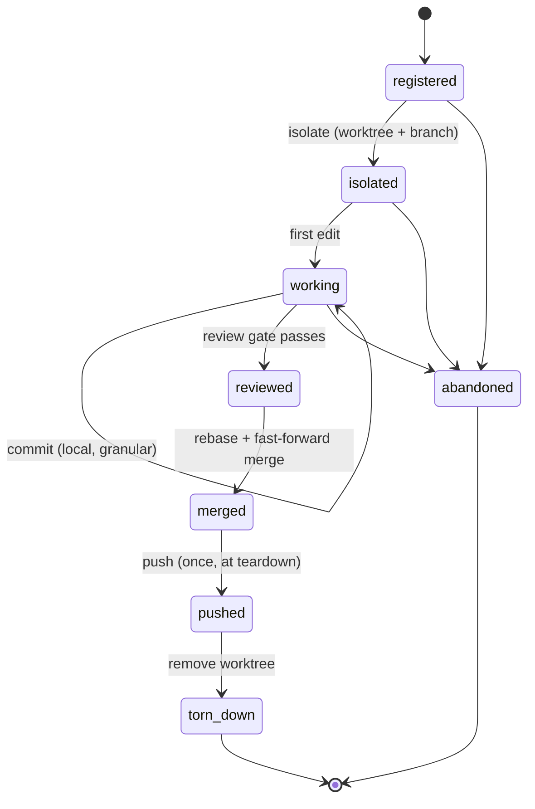
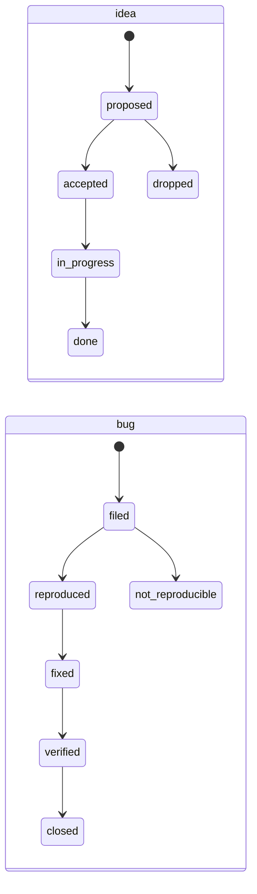

# State model

The four domains, their state machines, and the storage layout. This is the
specification the engine is implemented against.

## Declarative FSM format

A state machine is a YAML file. The same schema serves methodologies, session
lifecycle, and work-item lifecycles, so there is one loader and one validator.

```yaml
id: tdd
kind: pipeline
description: Test-driven development with a docs-first design phase.

initial: designing
terminal: [committed, abandoned]

states:
  designing:
    description: Understand the change against the architecture docs.
    roles: [design]          # the docs-first read gate attaches here
    next: [red, abandoned]
  red:
    description: A failing test that fails on the reported symptom.
    entry_gates: [test.suite_runs]
    exit_gates: [test.new_test_fails]
    next: [green, abandoned]
  green:
    description: Minimum change that makes the failing test pass.
    exit_gates: [test.all_pass]
    next: [refactor, reviewing, abandoned]
  refactor:
    description: Clean up under a green suite.
    exit_gates: [test.all_pass]
    next: [reviewing, red, abandoned]
  reviewing:
    exit_gates: [docs.updated, coverage.meets_floor, privacy.clean]
    next: [committed, red, abandoned]
  committed:
    description: Work is committed locally. Pushing is a session-level event.
```

Fields:

- **`initial`** — the state a fresh instance starts in.
- **`terminal`** — states from which no transition is required; reaching one
  completes the machine.
- **`next`** — the whitelist of legal successors. A transition to anything not
  listed is rejected by the engine regardless of enforcement level; this is
  structural validity, not policy.
- **`entry_gates`** / **`exit_gates`** — rule ids that must return clean before
  the state is entered or left. Whether a failing gate *blocks* or merely
  *warns* is policy, resolved from the manifest at evaluation time.

A gate names a rule id. The rule's implementation lives in `core/rules`, which
is the escape hatch for logic YAML cannot express (D5).

## Domain: session

Governs isolation and the push barrier. This is the domain with real
cross-process concurrency — several sessions may run against one checkout.



Invariants this domain enforces:

| Rule id | Meaning | Default |
|---|---|---|
| `session.isolated_before_edit` | No file edit while in `registered` — isolate first | block |
| `session.no_edit_in_main_checkout` | Edits land in the session worktree, never the shared checkout | block |
| `session.push_enabled` | Publishing is a session step at all (`session.push`, off by default) | block |
| `session.push_barrier` | At most one push per session, and only from `merged` | block |
| `session.ff_merge_target` | A fast-forward merge must be run from the main checkout, not inside the worktree | block |
| `session.own_file_set_only` | Commits touch only files this session declared | warn |
| `session.named_after_isolating` | Session has a task-derived name and color | warn |
| `session.teardown_complete` | Worktree removed after push | warn |

`session.ff_merge_target` deserves its comment: merging a branch while standing
inside that branch's own worktree merges it into itself and the follow-up push
pushes an unchanged target. Both commands exit zero. The failure is invisible
without a check, which is exactly the class of problem this library exists for.

### Attribution

Which session a tool call belongs to, most reliable first:

1. An explicit `INVARIANT_SESSION_ID` / `--id`.
2. The host's session identifier, when the caller supplies one.
3. The session whose worktree contains **the file being written to**.
4. The session whose worktree contains the working directory.
5. The single session registered at or above the working directory.

Steps 2 and 3 exist because step 4 cannot be relied on: a host runs hooks from
the project root and may reset the working directory between tool calls, so
with several sessions live, every one of them looks identical from the shared
checkout — attribution fails precisely when the isolation rules need it.

Step 3 is what keeps an edit attributable when step 2 is unavailable, which is
the common case rather than a rare one: a session registered before the host
identifier was recorded has none, and the documented fallback —
`INVARIANT_SESSION_ID` — is an environment variable that an edit tool call has
no way to carry. A destination path depends on neither.

The order matters. `target` sits *below* the host identifier so that who is
writing beats where the bytes land: a session writing into a peer's worktree
stays attributed to the writer, which is what makes that a detectable
violation instead of a silent reattribution. And a target that belongs to no
worktree is not an answer — resolution falls through, so an edit aimed at the
shared checkout still reaches `session.no_edit_in_main_checkout` with a session
to report against.

When step 3 succeeds and the session has no host identifier recorded, the
mapping is **learned**: the next call from that host session resolves by
identifier alone, including calls that carry no path at all. Only step 3 may
teach it. Learning from a weaker signal would bind the wrong pair permanently.

## Domain: pipeline

One task's progress through the configured methodology. Scoped to a session;
a session runs pipelines one at a time.

Shipped methodologies:

| id | For | Shape |
|---|---|---|
| `tdd` | Default. Test-first development | designing → red → green → refactor → reviewing → committed |
| `spec-first` | Design-heavy work where the spec is the deliverable | designing → specified → implementing → reviewing → committed |
| `bugfix` | Proving a reported defect is real before fixing it | triaging → reproducing → fixing → verifying → committed |
| `chore` | Mechanical work with no design content | doing → reviewing → committed |
| `none` | Escape hatch — a single state, no gates | working |

`docs-first` is not in this list because it is not a methodology (D12). It is a
pair of gates the engine injects into whichever methodology is configured:
`docs.read_architecture` leaving the design state, `docs.updated` leaving
review. A methodology cannot opt out of it; a project can only retune the
gates' level, and even that is discouraged.

Two details that are load-bearing rather than incidental:

- **The read gate is an exit gate, not an entry gate.** A pipeline starts *in*
  its design state, so an entry gate there would be evaluated before any work
  had happened and could never fail — a gate that looks present and enforces
  nothing. The check that means something is "you may not leave design until
  you have read the docs."
- **Injection is by role, not by state name.** A methodology this library has
  never seen still receives the gates, provided it labels its states. A
  methodology that declares *no* design state — `chore` — is asserting there is
  no design content, and is exempt from the read gate but not from the review
  gate. That exemption is deliberate: forcing an architecture read onto a
  formatter pass makes `chore` useless and pushes people to `none`, which drops
  every gate. A narrower rule that gets used beats a broader one that gets
  bypassed.

### Agent-role gates

A second pair rides the same injection: `agents.design_agent_ran` leaving the
design state, `agents.review_agent_ran` leaving review. They read the subagent
invocations the host recorded as pipeline evidence, keyed by
`agents.roles.<role>` in the manifest.

They exist because installing an agent and using one are different events, and
only the second changes any outcome. A project can carry four correctly
installed agents and never dispatch one.

Three properties, each deliberate:

- **Advisory in every shipped profile, including `strict`.** The engine can
  prove an agent *ran*; it cannot prove one was *needed*. A one-line fix made
  inline is a legitimate exception, and a gate that legitimate work has to
  override routinely is what teaches people to reach for `--force` on the gates
  that do matter.
- **An unconfigured role skips rather than passes.** A project with no review
  agent should see the gate report "not applicable", not report green. Those
  are different facts and `Verdict.skipped` keeps them apart.
- **A wrong agent does not satisfy a role.** The failure names what did run, so
  "I dispatched the curator" reads as the miss it is rather than as silence.

## Domain: work item

Two item types with distinct lifecycles.



The `filed → reproduced` edge is load-bearing: a bug may not enter `fixed`
without having passed through `reproduced`, because a fix for an unreproduced
defect proves nothing. The repro-proving agent owns that transition and is the
only actor allowed to make it.

A separate field records *residue* — what remains owed after the status says
done, such as a device soak that has not been run. Status and residue are
distinct on purpose: a status of `fixed` with an unfulfilled residue is a
normal, honest state, and collapsing the two produces documents that claim
more than was proven.

## Domain: memory

Not an FSM. A store with invariants and repair operations.

| Invariant | Check | Repair |
|---|---|---|
| Every file parses | Valid frontmatter, known `type` | report only |
| The index matches the directory | Every file has an index line; every line resolves | regenerate index |
| No dead links | Every `[[link]]` resolves, or is flagged as intentional-forward | report only |
| No duplicates | No two files cover the same fact | report candidates |
| No personal data | Privacy patterns find nothing | report with offsets |

The index is a **generated artifact** (D-memory, per interview): regenerating
it is a command, not an editing task. A hand-maintained index over hundreds of
files drifts, and the drift is silent.

## Storage layout

```
<git-common-dir>/invariant/state/
  registry.json           cross-session index; the only locked file
  sessions/<sid>.json     one file per session
  pipelines/<sid>.json    current + historical pipelines for a session
  locks/registry.lock     advisory lock file
```

**Why the git common directory.** State has to be shared by every worktree of a
repository. It cannot live under the project root, because each linked worktree
*has* its own project root — a session created from the main checkout would
then be invisible from the worktree it had just created, at exactly the moment
it needs to be addressable. The git common directory is the one location every
worktree resolves identically, and git already ignores it, so nothing has to be
excluded by hand. `paths.state` overrides this for a project outside git or one
that wants state somewhere specific.

**Finding the current session.** An explicit `INVARIANT_SESSION_ID` wins.
Otherwise the session whose worktree contains the working directory does, with
the deepest match winning so a nested worktree beats its parent. Failing that,
a session is matched by where it was registered — without which a session that
has not isolated yet, having no worktree, would be unreachable by the command
that isolates it. Ambiguity there is reported with the candidates listed rather
than guessed at.

**Concurrency.** Per-session files are written only by their owning session, so
they need atomicity but not locking: write to a temporary file in the same
directory, then `os.replace`, which is atomic on a single filesystem. The
registry is written by every session, so it is guarded by an advisory lock
(`flock`) held across a read-modify-write. Lock acquisition has a timeout; a
timeout is reported as a real error rather than waited out forever, because a
wedged lock must be visible.

**Recovery.** Everything is JSON, hand-inspectable, and hand-fixable.
`invariant state show` prints it; `invariant state repair` reconciles the
registry against the session files and against the actual worktrees on disk,
which is what a stale registry entry from a crashed session needs.

**Staleness.** A session file whose worktree no longer exists is stale. The
registry records a heartbeat updated on each transition; `repair` treats an
entry with no live worktree as abandoned rather than deleting it outright, so
that evidence of what happened survives the cleanup.
