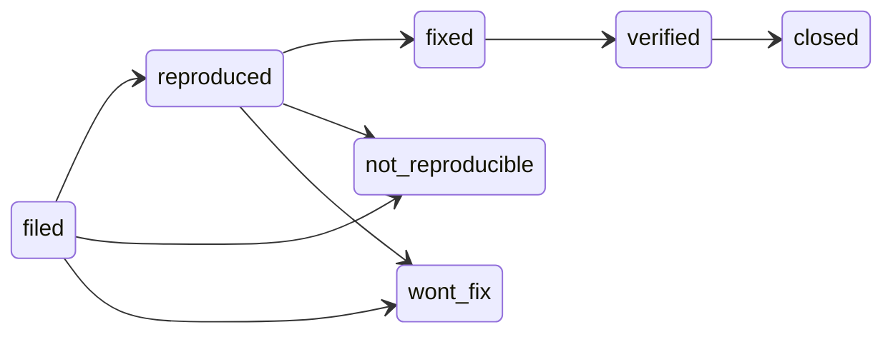

# Work items and memory

Two stores the engine governs that are not code: the backlog of ideas and
bugs, and the agent's long-term memory. Both are committed to the repository,
both are written through the CLI, and both are exempt from session isolation
because they are data about the work rather than the work.

## Work items

```bash
invariant item new bug --title "Export drops the last row" --field severity=high
invariant item new idea --title "Bulk export" --body "…"
invariant item list [--type bug|idea] [--status <s>] [--open]
invariant item show BUG_003
invariant item transition BUG_003 reproduced
invariant item residue BUG_003 --add "device soak still owed"
```

Every item carries a type, an id minted from the type and `items.id_strategy`
(`BUG_003`, or `BUG_EXPORT_DROPS_ROW` with `slug`), a status that is a state
of that type's machine, and a history of transitions with reasons.

### The bug lifecycle



There is no edge from `filed` to `fixed`. `item.bug_reproduced_before_fix`
refuses the shortcut, and the shipped `bug-reproducer` agent is how `filed →
reproduced` normally happens — one test that fails on the symptom, committed
as the fix's acceptance criterion. A bug that cannot be made to fail goes to
`not_reproducible`, which is a finding and not a failure — and is distinct
from `wont_fix`, which records a decision about a bug that is real and
understood. `fixed → verified → closed` is the landing; `closed` carries
`item.residue_matches_status`, so an item cannot close while it still owes
work.

### Ideas

`proposed → accepted → in_progress → done`, with `dropped` reachable until
work starts and `in_progress → accepted` as the retreat. The `backlog-curator`
agent fills in value and effort and places the entry in a tier; the status is
yours to move.

### Residue

Residue is work an item still owes after its status moved — a live-device
check after a fix, a doc after a feature. `item.residue_matches_status`
(advisory) flags a `done` or `fixed` item with residue still attached, so the
status cannot quietly outrun the work.

### Backends

The semantics above live above the storage. `items.backend` chooses the
format:

| backend | `items.path` | shape |
|---|---|---|
| `markdown` (default) | a directory | one `BUG_003.md` per item, frontmatter plus body |
| `json` | one file | a single document |
| `sphinx_needs` | one `.rst` page | `need` directives, for projects that already publish a requirements page |
| `none` | — | an external tracker holds the records; the machine and the agents still apply |

Switching backends changes nothing about what a status means.

## Memory

A directory of small markdown files, one fact per file, with frontmatter and
a generated index. Claude Code reads the index each session; the engine keeps
it honest.

```bash
invariant memory write prefer-uv-run --type feedback \
    --description "Run project tools through uv run; bare names are not on PATH in hooks" \
    --body-file note.md
invariant memory check         # schema, dead [[links]], index currency, duplicate candidates, privacy
invariant memory index         # regenerate the index from the directory
```

Four types: `user` (who the operator is), `feedback` (how to work, with the
why), `project` (ongoing goals and constraints not derivable from the code),
`reference` (pointers to external resources). Files link to each other with
`[[name]]`; a link to a file that does not exist is reported, not an error, so
a memory can name something worth writing later.

The `Stop` hook evaluates the memory rules at the end of every turn — the
same checks `memory check` runs by hand. All four are advisory under
`standard`:

| rule | checks |
|---|---|
| `memory.schema_valid` | every file parses, with the required frontmatter |
| `memory.index_current` | the index matches the directory |
| `memory.no_dead_links` | every `[[link]]` resolves |
| `memory.no_duplicates` | no two files cover the same fact — similarity-based, so it proposes rather than proves |

Memories are in the privacy scope by default: a home path or an email in a
remembered lesson is a finding, the same as in a document.

A project with its own memory convention sets `memory.managed: false`; the
library then neither writes nor checks the directory.
