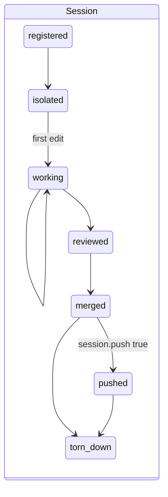
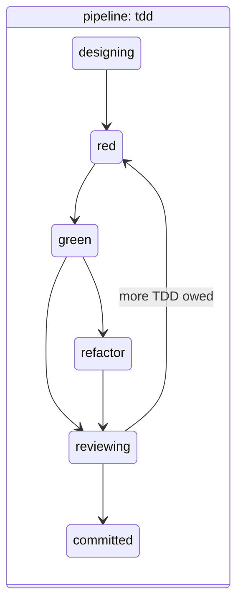

# Daily workflow

How work moves through invariant once a project has adopted it. The
[Quickstart](quickstart.md) shows one task end to end; this page explains the
pieces, what each one records, and the situations a single pass does not
cover — stopping halfway, several tasks at once, resuming tomorrow.

## The two state machines you live in



A **session** is one unit of agent work: a name, an id, an isolated worktree
and branch, a declared file set, a deliverables plan, and a record of every
gate it passed or was forced past. It ends at the merge.



A **pipeline** is one task's progress through a *methodology* inside a
session. Gates sit on the edges: `red → green` requires a test to have failed
first; `→ refactor` and `→ reviewing` require a green suite; `→ committed`
requires green, coverage at the floor, and a clean privacy scan. Every state
also has an ungated edge to `abandoned`, because giving up must never be the
thing a gate forbids.

Either machine, at any moment:

```bash
invariant session status
invariant pipeline status
invariant context            # both, plus what is legal and what is owed
```

## Sessions

### Start and isolate

```bash
invariant session start <task-name> [--base <branch>]
invariant session isolate --execute
```

The id is appended to the slug you typed (`add-widget` → `add-widget-b9c169e2`),
so the name is an address you can resume by. The base branch is the one
checked out in the main checkout when you ran `start`; pass `--base` to merge
somewhere else. If HEAD is detached, `start` refuses and asks for `--base`
rather than guessing.

`isolate` creates `../<project>-wt-<id>` on branch `session/<id>` (see
[Configuration → worktree placement](configuration.md#where-worktrees-live)
to put them inside the repository). Until it has run, the
`session.isolated_before_edit` rule refuses every edit, and the
`session.no_edit_in_main_checkout` rule keeps refusing edits in the main
checkout for the life of the session — a second checkout is the whole point.

The session moves from `isolated` to `working` on its own: the first
`Edit`, `Write`, `MultiEdit` or `NotebookEdit` that completes inside the
session's worktree advances it. Edits to exempt paths (`.claude/`, the
work-item store) and writes made through the shell do not count; a session
that only ever writes through the shell runs
`invariant session transition working` before `session review`.

One Claude Code session owns at most one live invariant session. The binding
happens automatically when the agent runs `session start`; `session status`
shows it.

### The deliverables plan

```bash
invariant session plan add "endpoint returns 404 for an unknown id"
invariant session plan add "architecture doc shows the new route"
invariant session plan show
invariant session plan done 1
```

The plan is what lets a session outlive the Claude Code session that started
it. Two gates read it:

- `session.deliverables_complete` — the merge is refused while an entry is
  open.
- `session.work_would_be_stranded` — fires at the end of a turn when there
  are commits on an unmerged branch. An open plan says "parked, on purpose",
  and the gate stays quiet for `session.plan_stale_days` (default 7).

Numbers are never reissued after `remove`, so `done 3` means the same thing
today as last week. A session with no plan is not held to one: the review
agent reads `planned` and `complete` separately and treats "no checklist" as
"finish when the increment is reviewed".

### Commit, review, merge, tear down

```bash
invariant session files add <path>...      # what this session owns
git commit ...                             # as many as you like, in the worktree
invariant session review                   # pipeline.complete, deliverables, privacy
invariant session sync                     # rebase onto the base if it moved
cd <main checkout>
invariant session merge                    # fast-forward; refused from a worktree
invariant session teardown                 # refused from inside its own worktree
```

`files add` is a declaration: `session.own_file_set_only` (advisory by
default) compares each commit against it, which is how two sessions in the
same repository stay out of each other's commits. Paths under
`session.exempt_paths` — `.claude/*`, the memory index — and the work-item
store are never held to it.

`merge` evaluates its gates *before* git runs, so a refusal is a gate and not
a report of something irreversible. It must run from the main checkout
(`session.ff_merge_target`): a fast-forward acts on whatever HEAD the calling
tree has. `teardown` likewise refuses to remove the worktree you are standing
in while a Claude Code session is still bound to it, because that wedges the
host; step to the main checkout first.

### Push, if the project publishes

`session.push: false` is the default. A session that should publish sets it
to `true` in the manifest, and then `invariant session push` is legal once,
after the merge (`session.push_barrier`). There is no second push.

### Tomorrow: resume, list, reap

```bash
invariant session list                      # every session on this machine, plan fraction
invariant session resume add-widget         # a slug, a full name, or an id
invariant session reap --dry-run            # abandon sessions whose worktree AND branch are gone
```

Starting a *second* session for a task name that already has one parked is
refused — that fork is what the model exists to prevent — and the refusal
prints the parked plan and the `resume` command. `--force` starts a genuinely
separate one.

## Pipelines

### Choosing a methodology

```bash
invariant pipeline start --task "<what>" [--methodology <id>]
```

The manifest's `methodology.pipeline` is the default (`tdd` unless you change
it); `--methodology` overrides it for this pipeline only, and the choice is
recorded so a later manifest edit cannot swap a running pipeline's gates.

| id | states | use it for |
|---|---|---|
| `tdd` | designing → red → green → refactor → reviewing → committed | the default; any change with behaviour to test |
| `bugfix` | triaging → reproducing → fixing → verifying → committed, or reproducing → reproduced | a defect: the repro is a state with stopping authority, `reproduced` lands a proof without a fix, and `not_reproducible` is a real outcome |
| `spec-first` | designing → specified → implementing → reviewing → committed | a change whose specification is the deliverable and the implementation follows it |
| `chore` | doing → reviewing → committed | a rename, a formatter pass, a dependency bump — green suite, no proof of red |
| `docs` | drafting → reviewing → committed | prose, records, backlog entries — privacy still blocks, the docs are still read |
| `none` | working | the escape hatch: one state, no gates; sessions and work items still apply |

Pick by the *content* of the change, not its size. A one-line fix to a
reported defect is `bugfix`; a one-line typo in a doc is `docs`. The gate set
is the methodology's claim about the work, and claiming `chore` for a
behaviour change is how a suite stays green while being wrong.

### Advancing

```bash
invariant pipeline gates [--state <id>]   # what is owed, without moving
invariant pipeline advance <state>
invariant pipeline test [--selector <sel>]...
invariant pipeline coverage
invariant pipeline ack <rule> --reason "<why>"
```

`gates` and `advance` are separate on purpose: asking what is owed must not
have the side effect of moving. `test` runs `commands.test` (or `test_one`
with the selectors) and records the exit status and the phase it ran in; that
record is what `test.new_test_fails` reads to know a red existed before the
green. `coverage` runs `commands.coverage` and records per-file numbers for
`coverage.meets_floor`.

`ack` records a decision to proceed against an *advisory* gate, with a
reason; the gate then reports as skipped-with-reason for the rest of the
pipeline instead of warning on every call. It is refused for a blocking gate
— those are satisfied, or [overridden](#when-a-gate-is-wrong).

### Agent roles

Two states carry a *role*: the design state (`designing`, `triaging` or `drafting`) is
owned by `agents.roles.design` and the review state by `agents.roles.review`.
The rules `agents.design_agent_ran` and `agents.review_agent_ran` check that
the matching agent ran before the change lands: both are entry gates on the
landing state (`committed`), because a dispatch is recorded when the agent
returns. A methodology with no design state — `chore` — is not asked about a
design agent at all. They are advisory
in every shipped profile, because "an agent was needed for this change" is a
judgement; a project that has decided it always is sets them to `block`.

## When a gate is wrong

Every gate has a route past it, and every route leaves a record on the
session. In order of how much they relax:

| Situation | Command | Scope |
|---|---|---|
| this one transition, this once | `invariant pipeline advance <state> --force --reason "<why>"` | one edge |
| this one tool call, at a hook | `invariant override <rule> --reason "<why>" [--calls N]` | N evaluations |
| this advisory gate, for the rest of the pipeline | `invariant pipeline ack <rule> --reason "<why>"` | one pipeline |
| stop asking for a while | `invariant standdown --reason "<why>" [--until pipeline\|session]` | every rule except `privacy.clean` |
| be asked instead of stopped | `enforcement.rules.<rule>: ask` in the manifest | permanent |
| change policy | `enforcement.rules.<rule>: warn` or `off` | permanent |

`privacy.clean` is the one rule a stand-down holds out unless you name it
(`--include privacy.clean`): nothing un-writes an identifier out of a
published history, so passing it stays a separate sentence you wrote.

A rule you keep overriding is a bug report against the default — change the
manifest, or change the rule.

## Several things at once

Two tasks in one repository are two sessions, each with its own worktree, each
driven from its own Claude Code session rooted in that worktree. The main
checkout is where merges and teardowns run and nothing else. A pipeline should
be driven from a host rooted in the project it belongs to: a Claude Code
session rooted elsewhere fires its hooks against *that* project's manifest, and
nothing is recorded against this one.
