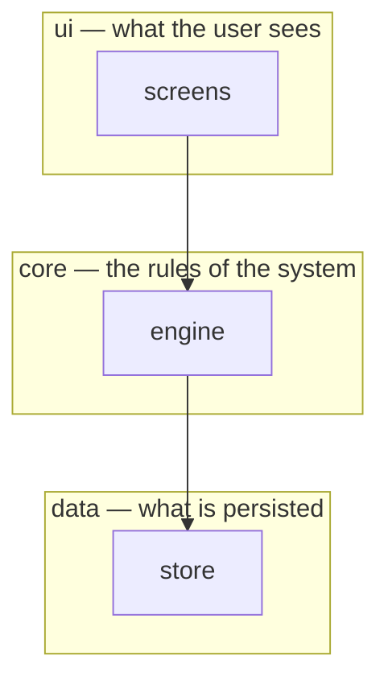

# {project} — architecture overview

This document is the authoritative map of {project}'s components and the
dependencies between them. It exists for a gate, not for a shelf: the
docs-first rule reads this directory before any design state can be left
(`docs.read_architecture`), and a structural change — a new component, a new
or removed dependency, a changed flow or schema — must update it before the
work can land (`docs.updated`). A plan argued from a diagram that is wrong is
a plan nobody checked, so when the code and this document disagree, fix one
of them in the same change.

## Layers

Replace the placeholder below with the real layers. Every dependency the code
has should appear as an arrow here; an arrow that only exists in the code is
one a design cannot be checked against.

**Dependency rule:** arrows point down and never back up. State which layer
may import which, and name the exceptions so a reviewer can tell a deliberate
one from a leak.

## Component responsibilities

One row per component drawn above. The "never does" column is the one that
earns its keep: it is what stops two components from growing the same
responsibility.

| Component | Owns | Never does |
|---|---|---|
| `screens` | Rendering state and collecting input | Decide what the input means |
| `engine` | The rules: validation, transitions, the invariants | Persist anything; know how it is rendered |
| `store` | Reading and writing persisted records | Interpret their contents |

## Compliance checklist

The checklist the project's reviewing agents read as canonical. Add the rules
this project has learned the hard way; keep each one checkable on a diff.

- Every dependency the change introduces is drawn in the Layers diagram.
- A new component is a new node here and a new row in the table above.
- Arrows point down: no layer imports from the layer above it.
- Touched source files are tested to the configured coverage floor.
- A persisted schema changes through the documented safe-migration pattern,
  never by altering records in place.
- No personal data in docs, memory, reports or commit messages — no home
  paths, addresses, identifiers or clock times.

---

This file was scaffolded once by `invariant init` because the docs directory
did not exist. It is the project's, and `invariant` will never rewrite it.
